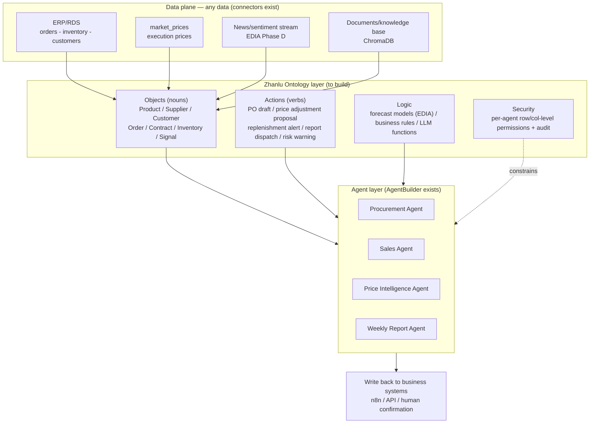
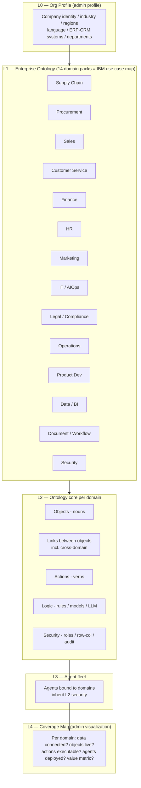

# Zhanlu Enterprise AI OS — Business Value Strategy (based on IBM enterprise AI use cases + Palantir Ontology architecture research)

Date: 2026-10-15
Status: Draft (section-by-section confirmation pending)

---

## 1. Current-State Diagnosis: Why "we built a product" but no business value

**Core judgment: Zhanlu today is a horizontal agent builder (a capability platform), not an ontology-driven business operating system (a value platform).**

| Dimension | Zhanlu today | Palantir AIP+Foundry reference | Gap in essence |
|------|------------|--------------------------|---------|
| Data | DB connectors (MySQL/PG/MSSQL/Oracle), ask_data_agent text-to-SQL, Alibaba Cloud RDS | Multimodal Data Plane: any data, Virtual Tables without copying data | Pipes exist, semantics don't |
| Semantics | Agents talk directly to tables/SQL; business meaning lives in people's heads | Ontology: objects/links/properties = the enterprise's "nouns" | Missing ontology layer |
| Actions | Tool calls (~70 hermes tools), n8n integration | Actions write back to ERP/business systems = the enterprise's "verbs" | Missing "write-back loop" |
| Security | JWT/broker auth in progress | Humans and agents share the same row/col-level permissions + audit | Missing per-agent permission model |
| Governance | None | AIP Evals: pre-launch agent evaluation, execution variance comparison | Missing evals/observability |
| Positioning | "We help you build agents" | "Alpha differentiation: encode the enterprise's own particularities into the ontology" | Selling tools vs selling business outcomes |

Palantir's key insight: **Ontology = the fourfold integration of data + logic + action + security.** Doing only the first two (where Zhanlu is stuck today) gives customers a "chatting database"; adding the latter two is what makes "agents do real work inside the business."

Key data points from IBM (usable in the value narrative):
- Gartner: by 2028, 33% of enterprise software will embed agentic AI (vs <1% in 2024); 15% of day-to-day business decisions made autonomously by agents
- IBM IBV: 64% of CSCOs/COOs say gen AI is already transforming supply chain workflows; organizations with higher AI supply-chain investment reported revenue growth 61% greater than peers; 76% of CSCOs say agents improve process efficiency
- Customer service: Gartner predicts 80% of common service issues resolved autonomously by 2029, cutting operating costs 30%
- IBM AskHR: 94% of employee HR queries handled by an agent, 11.5M interactions per year

---

## 2. Core Strategic Pivot: From "generic agent platform" to "Petrochemical/Manufacturing Supply Chain AI OS"

**Do not compete on the horizontal track.** Dify / Coze / n8n / FastGPT have already turned "build an agent" into a free commodity. Zhanlu's differentiation (Palantir's "alpha") comes from industry assets you already uniquely own:

1. **EDIA prediction platform**: demand forecasting for 12 products (C5/C9 etc.), LLM Planner, news ingestion (Phase D)
2. **Petrochemical trading platform**: `market_prices` execution prices, upstream/midstream/downstream views
3. **ERP Sales agent**: running on real ERP data in Alibaba Cloud RDS + ask_data_agent
4. **Weekly report automation**: weekly China market report (price movements, supply-demand signals, next-week recommendations)

These four pieces combine into a **vertical industry ontology seed** — your own company is customer #1 (dogfood), which is the localized version of Palantir's Forward Deployed Engineering model.

**One-line value proposition:**
> Zhanlu models an enterprise's data, business logic, operational actions, and permissions into a unified Ontology, letting AI agents work autonomously across the whole enterprise end-to-end — every department, every workflow, privately deployed, data never leaves the factory.

Positioning: Zhanlu is **structurally whole-enterprise** (every IBM domain is modeled as an ontology domain pack from day one) and **deep where the data is first** (petrochemical supply chain as the initial depth pack). See Section 8.

---

## 3. Zhanlu Ontology (Enterprise Profile) Design Draft



Minimal object model (v0, ready to land in the database):

| Object | Example properties | Link | Bound actions |
|------------|---------|----------|----------------|
| Product | code, name, category (C5/C9) | — | price forecast, price adjustment proposal |
| Price | product_id, type (erp_sale_order_weighted), ts, value | belongs→Product | price movement alert |
| Supplier | name, region, risk_score | supplies→Product | alternate-sourcing proposal, PO draft |
| Customer | name, tier | buys→Product | quotation generation, follow-up suggestions |
| Order | qty, price, status | customer+Product | status lookup, anomaly alert |
| Inventory | product, qty, location | at→Product | replenishment/stockout alert |
| Signal (news) | source, sentiment, topic | affects→Product/Supplier | feed weekly report, trigger assessment |
| Report | period, sections | aggregates→Signal/Price | generate, dispatch (email/IM) |

Key design principles (copying Palantir's homework, simplified):
- **Agents never touch tables directly, only ontology objects and actions** — upgrade ask_data_agent from "text-to-SQL" to "text-to-ontology-query"
- **Tiered actions**: read-type actions execute automatically; write-type actions (PO, price changes) require human confirmation by default, unlocked one by one as trust builds (augmentation → automation)
- **Every agent inherits its creator's permission scope** — answering Palantir's "agents and humans on the same security foundation" requirement

---

## 4. Use Case Matrix: IBM's 14 enterprise use cases × Zhanlu readiness

| Use case (IBM) | Zhanlu readiness | First deliverable scenario | Value metric |
|------------|--------------|---------------|-------------|
| Supply chain & procurement | ★★★ has data + forecasting | Price intelligence → procurement timing advice, stockout alerts | Procurement cost savings %, stockout incidents ↓ |
| Sales | ★★★ ERP Sales agent already running | Self-service data lookup, quotation generation | Per-order lookup time -70% |
| Data analysis & BI | ★★★ ask_data_agent | Natural-language business Q&A (with citations + confidence) | Analyst hours saved |
| Document/workflow automation | ★★☆ n8n integration | Fully automated weekly report generation + dispatch | X human hours saved per week |
| Operations management | ★★☆ EDIA forecasting | Demand forecast → inventory planning | Forecast accuracy, inventory turns |
| Customer service | ★★☆ | Internal knowledge base Q&A bot | First response time, resolution rate |
| Marketing | ★☆☆ | Customer outreach content derived from the weekly report | — |
| Risk/compliance | ★☆☆ | Supplier risk monitoring (news + internal data) | — |
| IT/AIOps, HR, legal, security, product eng. | Not now | — | Off the industry mainline |

**Conclusion (revised for whole-enterprise capability): all 14 domains get structural coverage via starter ontology packs (Section 8); depth investment follows the customer's data — mainline first = supply chain + procurement + sales + price intelligence.** The other domains are structurally present, admin-visible, and upgradeable — not targets for deep engineering until a customer's data justifies it.

---

## 5. Business Model & Market Positioning

| Option | Description | Judgment |
|------|------|------|
| Sell agent builder (status quo) | Benchmarked against Dify/Coze, free-tier race to the bottom, no stickiness | ❌ Drop as the selling point |
| Industry AI OS subscription | "Petrochemical Supply Chain AI OS" private deployment + annual subscription (deployment fee + per-object/per-agent pricing) | ✅ Primary model |
| Forward-deployed services | Palantir FDE style: embed on-site to build the customer's ontology, convert to subscription after delivery | ✅ Delivery method |
| Template marketplace | Industry ontology templates (petrochemical → manufacturing → trading) reused across customers | Long term |

Competitive position:
- vs Dify/Coze: they build "agent factories," we build "business loops + industry templates"
- vs Palantir: they are multi-million-USD deals with heavy overseas delivery; we offer lightweight private deployment (docker-compose / Tencent Cloud), Chinese-language scenarios, CNY pricing — targeting mid-market Chinese manufacturers/traders
- vs ERP vendors' built-in AI (Yonyou/Kingdee): they have the system but lack deep industry agents; we focus on the industry decision layer and coexist via API/DB connectors instead of replacing them

---

## 6. Phased Roadmap (current vs target)

| Phase | Timeline | Goal | Exit criteria |
|------|------|------|---------|
| P0 dogfood | 0–3 months | Run 3 closed loops in our own company: ERP Sales lookup, price intelligence alerts, fully automated weekly report dispatch; build ontology v0 (the 8 objects above) | Baseline numbers exist: time saved / cost reduced / forecast accuracy |
| P1 verbs + governance | 3–6 months | Write-back actions (PO drafts, alert dispatch), per-agent permissions, agent evals, observability | Write actions have a human-confirmation UI + audit log; eval pass rate >90% |
| P2 second customer | 6–12 months | Package P0 assets into a "petrochemical supply chain template," find 1–2 peers for paid pilots | One citable ROI case study (using P0 numbers) |

Adjacent fixes (not blocking the strategy, but affecting delivery credibility): the agent-builder streaming interruption bug (`caller_conversation_id` TypeError + schema migration + frontend proxy port) — a prerequisite for P0 dogfood.

---

## 7. Risks & Anti-Goals

- Anti-goal (revised per whole-enterprise direction): do not build *deep* domain packs for all 14 domains at once — the correct posture is **structural coverage everywhere, depth where the customer's data actually is**. A shallow-but-present ontology domain still gives the admin a visible coverage map and an upgrade path; a missing domain means Zhanlu is not "whole-enterprise capable."
- Anti-goal: the ontology must never become a static diagram — every object must be backed by a live data source, every action by an executable tool; otherwise it is decoration, not an operating system
- Risk: underperforming forecast accuracy destroys trust → all forecast outputs must carry confidence badges (EDIA already has this design)
- Risk: customer data security concerns → private deployment + "data never leaves the factory" is a selling point, not a burden
- Risk: onboarding friction — if building the enterprise ontology requires a consulting project, mid-market customers walk away → the admin onboarding wizard (Section 9) must generate a draft ontology automatically
- Dependency: EDIA mock function removal and the switch to real-time data — otherwise P0's value numbers won't hold up

---

## 8. Enterprise Ontology Architecture — the Admin "Enterprise Profile"

**Requirement (from product owner): one user onboards their organization onto Zhanlu, and the system must be end-to-end capable of supporting the whole enterprise — every section/department — based on that organization's ontology. The admin profile must visualize the Enterprise Ontology Architecture so the user can see exactly how Zhanlu supports them.**

### 8.1 Layered model



### 8.2 The 14 domain packs (structural coverage from day one)

Each domain pack ships with a **generic starter ontology** (objects + links + suggested actions from the IBM use-case research). Customers activate and extend them; depth comes from their own data:

| Domain pack | Starter objects (nouns) | Starter actions (verbs) |
|------------|------------------------|------------------------|
| Supply Chain | Product, Inventory, Shipment, Forecast | stockout alert, replenishment proposal, reroute |
| Procurement | Supplier, PO, Contract, RFQ | PO draft, supplier risk scan, contract review |
| Sales | Customer, Lead, Opportunity, Quotation | lead scoring, quotation generation, follow-up |
| Customer Service | Ticket, Customer, KnowledgeArticle | auto-reply, escalate with context, CSAT summary |
| Finance | Invoice, Payment, Expense, Budget | reconcile, anomaly flag, cashflow forecast |
| HR | Employee, LeaveRequest, Policy, PayrollItem | policy Q&A, onboarding checklist, payroll query |
| Marketing | Campaign, Content, Audience, Channel | content draft, campaign report, A/B summary |
| IT / AIOps | Incident, Service, Deployment, Asset | incident triage, runbook suggest, health report |
| Legal / Compliance | Contract, Clause, PolicyDoc, RiskItem | clause extraction, compliance check, renewal alert |
| Operations | WorkOrder, Shift, Equipment, KPI | schedule proposal, KPI alert, downtime analysis |
| Product Dev | Requirement, Feature, Feedback, RoadmapItem | feedback clustering, spec draft, priority rank |
| Data / BI | Dataset, Metric, Dashboard, Query | metric definition, NL-to-ontology-query, alert |
| Document / Workflow | Document, Task, Approval, Template | extract fields, route approval, archive |
| Security | Asset, Vulnerability, AccessLog, Policy | access anomaly flag, audit summary |

**Cross-domain links are the compounding asset** (Palantir's "decision graph"): e.g. Signal(news)→Supplier(procurement)→Contract(legal)→PO(supply chain)→Invoice(finance). A cross-domain event becomes a chain of coordinated agent actions instead of siloed notifications.

### 8.3 Admin profile UI components

1. **Ontology Graph Explorer** — interactive graph of the org's objects/links/actions, filterable by domain; every node shows its backing data source and executing agents
2. **Enterprise Coverage Map** — the "how Zhanlu supports you" view: a 14-domain heat map scoring each domain on `data connected → objects live → actions executable → agents deployed → value metric measured`; gaps are rendered as an explicit upgrade roadmap
3. **Agent ↔ Domain binding panel** — which agents serve which domains, with inherited permission scopes visible
4. **Governance panel** — per-agent permissions, audit log, eval results (P1 scope)

### 8.4 DB schema additions (Zhanlu backend, Postgres)

```
org_profile            (org identity, industry, systems, departments)
ontology_domain        (14 seeded packs; code, name, starter_json)
ontology_object        (org_id, domain_id, name, backing_table/query, properties_json)
ontology_link          (from_object, to_object, link_type, cardinality)
ontology_action        (object_id, name, tool_id, risk_level[read|write], requires_confirmation)
agent_domain_binding   (agent_id, domain_id, permission_scope)
coverage_state         (org_id, domain_id, data/objects/actions/agents/metric scores)
```

---

## 9. Onboarding: how Zhanlu builds the customer's enterprise ontology automatically

The ontology must be *generated*, not hand-drawn — otherwise every customer is a consulting project (the anti-goal in Section 7):

1. **Org profile capture** — admin enters company identity, industry, departments, and existing systems (ERP/CRM/DB/file shares) in the admin profile wizard
2. **Auto-discovery scan** — Zhanlu connects to the declared sources with existing connectors, introspects schemas (tables, columns, FKs), and drafts candidate objects/links per domain pack (schema → nouns; FKs → links; writable tables + available tools → candidate verbs)
3. **Draft ontology review** — admin sees the drafted ontology in the Graph Explorer, confirms/edits/removes objects; unconnected domains stay visible on the Coverage Map as gaps (structural coverage, honest depth)
4. **Agent assignment** — per domain, pick starter agents (or build new ones in AgentBuilder) bound to confirmed objects/actions; write-type actions default to human confirmation
5. **Value instrumentation** — for each activated domain, pick the value metric (Section 4 table); the Coverage Map starts measuring so the ROI story writes itself
6. **Compounding loop** — every new data source, tool, or agent enriches the ontology; coverage score rises; this is the renewal story

This flow is what makes the claim "one system supports the whole enterprise end-to-end" *demonstrable in the admin profile* instead of a slide.

---

*Sources: IBM Think (enterprise-ai / chatbot-use-cases / ai-agents-in-marketing / procurement / sales / supply-chain / customer-service-chatbots / ai-in-ecommerce, 2025–2026 updated versions); Palantir Foundry Architecture Center (ontology-system / platforms / multimodal-data-plane / interoperability / rubix / aip-architecture).*
