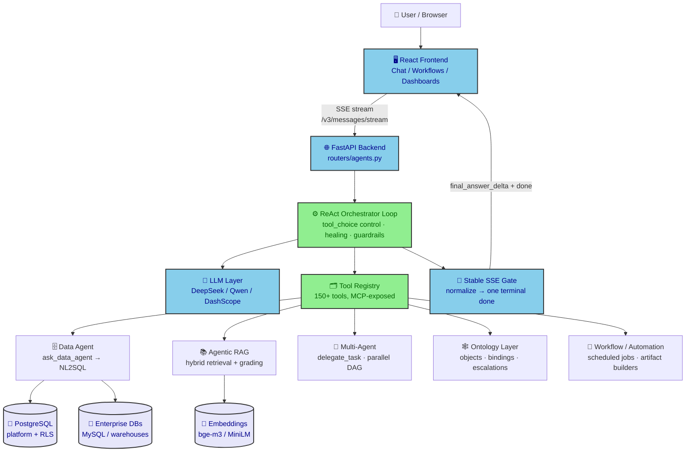
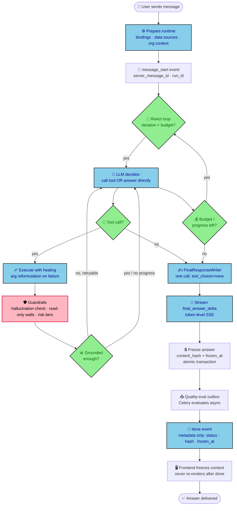
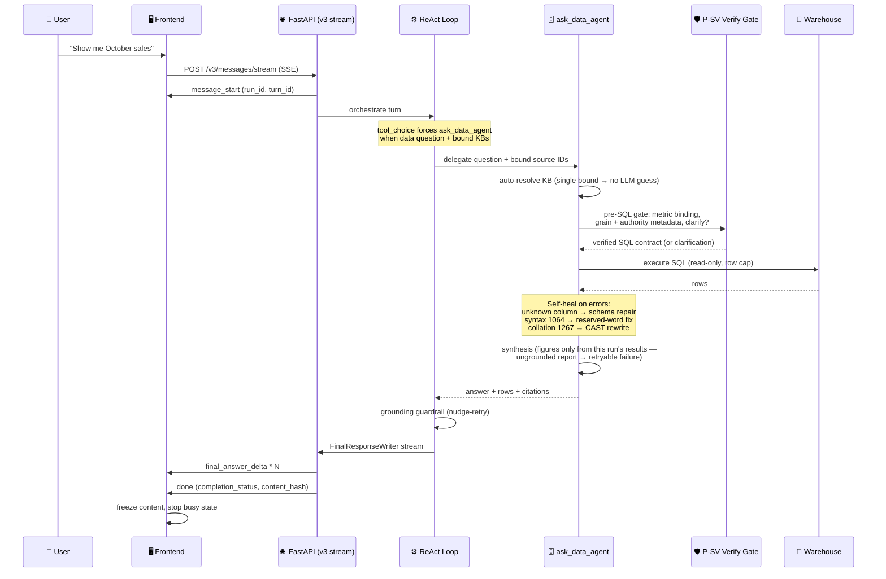
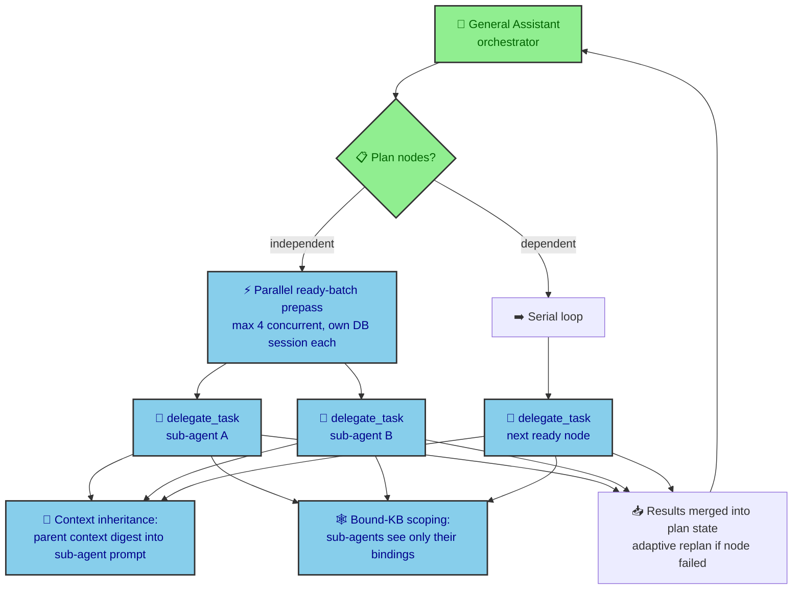
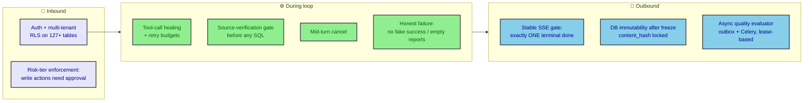

# Zhanlu Agentic AI Platform — End-to-End Workflow

> Interview quick-reference. All diagrams are Mermaid — paste into any renderer (GitHub, VS Code preview, mermaid.live).

---

## 1. System Architecture (Big Picture)

---

## 2. End-to-End Request Lifecycle (The Agentic Loop)

**Interview narrative:** the loop is *silent orchestration* — during tool calls the stream only emits progress events (`tool_progress`, `activity_step`, `phase`); text deltas only come from the single FinalResponseWriter pass at the end. This guarantees the final answer is built from verified tool results, not hallucinated mid-stream.

---

## 3. Sequence: One Turn Through the Data Agent (NL2SQL)

---

## 4. Multi-Agent Collaboration

---

## 5. Safety, Governance & Reliability (What Makes It Production-Grade)

---

## 6. Interview Talking Points (60-second summary)

1. **One agentic loop, many specialists.** A ReAct-style orchestrator with 150+ registered tools (also exposed via MCP), delegating to a data agent (NL2SQL), agentic RAG, and sub-agents — with a plan-DAG that runs independent nodes in parallel.
2. **Grounding is enforced, not hoped for.** A source-verification gate runs *before* SQL executes (metric binding, grain, clarify-if-ambiguous), and a report-grounding gate *fails* any answer whose figures didn't come from tool results in that run. Self-healing fixes unknown columns, syntax, and collation errors at runtime — schema-agnostic, no hardcoded tables.
3. **The stream is a protocol, not a pipe.** Silent orchestration → one FinalResponseWriter pass → stable SSE gate that normalizes legacy events, guarantees exactly one terminal `done`, preserves partial content on failure. Answers are frozen atomically (hash + timestamp, DB-immutable) and quality-evaluated asynchronously via an outbox with lease-based claiming.
4. **Honesty by design.** Failures surface as failures (no fabricated success), empty results trigger probes and retries before reporting, low-confidence RAG context gets refused rather than answered, and human escalations carry full context.
5. **Multi-tenant and governed.** Row-level security, risk-tiered write actions gated on human approval, mid-turn cancel, audit events on every governed action.

**Known trade-offs to mention proactively (shows maturity):** wall-clock budgets for long agent runs, per-tool timeouts, and FSM fallback mode — flagged and tracked, not hidden.
