# Building an Enterprise Agentic AI Platform — An FDE's Perspective

> **Presentation for the Interview Board** · Candidate: Minhazul Islam
> Framed for the **Forward Deployed Engineer (FDE)** role: shipping AI systems *inside* real enterprises — against their live data, their workflows, and their trust bar.

---

## 1. Why This Project Is FDE Work

Forward-deployed engineering is not "backend engineering, but at the customer site." It is:

- Sitting with the business, understanding how work actually flows
- Mapping messy enterprise reality into clean, computable models
- Integrating with live ERP/warehouse systems that are incomplete, inconsistent, and production-critical
- Earning trust with governed, auditable, human-in-the-loop automation — not demos

**I built a platform that does exactly this.** Zhanlu is a multi-tenant, agentic AI operating layer for enterprises: it connects to live customer data sources, models the business as an ontology, lets business users ask questions in natural language, executes governed actions with approval gates, and escalates to humans with full context when confidence is low.

Everything below was designed and shipped against *real* constraints: live ERP databases, flapping warehouses, stale credentials, self-serving deployments, and users who will immediately ask "why does this number look wrong?"

---

## 2. The Customer Problem (How I'd Pitch It to a Client)

> *"Your data lives in 6 systems. Your analysts spend days producing reports. Your frontline staff can't query anything without SQL. And no one trusts an AI chatbot with your ERP."*

| Business pain | What the platform delivers |
|---|---|
| Data scattered across ERP / BI / files | Unified **data source runtime** — bind any DB, auto-discover schema, RLS-isolated per tenant |
| "Just tell me October sales" needs a SQL person | **NL2SQL data agent** with a verification gate — ambiguous questions get *clarified*, not guessed |
| AI answers can't be trusted | **Grounding enforcement** — every figure must come from tool results in *this* run; unverifiable reports fail, they don't get fabricated |
| Automation that goes rogue | **Risk-tiered actions with human approval gates** — writes are proposed, humans confirm, everything is audited |
| Agents that silently fail | **Honest failure lifecycle** — empty results trigger probes and retries; escalation to humans carries full context |

---

## 3. Architecture Overview

The system is organized in five planes. The top plane mirrors how the enterprise is organized: **one project per department, one published agent per business function** — this is what users actually see (each project carries its own model set, resources, and access controls).

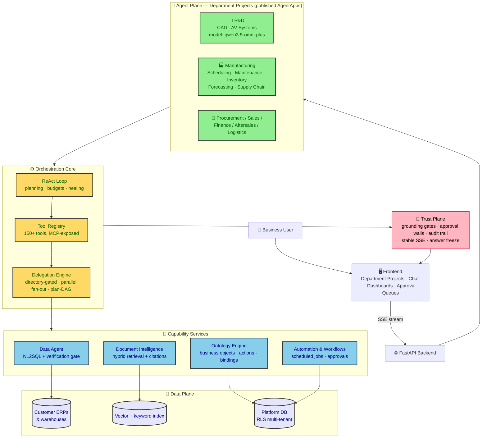

**How to read it:**
- **Agent plane** mirrors the org chart — department projects (R&D, Manufacturing, Procurement, Sales, Finance, Aftersales, Logistics…) each hosting published specialist agents with their own prompt, tools, and data bindings.
- **Orchestration core** is the brain: one ReAct loop plans, budgets, and delegates — to one specialist, a parallel fan-out, or a dependency-ordered plan-DAG (§6).
- **Capability services** are shared engines every agent reuses — nobody reimplements NL2SQL or RAG per department.
- **Trust plane** wraps every turn: grounding gates, human approval for writes, audit trail, and a stable stream with exactly one terminal answer.

### 3.1 How Multi-Agent Works in This Architecture

Agents collaborate on two axes: **vertically** (each agent runs inside the harness — §6.0) and **horizontally** (agents hand work to each other through the delegation engine, and to external organizations through open protocols).

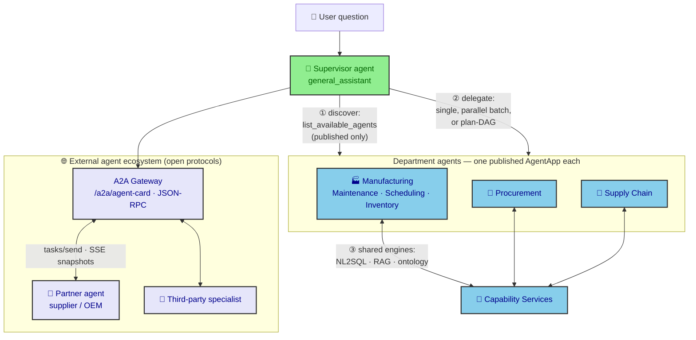

**The four interaction patterns, in one breath:** ① the supervisor *discovers* agents from a directory (only **published** AgentApps are visible — never a half-built one); ② it *delegates* — to one specialist, a bounded parallel batch (Production ∥ Inventory ∥ Supply Chain), or a dependency-ordered plan-DAG; ③ every agent *reuses* shared capability services rather than reimplementing them, and reads data only through its own ontology bindings; ④ when work belongs outside the organization, the **A2A gateway** hands it to external agents.

### 3.2 How A2A Works Here (Agent-to-Agent protocol)

A2A (Agent2Agent, v1.0 — JSON-RPC 2.0 over HTTPS) is implemented **bidirectionally**, so the platform is both a service provider and a consumer of external agents:

| Direction | Mechanism | Governing principle |
|---|---|---|
| **Inbound** — an external agent delegates *to* Zhanlu | The platform serves a machine-readable **AgentCard** (`GET /a2a/agent-card`, plus an aggregate card exposing every published agent as a skill). External agents call `tasks/send`; a task row is created and a pluggable executor routes the message through the **governed FSM pipeline** — external callers get the same policy, budget, and audit treatment as internal ones | *No side door:* external delegation enters through the same trust plane |
| **Outbound** — Zhanlu delegates *to* external agents | An internal agent calls the `a2a` tool; the client speaks `tasks/send` / `tasks/get` / `tasks/cancel`, with **SSE streaming** of task snapshots (falling back to plain JSON for non-streaming servers). Requests carry **unique agent-identity headers** so the remote party can trace the caller | *Traceable identity:* the platform signs who it is on the way out |
| **Task lifecycle** | Tasks are first-class records — created on send, polled, cancellable, with artifacts; `input-required` is a recognized terminal state that surfaces as a clarification, not a failure | *Honest lifecycle:* external work has the same status vocabulary as internal work |

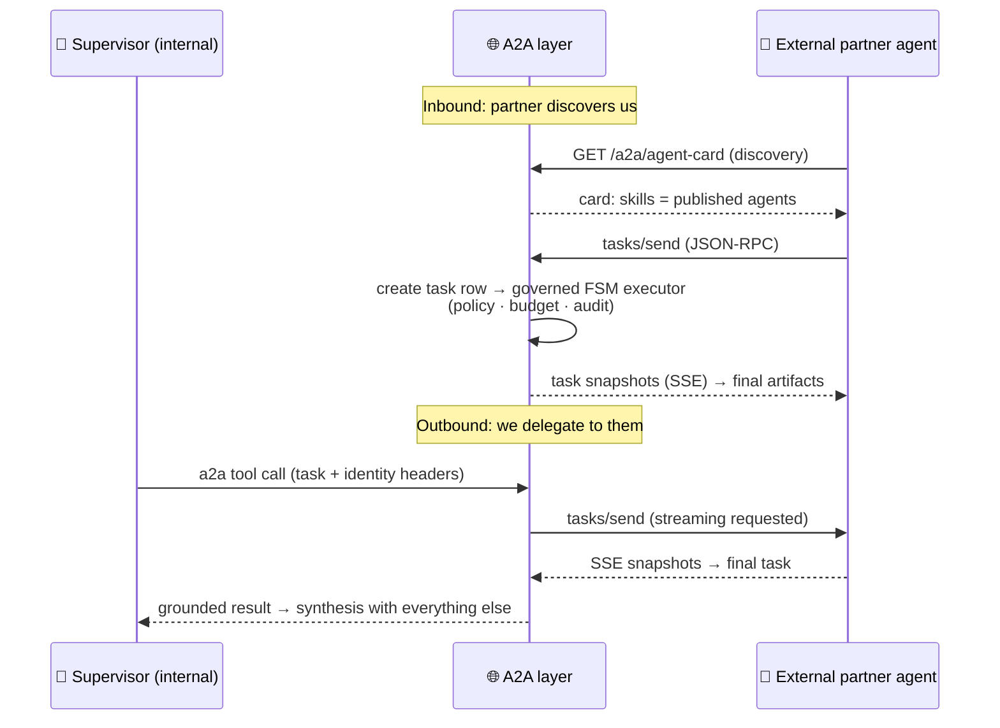

**Board one-liner:** *"Inside the walls, agents discover each other through a publication gate and delegate through the harness; across the walls, they speak A2A — same task lifecycle, same audit trail, and the platform never bypasses its own governance for an external caller."*

*(Sibling protocol: ACP is also exposed for agent communication profiles — same philosophy, different wire format. MCP covers tool-level integration; A2A covers agent-level delegation.)*

---

## 4. The FDE Core: From Messy Enterprise Data to Trusted Answers

This is the loop I spent most of my time on — because this is where FDE work actually lives.

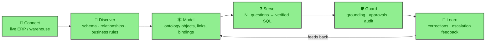

### 4.1 Connect & Discover
- Bind arbitrary customer databases (MySQL / Postgres / warehouses) — **no hardcoded tables, no hardcoded vocabulary**. Everything is discovered at runtime: schema, foreign keys, naming heuristics, domain clustering.
- Schema drift detection: the platform re-signatures schemas hourly and flags when the customer's DB changed under us — because in FDE reality, it *will*.
- Self-healing at query time: unknown columns repaired from live schema, syntax and collation errors rewritten on the fly. The platform adapts to the customer's DB; the customer never adapts to us.

### 4.2 Enterprise System Compatibility (QMS · WMS · MES · ERP · PLM · EAM)

The honest answer has two tiers:

| System | Integration status | How |
|---|---|---|
| **ERP** (SAP, Yonyou, Kingdee, or any DB-backed ERP) | ✅ Works today | Bind its database or REST layer; POs, suppliers, finance records become ontology objects; write-back (PO drafts, quotes) is approval-gated. Live ERP bindings run in production |
| **MES / QMS / WMS / EAM** with SQL or REST exposure | ✅ Works today | Same path — bind, discover schema into the semantic store, map objects, query cross-system in one grounded question ("supplier quality vs. delivery performance" joins QMS + WMS + ERP) |
| **Systems with proprietary interfaces** — SAP RFC/BAPI, OPC UA (SCADA/PLC), file-based QMS records, PLM APIs (Windchill/Teamcenter) | ⚠️ Needs a connector — a new data-source type + tool registration | The extension points already exist (`data_source_runtime`, tool registry, ontology mapping); each connector is bounded configuration work, not architecture change |
| **Edge/OT event streams** (line verdicts, sensor telemetry) | ⚠️ Event-stream binding | Their outputs become data sources like any other; the sensing pipeline (threshold → escalation fan-out) consumes them |

**The design rule that makes this claim safe:** the platform never replaces the enterprise system as the execution authority — it *reads through* their interfaces, *correlates* across them, and *writes back only through governed, approval-gated actions*. Bad data is never logged, and never ships, because the system of record stays the system of record.

### 4.3 Model the Business (Ontology)
- Business objects (Supplier, PurchaseOrder, Contract) linked to backing tables, connected by relationships, enriched with permission scopes.
- Agents operate *through* the ontology — a sub-agent for procurement sees only procurement objects. Scoping is structural, not prompt-hope.
- Corrections from users become few-shot examples; the system learns the customer's vocabulary.

### 4.4 Serve with a Verification Gate
- Before any SQL runs: metric binding check, grain/authority metadata, and if the question is ambiguous → **ask the user, don't guess**.
- Live result: 474 NL2SQL runs logged, ~86.5% successful, with the failures classified and retried honestly.

### 4.5 Guard — Where Trust Is Won
- **Grounding gate:** a report whose figures didn't come from this run's tool results *fails and retries* — I built this after catching the system regurgitating stale numbers from memory while the live warehouse had fresh data.
- **Approval gates:** write-backs to ERP (PO drafts, quotes) are born *pending human approval*. The AI proposes; the human disposes.
- **Escalation with context:** when the agent is stuck or the user is frustrated, it escalates — packaging the draft, the price, what it tried — so the human resumes in seconds, not from scratch.

---

## 5. End-to-End: A Procurement Turn (The Demo Story)

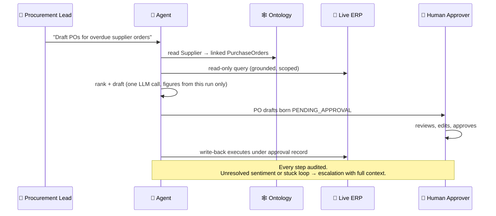

**Board takeaway:** this is the FDE pattern — *propose, don't act; ground, don't hallucinate; escalate, don't fake confidence.*

---

## 6. Deep Dive: How Multi-Agent Works in This System

The platform organizes agents the way the enterprise is organized — **one project per department, one published agent per function**. On the live system: R&D hosts the CAD Agent (Fusion 360 3D modeling) and Autonomous Vehicle Systems Agent; Manufacturing & Production hosts six published specialists (Production Scheduling, Predictive Maintenance, Inventory Management, Demand Forecasting, Supply Chain Optimization, Autonomous Vehicle Telemetry). Each project carries its own model set (e.g. `qwen3.5-omni-plus` for R&D), its own resources, shared memory, and access controls.

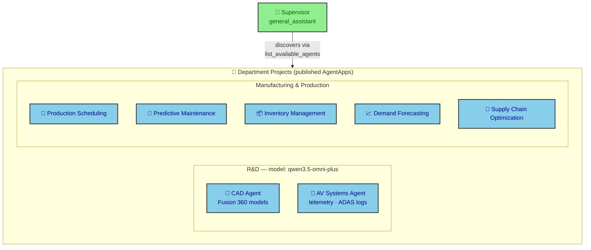

### 6.0 Inside the Agent Harness — What Wraps Every Agent

Every agent on the previous page — supervisor or specialist — runs inside the same **harness**: the deterministic machinery around the LLM that turns "a model that sometimes calls tools" into an accountable worker. The LLM only ever decides; the harness enforces.

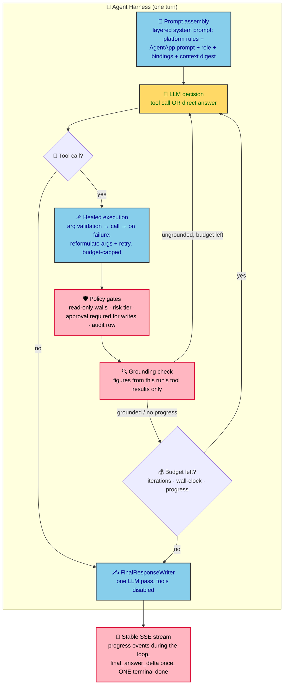

**The harness responsibilities, in order:**

1. **Prompt assembly** — the agent's identity is layered, not hardcoded: platform-level rules, the AgentApp's own prompt and tool policy, its department role, and its authorized data bindings. A specialist is literally *configured into* competence.
2. **Constrained decision loop** — the LLM proposes tool calls; the harness validates arguments, executes through the registry, and on failure *heals* (reformulates arguments and retries) instead of crashing the turn. Iteration and wall-clock budgets cap the loop; a progress-aware budget extends it only when the agent is demonstrably moving forward.
3. **Policy enforcement at the tool boundary** — every tool call passes read-only walls, risk-tier checks (writes demand a human approval record), and writes an audit row. The model cannot bypass this; the harness owns the keys.
4. **Grounding verification** — before an answer is accepted, its figures must trace to tool results from *this* run; otherwise the harness nudges and retries rather than shipping a fabrication.
5. **One controlled exit** — regardless of how the loop ends (answer, budget exhaustion, cancellation, failure), the harness funnels it into the stable stream: progress events during work, one final writer pass, exactly one terminal `done`, partial content preserved on failure. Nothing hangs, nothing double-answers, nothing silently dies.

**Board one-liner:** *"The LLM is the intern; the harness is the manager — it decides what the intern may touch, checks the work, cuts it off on budget, and takes responsibility for what gets reported."*

### 6.1 Four Orchestration Patterns (all live)

**Pattern A — Supervisor delegates to one specialist.** The supervisor LLM sees a directory of delegable agents (`list_available_agents`: builtins + *published* AgentApps only — draft agents are invisible, so it can never call something that isn't released). `delegate_task` resolves the named AgentApp and runs the child with **its own 5-layer system prompt and its own tool policy** — not a generic fallback.

**Pattern B — Heterogeneous parallel fan-out.** One `delegate_task` call carries a batch: `[{task, agent_name, max_iterations}, …]` — e.g. Production ∥ Inventory ∥ Supply Chain in a single dispatch, each under its own AgentApp prompt, toolset, and authorized data bindings. Concurrency is bounded by a semaphore (`DELEGATE_MAX_CONCURRENT=4`), every child gets its own wall-clock budget (default 600s, enforced at coroutine level), and every child writes its own invocation record linked to the parent.

**Pattern C — Plan-DAG execution.** For multi-step goals, the planner emits a dependency graph of typed nodes (nl2sql, sandbox, synthesize…). Independent nodes run in **parallel ready-batches**: topological rounds, each node in its *own* database session (SQLAlchemy sessions aren't concurrency-safe), bounded by `PLAN_DAG_MAX_CONCURRENT=4`, cache expired between rounds so dependency checks see committed state. Failed nodes can trigger corrective re-plans; adaptive re-planning (insert/modify/complete-early) is opt-in and fail-safe.

**Pattern D — Governed agent runs (orchestration kernel).** A separate contract for auditable agent execution: agent profile versioning, admission checks, quota/token budget, an 8-check policy gate before any tool call, idempotent execution envelopes, and a 3-check verifier — every step persisted (`agent_run` / `agent_run_step` / `agent_run_event`) for replay.

### 6.2 The Rules That Make It Safe

| Mechanism | What it prevents |
|---|---|
| **Only published AgentApps delegable** (resolution gate + directory use the same authority) | Supervisor calling a half-built or retired agent |
| **Tool policy layers** — `enabled_tools` = priority preferences, `disabled_tools` = hard operator deny, `strict_tools: true` = exact allowlist | Sub-agents reaching tools their department shouldn't touch |
| **Ontology-bound scoping** — each agent reads through its own bindings | Cross-department data leakage; the procurement agent sees procurement objects, structurally |
| **Parent-context inheritance** (flag-gated) — a compact digest of the parent conversation is injected into the child prompt | Sub-agent re-deriving (or contradicting) the parent's goal and context |
| **Per-child invocation records with `parent_agent_execution_id`** | Invisible delegations — the execution tree in the UI shows who called whom, with live status |
| **Wall-clock + iteration budgets per child, honest terminal status** | A hung specialist stalling the supervisor; failures surface as failures |
| **Structured finding contract** — children return grounded findings; the *supervisor* synthesizes the user-facing answer | Conflicting parallel children each writing to the user |

### 6.3 Walkthrough: Cross-Department Fault (Sequence)

```mermaid
sequenceDiagram
    participant U as 👤 Ops User
    participant S as 🎯 Supervisor
    participant PM as 🔧 Predictive Maint. Agent
    participant INV as 📦 Inventory Agent
    participant SCO as 🚚 Supply Chain Agent

    U->>S: "Line 3 vibration alerts rising — assess impact"
    Note over S: decomposes → plan with parallel branches
    par Parallel fan-out (semaphore, 4 max)
        S->>PM: diagnose telemetry + maintenance history
        S->>INV: check spare-part stock levels
        S->>SCO: check supplier lead times for replacement
    end
    PM-->>S: bearing degradation, ~2 weeks runway (grounded rows)
    INV-->>S: bearing in stock: 0; alternate part: 4 units
    SCO-->>S: primary supplier lead time 3 weeks; alternate 5 days
    Note over S: synthesizes ONE answer from findings —<br/>figures only from children's tool results
    S->>U: recommendation + citations + per-agent trace in execution tree
    opt Blocked / low confidence
        S->>U: escalation with full context packaged
    end
```

**Board takeaway:** the multi-agent layer isn't "multiple chatbots." It's a governed dispatch system — directory-gated discovery, capability-scoped specialists, parallel execution with real budgets, full invocation lineage, and one accountable synthesizer.

---

## 7. Under the Hood: ReAct, Semantic Store, NL2SQL, RAG — Detailed

This section is the technical deep dive: how each subsystem actually works, and how one user question travels through all of them.

### 7.1 The ReAct Loop (the reasoning engine)

ReAct = **Reason + Act**. The LLM alternates between *thinking* (deciding what to do next) and *acting* (calling a tool), observing each result before the next decision. The system wraps this in budget, healing, and guardrails.

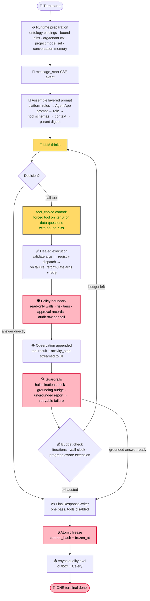

Key properties: during the loop the user sees **progress, not text** (activity steps, tool progress, phase events) — text only comes from the final writer, built from verified observations. Cancellation is checked between steps; failures are honest terminal statuses, never fabricated success.

### 7.2 The Semantic Store (how the system *learns* the customer's data)

The semantic store is what lets NL2SQL work on **any** customer database without hardcoding anything. It is built automatically at bind time and kept fresh continuously:

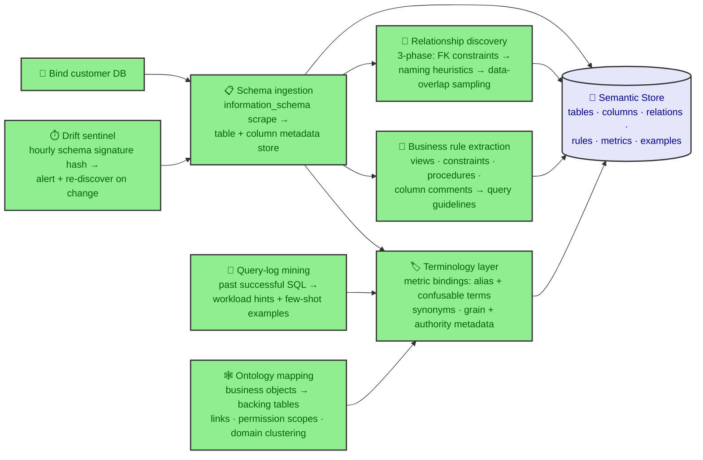

Why this matters (say this to the board): **the semantic store is the difference between a demo and a product.** A demo hardcodes "sales_order means X". The product discovers it, records the evidence, keeps it current via drift detection, and learns the customer's vocabulary from every query they run.

### 7.3 The NL2SQL Pipeline (question → verified SQL → grounded answer)

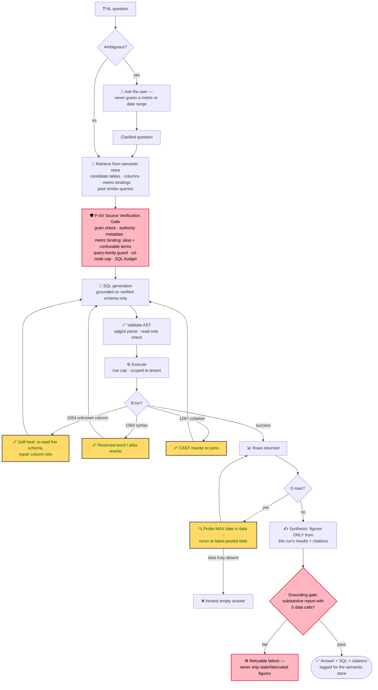

Production evidence: 474 NL2SQL runs logged, ~86.5% success; failures are classified (gate rejection vs. execution error vs. honest-empty) rather than hidden.

### 7.4 The RAG System (documents → cited answers)

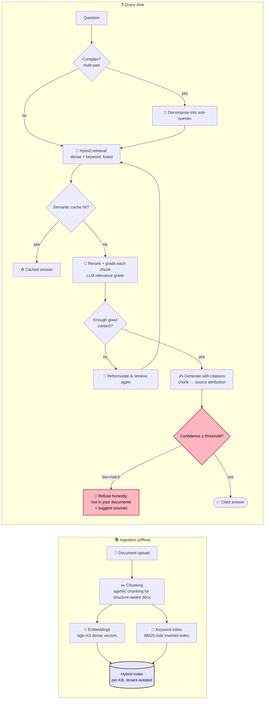

Key behaviors: **low-match refusal** (answering from thin context is treated as a failure mode, not a feature), per-tenant KB isolation, and citations down to the source file — the same grounding philosophy as the data path.

### 7.5 One Question, End to End (all subsystems together)

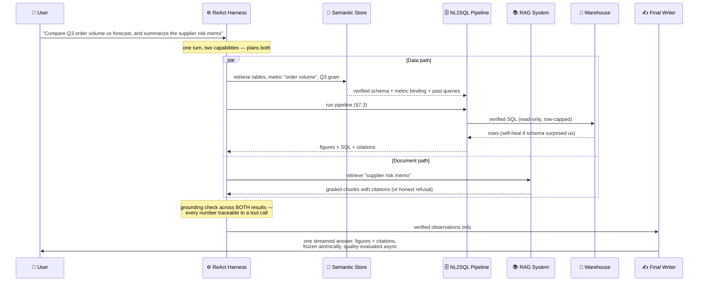

**Board takeaway:** the subsystems share one contract — *nothing reaches the user that isn't grounded in a verifiable source*: the semantic store grounds SQL, the P-SV gate grounds queries, self-healing grounds execution, RAG grades and refuses, and the final gate refuses ungrounded reports. Grounding is the platform's spine, not a feature.

---

## 8. Business Value × Technical Stack — Paired, Not Parallel

The FDE rule this section follows: **no technical capability is presented without the business outcome it buys, and no business promise without the mechanism that makes it real.** Benchmarks are drawn from industry sources (IBM IBV; industrial AIOS reference deployments) and marked as such — our own production evidence is marked separately.

### 8.1 The Value Spine (one diagram to walk)

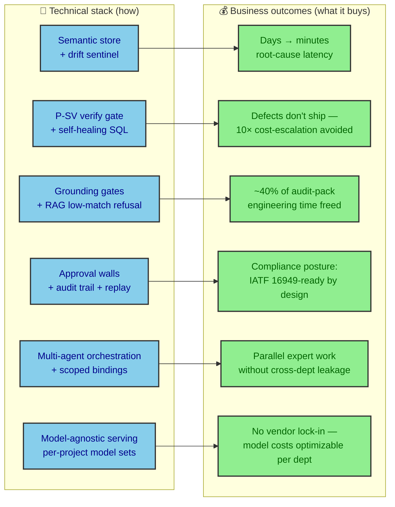

### 8.2 The Pairing Table (memorize three rows; know the rest)

| Technical capability | How it works (stack) | Business outcome (value) | Evidence |
|---|---|---|---|
| **Semantic store + drift sentinel** | Auto-discovers schema, relationships, business rules at bind time; hourly re-signature detects customer DB changes | New customer onboarded in days, not months of hardcoding; system survives ERP schema changes silently | Own: binds arbitrary MySQL/Postgres/warehouses with zero hardcoded tables |
| **NL2SQL verification gate** | Grain/authority metadata + metric binding checked *before* SQL runs; ambiguity → clarify the user | Reports finance and ops can act on — no more "two dashboards, three numbers" | Own: 474 runs, ~86.5% success; failures classified, not hidden |
| **Self-healing SQL** | Live-schema repair (unknown columns), syntax and collation rewrites at runtime | Data engineering tickets for "the report broke" drop toward zero; uptime of analytics without an analyst on call | Own: three error classes healed automatically |
| **Grounding gate** | Figures must trace to this run's tool results; stale/fabricated report → retryable failure | Kills the #1 enterprise AI fear: confidently wrong numbers. Escaped-defect math: ~10× cost at each stage survived | Industry: defect escalation 10× (station → warranty → recall) |
| **RAG with low-match refusal** | Hybrid dense+keyword retrieval, LLM grading, refuses thin context with source suggestions | Same honesty contract for documents: answers cite files; "not in your docs" instead of a plausible guess | Own: threshold-gated refusal, per-tenant KB isolation |
| **Approval-gated execution** | Write-backs born pending human approval; risk-tiered; every call audited | Automation without loss of control — AI proposes, humans dispose, regulators can replay everything | Industry: ~40% of IATF 16949 audit-pack time automatable; root-cause time −90% (AIOS benchmarks) |
| **Multi-agent orchestration** | Directory-gated specialists, bounded parallel fan-out, plan-DAG, scoped bindings, invocation lineage | One question fans out to Production ∥ Inventory ∥ Supply Chain concurrently — wall-clock time of the slowest specialist, not the sum; zero cross-department data leakage | Own: live department workspace (8 depts, published agents) |
| **Stable answer stream + freeze** | Silent orchestration → one writer pass → exactly one terminal `done` → atomic freeze with hash | Users trust the interface (no double-answers, no hangs); every answer is immutably attributable — the precondition for paying users | Own: partial content preserved on failure |
| **RLS multi-tenancy + RBAC** | Row-level security on 127+ tables; agents scoped to their bindings | One deployment serves many business units/customers safely — the SaaS economics multiplier | Own: platform DB with structural isolation |
| **Model-agnostic serving** | Per-project model sets (e.g. `qwen3.5-omni-plus` for R&D), interchangeable LLMs | Cost/routing optimized per department; no vendor lock-in — the "open architecture" IBM recommends | Industry: IBM IBV — open architecture for non-differentiating layers |

### 8.3 The ROI Script (when the board asks "what's it worth?")

> *"Three buckets. **First, latency of decisions:** root-cause investigations that span QMS/MES/ERP collapse from days to one conversation — industry deployments put that at ~90% cycle-time cut, and 4 in 10 manufacturers can't even compute their Cost of Quality today because the data is siloed — we unify it. **Second, cost of errors:** a grounding gate is cheap insurance against the most expensive failure in this industry — a defect or a wrong number that escapes, escalating ~10× at every stage, with line-stop penalties around €50k/hour. **Third, compliance labor:** roughly 40% of audit-pack assembly time is automatable, and because every verdict is logged with inputs, rules, model version and outcome, we don't just save the time — we produce audit-ready evidence as a by-product. Reference industrial deployments report ~8-month ROI payback on the quality loop; our contribution is the platform layer that loop runs on."*

**The one sentence to leave behind:** *"Every mechanism in my stack exists to convert one of three business liabilities — slow decisions, confident errors, compliance labor — into a system property instead of a person's vigilance."*

---

## 9. Industry Context: IBM "AI in the Automotive Industry" — Where This System Stands

*(Source: IBM Think, "AI in the automotive industry", published 15 Oct 2025.)*

### 9.1 The Industry Thesis in Numbers

| IBM IBV finding | Figure |
|---|---|
| OEM revenue share attributable to AI | **5% → 9%** within 3 years |
| AI boost to product value | **+22%** |
| AI boost to digital service value | **+37%** |
| Executives expecting 2035 vehicles to be SDV + AI-powered | **74%** |
| R&D budgets shifting to software/digital | **21% → 58%** (nearly tripled) |

The industry is pivoting from a **mechanical-driven to a software-driven business model** — and the AI investment is concentrating as much on the *backend* (production, supply chain, maintenance) as on the vehicle itself.

### 9.2 Use-Case Coverage Map (Article vs. This System)

| IBM article use case | This system | Evidence |
|---|---|---|
| Manufacturing & supply chain optimization | ✅ Covered | Production Scheduling, Supply Chain, Inventory, Demand Forecasting agents — published, grounded on live tables |
| Predictive maintenance & diagnostics | ✅ Covered | Predictive Maintenance Agent: telemetry + maintenance history → anomaly → downtime reduction |
| Vehicle design & prototyping | ✅ Covered | CAD Agent: parametric models, DFM checks, quotes, versioned releases |
| ADAS / AV software | ⚠️ Partial | AV Systems Agent analyzes telemetry, ADAS test logs, sensor health — not real-time driving AI (out of scope for an enterprise platform) |
| Digital twins & simulation | ⚠️ Adjacent | CAD + simulation data; no full digital-twin loop |
| Marketing, in-car experience, training automation | ❌ Not covered | Front-office/in-cabin layer — honest boundary |

### 9.3 Article Best Practices → Implemented in This Architecture

| IBM recommended best practice | Implementation here |
|---|---|
| Governance, data privacy, security ("privacy by design", citing Toyota) | Risk-tiered actions, human approval gates, RLS multi-tenancy, full audit trail — the *implemented* version of that framework |
| Open source / open architecture for non-differentiating layers | Model-agnostic platform: per-project model sets (e.g. `qwen3.5-omni-plus` for R&D), interchangeable LLMs |
| Innovate with ecosystem partners | MCP-exposed tool registry; A2A/ACP agent protocols for cross-system agents |
| Invest in software & digital R&D | The platform itself — built end-to-end, deployed against live enterprise data |

### 9.4 Critical Read (Why This Is FDE Work)

The IBM article is **vision-heavy and delivery-light**: it names use cases but says nothing about deploying them against messy ERP schemas, approval workflows, and enterprise trust thresholds. Closing that gap is precisely the forward-deployed engineer's job — and it is what Sections 4–6 of this document demonstrate. The article's case studies (BMW/AWS, Honda/IBM gen-AI knowledge transfer, FAW-VW transformation) are all vendor-assisted *internal* enterprise transformations — the same category as this work.

**One-line bridge for the board:** *"The IBM article describes where automotive AI is going; my department agent workspace is a working deployment of its backend half — with the governance layer the article calls for but doesn't build."*

---

## 10. Future Integration: General Equipment Manufacturing — Scaling the Same Architecture

*(Source: SYNEXIA-style General Equipment Manufacturing solution — precision machining, casting, assembly, tool wear, traceability. This section shows how the current platform extends into that domain, and what integration work remains.)*

### 10.1 Why This Domain Is a Natural Extension (Component Mapping)

The solution's three cross-industry platform products — **XC-01 AI+BI, XC-02 Knowledge Q&A, XC-03 Equipment O&M** — are capabilities the platform already ships. The gap is not architecture; it is **connectors and domain agents**.

| Their component | Current system equivalent | Integration work needed |
|---|---|---|
| **Manufacturing record** (part → machine → tool → program → parameters → work order lineage) | **Ontology engine** — objects, links, bindings, permission scopes (Supplier→PO→Contract pattern generalizes to Part→Machine→Tool→WorkOrder) | Define the GE object model + link types; bind CNC/MES/QMS/EAM as data sources |
| **XC-01 AI+BI** (cross-process correlation "in one query, not one investigation") | **NL2SQL pipeline** — cross-source queries with P-SV gate, metric bindings, self-healing | New data-source connectors (OPC UA / Modbus / time-series historians); add time-series grain to the semantic store |
| **XC-02 Knowledge Q&A** (process cards, tooling manuals, precision standards) | **RAG system** — hybrid retrieval, grading, citations, low-match refusal | Ingest process cards + standards; domain terminology in the semantic layer |
| **XC-03 Equipment O&M** (72 h failure warning, −30% downtime) | **Predictive Maintenance agent** — already published in the Manufacturing & Production workspace | Bind vibration/temp/spindle-load signals; add anomaly-threshold sensing → escalation fan-out (sensor pipeline exists) |
| **Closed loop: DETECT → DIAGNOSE → RECOMMEND → APPROVE → VERIFY** | **Already the platform's governance pattern** — detection events → cross-system diagnosis → governed recommendation → human approval gate → verification & replayable lineage | Wire GE-01..05 agent verdicts as ontology events; recommendations execute only through approved workflows (the platform never claims direct CNC write-back — same trust boundary) |
| **GE-01..05 workstation agents** (machining dimension, casting surface, assembly precision, process optimization, tool wear) | **AgentApp framework** — published per-department agents, SKILL/MCP tool packaging, tool policy layers | Each agent = new AgentApp + registered tools wrapping the vision/measurement kernels; few-shot adapters are the model engine's job (outside platform scope) |
| **Governed boundary** ("SYNEXIA recommends; approved engineering workflows execute") | **Risk-tiered actions + approval gates + audit trail** — implemented verbatim | Policy config per action type; no new mechanism required |

### 10.2 The Integration Path (phased, value-first)

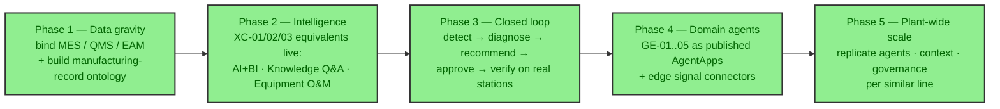

Design principle carried over: **value case first, scale second** — the platform's data-source abstraction and ontology mean phases 1–2 are configuration, not code; the genuinely new engineering is concentrated in phase 4's connectors and domain agents.

### 10.3 The Board One-Liner

> *"This solution page describes a closed loop — detect, diagnose, recommend, approve, verify — and a manufacturing record connecting part, machine, tool and work order. My platform already implements both: the ontology engine *is* the manufacturing record, and the approval-gate pattern *is* the loop. Integrating into general equipment manufacturing is connectors and domain agents, not a new architecture."*

### 10.4 Further Integration Surface (from the product matrix)

The SYNEXIA stack ships seven product lines. Mapped against the platform, six of the seven have a concrete future integration path — and one is a new product opportunity:

| Product line | Future integration with the platform |
|---|---|
| **Industry Agents** (AW-01..06: weld, seam, dimensional, gluing, assembly, stamping) | Agent verdicts (OK / rework / scrap) become **ontology events** — the existing sensing pipeline (threshold → escalation fan-out) turns a line-side verdict into root-cause correlation, part holds, and human review queues. Agents register as **MCP tools** in the platform registry |
| **Algorithm Library** (AL-01..17: vision, 3D measurement, time series) | Invoked by ID as agent tools; the platform records *which* algorithm version + grading-rule pack produced each verdict — decision lineage already includes model version and threshold snapshots |
| **Grading rules** ("OEM grading rules encoded — verdicts are OK/rework/scrap, not a score") | Encoded as **versioned business-rule packs** in the semantic store (the BusinessRuleExtractor pattern generalized) — rule changes become governed, versioned, auditable configuration instead of code pushes |
| **Industrial Model Engine** (vLLM + LoRA hot-swap, industry adapters) | The platform is the **governance plane** above it: model/version registry, rollback events, hard-sample feedback loops tracked as auditable tasks, per-customer namespace isolation |
| **Edge AI / Vision devices** | Out of software scope — but their *outputs* are just event streams. The data-source abstraction binds them like any DB/API; no architectural exception needed |
| **AIOS Ask / Insight / Diagnosis / Forecast / Execute** | Not an integration — **these are the platform's product faces.** Ask = RAG + citations; Insight/Diagnosis = cross-system NL2SQL + correlation; Forecast = forecasting agents; Execute = approval-gated actions |
| **🆕 Audit evidence-pack generator** (new product opportunity) | 8D / CAPA / PPAP drafts assembled from the verdict database + investigation threads + RAG-cited standards, approval-gated before release. Industry benchmark: ~40% of audit-pack engineering time is automatable — this is a sellable agent, and the platform already has every primitive it needs |

Plus one strategic item: **supplier quality correlation.** The doc notes suppliers can absorb up to 70% of a recall's cost — the ontology already models Supplier objects with links; correlating defect escapes to supplier records enables supplier quality scorecards and auto-drafted claims (the approval-gated PO/quote draft pattern, pointed the other direction).

**Multi-industry replication note:** the site lists Semiconductor, Chemicals, and New Energy as sibling solutions. Because industry identity lives in the ontology + agent layer (not the core), each new industry is *new configuration and new agents on the same platform* — the data-source abstraction, governance, streaming, and audit layers are industry-invariant. That is the argument for the platform's long-term value.

### 10.5 Delivery Method Alignment

The solution's five-phase engagement — Solution Consulting → Implementation & Integration → Custom AI Development → Private Deployment & O&M → O&M Support — is the FDE workflow this document demonstrates: assess value first, integrate with what the customer already runs, validate on *their* samples, scale only after the first value case is proven.

---

## 11. Engineering Judgment Under Real Constraints (War Stories)

I'd rather show you how I debug than what I compiled:

1. **The stale-report bug.** The agent produced a "fresh" report entirely from a memory ledger while the live warehouse had current data. Root cause: historical context injected without caveats. Fix: a grounding gate that *hard-fails* any substantive report with zero data-source calls — plus prompt rules and historical-data labeling. Lesson: **trust is a systems property, not a prompt.**
2. **The hanging data agent.** Users reported the chat freezing on a template variable ("Querying the {data_source_id} data source"). I traced the full flow: empty LLM arguments → wasted sub-loop iterations → skipped synthesis → spinner forever. Fixed end-to-end: auto-resolve single bound sources, observability scopes, frontend watchdogs, honest timeouts. Lesson: **FDE debugging is full-path tracing, not stack traces.**
3. **The deployment mismatch.** The UI was served by a stale deployment against an unmigrated database — our fixes were never live. Lesson: **in forward deployments, "works on my machine" is the default state of the world.** Verification means checking the running system, not the repo.

---

## 12. What I'd Bring to Your FDE Team

| FDE competency | Evidence from this project |
|---|---|
| **Translate business → data model** | Ontology engine: objects, links, bindings, permission scopes, coverage scoring |
| **Enterprise data integration** | Live ERP/warehouse bindings, schema discovery, drift detection, self-healing SQL |
| **Multi-agent orchestration** | 4 live patterns (supervisor delegation, bounded parallel fan-out, plan-DAG prepass, governed run kernel) with scoping, lineage, and budgets |
| **Ship with trust** | Grounding gates, approval workflows, RLS multi-tenancy, audit trails, escalation-with-context |
| **Debug in production** | Full-path tracing of agent failures, honest failure taxonomy, watchdogs on both sides of the wire |
| **Own the whole stack** | FastAPI + React + Postgres/MySQL + Docker + migrations + Celery — deployed, versioned, and operated by me |
| **Communicate with stakeholders** | This document; demo scripts that rebuild customer sandboxes deterministically; coverage maps translating AI capability into business use cases per function |

---

## 13. Honest Boundaries (What I'd Tell You Day One)

- Live-LLM runs were quota-constrained at times — some flows are integration-tested with deterministic harnesses and flagged as such, separately from production-verified paths.
- Long agent runs need wall-clock budget enforcement at every layer; I've implemented much of it and track the rest explicitly.
- I keep three states for every deliverable: **implemented ≠ tested ≠ production-ready** — and I never blur them.

---

## 14. Closing — My FDE Thesis

> *The hard part of enterprise AI is not the model. It's everything between the model and the customer's Monday morning: their schema quirks, their approval rules, their trust threshold.*

I built that middle layer end to end — solo — and debugged it against live enterprise systems. That's the job of a forward-deployed engineer, and it's the work I want to keep doing.
