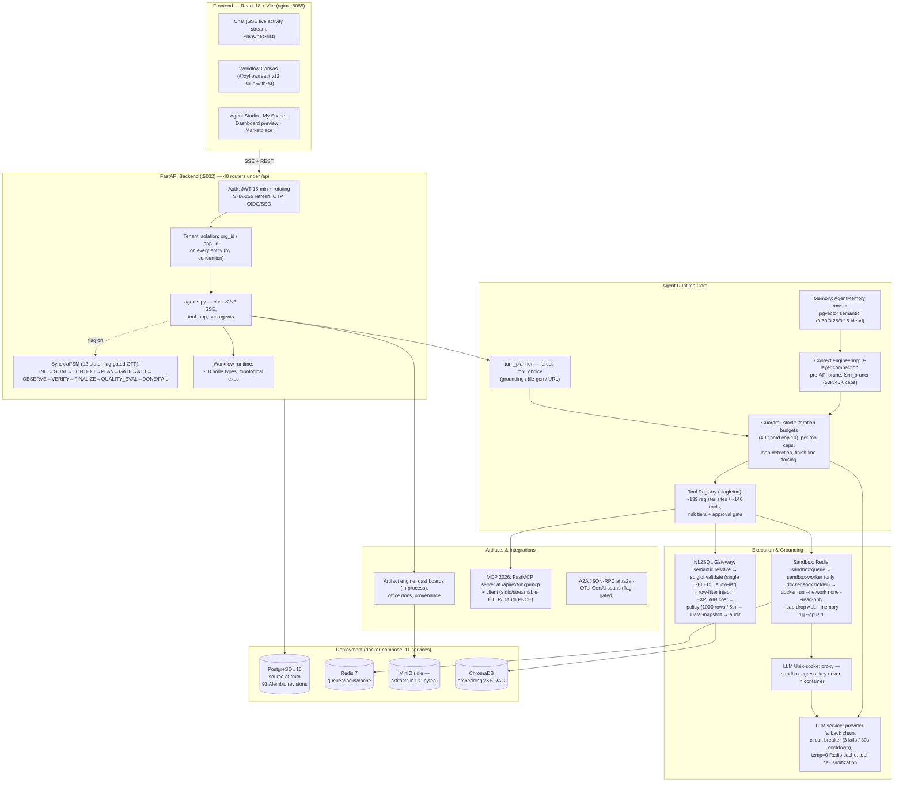

# Zhanlu — Enterprise AI Agent Platform: Project Overview

> Author's technical overview of the `zhanlu_n8n_main_version` workspace.
> Every claim is traceable to a file read in this repository; unverifiable items are marked **[needs confirmation]** and moved to §7.
> Primary sources: `README.md`, `PROJECT.md` (2026-09-02 refresh), direct code inspection of `backend/`, `frontend/`, `docker-compose.yml`, `Dockerfile.sandbox`, `backend/sandbox_worker/`, `backend/app/services/{tool_registry,nl2sql,sandbox,compaction,mcp_client,mcp_server,provider_health,synexia}/`, and `backend/app/routers/agents.py`.

---

## 1. Project Summary

Zhanlu is a multi-tenant enterprise AI operating system: a FastAPI + React platform where users chat with a governed main agent ("Synexia" cognitive core) that plans work, delegates to sub-agents, queries connected databases through a policy-enforced NL2SQL gateway, runs code in disposable Docker sandboxes, and ships verifiable deliverables (PPT/DOCX/XLSX/PDF/HTML dashboards, mini-apps) as permission-checked artifacts instead of chat text. It is built for enterprises that cannot treat an LLM chatbot as production software — every agent runs as a versioned "harness" with a 5-layer constitutional prompt, iteration budgets, grounding gates, audit events, and tenant-isolated data access, so answers are verifiable, sandboxed, and auditable rather than merely conversational. Deployed first in the Chinese chemical/BI industry (Ecisco) but industry-agnostic by design, it turns "AI that talks about your business" into "AI that queries your governed data, executes code safely, and produces the report your team needed — with a receipt for every step."

---

## 2. System Architecture

Two execution runtimes coexist honestly: the **active path is the legacy ReAct loop** in `agents.py` (v2 buffered + v3 SSE) with turn planning and guardrails; the **SynexiaFSM** (12 states, plan→gate→act→observe→verify with a bounded VERIFY-driven replan loop, `SYNEXIA_VERIFY_REPLAN_MAX=1`) is fully implemented in `backend/app/services/synexia/fsm.py` but shipped default-OFF (`SYNEXIA_FSM_ENABLED=false` in `.env`) — one flag flip away, with `chat_loop_adapter.run_via_fsm()` falling back to the legacy loop on any error.

---

## 3. Tech Stack Table

| Component | Technology | Purpose |
|---|---|---|
| Backend API | FastAPI + Uvicorn, single `main.py` | REST + SSE streaming; ~30-entity generic CRUD loop |
| ORM / migrations | SQLAlchemy 2.0 + Alembic (91 revision files) + boot-time auto-migrations | Schema management (dual system — see §7) |
| Primary store | PostgreSQL 16 (`postgres:5432`, compose `:5400`) | Source of truth, incl. artifact blobs (`postgres_bytea` backend) |
| Cache / queue | Redis 7 | Sandbox job queue (`sandbox:queue`), pub/sub events, LLM response cache, locks |
| Object storage | MinIO (256m limit) | Present but mostly idle; default artifact backend is Postgres bytea |
| Vector / RAG | ChromaDB (+ pgvector with numpy fallback) | Chat-upload RAG, semantic catalog, schema-linking embeddings, memory |
| LLM access | OpenAI-compatible `llm_service.py`; DeepSeek cloud default (`deepseek-chat`); local Ollama qwen3.5-27b documented | Task-based model routing, provider fallback + circuit breaker |
| Sandboxing | Docker (DooD), Redis BRPOP worker, Unix-socket LLM proxy | Isolated code/doc execution, no network, capped resources |
| NL2SQL | sqlglot validation, SQLAlchemy dialect adapters, semantic catalog | Governed read-only SQL with allow-lists, cost gates, snapshots |
| Document gen | python-docx / python-pptx / openpyxl / reportlab / LibreOffice headless | Office artifact generation and inline previews |
| Forecasting (domain) | XGBoost, statsmodels (VAR/VECM), Chronos-Bolt/Moirai, Optuna, conformal intervals | EDIA BI forecasting suite (~60 feature flags, ~20 tables) |
| Protocols | MCP 2026 (FastMCP streamable-HTTP), A2A (JSON-RPC), OTel GenAI spans | Interop with external tool servers and agent ecosystems |
| Auth | PyJWT (HS256, jti), rotating SHA-256-hashed refresh tokens, email OTP, OIDC/SSO with PKCE | Hardened per-route auth (no anonymous access anywhere) |
| Frontend | React 18 + Vite 6 (plain JS), Tailwind 3, Radix/shadcn, framer-motion, lucide | Warm-paper design system, bilingual (zh-first) UI |
| Canvas | @xyflow/react v12 | n8n-parity visual workflow builder (19 node render types, one generic `NodeShell`) |
| Frontend data | @tanstack/react-query, react-hook-form, zod, `@base44/sdk` legacy shell | Two-track API layer (SDK Proxy with 401-retry + native REST on `authFetch`) |
| Testing | pytest (~953 backend test files), Vitest (135 colocated files), Playwright e2e | Flag-off/on discipline: every feature ships flag-OFF + its own test file |
| Workflow reference | `n8n-master/` (255 MB upstream checkout) | Parity reference only — not built or run |

---

## 4. Key Engineering Contributions

Each bullet names the design, its mechanism, and the engineering reason.

- **Context-budget enforcement and 3-layer history compaction** (`backend/app/services/compaction/`, `agent_loop/fsm_pruner.py`) — tool results hard-capped at 50,000 chars (Hermes-style 40/60 head/tail split), total tool-result budget 40,000 chars per turn, and a progressive compaction ladder (Microcompact with zero LLM calls → deterministic Session Memory → LLM Full Compact) with `AUTOCOMPACT_BUFFER_TOKENS=13,000`, pre-API pruning before every LLM send (`pre_api_prune.py`), tiktoken-based estimation with a 4/3 padding factor, and orphaned `tool_call_id` stripping to prevent provider 400s. Why it matters: cost and latency are bounded per turn instead of growing with conversation length, and long-horizon runs don't die on context-window overflow.
- **Tool-loop detection and layered iteration budgets** (`harness/policy.py`, `routers/agents.py`, `tool_loop_guardrails.py`, `iteration_budget.py`) — `MAX_TOOL_ITERATIONS=40` with a same-turn `TOOL_CALL_HARD_CAP=10`, per-conversation `AGENT_MAX_ITERATIONS=100`, per-tool caps (`memory:1`, `ask_data_agent:2`, …), a loop-guard controller with warn/block/halt thresholds for exact-failure / same-tool-failure / no-progress patterns, a forced `tool_choice="none"` finish line, and a T-3 wrap-up nudge. Why it matters: a misbehaving agent degrades to a guaranteed fallback answer (artifact/data-summary generators) instead of an infinite, expensive loop.
- **Plan DAG / structured execution plans** (`synexia/plan_dag.py`, `capability_router.py`, `workflow_executor.py`) — plans are dependency-sorted graphs persisted as typed SSE events, so the frontend PlanChecklist survives page reloads; workflow runs execute in topological order with n8n-style branch routing, per-node `retryOnFail`/`continueOnFail`, error-workflow recursion, and partial re-run from any node. Honest limitation: node execution is **serial** (`for node in ordered:`) — parallel branch execution is documented future work (see §7).
- **Sandbox isolation with resource limits** (`sandbox_worker/main.py`, `services/sandbox/container_manager.py`) — the sandbox-worker is the *only* service allowed the Docker socket; every job runs `docker run --network none --read-only --cap-drop ALL --memory 1g --cpus 1 --tmpfs /tmp:size=256m` with a 120s default timeout and force-`rm -f` on expiry; outputs capped at 50 MB/file, 200 MB total; typed images (`pptx`/`office`/`python`/`skill`/`webapp`); the *only* egress is a host-side Unix-socket LLM proxy that enforces a model allowlist and rate limits, so **API keys never enter containers**. Why it matters: model-generated code gets zero network, zero host write access, and bounded blast radius.
- **MCP tool registry with schema normalization and risk tiers** (`tool_registry.py`, `mcp_server/fastmcp_app.py`, `mcp_client/`) — a singleton registry (~139 `registry.register` sites across 98 handler files) with per-tool `risk` (read/write/destructive/external) feeding an approval gate, RBAC-filtered schema exposure, OpenAI function-envelope normalization, AST-based auto-discovery (only modules with registrations get imported), 30s TTL-cached availability checks; FastMCP server wraps the same registry at `/api/ext-mcp/mcp`; MCP client supports stdio + streamable-HTTP (2026 spec) + OAuth PKCE with a 600s TTL session manager and health-ping reuse. Why it matters: one governance point for ~140 internal tools and any external MCP server — schema shape, exposure, and risk policy are uniform.
- **Provider-health tracking and circuit breakers** (`services/provider_health.py`, `llm_service.py`) — ordered provider fallback chain, circuit breaker at 3 consecutive failures with 30s cooldown and single-probe recovery, lowest-latency healthy-provider selection, transient-vs-fatal error classification, streaming failover only before first token, temperature=0 Redis response cache, and pre-flight tool-call-pair sanitization that strips orphaned tool messages before they can cascade into 400s. Why it matters: one flaky provider or one malformed message can't take the whole chat surface down. (Note: health routing is implemented but `LLM_HEALTH_ROUTING_ENABLED=False` by default.)
- **NL2SQL grounding with metric/unit validation** (`services/nl2sql/`) — the governed pipeline is: binding load → dialect capability gate → semantic resolution (rapidfuzz against metric synonyms, ≥2 near-tied candidates triggers `needs_clarification`) → LLM SQL generation with 3 error-feedback retries → sqlglot validation (single SELECT only, multi-statement and write/DDL blocked, function blocklist incl. `pg_sleep`/`dblink`, table allow-list) → row-level permission filter injection + re-validation → structural check against live `information_schema` with JOIN fan-out detection (`SUM` over un-pre-aggregated joins) and "did-you-mean" column suggestions → EXPLAIN cost gate → policy (1000-row limit, 5s timeout, cost threshold) → immutable DataSnapshot → audit event. Metrics carry `unit`, `aggregation`, and `synonyms` metadata (`models/metric_definition.py`). Why it matters: the model can only ever produce an allow-listed, read-only, budget-capped query against explicitly bound tables — with a frozen snapshot as evidence.
- **Verification and quality gating (honest scope)** (`synexia/fsm.py:557-711`, `eval_harness.py`) — the FSM VERIFY state runs deterministic verifiers + optional LLM rubric + grounding checks and drives a **bounded replan loop** (`SYNEXIA_VERIFY_REPLAN_MAX=1`, CRITICAL failures only, environmental errors excluded); verification is intentionally non-fatal, and the LLM corrective re-generation loop in FINALIZE was removed by decision (2026-09-03) in favor of heuristic reflexion scoring. A JSON golden-scenario eval harness ships 8 built-in scenarios with graders (`contains`/`not_contains`/`artifact_created`/`confidence_at_least`), plus a champion-judge eval gate (`golden_eval_runner.py`). Why it matters: answers are checked before claiming success, and regressions are caught by replayable scenarios.
- **Multi-tenancy and auth hardening** (`deps.py`, `routers/auth.py`, `entity_router.py`) — org/app tenant columns swept on every table, owner filtering with system-agent bypass, JWT access tokens with `jti` blacklisting on logout, one-time rotating refresh tokens stored as SHA-256 hashes, OTP registration, and per-route `Depends` (no auth middleware to forget). Why it matters: enterprise deployment requires that a logged-out session cannot be replayed and data access is scoped by construction.
- **Honest flag discipline** (`app/config.py`, 1,640 lines) — every feature ships flag-OFF with its own test file; tests must pass both OFF and ON. Implemented-but-dark modules (FSM, harness orchestrator, SSO, computer use, A2A, OTel, deep-research-v2) are real code awaiting enablement, not vaporware — and the docs say so explicitly (`PROJECT.md` §17).

---

## 5. Quantitative Facts

All verified by direct inspection unless marked otherwise.

**Scale**
- Backend app code: **257,165 LOC Python** (`backend/app/`), plus 626 LOC `sandbox_worker/` [verified from code]
- Frontend: **75,674 LOC** across **482** `.js/.jsx` files in `frontend/src/` [verified from code]
- Backend tests: **953** test files [verified from code]; ~154K LOC [PROJECT.md — needs confirmation]
- Docs: 227 markdown files; 41 in `docs/plans/` [PROJECT.md — needs confirmation]

**Tools & registry**
- Tool registry: **134** `registry.register(` call sites in `tool_handlers/` (~139 incl. `knowledge_graph`, `universal_analytics`, `skill_routing`), across **98** handler `.py` files [verified from code]
- FastMCP server exposes the registry (≈140+ tools incl. CRUD extras) at `/api/ext-mcp/mcp` [verified from code]; "~172 tools" figure [PROJECT.md — needs confirmation]
- MCP marketplace: 8 curated templates (GitHub Copilot, Slack, Notion, Sentry, Linear, Figma, Fetch, Playwright) [verified from code]
- Bundled skills: 55 skill directories in `backend/skills/`; 3 system skills [verified from code / PROJECT.md]

**Agents**
- Built-in `BUILTIN_AGENTS` roster: 14 code-defined agents (explore, plan, worker, verification, data_agent, forecast_agent, report_agent, orchestrator_agent, perception_agent, rag_research_agent, diagnosis_agent, pricing_agent, intelligence_agent, ecisco_bi_assistant) + 5 seeded system meta-agents (agent_builder, skill_agent, automation_agent, general_assistant, power_user) [verified from PROJECT.md listing — needs confirmation of exact current count in `agent_definitions.py`]
- Agent definition: 5-layer constitutional prompt (identity/boundary/reasoning/tools/output) + auto-derived harness JSON [PROJECT.md]

**Budgets & limits** (all verified from code)
- `MAX_TOOL_ITERATIONS=40`, `TOOL_CALL_HARD_CAP=10`, `AGENT_MAX_ITERATIONS=100`, `AGENT_FAST_MAX_TOOL_ITERATIONS=10`
- Loop guardrails: exact-failure block @5, same-tool-failure halt @8, no-progress block @5
- Context: tool-result cap 50,000 chars; per-turn total 40,000 chars; `AUTOCOMPACT_BUFFER_TOKENS=13,000`; pre-API prune trigger 16,000 tokens; tool-output cap 24,576 tokens
- Sandbox: 120s default timeout, 1 GB memory, 1 CPU, 50 MB/file and 200 MB total output caps
- NL2SQL: 1000-row limit, 5000 ms execution timeout, cost threshold 1000 (planner units), 3 SQL-gen retries, question max 2000 chars
- Circuit breaker: 3 consecutive failures → open, 30s cooldown; LLM timeout 120s; MCP call timeout 60s
- Swarm: `SWARM_MAX_CONCURRENT=8`; frontend `MAX_CONCURRENT_RUNS=3`
- Auth: access JWT 15 min (config default), refresh 30 days, password min 10 chars, login rate limit 5/min/IP

**Deployment**
- Compose: 10 base services + 1 override frontend = 11 (backend, sandbox-worker, postgres:16, redis:7, minio, minio-init, 4 sandbox image builders, nginx frontend); memory limits: backend 4g, sandbox-worker 512m, postgres 512m, minio 256m [verified from `docker-compose.yml`]
- Sandbox images: 5 typed images (`zhanlu-sandbox-python/-office/-pptx/-skill/-webapp`) [verified from `backend/docker/Dockerfile.sandbox-*`]; 4 have compose builders (skill image built manually) [verified]
- Alembic: 91 revision files (001–085 numbering with extras) [verified from code]
- Workflow runtime: ~18 canonical node types (4 triggers + llm/agent/kb_search/db_query/mcp_tool/http_request/code/set_fields/split_out/remove_duplicates/condition/switch/merge/output) [verified from `workflow_runtime.py`]; 19 frontend node render types via one generic `NodeShell` [PROJECT.md — needs confirmation]
- Eval: 8 built-in golden scenarios in `synexia/eval_harness.py` [verified from code]

**Config surface**
- `app/config.py`: 1,640 lines; ~182 feature booleans, flag-OFF-by-default [LOC verified; flag count needs confirmation]

---

## 6. Resume-Ready Description

### (a) LinkedIn / About version (≤80 words)

Architected and built Zhanlu, a multi-tenant enterprise AI agent platform (FastAPI, React, Docker) that turns LLM agents into governed workers: policy-enforced NL2SQL over customer databases (sqlglot validation, cost gates, immutable snapshots), Docker-sandboxed code execution with zero network and capped CPU/memory, ~140 registered tools behind a risk-tiered registry with MCP 2026 integration, context compaction and iteration budgets that bound cost per turn, and a 12-state verify-and-replan agent FSM — shipped with 953 backend test files and flag-gated rollout discipline.

### (b) Three STAR resume bullets (≤2 lines each)

- Designed a governed NL2SQL gateway (semantic metric resolution, sqlglot single-SELECT validation, row-filter injection, EXPLAIN cost gates, immutable DataSnapshots + audit events) that restricts LLM-generated SQL to allow-listed, read-only, 1000-row/5s queries — eliminating prompt-injection data exfiltration paths by construction.
- Built sandboxed agent execution: a Redis-queue Docker worker (the only docker.sock holder) running `--network none --read-only --cap-drop ALL --memory 1g --cpus 1` jobs with a Unix-socket LLM proxy so API keys never enter containers, plus circuit-breakered multi-provider LLM failover (3-failure/30s breaker, pre-first-token stream failover).
- Engineered bounded agent runtimes: 3-layer context compaction (50K-char tool-result caps, 13K-token autocompact buffer), layered iteration budgets (40-turn / 10-call hard cap / per-tool caps) with loop-detection guardrails and guaranteed fallback answers, plus an 8-scenario golden eval harness — keeping per-turn cost and latency bounded instead of growing with conversation length.

### (c) Plain-English explanation for non-technical recruiters

Companies want to use AI assistants on their own data — sales numbers, reports, spreadsheets — but a chatbot that can say anything, touch anything, and never show its work is unacceptable in a business. Zhanlu is the safety-and-productivity layer around the AI: it connects to a company's databases only through a locked-down query gateway (read-only, capped, fully logged), runs AI-written code inside sealed containers with no internet access, double-checks the AI's work before showing it, and delivers finished products — PowerPoint decks, Excel reports, dashboards — that employees can preview and audit. Think of it as hiring an analyst who works in a clean room, follows company rules, and files a receipt for everything they touch.

---

## 7. Gaps & Suggestions — Questions a Reviewer Will Ask

Things the code cannot answer; prepare answers before presenting.

1. **My specific role vs. teammates.** The repo shows *what* was built, not *who built it*. Which components were solely mine vs. shared? (Suggested framing: "sole architect of X; contributed Y to team-built Z.") `PROJECT.md` is written in first-person-plural; be ready to attribute concretely.
2. **Production tenants and real users.** Is there more than the Ecisco deployment? How many daily active users, agents created, conversations served? Nothing in code reveals adoption. The platform is described as "Chinese chemical/BI-industry-first (Ecisco), generic in design" — quantify it or present as pilot-stage.
3. **Real scale and performance numbers.** Code shows *limits* (budgets, timeouts) but no *measurements*: p50/p95 chat-turn latency, tokens per turn, sandbox job duration distribution, concurrent-user ceiling, DB sizes. Do load-test results or production dashboards exist? If not, the honest claim is "bounded by design," not "fast."
4. **Flag-gated = not running.** The flagship 12-state FSM (`SYNEXIA_FSM_ENABLED=false`), harness orchestrator, SSO/OIDC, computer use, A2A, and OTel tracing are all implemented but OFF in `.env`. A reviewer will ask: "Why ship dark code?" Prepare the answer (staged rollout risk management) and ideally a demo of one dark module enabled.
5. **Parallel DAG execution is not implemented.** Both plan nodes (`capability_router.py:99`) and workflow nodes (`workflow_executor.py:169`) execute strictly serially despite topological sorting — parallel branch execution is future work. Also future work: the workflow `run_agent` node does a single LLM completion with no sub-agent tool calling ("documented follow-up," `workflow_runtime.py:7-12`), and custom-tool sandbox execution is likewise a documented follow-up.
6. **Verification depth.** The FSM VERIFY replan loop is bounded (`SYNEXIA_VERIFY_REPLAN_MAX=1`) and intentionally non-fatal; the LLM corrective re-generation loop was removed (2026-09-03). A reviewer will ask whether that's enough for "verified answers" claims — and whether VERIFY metrics (replan success rate) exist.
7. **Evaluation rigor.** The real regression asset is `synexia/eval_harness.py` (8 built-in golden scenarios). The top-level `agent_qa/` directory is *not* a scenario library — it's an archived manual QA run (FINDINGS.md: FAILED; e2e_report.md: 2/6 assertions passed, 361s timeout) whose driver script wasn't archived. Expect the question: "How do you know agent quality improves release over release?" Consider expanding golden scenarios and publishing eval deltas.
8. **Known architectural debt (be ready to own it, not hide it).** `agents.py` is an 18,958-LOC monolith (58% of router LOC) with lazy imports dodging circulars; two schema systems (91 Alembic revisions + boot-time auto-migrations) with documented drift; tenancy enforced "by convention" (default `default-org`/`default-app`) with a permissive authz fallback; tokens in `localStorage` (httpOnly-cookie migration is a documented follow-up); frontend SSE readers duplicated per consumer; MinIO present but idle. Each has a rationale — state it and the plan.
9. **Cost model.** No code shows token spend per tenant/turn or any budget-quota enforcement for LLM spend (iteration budgets cap calls, not dollars). A buyer will ask "what does a seat cost to serve?" — measurement needed.
10. **Security review status.** Strong design (SSRF guards, secret redaction, injection scanning, sandbox egress proxy), but has any external penetration test or third-party security review been done? `tool_security.py` claims need independent validation for an enterprise sale.
11. **Vendor-reference vs. dependency.** `deepseek-harness-master/` (DeepSeek's open-source `dsh` harness monorepo, ≥500 TS files) and `NL2SQL/` (vendored DB-GPT and SQLBot) are reference checkouts with **zero code-level dependency** into `backend/` (verified: no imports). Clarify in any walkthrough that they are study/parity references, not shipped code — otherwise a reviewer may assume unattributed third-party code.
12. **Data retention & compliance.** Audit events and DataSnapshots exist, but where are retention policies, PII handling, and deletion workflows (relevant for Chinese data regulations, e.g., PIPL)? Not visible in code — needs confirmation.
