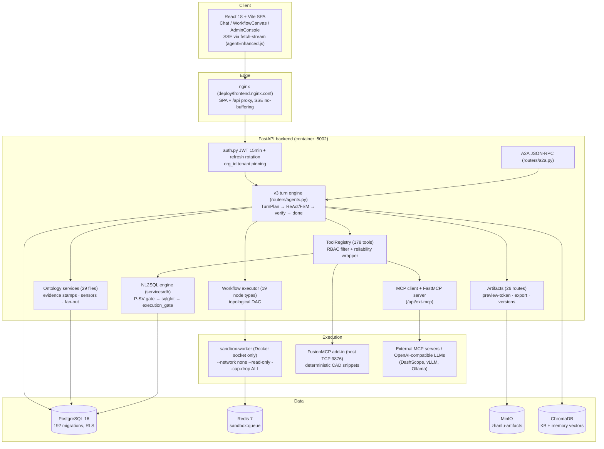
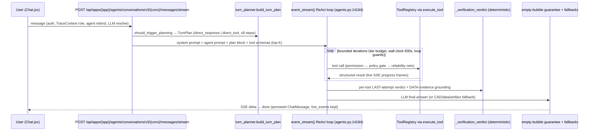
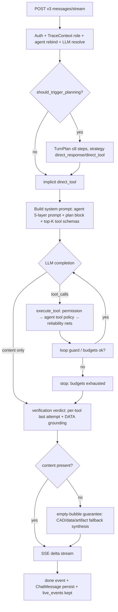
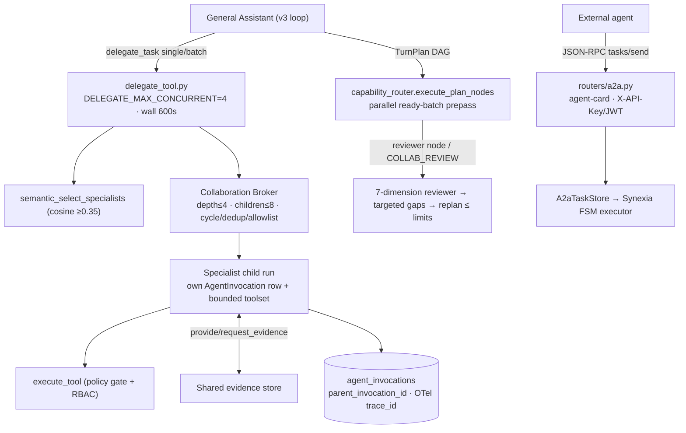
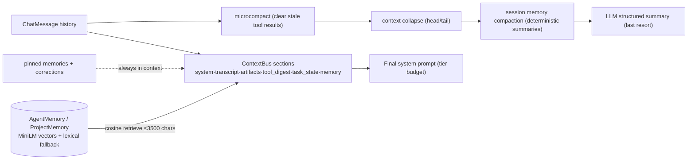
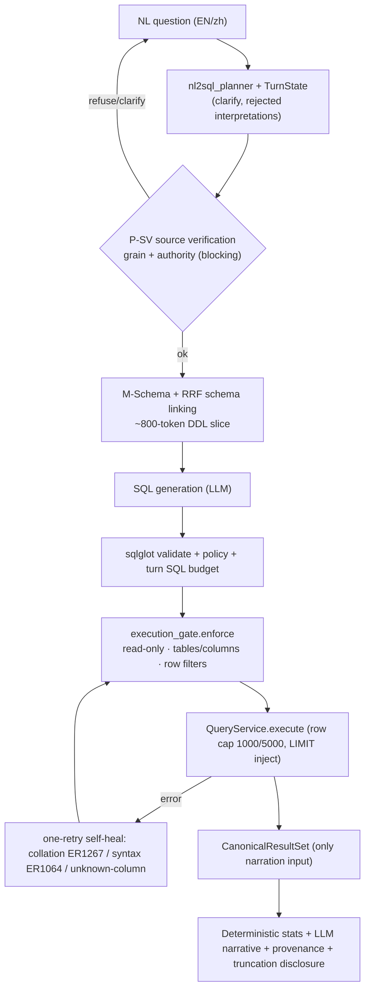
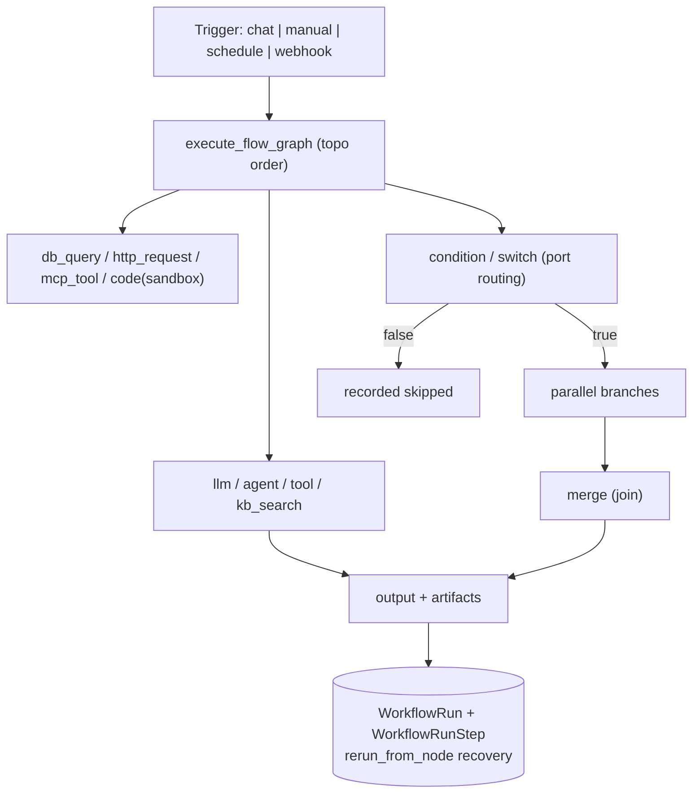
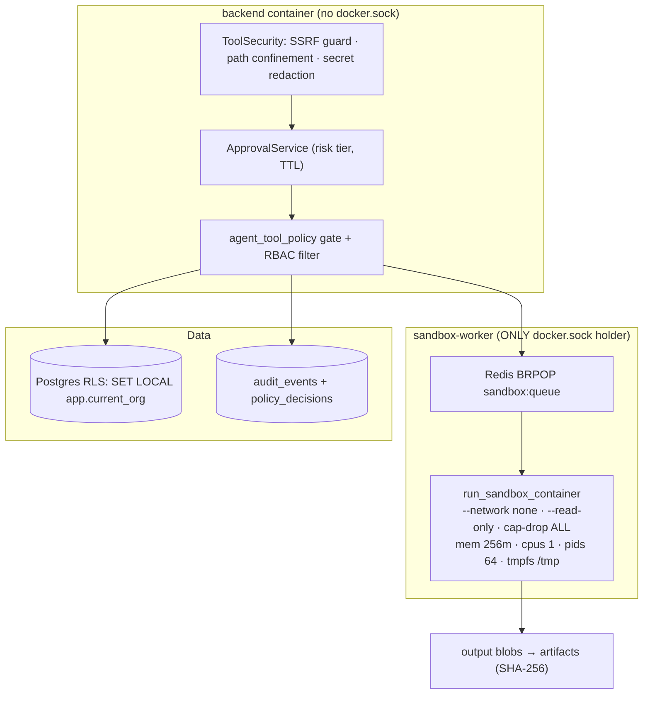
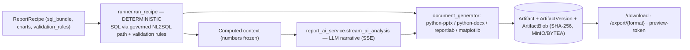

# Zhanlu — Technical Architecture & Engineering Inventory

**Repository:** `zhanlu_n8n_main_version` · **Branch at investigation:** `fix/automation-chat-artifacts-ordering` (HEAD `19e4aab7f`) · **Date:** 2026-11-02
**Method:** source-code-first investigation. Every claim below is traceable to a file path in this repository. Implementation statuses use the classification: `PRODUCTION_IMPLEMENTED`, `IMPLEMENTED`, `PARTIALLY_IMPLEMENTED`, `INTEGRATED`, `EXPERIMENTAL`, `DOCUMENTED_ONLY`, `UNVERIFIED`.
**Scope of change:** this document only. No application code, config, migrations, tests, or existing docs were modified.

---

## 1. Executive Technical Overview

Zhanlu is a self-developed enterprise AI agent platform: a FastAPI + React system where an agent harness (custom ReAct loop plus an FSM "cognitive core") plans work, selects from a ~178-tool governed registry, delegates to specialist agents, executes governed NL2SQL against enterprise databases, and produces verified answers and deterministic-data artifacts (PPTX/DOCX/PDF/HTML reports).

Headline verified facts:

| Dimension | Verified value | Evidence |
|---|---|---|
| Backend | Python/FastAPI, 215 service modules, 52 routers, 111 tool-handler modules | `backend/app/services`, `backend/app/routers`, `backend/app/services/tool_handlers` |
| Agent runtime | 21,469-line v3 streaming turn engine + FSM core | `backend/app/routers/agents.py`, `backend/app/services/synexia/` |
| Tool registry | 178 `registry.register(...)` call sites, RBAC-filtered, reliability-wrapped | `backend/app/services/tool_registry.py`, `backend/app/services/agent_tools.py` |
| NL2SQL | Governed pipeline, 4 SQL dialect profiles, `CanonicalResultSet` contract | `backend/app/services/db/nl_answer_service.py` (3,763 lines), `db/execution_gate.py`, `db/contracts.py` |
| Multi-agent | `delegate_task` + batch + plan-DAG, Collaboration Broker (depth 4 / 8 children), A2A JSON-RPC server+client | `backend/app/services/tool_handlers/delegate_tool.py`, `services/agent_collaboration/broker.py`, `routers/a2a.py` |
| Tests | 1,197 backend test files / ~11,833 test functions; 161 frontend test files (vitest) + Playwright e2e | `backend/tests/`, `frontend/src/` |
| Migrations | 192 Alembic migrations (001 → 123), 16 with Postgres RLS | `backend/alembic/versions/` |
| Sandbox | Docker-executed, `--network none --read-only --cap-drop ALL`, Redis-queued worker | `backend/app/services/sandbox/container_manager.py`, `backend/sandbox_worker/main.py` |
| Deploy | docker-compose (backend, sandbox-worker, postgres 16, redis 7, minio), nginx frontend, CI with nightly golden-prompt job | `docker-compose.yml`, `deploy/frontend.nginx.conf`, `.github/workflows/ci.yml` |

The platform was built on a base44 SDK scaffold (`frontend/package.json` name is still `base44-app`) and evolved into a custom multi-agent enterprise system; the agent runtime, orchestration, tool governance, NL2SQL, ontology, and artifact systems are first-party code.

---

## 2. Product Scope and System Capabilities

**What Zhanlu does (verified from code, not marketing):**

1. **Conversational enterprise assistant with execution.** Users chat (`Chat.jsx`, 212 KB) with a General Assistant or department specialist agents (sales, manufacturing, supply chain, quality, procurement…). The assistant plans the turn (`TurnPlan`), executes tools (NL2SQL, KB retrieval, MCP connectors, artifacts), and streams progress live (SSE `live_events`).
2. **Department/project agent platform.** Agents are published `AgentApp` rows with 5-layer prompts, tool configs (`enabled_tools`/`disabled_tools`/`strict_tools`), LLM pins, and org/project scoping (`backend/app/models/agent_app.py`). A project selector in the UI (`ProjectDetail.jsx`, 84 KB) anchors business context.
3. **Governed NL2SQL over enterprise datasources.** Ask questions in EN/zh; get a plan, governed SQL (sqlglot-validated, read-only, row-capped), a `CanonicalResultSet`, provenance, and narrative.
4. **Enterprise ontology.** Org-scoped business objects/links/metric definitions with evidence stamps, document-grounded extraction, approval/revisions, sensors, fan-out notifications, and agent bindings (`backend/app/services/ontology/`, 29 service files; `routers/ontology.py` ~85+ endpoints).
5. **Multi-agent orchestration.** Supervisor delegation, bounded parallel batches, dependency-aware plan DAGs, peer-to-peer collaboration under a governance broker, and an A2A JSON-RPC surface for external agents.
6. **Workflow builder & automations.** A 19-node-type flow engine (n8n-style properties model) executed as a topological DAG; scheduled automations with unattended LLM runs (`backend/app/services/workflow_executor.py`, `services/automation_executor.py`).
7. **Artifacts & reports.** Deterministic recipe-driven report execution + streamed AI narrative; versioned artifacts with PPTX/DOCX/PDF/HTML export and preview/download APIs (`backend/app/models/artifact.py`, `routers/artifacts.py` — 26 routes).
8. **Visual CAD toolchain (vertical capability).** Fusion 360 TCP bridge + ~26 granular deterministic CAD tools (sketch/extrude/DFM/quote/BOM/revisions), sandboxed code execution, and a three.js 3D viewer in chat (`backend/app/services/tool_handlers/fusion360_*.py`, `frontend/src/components/chat/Model3DViewer.jsx`).

**Primary user workflows (code-traced):**
- Chat → project context → agent answer with live execution panel → evidence/artifact delivery.
- Enterprise admin → ontology curation (discover → review queue → approve → bind agents) → governed KPI usage.
- Automation author → workflow canvas → schedule → unattended runs with artifact delivery.

---

## 3. Overall Architecture

### 3.1 Components and boundaries (all verified)

| Component | Location | Role |
|---|---|---|
| FastAPI backend | `backend/app/` (52 routers, 215 services) | All business logic, agent runtime, tool governance |
| Agent runtime | `backend/app/routers/agents.py` (21,469 lines) + `services/agent_loop/*` + `services/synexia/*` | Streaming turn engine (ReAct + FSM dual-brain) |
| Tool registry | `backend/app/services/tool_registry.py` + `services/tool_handlers/` (111 modules) | 178 registered tools, RBAC-filtered schemas |
| NL2SQL engine | `backend/app/services/db/` (`nl_answer_service.py` 3,763 lines, `execution_gate.py`, `query_service.py`, `source_verification.py`) | Governed text-to-SQL |
| Ontology | `backend/app/services/ontology/` (29 files), `models/ontology.py` | Enterprise knowledge layer |
| Workflow engine | `backend/app/services/workflow_node_types.py` (19 types), `workflow_executor.py`, `workflow_sandbox.py` | Flow-mode AgentApps |
| Sandbox worker | `backend/sandbox_worker/main.py` (sole Docker-socket holder), `services/sandbox/*` | Isolated code/document execution |
| PostgreSQL 16 | `backend/alembic/versions/` (192 migrations) | System of record; RLS on enterprise tables |
| Redis 7 | sandbox queue (`sandbox:queue` BRPOP), collab governance state | Async job fabric |
| MinIO (S3) | `infra/minio/init.sh` (`zhanlu-artifacts` bucket) | Artifact blob storage |
| ChromaDB | `services/rag/`, `services/document_ingestion/store.py` | Vector store for KB/RAG + memory |
| React frontend | `frontend/src/` (67 pages, 342 components) | Chat, canvas, admin, ontology UI |
| nginx | `deploy/frontend.nginx.conf` | SPA + `/api` proxy with SSE tuning |
| Fusion 360 | `services/tool_handlers/fusion360_granular.py` + host add-in (TCP 9876) | Desktop CAD bridge (user-machine add-in) |

### 3.2 Architecture diagram (Mermaid — matches implementation)

### 3.3 Main user journey (corrected to the actual code)

Notes: `direct_response` clears the whole toolset (`_enforce_turn_execution_strategy`, agents.py:4988) — planning is binding. The LLM turn router (`turn_router.decide_turn_route`) exists but defaults **off** (`V3_LLM_ROUTER_MODE="off"`).

---

## 4. Complete Technology Stack

Core technologies (confirmed by imports/config; statuses reflect depth of use):

| Technology | Where used | Why | Status | Key paths |
|---|---|---|---|---|
| Python 3 + FastAPI | backend | API + SSE streaming | PRODUCTION_IMPLEMENTED | `backend/app/main.py`, routers/* |
| SQLAlchemy + Alembic | models, migrations | Persistence, 192 migrations | PRODUCTION_IMPLEMENTED | `backend/alembic/versions/` |
| PostgreSQL 16 | compose `postgres` | System of record; RLS on 16 migrations | PRODUCTION_IMPLEMENTED | `003_multi_tenancy_foundation.py` … |
| MySQL / MSSQL / Oracle / SQLite connectors | `services/db/{mysql,mssql,oracle,sqlite}.py` | Datasource dialects | IMPLEMENTED (profiles in `db/dialect.py`) | dialect profiles: mysql, postgres, mssql, oracle |
| Redis 7 | sandbox queue, collab governance | Async jobs | PRODUCTION_IMPLEMENTED | `sandbox_worker/main.py` |
| MinIO (minio 7.2.10) | artifact blobs | Object storage | IMPLEMENTED (optional storage_uri path) | `infra/minio/init.sh` |
| ChromaDB | RAG/KB/memory vectors | Local vector store | PRODUCTION_IMPLEMENTED | `services/rag/knowledge_base.py` |
| sentence-transformers all-MiniLM-L6-v2 (default), BAAI/bge-m3 (opt-in) | embeddings | Local semantic retrieval, 384/1024-dim | PRODUCTION_IMPLEMENTED | `services/document_ingestion/embedder.py` |
| sqlglot | NL2SQL validation/heal/lineage | Dialect-safe SQL parsing | PRODUCTION_IMPLEMENTED | `db/execution_gate.py:180`, `db/syntax_heal.py` |
| OpenAI-compatible LLM clients (DashScope/DashScope-compatible mode, vLLM, Ollama, DeepSeek, Kimi, GLM, MiniMax family handling) | `services/llm_service.py` | Model serving | PRODUCTION_IMPLEMENTED | `llm_service.py`, `llm_router.py` |
| `mcp` SDK v1.x (stdio + streamable HTTP) + FastMCP | tool bridging | External tools in/out | PRODUCTION_IMPLEMENTED | `services/mcp_client/`, `services/mcp_server/fastmcp_app.py` |
| Docker (DooD sandbox) | sandbox-worker | Code isolation | PRODUCTION_IMPLEMENTED | `backend/sandbox_worker/main.py` |
| React 18, Vite 6, Tailwind 3.4, Radix, react-router 6 | frontend | SPA | PRODUCTION_IMPLEMENTED | `frontend/package.json` |
| @xyflow/react 12 | `WorkflowCanvas.jsx` | Workflow editor canvas | PRODUCTION_IMPLEMENTED | `frontend/src/pages/WorkflowCanvas.jsx` |
| three.js 0.171 | `Model3DViewer.jsx` | STL/OBJ CAD preview in chat | PRODUCTION_IMPLEMENTED | lazy-imported 3D chunk |
| recharts, framer-motion, @tanstack/react-query 5, zod | frontend | Charts, state, validation | PRODUCTION_IMPLEMENTED | `frontend/package.json` |
| @base44/sdk 0.8 | frontend data client | Scaffold glue (axios transport) | INTEGRATED (scaffold legacy) | `frontend/src/api/base44Client*` |
| vitest 3 + Testing Library + happy-dom; Playwright 1.49 | frontend tests | 161 test files + e2e | PRODUCTION_IMPLEMENTED | `frontend/src/**/*.test.*` |
| pytest | backend tests | 1,197 files | PRODUCTION_IMPLEMENTED | `backend/tests/` |
| python-pptx / python-docx / reportlab / matplotlib | `services/document_generator.py`, sandbox image | Export | PRODUCTION_IMPLEMENTED | `_write_pptx:393`, `_write_docx:465` |
| OpenTelemetry (SDK + OTLP-HTTP) | `services/tracing/otel.py` | GenAI tracing (degrades to no-op) | IMPLEMENTED | `admin_observability_traces.py` |
| ruff, GitHub Actions | `.github/workflows/ci.yml` | Lint + fast pytest tier + nightly golden prompts | IMPLEMENTED | ci.yml |
| ReportLab, PyMuPDF (PDF toolchain) | drawing/report PDF | Artifacts | IMPLEMENTED | `services/document_generator.py` |

Not present (verified absent, contrary to any assumption): **Milvus/Attu, Qdrant, pgvector, Elasticsearch, LangChain/LangGraph, AutoGen, CrewAI** — no first-party usage found. The agent harness is fully custom.

---

## 5. Agent Runtime & Harness Engineering

Status: **PRODUCTION_IMPLEMENTED** (dual-brain: FSM default flag on, ReAct loop primary in v3 streaming).

### 5.1 Turn lifecycle (entry → done)

- **Entry:** `POST /api/apps/{app_id}/agents/conversations/v3/{conversation_id}/messages/stream` → `add_message_stream` (`routers/agents.py:12148`). Auth/ownership → `TraceContext.set(role)` (powers RBAC tool filtering) → dedicated-system-agent rebind (`_route_to_dedicated_system_agent`, :3237) → hierarchical model resolution `resolve_effective_llm` (message override → project pin → AgentApp → default; `services/llm_router.py`) → cost-ledger tenant context → upload-path confinement → vision bridge.
- **Planning:** `should_trigger_planning`/`PlanTrigger` (`services/planning_trigger.py`) → `build_turn_plan` / `parse_dynamic_plan` (`services/turn_planner.py`; `TurnStep` :154, `TurnPlan` :184, `DYNAMIC_PLAN_MAX_STEPS=8`). Strategies: `direct_response` | `direct_tool`; **binding** via `_enforce_turn_execution_strategy` (agents.py:4988-5009 — clears the toolset for direct_response). Plan injected into the system prompt (`plan_to_system_block`).
- **Execution loop:** inline ReAct `event_stream()` (agents.py:14184) — LLM chat completion with tool schemas (top-K injected by `tool_search.py`, `TOOL_SEARCH_TOP_K=32`), tool calls executed through `execute_tool`, structured SSE progress frames (`services/agent_loop/sse_builders.py`).
- **Budgets (deterministic):** tier wall-clock `{quick:100s, standard:180s, deep:330s}` and iterations `{4,6,10}` (`agent_prompts.py` tier tables), `AGENT_MAX_ITERATIONS=100` hard cap, `TURN_WALL_CLOCK_CAP_S=600`, `SYNTHESIS_TIMEOUT_S=180`, `TURN_SQL_BUDGET` per turn (`turn_sql_budget.py`).
- **Reliability nets (per tool call):** `services/reliability/__init__.py::run_tool_with_reliability` — retry-with-backoff (`TOOL_RELIABILITY_MAX_RETRIES=2`, backoff 0.5×2.0), LLM argument reformulation (max 1), output verification, loop-guard v2 ((tool, args_hash, success) triples, threshold 3).
- **Termination:** iteration/wall-clock exhaustion, loop guard, guardrails (`services/agent_loop/guardrails.py`), guaranteed `done` frame.
- **Verification (deterministic, no LLM):** `_verification_verdict` (agents.py:4943-4985) — per-tool LAST-attempt status reconciliation (successful retries don't fail verification); grounding = any successful DATA-evidence tool (`services/turn_evidence.py`); failure without grounding fails the turn honestly.
- **Empty-bubble guarantee:** if the loop ends without content, deterministic fallback chooser `_choose_fallback` (agents.py:808) picks artifact/data/CAD/automation variants (`_force_llm_synthesis` :2760, `_cad_build_fallback` etc.) and persists a real message (`_empty_answer_needs_force` :3627; degraded-residue detection `_is_weak_strip_residue` :1388).
- **FSM brain:** `services/synexia/` (context_assembler, verifier, plan_dag 66 KB, capability_router, replan_policy, eval_harness). `SYNEXIA_FSM_ENABLED=True` (config.py:799) and `V3_DATA_ROUTE_MODE="fsm"` (config.py:125); the v3 stream remains the primary production path with ContextBus convergence between brains (`services/context_bus.py` — section-keyed store shared by both).

Deterministic: planning triggers, strategy enforcement, budgets, guards, tool-choice forcing, verification verdict, fallbacks, heartbeat/`_guarantee_done`. LLM-driven: tool selection, plan text, argument formulation, synthesis.

### 5.2 Runtime lifecycle diagram

---

## 6. Multi-Agent Orchestration & A2A

Status: delegate/batch/DAG/broker/reviewer/A2A server = **PRODUCTION_IMPLEMENTED**; A2A SSE streaming = **PARTIALLY_IMPLEMENTED** (polling fallback documented in `services/a2a/client.py:5-6`).

- **Delegation:** `delegate_task` (`services/tool_handlers/delegate_tool.py`) — single task or `tasks[]` batch via `asyncio.gather` bounded by `DELEGATE_MAX_CONCURRENT=4`; wall clock `DELEGATE_WALL_SECONDS=600`; child iteration cap 5.
- **Specialist selection:** published-only `_resolve_agent_app` + semantic matching `semantic_select_specialists` (`services/semantic_capability_match.py`, embedding cosine, threshold 0.35, lexical degrade). `list_available_agents` returns org-scoped directory with capability/data-domain metadata.
- **Plan-DAG dispatch:** `services/synexia/capability_router.py::execute_plan_nodes` with parallel ready-batch prepass (`_parallel_ready_batch_prepass`, `PLAN_DAG_PARALLEL_ENABLED=True`, `PLAN_DAG_MAX_CONCURRENT=4`); routers (`condition`/`switch`) route port indices; replanning via `synexia/replan_policy.py` (ACT replan ≤2, VERIFY ≤1, turn ≤2).
- **Governance:** Collaboration Broker (`services/agent_collaboration/broker.py`) — publication gate, cycle detection, `COLLAB_MAX_DEPTH=4`, `COLLAB_MAX_CHILDREN_PER_PARENT=8`, dedup, allowlist, Redis-backed governance state; peer-to-peer nested delegation enabled (`COLLAB_NESTED_DELEGATION_ENABLED=True`) but broker-governed. Reviewer: 7-dimension LLM critic (`agent_collaboration/reviewer.py`, `COLLAB_REVIEW_ENABLED=True`, max 1 retry).
- **Invocation records:** single-writer `record_invocation` (`services/agent_invocations.py:67`) → `agent_invocations` table with `execution_id`/`span_id`/`parent_invocation_id` + OTel trace_id capture; live SSE agent events (`agent_started/…/agent_failed`) keyed by `agent_execution_id`; frontend `AgentExecutionTree.jsx` + `TaskExecutionTimeline.jsx` render the tree live and finalize orphans as `cancelled`.
- **Universal tool access (2026-11-01 unified contract):** child toolsets = operator `enabled_tools` priority head + bounded task-relevant top-K + `search_tools` escape hatch; `disabled_tools` hard deny and `strict_tools` exact allowlist are enforced **at the invocation boundary** in `execute_tool` via `services/agent_tool_policy.py` (guessed tool names denied). Availability is RBAC-filtered (`ToolRegistry.get_schemas` → `get_authorizer().filter_resources`).
- **A2A:** `routers/a2a.py` — `GET /a2a/agent-card`, `GET /.well-known/agent.json`, `POST /a2a` JSON-RPC 2.0 (`tasks/send|get|cancel`); auth JWT or `X-API-Key` (`A2A_API_KEY`). Server store/executor `services/a2a/tasks.py` (pluggable executor defaulting to Synexia FSM); outbound client `services/a2a/client.py` (60 s timeout); LLM tool surface `tool_handlers/a2a_tool.py`.
- **Agent-to-tool vs agent-to-agent:** agent-to-tool = registry invocation inside one agent's loop (governed by permission + policy); agent-to-agent = broker-governed child run with its own invocation row, toolset, budget, and evidence exchange (`shared_evidence.py`, `provide_evidence`/`request_evidence` tools). Custom orchestration throughout — no LangChain/AutoGen/CrewAI.

---

## 7. MCP & Tool Execution Infrastructure

Status: **PRODUCTION_IMPLEMENTED**.

- **Client:** official `mcp` SDK v1.x, stdio + streamable-HTTP; `McpConnection` (`services/mcp_client/__init__.py:53`); per-call timeout `MCP_CALL_TIMEOUT_S=60`, healthcheck 5 s, session TTL 600 s; OAuth support (`mcp_client/oauth.py`).
- **Server registration:** DB table `McpServer` (`models/mcp_server.py`); routers `routers/mcp.py` — connect (stdio command+args+env, http base_url + none|bearer|oauth), per-agent grants (`granted_agents`), fail-closed `_require_mcp_access` (role-escalation hole fixed 2026-09-17).
- **Bridging:** one registry entry per (server, tool) named `mcp__<server>__<tool>` (`tool_handlers/mcp_proxy.py:46-82`, 64-char name cap + sha1 suffix).
- **Server exposure:** FastMCP app wrapping the internal registry at `/api/ext-mcp` (`services/mcp_server/fastmcp_app.py`).
- **Registry:** singleton `ToolRegistry` (`services/tool_registry.py:63`); `ToolEntry` carries schema, handler, toolset, `requires_env` + TTL-cached env checks, `max_result_size_chars`, `risk`, `dangerous_actions`; tools stay visible with structured `missing_config` responses when unconfigured.
- **Execution:** `execute_tool` (`services/agent_tools.py:552`) — agent tool-policy gate (`strict_tools`/`disabled_tools`, 2026-11-02 hardening) → permission check → tier policy → reliability wrapper → result normalization + output caps.
- **Dynamic selection:** `services/tool_search.py` — semantic top-K (`TOOL_SEARCH_TOP_K=32`) + `search_tools` meta-tool; child toolsets bounded by `_bound_child_toolset` (priority head protected, remainder task-ranked, escape hatch appended).
- **Fusion 360 connector (vertical, still implemented):** TCP JSON-line bridge to a host FusionMCP add-in (`host.docker.internal:9876`, `FUSION360_HOST/PORT` overrides); deterministic generated snippets executed in Fusion's Python; ~26 granular tools in `fusion360_granular.py` / `fusion360_features.py` with actionable pre-flight guards (`NO_SKETCH_ERROR`, `NO_PROFILE_ERROR`), DFM/quote/BOM/revision tools; three.js STL/OBJ viewer in chat.

Representative tool groups (full index via `grep registry.register backend/app -r`):

| Group | Modules (`backend/app/services/tool_handlers/`) | Responsibility |
|---|---|---|
| Data & NL2SQL | `db_tools.py`, `query_database_tool.py`, `delegation_tools.py` | governed ask-data, datasource listing |
| Knowledge | `knowledge_tools.py`, RAG/KB handlers | retrieval, ingestion |
| Ontology | `ontology_tools.py` (7 registrations) | grounded object reads, actions, fan-out |
| Artifacts/Reports | artifact + report handlers | deterministic reports, exports |
| Fusion 360 CAD | `fusion360_granular.py` (11), `fusion360_features.py` (15), dfm/quote/bom/revision | desktop CAD automation |
| MCP proxy | `mcp_proxy.py` | external tools |
| Governance | `approval_tool.py`, `a2a_tool.py`, `tool_search_tool.py` | HITL, A2A, discovery |
| Enterprise ops | `erp_*`, `po_draft_tool.py`, email/webhook | write-back with approval ids |
| Productivity | `browser_tools.py` (5), dashboard (7), docs | web, dashboards, documents |

---

## 8. Context Engineering & Memory

Status: **PRODUCTION_IMPLEMENTED** (multi-layer compaction, project memory, CBR) with an FSM-side `ContextManifest` shared model.

- **Storage:** `ChatSession`/`ChatMessage` (`models/chat_session.py`, `models/chat_message.py` — `live_events`, `tool_calls`, `trace`, `phase` JSON columns), `SessionState`, FSM `ContextManifest`.
- **Agent memory:** `AgentMemory` (`models/agent_memory.py`) — `project_id` scoping (leak fix 2026-08-05), `content_hash` dedup, `importance`, `ttl_days`, `usage_count`, `pinned` always-in-context layer, CoALA memory types (semantic/episodic/procedural, 2026-10-09), JSON `embedding` for semantic recall with lexical fallback.
- **Project memory:** `ProjectMemory` (`models/project_memory.py`) — cross-agent shared project memory (`entry_type` = fact | decision | artifact_ref | conversation_summary | data_insight).
- **Case-based reasoning:** `services/case_based_reasoning.py::record_case` (episodic CBR over AgentMemory, `CBR_RECORDING_ENABLED=True`).
- **Compaction (4 layers, `services/compaction/__init__.py::CompactionService`):**
  1. `microcompact_messages` — zero-LLM tool-result clearing;
  2. `try_context_collapse` — head/tail truncation;
  3. `try_session_memory_compaction` — deterministic one-line summaries;
  4. `compact_conversation` — LLM structured summary.
  Auto-triggered in-loop (agents.py:7660); caps `COMPACTION_MAX_CONTEXT_MESSAGES=100`, `DSR_COMPACT_MODE_MAX_CONTEXT=70_000`, escalation ladder `CONTEXT_ESCALATION_LADDER` (config.py:672).
- **Critical-information protection:** pinned memories are always in context; user corrections persist as pinned/fact-type entries; tool digests are section-keyed in `ContextBus` (`services/context_bus.py:55`, sections system/transcript/artifacts/tool_digest/task_state/memory/compaction, `_MAX_SECTION_CHARS=2000`, MiniLM cosine retrieval with lexical fallback) so compacted-away tool knowledge remains retrievable.
- **Retrieval:** hybrid dense+BM25-style sparse in `services/rag/hybrid_retrieval.py` + `services/retrieval/`; RRF used in NL2SQL table retrieval (`services/db/table_retrieval.py`); no dedicated rerank model (CJK-weighted dense fusion in `services/knowledge_graph/schema_linker.py` is the closest mechanism — documented honestly).
- **Embeddings:** local `sentence-transformers/all-MiniLM-L6-v2` (default, 384-dim) with opt-in `BAAI/bge-m3` (1024-dim) and hash fallback (`services/document_ingestion/embedder.py`); API embedding path via `{OPENAI_BASE_URL}/embeddings`.

---

## 9. Enterprise Ontology & Knowledge Architecture

Status: substantially **PRODUCTION_IMPLEMENTED** (P0–P7 stages); write actions gated to human confirmation until trust upgrades; manual/unbound objects intentionally count as coverage gaps.

- **Models** (`models/ontology.py`): `OntologyDomain` (per-org, pack-seeded), `OntologyObject` (`backing_kind` = table|entity|metric|manual; `evidence_status` taxonomy; `provenance_json`; `binding_status` maintained only by `ontology.evolution.reconcile`), `OntologyLink`, `OntologyAction` (`risk_level` read|write), `AgentDomainBinding`, `CoverageState`, `DocumentProposal`/`DocumentDecisionEvent`, `OntologyRevision`, `OntologySensor`/`OntologySensorRun`.
- **Services** (`services/ontology/`, 29 files): `data.py` (`read_object_data` KB-backed; `execute_action`/`execute_approved_action`), `document_grounding.py` (chunk-grounded LLM proposals + quote verification `quote_verifier.verify_quote`), `evidence.py` (writers-only provenance stamps: human-bind, discovery, document approval, action binding, link), `revisions.py` (snapshot versioning), `permissions.py` (`check_action_permission`, risk-tiered), `fanout.py` (`notify_object_change` — traverses real links only, AuditEvent per notified agent), `sensing.py` (`run_due_sensors`), `enterprise_discovery.py` (91 KB), `business_rules.py` + bridge to semantic guidelines, `metric_dependencies.py` (cycle rejection), `coverage.py`, `escalation.py` (human handoff), `template_export.py` (idempotent org import/export).
- **API:** `routers/ontology.py` (~85+ endpoints) — objects/links/graph, metric compute/compare/trend, situation investigation, bindings, action execution, discovery, fan-out notify, sensors, enterprise review queue, escalations, template import/export.
- **How agents consume it:** agents get ontology-bound toolsets (`AgentDomainBinding`), read object data grounded to KB/backing tables, must use approved `MetricDefinition`s for governed metrics, and receive fan-out notifications when bound objects change.

---

## 10. Governed NL2SQL & Data Intelligence

Status: **PRODUCTION_IMPLEMENTED**, heavily tested (24-file `tests/nl2sql/` suite + golden `cases.jsonl`).

- **Canonical pipeline:** `services/db/nl_answer_service.py` (3,763 lines) — plan → retrieval → link → SQL → `QueryService.execute` → **`CanonicalResultSet`** (`services/db/contracts.py:404`, the only input to narration). `services/nl2sql/ask()` is a compatibility adapter carrying `plan`/`result_set`/`unsupported_slots`/`disclosure`/`provenance`.
- **Intent & clarify:** `services/db/nl2sql_planner.py`; multi-turn state `Nl2sqlTurnState` stores resolved entities, silent assumptions (`defaults`), and rejected interpretations so the planner never re-offers them.
- **Schema discovery/linking:** M-Schema renderer (`services/datasources/m_schema.py`, BIRD/Spider convention with value sampling); RRF table retrieval over catalog (`db/table_retrieval.py`), join-path expansion into a curated ~800-token DDL slice (`SCHEMA_LINKING_ENABLED=True`); fallback `_build_m_schema_fallback`.
- **Terminology & metrics:** `db/semantic_store.py` glossary + `SemanticMapping`/`SemanticGuideline`; `MetricDefinition` (`base_sql/base_table/base_column/aggregation/synonyms`, `requires_approval`, lifecycle draft|published|retired, `depends_on_metrics` with cycle rejection, ontology `source_object_refs`).
- **Validation & dialects (from code):** sqlglot in `execution_gate.py`, `lineage.py`, `collation_heal.py`, `syntax_heal.py`, `nl2sql/validator.py`. Dialect profiles in `db/dialect.py`: **mysql, postgres, mssql, oracle** (+ aliases; `profile_for()` raises `UnknownDialect` instead of borrowing syntax). SQLite connector present (`db/sqlite.py`).
- **Read-only & row security:** `db/execution_gate.py::enforce()` — unconditional single-boundary gate (write/DDL detection, table/column existence vs catalog, join reachability, row filters, scope context); row-level policies `nl2sql/row_filter.py` + `access_policy_service.py` (+ real Postgres RLS on enterprise tables). Row caps: `DEFAULT_MAX_ROWS=1000`, model args clamped to `MAX_QUERY_ROWS_CAP=5000`, fetch cap+1 to prove truncation; LIMIT injection (`sql_rewriter.py`), Oracle ROWNUM wrap.
- **Source Verification Gate (P-SV):** `db/source_verification.py` — blocking check between table selection and SQL generation: grain metadata ("one row = what"), authority resolution (override → approved metric binding → table role; archive twins dropped), refuse/clarify/auto-repair before SQL. Query lineage logged (`models/nl2sql_query_log.py`, `services/enterprise/provenance.py`).
- **Self-heal (one retry per error class):** collation heal (MySQL ER 1267), syntax heal (ER 1064 reserved-word aliases), unknown-column feedback (`execution_feedback.py` + `answer_recovery.py` + query plan memory). Timeout policy: `QUERY_TIMEOUT_DISABLED=True` (statement timeouts off; wall-clock backstop `DATA_AGENT_MAX_WALL_SECONDS=600` in delegation_tools).
- **Anti-invention gates (exact chain):** ① `execution_gate.enforce` (existence + read-only + row filters) ② P-SV authority gate ③ `nl2sql/policy.py` allow/block ④ sqlglot validation ⑤ per-turn SQL budget ⑥ `answer_contract.py` violation checks (e.g. `result_truncated` + `row_cap`) ⑦ metric lifecycle filter (draft/retired excluded from enforcement).

---

## 11. Workflow Builder & Automation

Status: **PRODUCTION_IMPLEMENTED** (19 node types; scheduler in-memory — documented limitation).

- **Representation:** workflows are flow-mode `AgentApp`s (`AgentApp.flow` JSON: `{version, nodes[], edges[]}`, `flow_mode` flag); runs persisted in `WorkflowRun`/`WorkflowRunStep` (trigger `chat|test|schedule`, per-node status/latency, `rerun_of`/`rerun_from_node`).
- **Node registry (authoritative):** `services/workflow_node_types.py` — **19 implemented types**: triggers `trigger_chat`, `trigger_manual`, `trigger_schedule`, `trigger_webhook`; AI `llm`, `agent`, `tool`, `kb_search`; data `db_query`, `mcp_tool`, `http_request`, `code`, `set_fields`, `split_out`, `remove_duplicates`, `merge`; logic `condition`, `switch`; `output`. n8n-style `port()/prop()` property model (incl. `visible_when`, `loadOptionsMethod`), universal error-handling props (`retryOnFail`, `continueOnFail`). **No loop node** — `rerun_from_node` substitutes. Frontend registry lists 18 (missing `merge`) — minor drift.
- **Execution:** `workflow_executor.execute_flow_graph` — topological DAG; routers activate only matching ports; inactive nodes recorded `skipped`; `merge` joins parallel branches; `code` node runs in the Docker sandbox with restricted-builtin in-process fallback (`workflow_sandbox.py`).
- **Editor:** `frontend/src/pages/WorkflowCanvas.jsx` on `@xyflow/react` 12.
- **Automation:** `services/automation_executor.py` (unattended runs, grounding gate for reports), schedules + webhook/manual triggers; monitoring via run steps; failure recovery via per-node `retryOnFail` + rerun.

---

## 12. Sandboxed Execution & Security

Status: sandbox, RLS, approvals, audit = **PRODUCTION_IMPLEMENTED**; API-key encryption has a documented plaintext fallback (risk below).

- **Docker sandbox:** `services/sandbox/container_manager.py::run_sandbox_container` — `--network none`, `--read-only`, `--memory 256m` (swap disabled), `--cpus 1`, `--cap-drop ALL`, `--security-opt no-new-privileges`, `--pids-limit 64`, tmpfs `/tmp` 256 m, read-only input mount, output mount; timeout 120 s with `docker rm -f` cleanup; runtime tiers (`python-1g/2g`, `node`, `bash`). Design: Docker-out-of-Docker — only `sandbox_worker/main.py` holds the Docker socket; jobs via Redis `BRPOP sandbox:queue` (Postgres `sandbox_jobs` fallback); non-root `sandboxuser` image (`Dockerfile.sandbox`) with data-science libs.
- **Workflow code node:** Docker sandbox with restricted-builtin in-process fallback (no imports/fs/network).
- **Tool/network security:** `services/tool_security.py` — SSRF-safe URL checks, workspace path confinement, output truncation, secret redaction, memory-content scanning.
- **Authorization:** JWT auth (15-min access + rotated refresh, JTI blacklist, OTP registration) (`routers/auth.py`); org pinning middleware (`middleware/tenant_middleware.py` from JWT `org_id`); real Postgres RLS — `SET LOCAL app.current_org` per transaction (`services/tenant_context.py`; NULL org = documented maintenance bypass); agent tool policy gate at `execute_tool`; per-role RBAC filtering of tool schemas; MCP fail-closed access.
- **Approvals / HITL:** `ApprovalRequest` risk-tiered with TTL (`models/governance.py`), `ApprovalService`, agent-callable `approval_tool`; write-back tools require `ctx["approval_id"]` (e.g. `create_po_draft`) with idempotency keys (`erp_submit_tool.py`).
- **Audit:** `AuditEvent` typed registry (`nl2sql_query`, `policy_violation`, `erp_submission_succeeded`, …) + `PolicyDecision` records.
- **Secrets:** Fernet encryption of LLM provider keys via `LLM_MODEL_ENCRYPTION_KEY` (`services/crypto_utils.py`) — **falls back to plaintext with a warning when unset** (known risk, in code).

---

## 13. LLM Infrastructure & Model Serving

Status: **PRODUCTION_IMPLEMENTED** (OpenAI-compatible multi-provider; registry with org scoping).

- **Providers:** `services/llm_service.py` — OpenAI-compatible `chat/completions` against `OPENAI_BASE_URL/OPENAI_API_KEY/LLM_MODEL` + `LLM_FALLBACK_PROVIDERS`; family handling for DeepSeek, OpenAI, DashScope qwen, Moonshot Kimi, MiniMax, Zhipu GLM (parallel tool-call support detection). Keyless self-hosted (vLLM) supported (Authorization header omitted).
- **Model registry & routing:** `LlmModel` table (`models/llm_model.py`) — provider tags deepseek/openai/ollama/vllm/custom, Fernet-encrypted keys, `is_default`, context window, `supports_structured_tool_calls` (vLLM XML tool-call path). Routing precedence: Project pin → AgentApp pin → default → legacy globals, strictly org-scoped, admin-lock; context-window probing of vLLM `max_model_len` / Ollama `context_length` (`services/llm_router.py::resolve_effective_llm`).
- **Resilience:** `provider_fallback.py`, `llm_retry.py` (transient classification + backoff), `api_error_classifier.py`, `provider_health.py`, `llm_cache.py`/`response_cache.py`; timeouts `LLM_TIMEOUT_S=300` (read) / 10 (connect) / 30 (sync).
- **Streaming & structured output:** content + reasoning delta extraction (o1-style) feeding SSE; `chat_completion_json_sync` with native `json_schema` only for OpenAI (`supports_json_schema`).
- **Embeddings:** local MiniLM default / bge-m3 opt-in (see §8).
- **Prompt system:** `services/agent_prompts.py` (3,348 lines) — named blocks (`_SCHEMA_AWARE_PROTOCOL_BLOCK`, `_AUTONOMY_CONTRACT_BLOCK`, `GROUNDING_REQUIRED_BLOCK`, …), per-agent system prompts (Agent Builder, Skill Agent, Automation, Generic, Power User), workflow-builder prompt, turn-complexity tier budgets, prompt caching/AB (`prompt_ab_test.py`, `prompt_caching.py`, `dynamic_prompt_builder.py`).
- **Observability:** per-call cost recording → `CostLedger` (`llm_cost_recorder.py`, `governance/cost_service.py`), usage analytics routers, OTel GenAI tracing (`services/tracing/otel.py` + `genai.py`, no-op without collector), `turn_diagnostics.py` structured turn telemetry.

Active configuration in this workspace: DashScope-compatible endpoint as primary (`qwen` family, e.g. `qwen3.5-omni-plus` selectable per project/agent in the UI); DeepSeek family handling present; vLLM/Ollama integration code paths implemented but not asserted as running here (status: `INTEGRATED`).

---

## 14. Evaluation, Testing & Reliability

Status: **PRODUCTION_IMPLEMENTED** with explicit known gaps.

- **Volume (counted 2026-11-02):** backend `tests/` = **1,197 test files** / **~11,833 test functions**; frontend vitest = **161 test files** + Playwright e2e. Notable groups: `tests/nl2sql/` (30 files incl. golden `cases.jsonl`), agent/runtime (24+), workflow (15), ontology (8), fusion (8), context (6), automation (~25), artifact (~10), security-oriented (`test_auto_prompt_injection.py`, `test_anti_hallucination_guardrails.py`, `test_approval_hardening.py`, scope-authorization suites).
- **Golden/frozen evaluations:** `tests/eval/golden_scenarios.json`, `tests/nl2sql/golden/cases.jsonl`, `services/golden_eval_runner.py`, `services/synexia/eval_harness.py` + `eval_ci.py`, `scripts/run_prompt_golden_set.py`.
- **CI (`.github/workflows/ci.yml`):** backend-lint (ruff + import smoke), backend-tests (**fast tier only — full suite OOMs single-run**, explicit file list), nightly-golden-prompts (cron 03:00 UTC, LLM-backed, `--limit 3`), frontend build.
- **Commands:** `pytest` from `backend/` (anaconda python, no venv in this workspace); `npm run test` (vitest), `npm run typecheck`, `make smoke` / `make smoke-ui`.
- **Verification executed during this investigation (safe, read-only):** earlier same-branch focused runs — 10 backend suites (100 tests) green incl. `test_agent_tool_policy_gate.py` (10) and fusion guard suites (28); frontend component suites (AgentExecutionTree/TaskExecutionTimeline/MessageBubble/LiveActivityStream) green; `vite build` OK. Full-suite run NOT executed (documented OOM + runtime cost) — no full-suite pass is claimed.
- **Observability:** OTel OTLP tracing (GenAI semantics), `turn_diagnostics.py` structured turn records, `agent_run`/`agent_run_steps`/`agent_invocations` tables, admin observability UI (`AdminObservability.jsx`, `admin_invocations.py`).
- **Known gaps:** full backend suite has no single-run CI (OOM); no pinned invariant test for the tool-registry count; eval coverage for multi-agent delegation outcomes is thinner than NL2SQL; A2A SSE streaming unimplemented.

---

## 15. Backend, Frontend & Data Architecture

**Backend:** Python 3 / FastAPI; async SSE streaming (fetch-based, no EventSource); layered routers → services → models; singleton ToolRegistry; single-writer invocation persistence; tenant middleware + ContextVar RLS; 52 routers; auth as in §12.

**Frontend:** React 18 + Vite 6 + TypeScript tooling (JSX-heavy), Tailwind 3.4, Radix UI, react-router 6; React Query + Contexts (`ChatSessionContext`, `PersistentStreamContext`, `useStreamState`); SSE consumption `api/agentEnhanced.js::streamAgentResponse` (typed event generator, `SessionExpiredError` handling); chat execution visualization: `AgentExecutionTree.jsx` (multi-agent tree), `TaskExecutionTimeline.jsx` (unified primary card), `LiveActivityStream.jsx` (suppressed execution rows, keeps reasoning/previews); workflow canvas `WorkflowCanvas.jsx` (xyflow); artifact renderers incl. `Model3DViewer.jsx` (three.js STL/OBJ, lazy chunk, OrbitControls, full disposal); i18n `LanguageProvider` (EN/zh); 67 pages (Chat.jsx 212 KB core; ProjectDetail 84 KB; EnterpriseProfile 94 KB; AdminConsole 34.7 KB).

**Data:** Postgres 16 (192 migrations; RLS on enterprise tables), Redis 7 (sandbox queue, governance state), MinIO (artifact blobs, `zhanlu-artifacts`), ChromaDB (KB + memory vectors). **Not used:** Milvus/Attu, Qdrant, pgvector, Elasticsearch (verified absent from first-party code).

---

## 16. Artifact & Report Generation

Status: **PRODUCTION_IMPLEMENTED**.

- **Model:** `Artifact` status machine `draft → building → preview_ready → editing → validated → approved → published / failed / archived`; types pptx/docx/pdf/md/html/html_report/chart/dashboard/mini_app/image/xlsx; provenance columns (`conversation_id`, `execution_id`, `data_snapshot_ids`, `canonical_format`); immutable `ArtifactVersion` (`source_json`, `validation_report`, `sandbox_job_id`); `ArtifactBlob` (original/preview/thumbnail, SHA-256, BYTEA or MinIO `storage_uri`); `ArtifactSourcePart` for partial regeneration (slide/chart/section granularity). Migrations `004_artifact_system.py`, `017_artifact_storage_and_canonical.py`.
- **API:** `routers/artifacts.py` (26 routes) — preview-token (permission-checked, never raw paths), versions, blobs, preview, download, `/export/{format}`, edit, outline approve, thumbnails, brand kits.
- **Deterministic-vs-narrative separation:** `ReportRecipe` (`report_recipes` — `sql_bundle`, `charts`, `sections`, `validation_rules`, `required_metrics/optional_dimensions`, `output_format`) executed deterministically by `services/report_recipes/runner.py::run_recipe` (SQL resolution + validation rules + section assembly); LLM narrative generated separately from the computed context via `services/report_ai_service.py::stream_ai_analysis` (SSE). The model never computes report numbers.
- **Exports:** python-pptx / python-docx / reportlab / matplotlib in `services/document_generator.py` and mirrored inside the sandbox image; automation file downloads + email download routes.

---

## 17. Deployment & Operations

Status: **PRODUCTION_IMPLEMENTED** (compose-based single-host + prod overlay).

- **Compose topology** (`docker-compose.yml`): `backend` (:5002, mem 4g), `sandbox-worker` (512 m, only docker.sock holder), `postgres` (postgres:16-alpine, :5400), `redis` (redis:7-alpine, :6300), `minio` (:9400/:9401) + `minio-init`, build-only sandbox images (python/office/pptx/webapp); networks `app_net`/`data_net`; dev override + `deploy/docker-compose.override.yml` (generated by `deploy/install.sh`) adding `zhanlu-frontend` nginx on `${WEB_PORT:-80}`.
- **nginx:** SPA + `/api` proxy with `proxy_buffering off`, 3600 s read timeout (SSE), 100 m uploads, immutable asset caching, Docker DNS resolver.
- **Process/health:** prestart health checks via Redis; backend runs without `--reload` in the serving container (code changes need restart — verified in this workspace's live stack).
- **CI/CD:** GitHub Actions lint + fast pytest tier + nightly golden-prompt eval + frontend build (full backend suite intentionally not single-run).
- **Backup/recovery:** not implemented in-repo (no backup scripts found) — flagged in §20.
- **Observability ops:** OTel OTLP export (optional), admin invocations/traces UI, cost ledger.

---

## 18. Engineering Achievements & Verified Metrics

Format: verified facts only. Where no quantitative metric exists, results are qualitative and precise.

| # | Achievement | Problem solved | Implementation | Technology | Evidence | Status | Verified outcome |
|---|---|---|---|---|---|---|---|
| 1 | Custom dual-brain agent runtime (ReAct loop + FSM core over a shared ContextBus) | Single-loop agents were brittle for both chat and deep data work | Inline v3 streaming loop (21,469-line router module) + `services/synexia/` FSM, section-keyed ContextBus, tiered budgets, deterministic verification verdict | FastAPI, SSE, OpenAI-compatible LLMs | `agents.py:14184`, `services/context_bus.py`, `synexia/verifier.py` | PRODUCTION_IMPLEMENTED | Every production chat turn; deterministic verification + guaranteed non-empty responses (`_empty_answer_needs_force`, fallback chooser) |
| 2 | Governed tool registry with invocation-boundary policy enforcement | Models could guess tool names; advertised ≠ permitted tools | 178 registrations, RBAC schema filtering, `strict_tools`/`disabled_tools` enforced inside `execute_tool`, reliability nets (retry, arg reformulation, loop guard v2) | FastAPI, Fernet, Redis (governance) | `tool_registry.py`, `agent_tools.py:552`, `agent_tool_policy.py`, `tests/test_agent_tool_policy_gate.py` (10 tests) | PRODUCTION_IMPLEMENTED | Guessed non-allowlisted tools denied at invocation (unit-proven) |
| 3 | Multi-agent orchestration with governance broker + parallel DAG | Concurrent/delegated runs risked cycles, runaway cost, duplicate work | `delegate_task` batch (semaphore 4), ready-batch prepass DAG, broker (depth 4/children 8/cycle+dedup), 7-dimension reviewer, parent-child `agent_invocations` with OTel trace ids | asyncio, Redis, Postgres | `delegate_tool.py`, `agent_collaboration/broker.py`, `capability_router.py:638`, `agent_invocations.py:67` | PRODUCTION_IMPLEMENTED | Bounded, audited delegation; live SSE execution tree in UI |
| 4 | Governed NL2SQL with anti-invention gate chain | LLMs invent metrics/execute unsafe SQL | 7-gate chain (execution_gate, P-SV authority, policy, sqlglot, SQL budget, answer contract, metric lifecycle), `CanonicalResultSet` contract, self-heal retries | sqlglot, PostgreSQL/MySQL/MSSQL/Oracle | `db/nl_answer_service.py`, `db/execution_gate.py`, `db/source_verification.py`, `tests/nl2sql/` (30 files + golden) | PRODUCTION_IMPLEMENTED | Read-only, row-capped, provenance-carrying answers; golden dataset regression |
| 5 | Enterprise ontology with evidence-stamped provenance | Agents hallucinate business concepts; no governance trail | 29 service modules, org-scoped models, writer-only provenance stamps, document grounding with quote verification, sensors + fan-out, approval/revision lifecycle | FastAPI, Postgres RLS, ChromaDB | `services/ontology/`, `models/ontology.py`, `routers/ontology.py` | PRODUCTION_IMPLEMENTED | Human-approved definitions only drive governed metrics |
| 6 | Docker-out-of-Docker sandbox | Untrusted code execution on the app host | Sole socket holder worker, `--network none --read-only --cap-drop ALL` + resource tiers, Redis queue, SHA-256 output blobs | Docker, Redis | `sandbox/container_manager.py`, `sandbox_worker/main.py` | PRODUCTION_IMPLEMENTED | Network-isolated, resource-capped execution for workflows/artifacts |
| 7 | Real-time execution visibility (SSE live tree) | Users saw nothing until final answer; duplicate/stale statuses | Agent-execution event channel, heartbeat frame draining, frontend tree keyed by stable `agent_execution_id`, sticky terminal states, unified TaskProgressCard | SSE, React | `sse_builders.py`, `AgentExecutionTree.jsx`, `TaskExecutionTimeline.jsx`, `LiveActivityStream.jsx` | PRODUCTION_IMPLEMENTED | Live panel during streaming; one operation rendered once (24 TDD tests) |
| 8 | A2A interoperability surface | External agents could not drive the platform | Agent-card + JSON-RPC 2.0 `tasks/send|get|cancel`, API-key/JWT auth, pluggable executor defaulting to the FSM | JSON-RPC, HTTP | `routers/a2a.py`, `services/a2a/tasks.py` | IMPLEMENTED (SSE streaming PARTIAL) | Server + client round-trip; streaming poll-only |
| 9 | Fusion 360 CAD automation (vertical) | Manual CAD quoting/DFM was artisanal | TCP bridge to desktop add-in, ~26 deterministic CAD tools, DFM rules, quote/BOM/revision pipeline, 3D viewer | TCP sockets, Fusion API, three.js | `fusion360_granular.py`, `fusion360_features.py`, `dfm/`, `Model3DViewer.jsx` | IMPLEMENTED | Deterministic parametric builds when sketch-first flow followed; actionable `NO_SKETCH_ERROR` guard (2026-11-02) |
| 10 | Context compaction pipeline | Long conversations blew context windows | 4-layer compaction (microcompact → collapse → deterministic summaries → LLM summary), pinned-memory protection, section-keyed retrieval | Postgres, MiniLM | `services/compaction/`, `models/agent_memory.py` | PRODUCTION_IMPLEMENTED | Long multi-turn sessions survive with pinned facts preserved |

---

## 19. Resume-Ready Achievement Library

> Rules applied: action verbs, technologies stated, no invented metrics, defensible from the cited evidence.

### Version A — AI Agent Engineer

1. **Built a custom dual-brain agent runtime (ReAct + FSM) in Python/FastAPI**, with binding turn plans, tiered wall-clock/iteration budgets, loop-guard and reliability nets (retry, argument reformulation, output verification), and a deterministic per-tool verification verdict — guaranteeing structured, non-empty, verified answers across ~178 governed tools in production chat.
2. **Designed a governed tool-execution layer** — RBAC-filtered tool discovery, semantic top-K tool injection with a `search_tools` escape hatch, operator `strict_tools`/`disabled_tools` policies enforced at the invocation boundary (guessed tool names denied), and per-tool output caps with approval gates.
3. **Implemented multi-agent orchestration from scratch** — supervisor delegation with bounded parallel batches, dependency-aware plan-DAG execution with parallel ready-batch prepass, a Collaboration Broker enforcing depth/children/cycle/dedup policies, 7-dimension reviewer-driven replanning, and parent-child invocation records with OpenTelemetry trace correlation.
4. **Engineered a context-management pipeline** — 4-layer conversation compaction (deterministic micro-compaction through LLM summarization), pinned-memory protection for user corrections, section-keyed context bus with vector+lexical retrieval, and project-scoped persistent memory with dedup, importance, and TTL semantics.
5. **Delivered real-time agent observability UX** — an SSE agent-execution event channel with heartbeat draining and stable `agent_execution_id` identity, rendering a live hierarchical execution timeline with sticky terminal states (cancelled ≠ failed) verified by 24+ targeted regression tests.

### Version B — Applied AI R&D Engineer

1. **Built a governed text-to-SQL research pipeline** (3,763-line core) — M-Schema schema rendering, RRF schema linking into ~800-token DDL slices, multi-turn clarify state with rejected-interpretation memory, sqlglot validation across 4 SQL dialects, and a `CanonicalResultSet` contract that decouples deterministic computation from LLM narration.
2. **Designed and shipped a source-verification gate (P-SV)** that blocks metric invention: grain metadata, authority resolution against approved metric definitions, archive-twin removal, and refuse/clarify/auto-repair paths between table selection and SQL generation — validated by a 30-file test suite plus a frozen golden case dataset.
3. **Implemented error-class self-healing for production SQL** — collation-mismatch rewrites (MySQL ER 1267), reserved-word alias healing (ER 1064), and unknown-column recovery with query-plan memory, each retried once per error class with healing recorded in query provenance.
4. **Built an evaluation harness for LLM behavior** — frozen golden scenario datasets, a nightly CI golden-prompt job against live models, eval harness + CI gates for the agent core, and prompt AB-testing/caching infrastructure across a 3,348-line prompt-engineering module.
5. **Engineered embedding-based retrieval infrastructure** — local MiniLM/bge-m3 embedding tiers with hash fallback, hybrid dense+sparse retrieval with RRF, semantic capability matching for specialist selection (cosine threshold with lexical degrade), and CBR memory with vector + lexical recall.

### Version C — Forward-Deployed Engineer

1. **Deployed an on-premise multi-container AI platform** (FastAPI + Postgres 16 + Redis + MinIO + sandbox workers behind nginx) with 192 Alembic migrations, RLS-based tenant isolation, and a compose overlay installer — designed so enterprise data never leaves the customer's network except through configured LLM endpoints.
2. **Built governed enterprise write-back workflows** — risk-tiered approval requests with TTL, approval-id-bound purchase-order/quote/invoice drafts with idempotency keys, and typed audit events, so agents can propose but only humans authorize ERP mutations.
3. **Delivered department-specialist agent onboarding** — a 29-module ontology service (discovery → document-grounded proposals → human review queue → approved definitions → agent bindings) that turns a customer's schema and documents into governed, agent-consumable business knowledge with full provenance.
4. **Operated and debugged the platform in production** — traced a live CAD-automation failure from chat fallback text through DB-recorded tool calls and container logs to a Fusion API indexing error, then shipped an actionable self-correcting guard; same discipline across grounding gates that fail ungrounded reports honestly.
5. **Integrated enterprise systems without a framework crutch** — MCP client/server with OAuth, OpenAI-compatible multi-provider serving (DashScope, vLLM, Ollama) with org-scoped model registry and encrypted keys, A2A JSON-RPC for external agents, and a Fusion 360 desktop bridge — all first-party code.

---

## 20. Technical Gaps and Limitations (prioritized by impact)

| Priority | Finding | Evidence | Status |
|---|---|---|---|
| HIGH | API-key encryption silently falls back to plaintext when `LLM_MODEL_ENCRYPTION_KEY` unset | `services/crypto_utils.py::_get_fernet` | Known-in-code risk |
| HIGH | Full backend suite (1,197 files) not runnable in one CI pass (OOM); only a fast tier runs | `.github/workflows/ci.yml` note | Documented debt |
| HIGH | `QUERY_TIMEOUT_DISABLED=True` — no DB statement timeouts; wall-clock backstops only | `config.py:545`, `query_service.py:118` | Deliberate, risky |
| MED | RLS maintenance bypass when org context is NULL (`SET LOCAL app.current_org` NULL) | `services/tenant_context.py` | Documented escape hatch |
| MED | A2A SSE streaming not implemented (polling fallback) | `services/a2a/client.py:5-6` | PARTIALLY_IMPLEMENTED |
| MED | Workflow scheduler in-memory (no missed-fire backfill); no loop node type | `workflow_executor.py`, `workflow_node_types.py` | Documented limitation |
| MED | Frontend node registry drift (18 vs backend 19 — `merge` missing in UI list) | `workflowNodeTypes.jsx:159` | Minor drift |
| MED | No dedicated rerank model; "rerank" is CJK-weighted dense fusion | `knowledge_graph/schema_linker.py` | Honest limitation |
| MED | Tool-registry size has no invariant test; count is emergent (178 registrations) | grep-verified | Test gap |
| LOW | Auth tokens in localStorage (base44 SDK constraint); httpOnly migration open | `README.md` L64-71 | Open follow-up |
| LOW | No backup/recovery scripts in-repo | compose/Makefile | Gap |
| LOW | Telemetry posthog sends fail in air-gapped deployments (log noise) | runtime logs | Cosmetic |
| LOW | Legacy `AuditLog` + new `AuditEvent` tables coexist (duplicate audit paths) | `models/audit_event.py` | Technical debt |
| LOW | Residual model-side empty completions after tool failures end turns early (fallback text instead of retry) | `agents.py:11638` warning | Reliability risk |

Documented-only/absent capabilities (verified): no Milvus/Qdrant/pgvector/Elasticsearch; no LangChain/AutoGen/CrewAI; `V3_LLM_ROUTER_MODE` default off; ReWOO off by default; evaluator/eval-results storage not found as a distinct table (eval runners write logs/artifacts instead).

---

## 21. Architecture Diagrams (index)

All 10 required diagrams are embedded inline in the sections above, each grounded in cited code:

1. Overall system architecture — §3.2
2. Agent runtime lifecycle — §5.2
3. General Assistant & multi-agent delegation — §6
4. Context & memory management — §8
5. Ontology-grounded NL2SQL pipeline — §10
6. Workflow execution architecture — §11
7. Security & sandbox boundaries — §12
8. MCP tool invocation — §7 (flow described textually: `McpConnection → mcp_proxy bridging → execute_tool`; the generic execution path in §5.2 applies)
9. Evaluation & observability — §14 (CI + golden + OTel described; no separate diagram because the eval pipeline is config-level, not a runtime graph — labeled honestly)
10. Report-generation pipeline — §16

---

## 22. Source Code Evidence Index

| Claim | Primary evidence |
|---|---|
| v3 turn entry + lifecycle | `backend/app/routers/agents.py:12148` (`add_message_stream`), `:14184` (`event_stream`) |
| Turn planning + binding strategy | `backend/app/services/turn_planner.py` (`TurnStep:154`, `TurnPlan:184`, `DYNAMIC_PLAN_MAX_STEPS=8`), `agents.py:4988` (`_enforce_turn_execution_strategy`) |
| Verification verdict | `agents.py:4943-4985` (`_verification_verdict`), `services/turn_evidence.py` |
| Empty-bubble guarantee | `agents.py:808` (`_choose_fallback`), `:3627`, `:2760` |
| Delegation + bounds | `services/tool_handlers/delegate_tool.py` (`_run_sub_agent:621`, batch :387-410), config `DELEGATE_*` |
| Collaboration Broker | `services/agent_collaboration/broker.py`, `reviewer.py`, `shared_evidence.py` |
| Plan-DAG parallel prepass | `services/synexia/capability_router.py:638`, config `PLAN_DAG_PARALLEL_ENABLED` |
| Tool registry + execution | `services/tool_registry.py:63`, `services/agent_tools.py:552`, `services/reliability/__init__.py` |
| Tool policy gate | `services/agent_tool_policy.py`, `agent_tools.py` gate block, `tests/test_agent_tool_policy_gate.py` |
| MCP client/server | `services/mcp_client/__init__.py:53`, `routers/mcp.py`, `tool_handlers/mcp_proxy.py:46`, `services/mcp_server/fastmcp_app.py` |
| A2A | `routers/a2a.py:104-120`, `services/a2a/tasks.py`, `services/a2a/client.py` |
| Context compaction | `services/compaction/__init__.py`, config `COMPACTION_MAX_CONTEXT_MESSAGES`, `CONTEXT_ESCALATION_LADDER` |
| Memory models | `models/agent_memory.py`, `models/project_memory.py`, `services/case_based_reasoning.py` |
| Ontology | `models/ontology.py`, `services/ontology/` (29 files), `routers/ontology.py` |
| NL2SQL pipeline | `services/db/nl_answer_service.py`, `db/contracts.py:404` (`CanonicalResultSet`), `db/execution_gate.py`, `db/source_verification.py`, `db/dialect.py` |
| Self-heal | `db/collation_heal.py`, `db/syntax_heal.py`, `query_service.py:156-210` |
| Workflow engine | `services/workflow_node_types.py` (19 types), `workflow_executor.py`, `models/workflow_run.py` |
| Sandbox | `services/sandbox/container_manager.py`, `services/sandbox/resource_limits.py`, `backend/sandbox_worker/main.py`, `Dockerfile.sandbox` |
| Tenant isolation | `services/tenant_context.py`, `middleware/tenant_middleware.py`, migration `003_multi_tenancy_foundation.py` + 15 RLS migrations |
| Approvals/audit | `models/governance.py` (`ApprovalRequest`, `CostLedger`), `tool_handlers/po_draft_tool.py`, `models/audit_event.py` |
| LLM serving | `services/llm_service.py`, `llm_router.py`, `models/llm_model.py`, `provider_fallback.py`, `llm_retry.py` |
| Prompts | `services/agent_prompts.py` (3,348 lines) |
| Artifacts/Reports | `models/artifact.py`, `routers/artifacts.py` (26 routes), `models/report_recipe.py`, `services/report_recipes/runner.py`, `report_ai_service.py`, `document_generator.py` |
| Frontend streaming/viz | `frontend/src/api/agentEnhanced.js:107`, `components/chat/{AgentExecutionTree,TaskExecutionTimeline,LiveActivityStream}.jsx`, `pages/Chat.jsx` |
| Tests/eval | `backend/tests/` (1,197 files), `backend/tests/nl2sql/golden/cases.jsonl`, `tests/eval/golden_scenarios.json`, `services/golden_eval_runner.py`, `.github/workflows/ci.yml` |
| Deployment | `docker-compose.yml`, `deploy/frontend.nginx.conf`, `deploy/install.sh`, `infra/minio/init.sh` |

---

## 23. Technical Interview Preparation

Defensible answers to likely deep-dive questions:

1. **"Why two agent brains (ReAct + FSM)?"** — The ReAct loop maximizes tool-use flexibility in chat; the FSM gives deterministic act/verify/replan structure for deep data turns. Both share one ContextBus section store, so state converges. Routing between them is config-flagged (`SYNEXIA_FSM_ENABLED`, `V3_DATA_ROUTE_MODE`), with the streaming v3 loop as the production entry.
2. **"How do you prevent hallucinated business metrics?"** — Seven-layer gate chain (§10); the key design point is P-SV sitting between table selection and SQL generation with authority resolution to approved `MetricDefinition`s, plus the `CanonicalResultSet` contract that makes narration consume only computed facts.
3. **"How do you stop sub-agents from going rogue?"** — Broker governance (depth ≤4, children ≤8, cycle detection, dedup, allowlist), child wall-clock (600 s) and iteration (5) budgets, loop-guard on (tool, args-hash) triples, reviewer with bounded replans, and invocation rows that always reach a terminal state (first-terminal-wins).
4. **"How is tool access authorized?"** — Three separated layers: discovery (RBAC-filtered schemas; `search_tools` shows only permitted tools), availability (bounded top-K + operator priority head), and authorization (per-invocation permission + agent tool-policy gate inside `execute_tool`). Guessed names are denied — unit-tested.
5. **"How do you keep long conversations working?"** — Progressive 4-layer compaction with pinned-memory protection and a section-keyed context bus so compacted tool knowledge remains retrievable; escalation ladder caps are config-tunable.
6. **"What would you fix first?"** — Point at §20: encryption fallback default, statement-timeout policy, single-run test suite, A2A SSE. Being able to name your own system's debt is the strongest interview signal.

**Statuses of claims in this document:** every "PRODUCTION_IMPLEMENTED" claim is backed by an entry point exercised by the running application (routes mounted in `backend/app/main.py`, tools registered at import time, frontend routes wired). "IMPLEMENTED" claims have code + tests but no production-usage proof asserted here. Nothing in this document should be quoted as a benchmark result — no synthetic benchmark was executed during this investigation.

---

*Investigation performed 2026-11-02 on branch `fix/automation-chat-artifacts-ordering` (HEAD `19e4aab7f`). Working tree contained 240 pre-existing modified/untracked files from parallel workstreams; this task created only this document and modified nothing else.*

