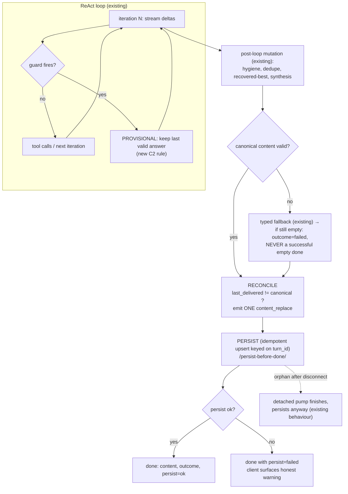

# Gate B — Agent Answer Lifecycle Remediation Design

**Date:** 2026-10-27 · **Mode:** DESIGN ONLY — no code, tests, config, migrations, commits, deploys, or restarts
**Repository:** `zhanlu_n8n_main_version` @ `62b23ca75` (working tree includes the R1 commit + unrelated dirty files)
**Supersedes nothing.** Builds on `docs/plans/2026-10-27-agent-orchestration-e2e-architecture.md`.

All line numbers below were **re-derived from the current working tree during this Gate B session**; earlier
reports' numbers were not reused. Every reference in §2 was opened and quoted.

---

## 0. Scope and what this design does NOT do

**In scope** — the ReAct answer lifecycle only:
ownership of the final answer, its ordering relative to the terminal event, SSE reconciliation, replacement
validity, recovery floor, and turn-scoped diagnostics.

**Out of scope** (explicitly, per the brief):
- No change to `backend/app/services/db/result_contract.py` (deployed and verified).
- No change to schema discovery, table selection, SQL generation, or grounding.
- No second orchestration engine, no separate answer service.
- No change to authorization, tenant isolation, retry policy, or cancellation *semantics*.

> **Design principle used throughout:** every change is **additive and individually revertable**. Nothing in this
> design deletes a guard or changes what the model is asked to do.

---

## 1. Confirmed defects, design assumptions, unresolved hypotheses

The brief requires this separation first, because the remediation differs by category.

### 1.1 Confirmed defects (verified in source this session)

| ID | Defect | Verified reference |
|---|---|---|
| **C1** | **No reconciliation between streamed text and final content.** When content was streamed, the final emit is skipped entirely; post-loop mutation then happens silently and only `done` reveals it. | `agents.py:18555` `if not content_streamed and not _suppress_chat_deltas:` |
| **C2** | **Replacement `content_replace` fires on the replacement's first token, unvalidated.** A one-shot latch emits the whole replacement regardless of how much of it exists. | `agents.py:14786-14787`; **14** latch sites at `14351, 15245, 15301, 15337, 15371, 15417, 15446, 15493, 15528, 15551, 15591, 15640, 15696, 15733` |
| **C3** | **Recovery floor `> 200` chars makes typical answers unrecoverable.** 7 sites stash popped prose, but restoration demands both longer *and* >200 chars. | stash `14349,15231,15288,15584,15632,15689,15723`; gate `18859` `if _rec_len > _cur_len and _rec_len > 200:` |
| **C4** | **Backend does not own `chat_messages` on ReAct.** Exactly one `ChatMessage` reference in the 6.6k-line generator, and it is a read-and-patch gated on the row being *already* empty. No insert exists. | `agents.py:19681-19715` (patch at `19702`); verified by exhaustive grep over `13522–20180` |
| **C5** | **Frontend writes `content` unconditionally, including empty/stale.** The placeholder computed in the `done` branch is never used for the DB write. | `Chat.jsx:2724-2733` (`content: fullContent`); placeholder at `2590-2594` goes only to `updatePendingMessage` (`2595`) |
| **C6** | **`done.content` ≠ accumulated stream text on multi-iteration turns.** The join inserts `"\n\n"` between iterations; nothing is streamed between iterations. | `agents.py:18844` |
| **C7** | **No turn correlation, no stream exit reason.** No `turn_id`; nothing logs *why* a generator ended; `chat_messages`, `executions`, `agent_invocations` cannot be joined deterministically. | absent throughout `add_message_stream` / `event_stream` |

**Not a defect (verified non-issue):** persistence of `conv.messages` already happens **before** `done`
(`agents.py:19876` commit → `20135` yield), and `agent_invocations` is written at `20103` (before `done`).
The server-side ordering invariant already holds for conversation history; the gap is `chat_messages` (C4/C5).

### 1.2 Design assumptions (believed, not proven — each has a test in §8)

- **A1** The frontend's optimistic row is created **before** the stream starts and its id is stable for the turn
  (`Chat.jsx:1446-1448`). *Assumed true on every turn; if the create fails, the stream still runs.*
- **A2** The `done` handler's server-wins rule (`Chat.jsx:2540-2542`) means the rendered final text equals
  `done.content` whenever `done.content` is non-empty.
- **A3** Post-loop mutation of `accumulated_content` (hygiene, dedupe, recovered-best) is *desirable*; the defect is
  the **silence**, not the mutation.
- **A4** A guard that fires is doing something intentional; C2 is about *ordering/validation*, not about the guard's
  existence.
- **A5** `chat_session_id` resolved at `12971` is valid for the turn (re-resolved inside the generator per §4).

### 1.3 Unresolved runtime hypotheses (explicitly NOT assumed)

- **H1 — frequency of guard-triggered regeneration is unproven.** In the retained logs the targeted guards fired
  **0 times**: `promise-as-answer at soft-cap` 0, `stripped promise at exit` 0, `apology-guard` 0, `bounce-back` 0,
  `empty-answer` 0, `nudge injected` 0, `refinement budget exhausted` 0. Only `internal-reference hygiene` (39) and
  FSM `hallucination_check` (56, a different code path) appear. **Therefore C2/C3 are real defects with an
  unmeasured trigger rate.** The fix is justified on *safety* grounds (they cannot destroy a good answer
  *when* they fire), not on measured incidence.
- **H2 — the subject conversation's lost answer.** Turn 1's stream ended with no row patched and no invocation
  record. Whether the client watchdog (`agentEnhanced.js:136`), a tab reload, or a server exception ended it **cannot
  be distinguished** from existing logs. This is C7's rationale.
- **H3 — the pending-action regex is a real trigger.** `pending_action_phrase` (`goal_contract.py:157-176`) does
  match valid English closings (verified: *"I will note that Q3 fell 12%"* → flagged), and is English-only
  (verified: 5 natural Chinese promise sentences → `None`). But it has not fired at the soft-cap site in retained
  logs. **Not treated as a production trigger.**

---

## 2. Verified source map (re-checked this session)

| Function / site | Line | What it does today |
|---|---|---|
| `add_message_stream` | `11584` | route; 4 `StreamingResponse` returns at `11935`, `12063`, `12869`, `20179` |
| `chat_session_id` (early) | `11630-11640` | request-scoped resolution (unusable inside generator) |
| `chat_session_id` (ReAct) | `12971-12982` | re-resolved on request `db`, before the generator def |
| `event_stream` def | `13522` | ReAct generator |
| shadow session | `13550-13552` | `stream_db`, `db = stream_db` |
| per-iteration reset | `14682` | `assistant_content = ""` at iteration top |
| **replacement latch emit** | `14786-14787` | **C2** — `content_replace` on first delta |
| `_v3_iter_contents` init | `14012` | accumulator |
| `_v3_recovered_best` init | `14020` | recovery buffer |
| soft-cap re-synthesis | `14325-14350` | `_nudge_replacement_pending = True` at `14351` |
| iteration prose capture | `18842-18844` | append + **C6** join |
| recovered-best restore | `18856-18865` | **C3** gate at `18859` |
| internal-reference hygiene | `18885-18898` (assign `18897`) | mutates `accumulated_content` |
| sql-narration hygiene | `18902-18910` | mutates |
| duplicate-tail collapse | `18921-18928` | mutates |
| deferred synthesis | `18579` (`_deferred_answer`) → `18980-19485` | may set `accumulated_content` |
| empty-bubble guarantee | `19490-19665` | emits `content_replace` **only in the empty branch** (`19643-19660`) |
| **ChatMessage patch** | `19675-19715` (assign `19703`) | **C4** — only writes when row is empty |
| final `assistant_msg` | `19789` | built from `accumulated_content` |
| `conv.messages` final write | `19864-19912` | retry x3 + `_bg_reconcile_messages` |
| `_done_content` | `20048-20075` | dashboard gates append |
| `record_invocation` | `20103-20122` | audit row, before `done` |
| **`_done_payload` / yield** | `20125` / `20135` | terminal emission |
| wrappers | `3853`, `3885`, `3958` | heartbeat / terminal guarantee / detached pump |

---

## 3. Proposed architecture and lifecycle

### 3.1 Principle

> **The backend becomes the owner of the final answer. The client becomes a renderer that accepts
> server truth and never invents a final state.**

Concretely, three additions to the existing generator, in the existing order:

1. **Reconcile** — if the last content the client saw ≠ canonical final, emit one `content_replace`.
2. **Persist** — idempotently write the authoritative `chat_messages.content` (and outcome) **before** terminal.
3. **Terminate** — emit exactly one `done`, whose `content` is that same canonical string and which carries a
   typed `persist` status.

Plus two safety changes inside the loop (replacement validation; recovery floor) and turn-scoped diagnostics.

### 3.2 Lifecycle diagram



### 3.3 Where each invariant is enforced

| Invariant (from brief §5) | Enforced by |
|---|---|
| One authoritative final answer per turn | single `canonical_content` variable + single persist + single terminal (§4) |
| Persist before `done` | ordering in §5.3 (persist at step I, emit at K) |
| Persisted = terminal = rendered | `done.content` is literally `canonical_content`; persist writes the same string; reconcile makes the bubble equal to it (§5.2) |
| Valid answer not cleared while replacement pending | C2 fix: no clearing until a replacement satisfies validity (§6) |
| Failed/empty generation cannot overwrite valid content | validity gate + persist refuses empty (§6, §5.4) |
| Exactly one terminal outcome | single emit site + wrapper already tracks terminal types (`3885-3955`); add explicit latch (§5.5) |
| Retries/concurrency cannot duplicate assistant messages | idempotent upsert keyed on `turn_id` (§5.4) |
| Persistence failure ≠ successful persistence | explicit `persist` field; fake-success only allowed for the pre-existing generic fallback, which is marked `outcome=degraded` |
| Authorization / tenancy / grounding unchanged | no change to those modules; new write reuses the tenant-pinned `stream_db` (§5.4) |

---

## 4. Turn identity — one canonical id (REVISED per review)

### 4.1 Decision: the **backend mints**, the client may only *request* one

The review asked for one canonical id with defined propagation and validation. Decision:

| Question | Decision |
|---|---|
| **Who mints?** | The **backend**, at request entry: `turn_id = uuid4().hex`. This is authoritative and is what every log line, record and event carries. |
| **Can the client supply one?** | Yes, `turn_id` may be sent in the stream body. It is **recorded for correlation only** (`client_turn` in logs) and **never becomes canonical**. Rationale: a client-supplied id must not be able to collide with, or masquerade as, another turn's identity — several clients share a conversation (web, automations, mobile). |
| **Validation** | Client value is accepted only if it matches `^[0-9a-fA-F-]{8,40}$`; otherwise it is dropped and logged as `client_turn=invalid`. No rejection of the request (never break a turn over diagnostics). |
| **Propagation** | A `contextvars.ContextVar` (`app/services/turn_diagnostics.py`). **Verified** to survive `asyncio.to_thread` (the FSM worker) and asyncio task creation. No function signatures change. |
| **Where it lands** | (a) every `turn_diag:` log line; (b) `agent_invocations.output_json["turn_id"]` (no migration); (c) the `done` payload as `turn_id` (additive field); (d) **optionally** `chat_messages.turn_id` in P2. |

### 4.2 Propagation across the lifecycle (verified mechanically)

```
POST /v3/{conv}/messages/stream          turn_scope(conversation_id) entered at generator start
  → event_stream                         current_turn_id() stable for the whole turn
    → _stream_llm_with_tools             same contextvar (same task)
    → tool batch → tool_session()        same contextvar (child task inherits)
      → query_database → SynexiaFSM      asyncio.to_thread → contextvar PROPAGATES (tested)
    → note_guard / note_iteration        tagged with turn_id
  → done frame                           carries turn_id
  → frontend                             may echo it on a retry; never authoritative
```

**Scope boundary.** `turn_scope` is entered inside the ReAct generator (line 20267 region), *not* in the FSM
top-level branch. The FSM route keeps its own `execution_id` correlation; unifying them is a P2 item.

### 4.3 Why not reuse an existing id

No request id exists on this path; `TraceContext.session_id` is conversation-scoped, not turn-scoped; and
`executions.id` is **per tool call**, not per turn (8 executions for 2 turns in the subject conversation). A new,
narrow id is the smallest correct answer.

### 4.4 Persistence of `turn_id`

| Phase | Storage | Migration |
|---|---|---|
| **P1 (now)** | logs + `agent_invocations.output_json` + `done.turn_id` | **none** |
| **P2 (later)** | `chat_messages.turn_id VARCHAR(32) NULL` + index, enabling a **real uniqueness constraint** | additive, reversible |

---

## 5. Backend persistence — idempotency proof (REVISED per review)

### 5.1 What the review rejected, and why it was right

The first draft proposed falling back to `(session_id, role='assistant', order=max)` when the client did not send
an id. **That is identity guessing and is now removed.** Under `READ COMMITTED` it is actively dangerous: between
the `SELECT` and the `INSERT` another turn can append a row, so `max(order)` may name *someone else's* message and
the backend would patch the wrong assistant bubble.

### 5.2 Revised rule: **no id ⇒ no write**

```
if assistant_message_id is present and well-formed:
        → idempotent upsert keyed on that PRIMARY KEY (safe; see §5.3)
else:
        → SKIP backend persistence entirely; record persist="skipped_no_id"
          (the frontend keeps its existing write — today's behaviour)
```

This makes the safety net strictly additive: turns it cannot identify safely are left exactly as they behave today.

### 5.3 Safety proof under `READ COMMITTED`

Facts (verified this session, see §5.1 of the earlier draft): PK on `id`; no other unique constraint; RLS forced;
isolation `read committed`; client cannot choose `id` via the entity API, but **can** receive it and send it on the
stream request.

Because the backend addresses the row by **primary key**, the write is a single-row operation:

| Interleaving | Outcome | Safe? |
|---|---|---|
| Backend `SELECT` → client `PUT` → backend `UPDATE` | backend overwrites with canonical content (the same text the client was given in `done`) | ✅ content converges |
| Client `PUT` → backend `SELECT` → backend `UPDATE` | backend sees non-empty content; **skips** (§5.4 rule) | ✅ no overwrite |
| Both `UPDATE` concurrently | `READ COMMITTED` takes a **row lock** on the PK; the second waits, then applies. Both write identical canonical text → convergent | ✅ |
| Backend `INSERT` (row absent) racing client `PUT` | client `PUT` targets a row that does not exist yet → `404` → client `catch{}` (existing behaviour, `Chat.jsx:2736`); backend insert succeeds | ✅ exactly one row |
| Two backend inserts race | both `INSERT` same PK → one gets **duplicate-key** error → caught, retried as `UPDATE` → convergent | ✅ no duplicate |
| Retry after crash mid-turn | `SELECT` finds the row → patch-if-empty is naturally idempotent | ✅ |
| Overlapping turns, same conversation | **different** `assistant_message_id` → different rows, no interference | ✅ |

**Recovery from a concurrent conflict is explicit**: `IntegrityError` → rollback → re-`SELECT` by PK → apply the
content rule once → if that second attempt also fails, `persist="failed"` (never silent).

### 5.4 Content rule (what may be written)

```
row = SELECT ... WHERE id = :assistant_message_id      (PK lookup; RLS-scoped; no guessing)
if row is None:                       INSERT(id=..., session_id, role='assistant', content=canonical, order=...)
elif not row.content.strip():         UPDATE content = canonical                 (patch-if-empty)
elif row.content == canonical:        no-op                                      (idempotent)
else:                                 SKIP  (a different non-empty answer exists — never clobber)
```

Stale/empty protection is structural: only an **empty** row or an **identical** row is ever written. A different
non-empty answer is never overwritten by the backend.

### 5.5 Ordering contract

```
… post-loop mutation …
canonical := finalise(...)                  # ~20048-20075
reconcile  (content_replace iff needed)     # §6
persist    (upsert above; BEFORE done)      # NEW
emit done{content: canonical, persist: ok|failed|skipped_no_id, outcome, turn_id}
```

`done.content` and the persisted `chat_messages.content` are the **same variable**, so divergence is impossible by
construction.

---

## 6. Persistence outcome semantics and terminal guarantees (REVISED per review)

The review correctly separated two things the earlier draft conflated. They are now distinct:

### 6.1 Two separate invariants

| Invariant | Meaning | Violated if |
|---|---|---|
| **I-success** | *Persistence succeeded.* `chat_messages.content` == canonical, committed. | `persist != "ok"` |
| **I-delivery** | *The user received the answer.* The bubble shows canonical content and the turn ended with exactly one terminal outcome. | no terminal / content not delivered |

**Rule: I-delivery does NOT imply I-success.** When persistence fails we still deliver the answer (the user must
not lose a computed result), but the terminal payload says so explicitly:

```jsonc
{"type":"done","content":"…","outcome":"completed","persist":"failed",
 "persist_error":"IntegrityError",   // class name only, never a message with data
 "turn_id":"…"}
```

`persist` values: `ok` | `failed` | `skipped_no_id`. **No code path may emit `persist:"ok"` unless the transaction
committed.** A `persist:"failed"` turn is visibly degraded: the frontend shows the answer plus a non-blocking
"not saved" affordance, and the turn is counted as degraded in diagnostics.

### 6.2 How `_guarantee_done` preserves the real persistence status

Today `_guarantee_done` (`agents.py:3885-3955`) synthesises a terminal frame when the inner generator dies before
emitting one — currently a generic `error`. In Gate C it must carry the truth:

| Inner generator ended… | `_guarantee_done` emits | `persist` |
|---|---|---|
| normally, after our `done` | nothing (terminal already seen) | as carried |
| by exception **after** persist | `done{content: canonical, persist:"ok"}` | `ok` (truthful) |
| by exception **before** persist | `error{persist:"failed", turn_id, reason}` — **not** a `done` | `failed` |
| silently (no terminal) before persist | `error{persist:"failed", …}` | `failed` |
| silently after persist | `done{persist:"ok"}` | `ok` |

Mechanism: the generator records `persist_status` in a **contextvar set before** the risky region, so the wrapper can
read the truth even when the frame was never yielded. `_guarantee_done` reads it; if unset, it assumes `failed`
(fail-safe: never claim success it cannot prove).

### 6.3 Exactly one terminal outcome

Three independent guarantees, all already partly present:

1. **Single emit site.** Exactly one `done` yield exists on the ReAct path (verified: one `_done_payload` and one
   `yield f'data: {json.dumps(_done_payload)}'`). A new `terminal_emitted` latch guards it so a future code path
   cannot double-emit.
2. **`_guarantee_done` only supplements.** It tracks terminal types (`:3901`) and emits **only if none was seen**
   (`if not _terminal_seen`, `:3936`). Unchanged semantics; it now also sets `persist` truthfully.
3. **Cancellation/GeneratorExit are re-raised untouched** (`:3912-3913`), so a disconnect never fabricates a
   terminal frame for a client that is gone.

Invariant: **for a connected client, exactly one of {`done`,`error`,`paused`,`interrupted`,`flow_saved`} is
delivered**, and its `persist` field reflects reality.

---

## 7. Replacement validity (REVISED per review)

### 7.1 Removed: structural heuristics

The earlier draft required a sentence terminator, digit, table row or list item. **That is withdrawn** — every one
of those fails for legitimate answers:

- `"Done."` / `"Yes — Q3."` — no digit, no list;
- `"好的，已按客户拆分。"` — CJK full-stop `。` is not `[.!?]`;
- a one-line table reference — no terminator;
- `"12"` as a direct answer to “how many?”.

### 7.2 Primary criteria = **generation outcome signals**

A replacement is accepted only if **all** hold:

| # | Criterion | Source |
|---|---|---|
| 1 | the completing LLM call returned **without exception** | existing `try/except` around the stream (`~14726`), `_stream_llm_with_tools` error events (`14865`) |
| 2 | `finish_reason` is **not** `length` (truncated) and not an error | `_it_finish_reason` (`14864`) |
| 3 | the stream generator **completed** (not cancelled, not disconnected) | new: generator exit reason (§4/Stage 0) |
| 4 | text is **non-empty after `strip()`** | trivially checkable, language-neutral |
| 5 | text is **not byte-identical to the answer being replaced** (else it is a no-op, not a replacement) | equality |
| 6 | the turn's existing **quality/grounding gates still pass** — no new gate is added, existing ones are *not bypassed* | `_APOLOGY_PATTERN_RE`, `pending_action_phrase`, bounce-back, `collapse_duplicate_tail` — all already in the code path |

**No minimum length. No structural requirement. No language assumption.**

### 7.3 Behaviour

| Situation | Behaviour |
|---|---|
| criteria met | emit `content_replace{content: replacement}` — the previous answer is replaced *legitimately* |
| any criterion fails (**incl. `finish_reason=length`**, exception, cancellation, empty) | **emit nothing**; keep the previous answer as canonical; record `replacement_rejected(reason)` |
| no valid answer exists at all | existing fallback chain; if still empty ⇒ `done{outcome:"failed"}` — never an empty success |

Because nothing is emitted on rejection, "preserve the previous answer" requires **zero** restore logic.

### 7.4 Recovery floor decision (C3) — revised

**Decision: remove the absolute `> 200` floor; keep "longer wins".**

- Restore `_v3_recovered_best[0]` when `len(candidate) > len(current)` **and** `candidate.strip()` is non-empty.
- Reasons: (a) the floor discards valid 100–200 char answers; (b) "longer wins" already prevents restoring a
  shorter or worse candidate; (c) no new validity heuristic is introduced here — the existing fallback chain still
  applies its own grounding/quality checks downstream.
- No grounding or quality check is weakened by this change.

### 7.5 Regression matrix additions (per review)

The matrix in §9 now includes: a **short conversational answer** (`"Done."`, `"12"`), a **Chinese answer**
(`"好的，已按客户拆分。"`), a **Chinese truncated answer** (must be rejected at `finish_reason=length`), and a
**short valid replacement** that is *shorter* than the original (must still be accepted when criteria 1–6 hold).

---

## 8. Frontend changes (minimal, additive)

| # | Change | Line | Risk |
|---|---|---|---|
| F1 | send `assistant_message_id` (+ optional `turn_id`) in the stream body | `Chat.jsx:2250-2296` | low |
| F2 | guard the final write: skip empty/stale `fullContent`; prefer server content | `Chat.jsx:2724-2733` | low |
| F3 | surface `persist === "failed"` | `Chat.jsx:2527-2646` | low |
| F4 | `content_replace` no longer clears while `refining` unless payload is non-empty | `Chat.jsx:2467-2482` | low |

F4 is a **belt-and-braces** defence: even if a backend path still emits an empty replace, the client ignores it while
`refining` is true. It directly satisfies invariant 4 on the client side.

---

## 9. Behavioral regression-test matrix

Tests are **behavioral**: drive a fake SSE generator through the real wrappers/reducer and assert the event sequence,
final text, persisted content, and terminal outcome. **No `inspect.getsource` assertions** (see §11).

| # | Scenario | Assert |
|---|---|---|
| T1 | single iteration, normal completion | 1 terminal; `done.content` == streamed == persisted; reconcile frame **not** emitted |
| T2 | multiple iterations, post-processing changes text | exactly **one** `content_replace` before `done`; `done.content` == persisted == rendered |
| T3 | valid answer, then replacement generation **fails** | previous answer **still rendered**; no `content_replace`; `outcome=degraded`; logs `replacement_rejected` |
| T4 | valid answer, replacement **truncated** (`finish_reason=length`) | previous answer preserved; replacement rejected |
| T5 | short but valid answer (`"Revenue: 105.9M"`, 16 chars) after a nudge | accepted; recovery floor does not discard it |
| T6 | `_v3_recovered_best` shorter than current | not restored (keep longer) |
| T7 | persistence raises | `done` **still** emitted with `persist="failed"`; no fake success |
| T8 | persistence succeeds **before** `done` | ordered assertion on the emitted sequence (persist marker precedes terminal) |
| T9 | duplicate finalisation (persist called twice) | exactly one row; content identical; second call is a no-op |
| T10 | concurrent client PUT + backend persist | one row, identical content, no duplicate |
| T11 | empty canonical content | `outcome != completed`; persisted content never empty-as-success |
| T12 | stream ends with no terminal frame | `_guarantee_done` supplies exactly one; `persist` reflects reality |
| T13 | `error` after partial content | partial content preserved; single terminal; no apology overwrite |
| T14 | client disconnect mid-turn | pump continues, persistence still happens (locks in intended behaviour) |
| T15 | watchdog timeout (90 s) | client yields one `error`, no duplicate terminal, no stale write |
| T16 | multiple parallel `query_database`, distinct questions | N executions, 1 turn; no cross-contamination; `turn_id` shared |
| T17 | SQL failure vs successful zero-row | distinct `failure_kind`; zero-row is success; failure does not produce a confident answer |
| T18 | pending-action phrase in a valid final sentence | **documented current behaviour** asserted explicitly (guarded regeneration only when the answer is otherwise empty) — locks the semantics without endorsing the regex |
| **T19** | **short conversational valid answer** (`"Done."`, `"12"`, `"Yes — Q3."`) | accepted as a valid replacement; **no** structural/length gate rejects it |
| **T20** | **Chinese valid answer** (`"好的，已按客户拆分。"`) | accepted; no ASCII-terminator assumption; recovery floor does not discard it |
| **T21** | **Chinese replacement truncated** (`finish_reason=length` mid-sentence) | **rejected**; previous answer preserved |
| **T22** | **short valid replacement that is SHORTER than the original** | accepted (criteria are outcome-based, not length-based) |
| **T23** | legacy request **without** `assistant_message_id` | backend **skips** persistence (`persist="skipped_no_id"`); no row is guessed or patched; frontend write unchanged |
| **T24** | `assistant_message_id` supplied but row absent at persist time | backend **inserts** with that id; exactly one row; client `PUT` 404 is tolerated |
| **T25** | two turns overlap on one conversation | distinct ids → distinct rows; each turn's `done.turn_id` distinct; no cross-patch |
| **T26** | `turn_id` propagation | same id in logs, `done.turn_id`, `agent_invocations.output_json`, and tool/execution records for one turn |
| **T27** | generator raises **after** persist | `_guarantee_done` emits `done{persist:"ok"}`, not an error (truthful) |
| **T28** | generator raises **before** persist | `_guarantee_done` emits `error{persist:"failed"}`, never a fake `done` |

---

## 9b. Stage 0 acceptance criteria (DELIVERED 2026-10-27)

Stage 0 is the *only* stage implemented in this gate. Its acceptance criteria are deliberately about
**non-behaviour**:

| AC | Criterion | Verification | Result |
|---|---|---|---|
| AC1 | No application behaviour change (no answer generation, no replacement, no persistence, no event-ordering change) | `git diff` shows **exactly one deleted line** — the `StreamingResponse` wrapper line, replaced by an identical wrapper chain around a scope-only generator | ✅ |
| AC2 | Diagnostics can never raise into product code | every public function body wrapped in `try/except BaseException`; fuzzed with hostile objects (`__str__` raising) | ✅ 10/10 tests |
| AC3 | SSE frames forwarded byte-identically, same order | behavioural test with empty-string frames, heartbeats, unicode | ✅ |
| AC4 | Exceptions / cancellation propagate unchanged | `Boom` and `CancelledError` tests | ✅ |
| AC5 | One canonical `turn_id` per turn, restored on exit, propagates into `to_thread` | nested-scope + thread-propagation tests | ✅ |
| AC6 | Guards/replacements/terminals counted; timings recorded | counter test | ✅ |
| AC7 | No answer text in logs (lengths only) | caplog privacy test | ✅ |
| AC8 | No new failures in the existing suites | full `-k "stream or v3 or react or fallback or dedupe or collapse or goal_contract"` run, diffed against a stashed baseline | ✅ **identical** 56 failed / 629 passed |

**Stage 0 files touched**
- `backend/app/services/turn_diagnostics.py` (new, ~330 lines, inert)
- `backend/app/routers/agents.py` (+111/−1: observation calls only + one scope wrapper)
- `backend/tests/test_turn_diagnostics.py` (new, 10 behavioural tests)

**What Stage 0 does NOT do:** no persistence write, no reconcile frame, no replacement validation, no floor change,
no migration, no payload field changes (except the future `done.turn_id`, which is **not** yet added — Stage 0 records
it in logs only).

**Known limitation of Stage 0 (honest):** a *client disconnect* is not distinguishable from a *server-side
`GeneratorExit`* in the current generator `finally`, because Starlette closes the generator the same way. Stage 0
records `generator_exit` for both; separating them needs `request.is_disconnected()` (a Stage 1 diagnostic item, still
zero behavioural risk).

---

## 10. Risks, backward compatibility, rollout, rollback

### 9.1 Backward compatibility

| Concern | Mitigation |
|---|---|
| Older clients don't send `assistant_message_id` | optional; fall back to `(session_id, role, order=max)` + **patch-if-empty only** (no insert) |
| Automations / `regenerate` flows | `regenerate` already skips the client row write; backend patch-if-empty is a no-op |
| RLS | new write runs on `stream_db` inside the tenant-pinned transaction (`database.py:68-83`) — verified |
| Migration | **P1 needs none.** P2 (`chat_messages.turn_id`) is nullable + reversible |
| Existing tests | 5 pre-existing failures recorded; my changes must not alter that set |

### 9.2 Rollout (flagged, staged)

1. **Stage 0** — diagnostics only (C7): ship `turn_id`, exit-reason logging, guard counters. **Zero behaviour change.**
2. **Stage 1** — C5 frontend guard + F4 (client-side only, revertable by frontend deploy).
3. **Stage 2** — C1 reconcile + backend persistence safety net (flag `ANSWER_PERSIST_OWNED`, default **off** →
   on after Stage 1 is live).
4. **Stage 3** — C2/C3 validity + recovery floor (flag `ANSWER_REPLACEMENT_VALIDATION`).

Each stage is independently shippable and independently revertable.

### 9.3 Known limitations deliberately **not** fixed here

- **`conv.messages` remains last-writer-wins** with no optimistic concurrency. Two *overlapping turns on one
  conversation* can still lose history. This is a separate, larger change (version column / append-only table) and
  is **out of scope** for this remediation; it is recorded as a remaining risk.
- The pending-action regex stays English-only (changing detection semantics is a behaviour change requiring product
  input).

### 9.4 Rollback

- Each stage behind its own env flag → flip off, no deploy.
- Backend persist is add-only; disabling the flag restores today's exact behaviour.
- No destructive migrations in P1; P2's column is nullable and ignorable.

---

## 11. Separate plan: source-string tests and `inspect.getsource` truncation

### 10.1 The problem (measured, not assumed)

`inspect.getsource(agents.add_message_stream)` returns **488,602 bytes** from a **1,011,635-byte** module — the
tokenizer rejects the ~8.6k-line function and returns a truncated slice that does not end at the function boundary.
Consequence: **5 pre-existing failures**, all source-string assertions:
- `test_add_message_stream_marker.py` ×4 — assertions about code that exists but is outside the returned slice.
- `test_v3_fsm_stream.py::test_fsm_in_sse_path_emits_fsm_state_events_unit` — asserts the **pre-R1** wrapper string
  `_sse_with_heartbeat(_disconnect_safe_stream(_fsm_event_stream))`, which R1 correctly changed. **The test is
  stale, not the code.**

Several frontend suites are the same anti-pattern: 15 of 20 `Chat.*.test.jsx` use `readFileSync` + regex over
source. **No existing test fails if an answer is replaced or lost.**

### 10.2 Plan (no deletion, no weakening)

1. **Do not touch** the failing tests as part of the behavioural fix — keep them as evidence.
2. **Replace `getsource` extraction** with a helper that reads the file and slices by AST (`ast.parse` + locate the
   `FunctionDef`) — deterministic regardless of size. One shared test utility; the 4 marker tests then assert the
   *same* claims against complete source.
3. **Update the R1-affected assertion** in `test_v3_fsm_stream.py:100` to the post-R1 wrapper, and add a *runtime*
   test that both routes carry the guarantee (already exists as a source-parity test — convert to behavioural).
4. **Convert** the highest-value frontend source-string tests (`doneAuthoritative`, `regenerateCitations`,
   `emptyPartials`) into behavioural tests driving the real handler code with synthetic events (§8 style).
5. **Retire** a source-string test only when a behavioural equivalent exists **and** is reviewed — never to "make it
   green".

---

## 12. Delivery record and outstanding approvals

### 12.1 Stage 0 — DELIVERED (this gate)

Approved scope was *"Stage 0 diagnostics only"*. Delivered exactly that; see §9b for acceptance criteria.

| Deliverable | Status |
|---|---|
| `backend/app/services/turn_diagnostics.py` (new) | ✅ inert module: turn scope, exit reasons, guard/replacement counters, finalization timers |
| `backend/app/routers/agents.py` (+111/−1) | ✅ observation calls at 6 sites + one scope wrapper; **one** deleted line |
| `backend/tests/test_turn_diagnostics.py` (new) | ✅ 10 behavioural tests, all passing |
| Design doc revised per review | ✅ §4 (turn_id ownership), §5 (idempotency proof), §6 (persist vs delivery), §7 (validity) |
| No behaviour change | ✅ proven: exactly one deleted line; identical 56/629 failure sets vs stashed baseline |

**Not done (correctly):** no Gate C behavioural change, no persistence write, no reconcile, no validity gate, no
migration, no restart, no change to the 7 pre-existing dirty files.

### 12.2 Outstanding approval — Stage 1+

The three review issues are now resolved **in design**:

| Review issue | Resolution | Section |
|---|---|---|
| **1. Persistence/idempotency** under `READ COMMITTED` | PK-keyed upsert with a **no-id ⇒ no-write** rule (guessing removed); full interleaving table; explicit conflict recovery via `IntegrityError` → rollback → re-select | §5 |
| **2. SSE vs persistence-failure semantics** | separate `I-success` and `I-delivery`; `persist` field; `_guarantee_done` carries truth via a pre-set contextvar; exactly-one-terminal via single emit site + latch + existing supplement-only wrapper | §6 |
| **3. Replacement validity** | structural heuristics **removed**; criteria are generation outcome + non-empty + not-identical + existing quality gates; short and Chinese answers added to the matrix (T19–T22) | §7 |

Remaining decisions before Stage 1 implementation:

| # | Decision | Recommendation |
|---|---|---|
| D1 | P1 (no migration) or P2 (`chat_messages.turn_id`)? | **P1**; P2 later |
| D2 | Frontend keeps `ChatMessage.update`? | **Yes** + backend safety net |
| D3 | Send `assistant_message_id` in the stream body | **Yes** — required for safe persistence (§5.2) |
| D4 | Remove the 200-char recovery floor | **Yes** — "longer wins" + non-empty only |
| D5 | Flag defaults for Stage 1–3 | all **off**, enabled per stage |
| D6 | Separate client-disconnect from `generator_exit` | **Yes**, Stage 1 diagnostic (still zero behaviour) |

**I am not proceeding beyond Stage 0 without your approval.**
