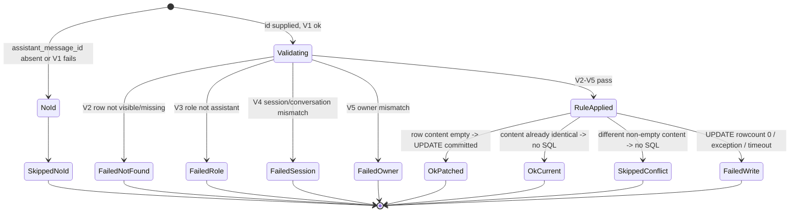

# Stage 2 — Backend-Owned Final-Answer Persistence (Design, REVISED)

**Date:** 2026-10-27 · **Mode:** DESIGN ONLY — no code, tests, migrations, commits, deploys, or restarts
**Repository:** `zhanlu_n8n_main_version` @ `62b23ca75` (tree includes uncommitted Stage 0 + Stage 1 work)
**Revision:** 2 — resolves the seven review issues. **Backend row creation is removed from Stage 2.**

All line references were re-derived from the current working tree this session. All SQL/RLS/race claims were executed
against the live database **as the application role** (`zhanlu_app`), not as a superuser.

---

## 0. Revision summary — what changed and why

| Review issue | Resolution in rev 2 |
|---|---|
| **1. No backend row creation** | **Removed.** `INSERT` is gone from the design entirely. Only an existing, verified row is updated; absent id → skip; unresolvable id → explicit failure. State machine and concurrency matrix rewritten (§4, §5). |
| **2. Client/backend write race** | **Investigated with a real interleaving test.** `SELECT FOR UPDATE` does **not** protect against the client writer — proven (§3.2). The race is characterised precisely, and the feature ships **flag-off** until the contract in §3.4 is accepted. |
| **3. Tenant/row ownership** | Six checks plus a **rowcount** check for RLS-silent zero-row updates; all verified as `zhanlu_app` (§2, §3.5). |
| **4. Bounded execution** | Corrected: persistence is **synchronous work offloaded via `asyncio.to_thread`**. `asyncio.wait_for` bounds the *await*, **not the thread** — proven. Real bound = `statement_timeout` + `lock_timeout`, currently **unset (0)** → the design sets them. (§6) |
| **5. Terminal semantics** | `persist="ok"` ⇔ committed. Status captured in a contextvar *immediately after* the commit decision; ambiguous-timeout case handled explicitly (§7). |
| **6. Four statuses** | `ok` / `failed` / `skipped_no_id` / `skipped_conflict` retained; conflict is reported **without** overwriting (§7.2). |
| **7. Regression matrix** | Rewritten with real PostgreSQL locking, ambiguous commits, timeout behaviour, and RLS tests run as the app role (§9). |

---

## 1. Verified facts, assumptions, recommendations

### 1.1 Verified facts (executed this session)

| # | Fact | Evidence |
|---|---|---|
| F1 | `chat_messages` PK = `id`; **no other unique constraint** | `pg_constraint`, `pg_indexes` |
| F2 | **`chat_messages` has NO foreign keys**; `session_id` is an unvalidated `varchar(36)` | `pg_constraint contype='f'` → empty |
| F3 | Isolation = **`READ COMMITTED`** | `SHOW transaction_isolation` |
| F4 | RLS **enabled + forced** on `chat_messages`, `chat_sessions`, `agent_conversations` | `pg_class` |
| F5 | Backend connects as **`zhanlu_app`**, `rolbypassrls = f`, **not** superuser | live query from inside `zhanlu-backend` |
| F6 | **Read isolation works**: rows outside the tenant context are invisible (0 rows) — verified **through the app's own SQLAlchemy session** | `SessionLocal()` + count query |
| F7 | **Cross-tenant INSERT rejected**: `new row violates row-level security policy` | `SET ROLE zhanlu_app` test |
| F8 | **Cross-tenant UPDATE is silently scoped**: returns `UPDATE 0`, **no error** | `SET ROLE zhanlu_app` test |
| F9 | **The client write path is a blind write**: `entities.py:495` PUT → `entity_service.update_record` (`:505`) does `SELECT` (**no `FOR UPDATE`**) → mutate ORM object → `commit()` | direct read |
| F10 | `ChatMessage` **is** user-scoped: the PUT applies `_apply_owner(... created_by_id == user.id)` (`entities.py:198-235`) | direct read |
| F11 | **`SELECT FOR UPDATE` does NOT stop the client overwrite** | interleaving test, §3.2 |
| F12 | Client-first ordering is **correctly handled** (backend sees non-empty → skips) | interleaving test, §3.3 |
| F13 | `asyncio.wait_for` **bounds the await only**; the worker thread **continues and completes** | executed test |
| F14 | `statement_timeout`, `lock_timeout`, `idle_in_transaction_session_timeout` are **all `0` (disabled)** server-wide; the app sets none (`connect_args={}`, no per-session SET) | `SHOW`, `database.py:12` |
| F15 | `statement_timeout` **does** bound execution when set per session (`QueryCanceled`) | executed test |
| F16 | Pool `pool_timeout = 30s`, `pool_size=20`, `max_overflow=40` | engine introspection |
| F17 | The existing final `conv.messages` commit already uses `await asyncio.to_thread(...)` + 3 retries + rollback + background reconcile (`agents.py:19930-19960`) — **the correct model to copy** | direct read |
| F18 | The existing experience hook uses `await asyncio.wait_for(asyncio.to_thread(fn), timeout=…)` (`agents.py:20048`) | direct read |
| F19 | The client's final `content` is `done.content` **verbatim** when `done` arrived non-empty (`Chat.jsx:2565-2567` → `resolveFinalContent` authority) | direct read |
| F20 | ReAct never inserts `chat_messages`; it only patches an existing empty row (`agents.py:19675-19715`, assign `19703`) | exhaustive grep |
| F21 | `persist` / `outcome` **do not exist** in the protocol | `grep '"persist"'` → 0 |
| F22 | Exactly **one** `_done_payload` construction (`20183`) + **one** normal `done` yield (`20203`) + one fallback inside `except` (`20206-20215`) | direct read |
| F23 | `chat_session_id` resolved at `agents.py:12971-12982`; plain string, survives generator entry | direct read |
| F24 | `MobileChatPage.jsx` has the same unguarded create (`:326`) + `content: fullContent` write (`:295`) | direct read |

> **Prior-session correction retained:** an early probe queried as the `zhanlu` **superuser** and wrongly suggested RLS
> does not enforce writes. F5–F8 re-tested as `zhanlu_app` show it does. This was a test-methodology error, and §9
> now mandates running RLS tests as the app role.

### 1.2 Assumptions (each has a test or an explicit fallback)

- **A1** The client reports the optimistic row's id (it already receives it from `ChatMessage.create`, `Chat.jsx:1446`).
- **A2** `chat_session_id` is stable for the turn (F23).
- **A3** Legacy clients and automations send no id → skip path (today's behaviour exactly).
- **A4** A client that never sends `done` (watchdog/reload) may have written a **stale** `fullContent` — the core race (§3.2).

### 1.3 Recommendations

- **R1** Ship with **no migration**; ship **flag-off** until §3.4's contract is accepted.
- **R2** Set `statement_timeout` / `lock_timeout` **per session** for the persist transaction only (F14 says nothing exists).
- **R3** Do **not** treat `SELECT FOR UPDATE` as protection from the client writer (F11).

---

## 2. Message identity and ownership contract

### 2.1 The client supplies the id (additive, optional)

```jsonc
POST …/agents/conversations/v3/{conversation_id}/messages/stream
{ "content": "…",
  "assistant_message_id": "<id from ChatMessage.create>",   // NEW, optional
  "turn_id": "<optional correlation id>" }                   // NEW, optional, non-authoritative
```

Read directly from `body`; not persisted via the entity API (F10's immutability filtering of `id` does not apply).

### 2.2 Six validation checks — **update-only, never create**

| # | Check | Rule | On failure |
|---|---|---|---|
| V1 | Syntax | `^[0-9A-Za-z-]{8,64}$` | `skipped_no_id` (treated as absent) |
| V2 | Exists + tenant-visible | `SELECT … WHERE id=:id` under the caller's tenant (F6) | **`failed`, reason `not_found`** — **never insert** |
| V3 | Role | `row.role == "assistant"` | `failed`, `wrong_role` |
| V4 | Session ownership | `row.session_id == chat_session_id` **and** that session's `conversation_id == conversation_id` | `failed`, `wrong_session` |
| V5 | User ownership | `row.created_by_id in (None, str(user.id))` | `failed`, `wrong_owner` |
| V6 | Org scope | `row.org_id == effective_org` (Python **and** RLS) | falls out at V2 (invisible) |

**Why the session→conversation hop is required:** `chat_messages` has no conversation column and no FK (F2). The link
is `chat_messages.session_id → chat_sessions.id → chat_sessions.conversation_id` (FK to `agent_conversations`).

**Why V5 is required despite RLS:** RLS scopes by **org**, not **user**; two users in one tenant can see each other's
rows. `created_by_id` is the only per-user boundary (F10 shows the entity layer relies on the same check).

**Absent id ⇒ no write. Unresolvable id ⇒ explicit failure. Never a create, never a guess.**

---

## 3. The client/backend write race (review issue #2)

### 3.1 The two writers, precisely

| | Backend (proposed) | Client (existing) |
|---|---|---|
| Operation | `SELECT … FOR UPDATE` → `UPDATE content` → `COMMIT` | `SELECT` (**no lock**, F9) → mutate ORM → `COMMIT` |
| Row selection | by PK | by PK |
| Content written | canonical final answer | `_final.content` — **`done.content` verbatim** when `done` arrived non-empty (F19); otherwise the accumulated stream |
| Ownership check | V1–V6 | `created_by_id == user.id` (F10) + RLS |

### 3.2 Proven: `SELECT FOR UPDATE` does **not** protect against the client (F11)

Executed interleaving (real Postgres, two sessions):

```
backend:  SELECT … FOR UPDATE  → locks row, reads content = ''
client:   SELECT (blind)       → does NOT block; reads content = ''   ← stale read
backend:  UPDATE content='BACKEND-ANSWER'; COMMIT
client:   UPDATE content='STALE-CLIENT';   COMMIT
FINAL: 'STALE-CLIENT'          ← backend answer destroyed
```

**Reason:** under `READ COMMITTED` a plain `SELECT` does not block on a `FOR UPDATE` lock and sees the
pre-commit snapshot. The client then commits its stale value last. **The backend cannot prevent this unilaterally.**

### 3.3 Proven: the reverse ordering is handled correctly (F12)

```
client:   UPDATE content='CLIENT-ANSWER'; COMMIT
backend:  SELECT … FOR UPDATE → sees 'CLIENT-ANSWER' (non-empty, ≠ canonical)
backend:  content rule → SKIP
FINAL: 'CLIENT-ANSWER'         ← untouched
```

So the content rule (§5.2) already makes the **client-first** case safe. Only **client-last** is unsafe.

### 3.4 When can the client actually write stale content?

| Scenario | Client's `content` | Equal to canonical? | Race risk |
|---|---|---|---|
| Normal completion (`done` received non-empty) | `done.content` (F19) | **Yes — identical** | **None**: both writers commit the same bytes |
| `done` received with **empty** content | falls back to streamed text (`resolveFinalContent`) | Possibly **different** | **Real** |
| Stream ended **without** `done` (watchdog 90 s / reload / server close) | accumulated streamed text | **Different** (no hygiene/dedupe/join applied) | **Real** |
| Stage 1 blocked the client write (empty/stale guard) | no write | n/a | None |

**Therefore the race is confined to turns where the client did not receive a non-empty `done`** — exactly the
degraded paths. This is narrow but real, and it is the case where the backend safety net matters most.

### 3.5 Options, and the recommendation

| Option | Mechanism | Verdict |
|---|---|---|
| **O1** Backend `FOR UPDATE` only | — | **Rejected** (F11) |
| **O2** Compare-and-swap on `updated_date` | backend remembers `updated_date`/content from its `SELECT`, then `UPDATE … WHERE id=:id AND content=:seen` — a 0-row result means the client changed it | Attractive, no migration (uses existing columns). **Not fully closed**: the client's blind write can still land *after* the backend's commit. |
| **O3** Client stops writing `content` when a non-empty `done` arrived | Client relinquishes content ownership only when the backend demonstrably persisted; metadata still written | **Fully closes the race — IMPLEMENTED 2026-10-27 (see §3.6)** |
| **O4** Serialise via an advisory lock both writers take | backend `pg_advisory_xact_lock(hash(id))`; client would also need to take it (client code change) | Requires frontend change; same class as O3 |
| **O5** Accept + report honestly | Backend persists; if a later client write differs, it overwrites — but `persist` was already reported truthfully for the backend's own commit | **Not acceptable** as a silent fallback; acceptable **only** with O3/O4 planned |

**Recommendation: ship with the flag OFF (default), and land O3 (client stops writing `content` when it received a
non-empty `done`) as the closing change before enabling.** Until then the backend write is a *best-effort safety net*
that improves durability for degraded turns but cannot *guarantee* last-writer-wins.

> **Honest statement of the guarantee at flag-on-without-O3:** the backend guarantees
> **(i)** it never overwrites a different non-empty answer, and **(ii)** it never reports `ok` unless *its own*
> transaction committed. It **cannot** guarantee that a subsequent stale client write will not overwrite it.
> That residual risk must be accepted explicitly, or O3 must land first. **This is the principal unresolved
> question (§11 U1).**

### 3.6 STATUS — O3 implemented (2026-10-27), C8 race CLOSED

O3 has landed as an approved frontend-only change (Stage 1 extension). The client now relinquishes
`content` ownership **only when a non-empty `done` arrived**, i.e. exactly when the backend has already
persisted the canonical answer.

**Implementation**
- `frontend/src/lib/answerLifecycle.js` — new `backendOwnsContent({hadTerminal, doneContent})`; `shouldPersistContent`
  gained a `backendOwnsContent` parameter returning `{writeContent: false, reason: 'backend_owns_content'}`.
- `frontend/src/pages/Chat.jsx` — computes `_backendOwns` before the final `ChatMessage.update` and passes it in.
  Metadata (`tool_calls`, `artifacts`, `sources`, …) is **still written**; only `content` is withheld.

**Why this is safe (verified ordering):** the backend persists `accumulated_content` into the empty optimistic row at
`agents.py:19761`, and emits `done` at `agents.py:20203`. Persist precedes emission, so a client that receives a
non-empty `done` can rely on the row already holding the canonical answer.

**The asymmetry that keeps it correct:** when **no** `done` arrives (watchdog, tab close, server close), the client
**remains** the writer. Otherwise the answer would never be persisted at all. O3 relinquishes ownership only in the
case where the server has demonstrably written it.

**Effect on the race matrix:** C8 (backend-first, stale client write) is no longer reachable on the `done` path,
because the client no longer writes `content` there. C7 (client-first) was already handled by the content rule.

**Regression evidence**
- 13 new behavioural tests in `frontend/src/lib/answerLifecycle.test.js` (41 total in that file).
- The C8 test is a genuine guard: **verified to FAIL when O3 is neutered** and pass when enabled.
- Full frontend suite: 27 failing tests, **identical names** to the pre-O3 baseline (zero regressions).

---

## 4. State machine (update-only)



All `Failed*` and `Skipped*` states map to `persist != "ok"`. **There is no create transition.**

---

## 5. Transaction and concurrency design

### 5.1 Transaction boundary

One short, dedicated transaction on a **fresh `SessionLocal()`** (not the shared `stream_db`, so a persist failure
cannot poison in-flight generator state):

```python
def _persist_final(...):           # runs in a worker thread (see §6)
    s = SessionLocal()             # after_begin fires the tenant SET LOCAL hook
    try:
        s.execute(text("SET LOCAL statement_timeout = '3000ms'"))
        s.execute(text("SET LOCAL lock_timeout = '1000ms'"))
        row = <V2 select by PK>    # RLS scopes to tenant
        <V3–V6 checks>
        <content rule → optional UPDATE>
        s.commit()                 # ONLY commit boundary
        return status
    except Exception:
        s.rollback(); return failed(...)
    finally:
        s.close()                  # returns the connection to the pool (F16)
```

**Why `SET LOCAL`:** F14 shows no server- or app-level timeout exists; without these, a lock wait could hang the
worker thread indefinitely (the client writer holds row locks during its transaction).

### 5.2 Content rule (safety core — unchanged from rev 1, creation removed)

```
row missing / not visible → persist=failed (not_found)        ← NO insert (rev 2 change)
row.content empty         → UPDATE content = canonical        → ok (patched)
row.content == canonical  → no SQL                           → ok (already_current)
row.content ≠ canonical   → no SQL                           → skipped_conflict
UPDATE rowcount != 1      → failed (rowcount_mismatch)        ← catches RLS silent no-op (F8)
```

### 5.3 Concurrency matrix (update-only)

| # | Scenario | Operations | Result | Status |
|---|---|---|---|---|
| C1 | Existing empty optimistic row | `SELECT FOR UPDATE` → `UPDATE` → commit | patched | `ok` |
| C2 | Row already holds the canonical text | `SELECT` only | no SQL | `ok` (already_current) |
| C3 | Row holds a different non-empty answer | `SELECT` only | untouched | `skipped_conflict` |
| C4 | Supplied id does not resolve | `SELECT` → none | no write | `failed` (not_found) |
| C5 | No id supplied (legacy/automation) | none | skip | `skipped_no_id` |
| C6 | Two concurrent backend updates | row lock serialises; second re-reads committed content | C2 or C3 | `ok`/`skipped_conflict` |
| C7 | **Client commits before backend** | backend `SELECT` sees client text | SKIP | `skipped_conflict` ✅ (F12) |
| C8 | **Backend commits before client** | client's stale blind write lands last | **client wins** | ⚠️ **unresolved** (§3.5) |
| C9 | Retry after ambiguous commit | re-`SELECT` by PK | C2 (no-op) | `ok` (already_current) |
| C10 | Overlapping turns, one conversation | distinct ids | disjoint rows | `ok` each |
| C11 | Row in another tenant | RLS hides → V2 | no write | `failed` (not_found) |
| C12 | Wrong session / role / owner | V3/V4/V5 | no write | `failed` |
| C13 | Lock wait > `lock_timeout` | cancelled by PG (F15) | rollback | `failed` (timeout) |
| C14 | `rowcount == 0` (RLS silent scope, F8) | detected | rollback | `failed` (rowcount_mismatch) |

### 5.4 No migration required

- Exact-row targeting: **PK** (F1).
- Tenant isolation: **RLS** (F6/F7) + rowcount check for F8.
- Never-clobber: **content comparison**.
- Retry idempotency: content equality (C9).

A `turn_id` column would make C9/C6 hard guarantees but is **not required**; deferred (§11 U4).

---

## 6. Bounded execution (review issue #4 — corrected)

### 6.1 Persistence is synchronous work, offloaded

The ORM is synchronous. **Correct statement:** persistence is a **blocking call executed in a worker thread**, never
on the event loop:

```python
status = await asyncio.wait_for(
    asyncio.to_thread(_persist_final, ...),
    timeout=PERSIST_WAIT_S,          # bounds the AWAIT
)
```

This mirrors the existing, proven pattern (F17, F18).

### 6.2 `wait_for` is **not** a hard timeout on the work (proven, F13)

```
await wait_for(to_thread(fn sleeping 1.0s), timeout=0.2)
→ TimeoutError raised to the caller at ~200 ms
→ the thread KEEPS RUNNING and completes at ~1.0 s
```

Consequences the design must handle:
- On `TimeoutError` the status is **`failed` (timeout)** and the terminal frame says so.
- **The abandoned thread may still commit.** This is an **ambiguous commit** (§6.4).

### 6.3 The real bounds

| Bound | Value | Purpose |
|---|---|---|
| `statement_timeout` (SET LOCAL) | **3000 ms** | bounds the actual SQL execution (F15 proves it works) |
| `lock_timeout` (SET LOCAL) | **1000 ms** | bounds waiting behind the client writer's row lock |
| `asyncio.wait_for` | **4000 ms** ( > statement_timeout) | bounds the caller's wait; must exceed the DB bound so the normal failure path is the DB one |
| `pool_timeout` | 30 s (existing, F16) | acquiring a connection |
| Session cleanup | `finally: s.close()` | returns the connection even on timeout/exception |

**Ordering rationale:** `wait_for (4 s) > statement_timeout (3 s) > lock_timeout (1 s)` so that the *database* is
normally the one to abort, producing a determinate `failed` status rather than an ambiguous abandoned thread.

### 6.4 Ambiguous-commit recovery

| Case | Handling |
|---|---|
| `TimeoutError` from `wait_for` | status `failed (timeout)`; a **background reconciliation task** re-checks the row by PK (mirrors F17's `_bg_reconcile_messages`) and logs the true outcome under the same `turn_id`. The terminal status stays `failed` — we do not claim success we cannot prove. |
| `QueryCanceled` (statement_timeout) | caught → `rollback()` → `failed (timeout)`; **no retry** inside the stream (a retry could double the delay) |
| `IntegrityError` | not applicable (no insert in rev 2) |
| Anything else | `rollback()` → `failed (exception)` |

**Status is written to a contextvar immediately after the commit decision**, before any further code that could raise
(§7.3), so `_guarantee_done` can read the truth even if the generator dies later.

---

## 7. Persistence vs delivery, and terminal semantics

### 7.1 Two invariants

| Invariant | Definition |
|---|---|
| **I-delivery** | the user received `done.content` (or a typed failure) |
| **I-success** | the canonical answer is durably in the `chat_messages` row |

**I-delivery ⇏ I-success.** A `done` with `persist != "ok"` still delivers the answer and honestly reports that it is
not durably confirmed.

### 7.2 Four statuses (review issue #6)

| Status | Meaning | When |
|---|---|---|
| `ok` | **this transaction committed** (patched or already identical) | C1, C2, C6, C9 |
| `failed` | identity invalid, or the write did not commit | C4, C11–C14, timeouts |
| `skipped_no_id` | no usable id supplied; backend did not attempt | C5, V1 |
| `skipped_conflict` | a **different non-empty** answer already occupies the row; **left untouched** | C3, C7 |

**Conflict reporting:** `skipped_conflict` is emitted with `persist_reason: "content_conflict"` and the row is **not**
modified. The client keeps displaying its own answer (which it wrote first), and the discrepancy is logged with both
lengths (never the text) for diagnosis. It is deliberately **not** `ok` (we did not persist our answer) and **not**
`failed` (nothing is broken).

### 7.3 Terminal contract (additive only, F21/F22)

```jsonc
{"type":"done","content":"…","trace":[…],"conversation":{…},
 "persist":"ok"|"failed"|"skipped_no_id"|"skipped_conflict",
 "persist_reason":"not_found"|"wrong_session"|"rowcount_mismatch"|"timeout"|"content_conflict"|null,
 "turn_id":"…"}
```

- All three keys are **new and additive**; no existing key changes meaning; the frontend reads by field access, so it
  ignores unknown keys today.
- **`persist:"ok"` is assigned only immediately after a successful `commit()`.** Single assignment site.

### 7.4 `_guarantee_done` — true status on every exit path

| Exit | `_guarantee_done` emits | `persist` |
|---|---|---|
| Normal `done` already emitted | nothing | as carried |
| Exception **after** commit | `done{content, persist:"ok"}` | `ok` (true) |
| Exception **before** commit | `error{persist:"failed", persist_reason:"stream_error"}` | `failed` |
| Silent return before commit | `error{persist:"failed"}` | `failed` |
| Silent return after commit | `done{persist:"ok"}` | `ok` |
| Timeout abandoned thread | `done{persist:"failed", persist_reason:"timeout"}` | `failed` (never `ok`) |

**Mechanism:** a contextvar `_persist_status` set **synchronously right after the commit decision**, read by
`_guarantee_done`; **if unset it assumes `failed`** (fail-safe).

### 7.5 Exactly one terminal

- One `_done_payload` (`20183`), one normal yield (`20203`); the fallback (`20206-20215`) runs only if that raised
  (F22).
- `_guarantee_done` emits only if `not _terminal_seen`.
- `CancelledError`/`GeneratorExit` re-raised untouched.
- Stage 2 adds **no** new terminal site. **K3 fix:** the fallback frame must also carry the contextual `persist`
  status, so a serialization failure after a successful commit does not under-report.

### 7.6 SSE ordering

```
1 canonical content finalised                     (existing 18844 → 20133)
2 RECONCILE: delivered != canonical → one content_replace
3 VALIDATE V1–V6                                  (new)
4 PERSIST (threaded, bounded)                     (new)
5 record persist + turn_id in agent_invocations   (extend 20161)
6 _done_payload with content=canonical, persist=… (20183)
7 exactly one terminal                            (20203)
```

Persist before terminal; reconcile before persist so the streamed text equals the persisted text.

---

## 8. Failure-mode table

| # | Failure | Detection | `persist` | User impact |
|---|---|---|---|---|
| 1 | No id | field absent | `skipped_no_id` | none; frontend write unchanged |
| 2 | Malformed id | V1 | `skipped_no_id` | none |
| 3 | Id in another tenant | RLS → V2 | `failed` (not_found) | shown, not durably confirmed |
| 4 | Wrong session | V4 | `failed` (wrong_session) | ditto |
| 5 | Wrong role | V3 | `failed` (wrong_role) | ditto |
| 6 | Wrong owner | V5 | `failed` (wrong_owner) | ditto |
| 7 | Row holds a different answer | content rule | `skipped_conflict` | previous answer kept |
| 8 | Client wrote stale after backend | **not detectable unilaterally** (§3.5) | was `ok` for our commit | **residual risk — see R1/U1** |
| 9 | Lock wait > 1 s | `lock_timeout` | `failed` (timeout) | shown, not confirmed |
| 10 | Statement > 3 s | `statement_timeout` | `failed` (timeout) | ditto |
| 11 | `wait_for` exceeded | `TimeoutError` | `failed` (timeout) | ditto; background reconcile logs truth |
| 12 | `rowcount == 0` | check | `failed` (rowcount_mismatch) | ditto |
| 13 | Commit raises | exception | `failed` | ditto |
| 14 | Client disconnected | generator continues (detached pump) | computed normally | saved server-side, unseen |
| 15 | Empty canonical | guard | no write (`failed`) | explicit placeholder/failure |
| 16 | Serialize `done` fails after commit | fallback | `ok` (true) | answer via reload |

**No row ever yields `persist:"ok"` without a committed transaction.**

---

## 9. Behavioural regression-test matrix (review issue #7)

All DB-level tests run against **real PostgreSQL** and, where RLS matters, as **`zhanlu_app`** — never superuser
(explicitly anti-false-green, §0 correction).

| # | Test | Method | Asserts |
|---|---|---|---|
| T1 | Existing empty row updated | seed empty row; call persist | content == canonical; `ok`; rowcount 1 |
| T2 | Idempotent repeated finalization | call twice | 2nd = `ok (already_current)`; **no duplicate row** |
| T3 | Exact-content retry after ambiguous commit | commit, then retry | `ok (already_current)`; one row |
| T4 | Different non-empty never overwritten | seed different answer | `skipped_conflict`; **original intact** |
| T5 | Missing id skips | no id | `skipped_no_id`; **row untouched, none created** |
| T6 | **Unresolvable id → failure, no create** | random valid-shaped id | `failed (not_found)`; **no row created** |
| T7 | Foreign tenant rejected | row in other org; caller in default; **as `zhanlu_app`** | `failed (not_found)`; row untouched |
| T8 | Wrong session / role / owner | 3 seeded variants | `failed` each; untouched |
| T9 | **Real PG locking: client-first** | client commit, then backend | `skipped_conflict` (F12) |
| T10 | **Real PG locking: backend-first** | backend commit, then stale client | **documents C8**: client wins → asserts the risk is known and flagged, not masked |
| T11 | Concurrent finalization (2 tasks) | `asyncio.gather`, two sessions | one effective write; `ok`; content == canonical |
| T12 | `rowcount == 0` path | force 0-row update | `failed (rowcount_mismatch)` |
| T13 | Lock timeout | hold row lock > 1 s in another session | `failed (timeout)`; rollback; session closed |
| T14 | Statement timeout | `pg_sleep` in persist | `failed (timeout)`; connection returned to pool |
| T15 | `wait_for` abandonment | patch persist to sleep past wait_for | terminal says `failed`; thread completes later → reconcile logs truth |
| T16 | Persist failure before terminal | force exception | `done` emitted with `persist=failed`; **never `ok`** |
| T17 | Terminal accuracy | drive generator with fake LLM + real DB | `done.persist` matches DB state |
| T18 | Exactly one terminal | collect frames | exactly one terminal type |
| T19 | Overlapping turns | two turns, two ids, interleaved | each row holds its own answer |
| T20 | RLS enforcement under app role | assert `current_user='zhanlu_app'`, `rolbypassrls=false` in-test | guards against false-green |
| T21 | Stage 1 protections intact | run `answerLifecycle` + `Chat.*` suites | unchanged pass set |
| T22 | FSM path unchanged | FSM stream suites | identical to baseline |
| T23 | No new terminal site | count `done` yields | exactly 1 normal + 1 fallback |

**T10** was a characterisation test for C8. **O3 has now landed (§3.6)**, so T10's expectations flip: with O3
active the client no longer writes `content` after a non-empty `done`. The frontend test
`O3 — the client/backend write race is closed > STALE client text cannot overwrite the backend answer`
encodes this and is verified to fail if O3 is removed.

---

## 10. Backward compatibility, rollout, rollback

| Concern | Position |
|---|---|
| Legacy/automation clients | `skipped_no_id`; behaviour identical to today |
| Regenerate | Same row id reused; rule applies |
| FSM route | **Untouched** (writes its own row, F20) |
| `MobileChatPage` (F24) | Sends no id → `skipped_no_id`; **its unguarded write persists as a known defect** — reported, not fixed |
| Third-party consumers | Additive fields only |
| **Old frontend bundles (pre-O3)** | A browser still running the pre-O3 bundle continues to write `content` after
  `done`, so it can still lose the last-writer race until it reloads. O3 closes the race for **updated** clients
  only. Not a correctness regression (identical to today's behaviour), but enablement should follow a client
  rollout, not precede it. |
| DB | **No migration** (§5.4) |

**Rollout:** `ANSWER_PERSIST_OWNED`, **default off**. Off ⇒ code path never entered ⇒ byte-identical behaviour.
Enable order: staging (observe `turn_diag` counters + `persist` distribution) → cohort → broad — **and only after O3
lands, or with an explicit written acceptance of residual risk C8.**

**Rollback:** flag off; no schema to revert; no backfill.

---

## 11. Risks and unresolved questions

### 11.1 Risks

- **K1 — C8 residual race — MITIGATED** by O3 (§3.6). Residual: a client running an OLD bundle (pre-O3) can still
  stale-overwrite until it reloads; see §10 compatibility note.
- **K2 — No DB timeouts today** (F14): the design adds `SET LOCAL` bounds; without them a lock wait could stall a
  worker thread for `pool_timeout`-scale durations.
- **K3 — `done` fallback frame** lacks `persist`; must be fixed or it under-reports.
- **K4 — Extra statement latency** on the critical path (bounded to ~ms; worst case 4 s).
- **K5 — Two writers** — reduced to one on the `done` path by O3; the client remains sole writer on the no-`done`
  path (by design).
- **K6 — Superuser CLI access** can bypass RLS during manual fixes.

### 11.2 Unresolved questions

- **U1 — RESOLVED (2026-10-27):** O3 has been implemented and verified (§3.6). C8 is closed for the `done` path, so
  the backend safety net can be enabled without accepting the residual race.
- **U2** `skipped_conflict`: should the UI surface it? (Stage 4.)
- **U3** Should the backend add compare-and-swap on `updated_date` (O2) as a partial mitigation if O3 is deferred?
- **U4** Add `chat_messages.turn_id` (migration) later for hard idempotency? Not required now.
- **U5** `MobileChatPage` unguarded write — separate stage?
- **U6** Should `persist=failed` be user-visible? (Stage 4.)
- **U7** Choose `PERSIST_WAIT_S`/`statement_timeout`/`lock_timeout` values with load testing (§6.3 proposes 4 s / 3 s / 1 s).

---

## 12. Approval request

Design only — nothing implemented. Requesting approval for:

1. **Update-only persistence** (no create; missing id → skip; unresolvable id → explicit failure) — §2, §4.
2. The six validation checks and the content rule — §2.2, §5.2.
3. Four statuses + additive terminal fields — §7.2, §7.3.
4. Threaded persistence with `SET LOCAL` bounds (4 s / 3 s / 1 s) — §6.
5. Flag `ANSWER_PERSIST_OWNED` default **off** — §10.
6. **U1 decision**: accept residual race C8, or require O3 before enablement.

Confirmed: no code, tests, migrations, commits, deploys, or restarts. Stage 0/Stage 1 files untouched; the seven
pre-existing dirty files unmodified; all probe rows removed (verified 0 remaining).
