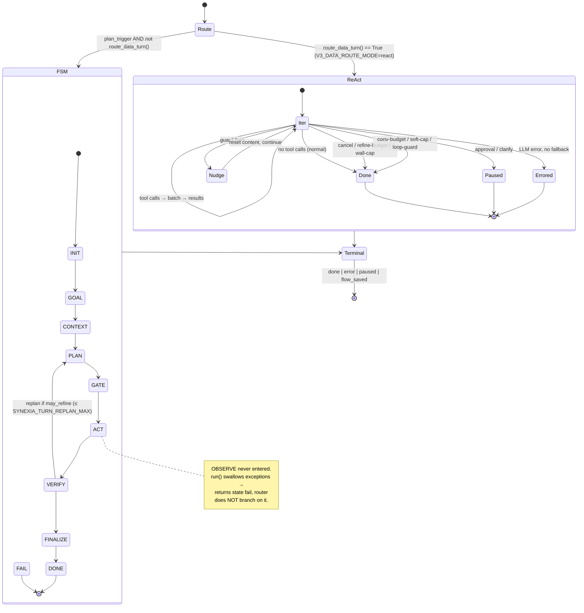
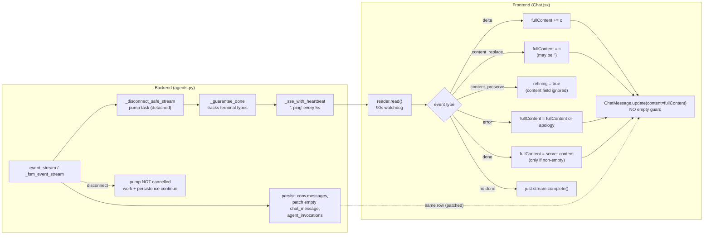
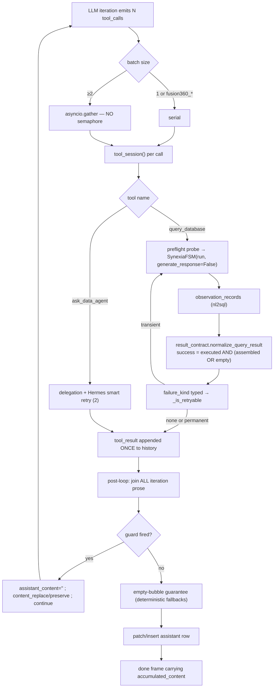

# Zhanlu Agent Orchestration — End-to-End Architecture

**Date:** 2026-10-27 · **Mode:** READ-ONLY investigation (no code changed, nothing committed, no container restarted)
**Scope:** one user message → frontend request → backend orchestration → persisted + rendered assistant answer.
**Subject conversation:** `1414bb16-dcd1-43ed-8477-41f1b35534e9` / ChatSession `b39f6a62-609b-407b-80a1-cec178cc294c`
**Branch / HEAD:** `fix/automation-chat-artifacts-ordering` @ `62b23ca75`

All paths are relative to the repository root. Line numbers were read from the working tree at HEAD `62b23ca75`
(which includes the uncommitted-at-the-time R1 change; the tree has unrelated dirty files listed in §12).

---

## 0. Verdict up front

The reported "answer appears → collapses → another answer is generated" is **not one defect**. Code tracing plus live
data show **four independent mechanisms with different triggers**, and they are frequently confused with each other:

| # | Mechanism | Trigger | Status |
|---|---|---|---|
| **A** | **Deferred re-synthesis wipes and re-generates the answer after it was already streamed.** ~13 "nudge" sites set `assistant_content = ""` and continue the loop; three sites also emit `content_replace` with `content:""`. | A guard fires on an answer the model already produced (promise phrase, apology, bounce-back, empty-answer, hallucination, file/pptx guard, goal contract…). | **Confirmed in code**; consistent with live logs. |
| **B** | **`done.content` ≠ what the user saw, and ≠ what is persisted.** `done.content` is a `"\n\n"` join of **all** iterations, while the UI only ever holds the **last** iteration's text (after `content_replace`) — so `done` always replaces the bubble with a different string and the client writes that string back over the row. | Every multi-iteration turn that streamed prose in >1 iteration. | **Confirmed in code.** |
| **C** | **Client-side Regenerate wipes the bubble and pops the server's history copy.** `handleRegenerate` resets the bubble to `content: ''`; the backend pops the previous assistant message. | User clicks Regenerate. | **Confirmed in code** (deliberate, but it is literally "collapse then answer again"). |
| **D** | **Empty assistant rows are invisible and can be written empty.** The render filter hides any assistant message with falsy `content` unless it is the streaming one; the client's final `ChatMessage.update` writes `content: fullContent` with no empty guard. | Stream ends without a `done` that carries text, or an error frame arrives before any text. | **Confirmed in code.** |

**Two widely-believed causes are disproved by this investigation:**

1. **"The FSM top-level route loses the terminal `done` frame."** The subject conversation **never took the FSM
   top-level route**. `V3_DATA_ROUTE_MODE=react` makes `route_data_turn()` return `True`
   (`backend/app/services/turn_router.py:152-166`), and at `03:10:54.750` the log records
   `v3 add_message_stream: phase3 react route — FSM narrator retired for this turn (was data-bound-override)`.
   Both `agent_invocations` rows for the conversation are `route=react`. The **R1 fix (commit `62b23ca75`) hardens a
   route this conversation did not use**; R1 is still a correct hardening, but it **cannot** be the root cause here.
2. **"Duplicate assistant `ChatMessage` rows per turn."** Live data has exactly **4 rows for 2 turns**
   (§6.2) — one assistant row per turn. The ReAct path **never inserts** an assistant row; it *patches the
   frontend's existing empty row* (`backend/app/routers/agents.py:19686-19711`, patch at `:19703`), and the FSM
   path skips its own insert on `regenerate`. The duplicate-row hypothesis is **refuted by data**.

> **Naming discipline used below.** *Route* = which top-level pipeline ran (`FSM` vs `ReAct`). *Turn* = one user
> message and everything that answers it. *Iteration* = one LLM call cycle inside the ReAct loop. *Execution* = one
> `executions` row, which on the ReAct route is **one `query_database` tool call's internal FSM**, not a turn (§6.4).

---

## 1. Frontend request and rendering lifecycle

### 1.1 The three send paths (and which one agent chat uses)

`frontend/src/pages/Chat.jsx` has **three** send implementations that must not be confused:

| Path | Entry | Transport | Reachable for agent chat? |
|---|---|---|---|
| **Agent (v3)** | `handleSend` → `handleAgentSend` (`Chat.jsx:2099`) | `POST …/conversations/v3/{id}/messages/stream` via `streamAgentResponse` (`frontend/src/api/agentEnhanced.js:107-198`) | **Yes — the normal path.** |
| **Legacy raw LLM** | `handleAgentSend` non-agent branch | `POST …/integration-endpoints/Core/InvokeLLMStream` (`Chat.jsx:1691`) | No (requires `effectiveAgent` falsy). |
| **Legacy non-stream** | same, fallback | `base44.integrations.Core.InvokeLLM` (`Chat.jsx:1759`) | No. |

This document follows the **agent (v3)** path, because that is what the subject conversation used.

### 1.2 Submission and optimistic assistant-message creation

1. `handleSend` (`Chat.jsx:1253`) bumps the generation counter: `const gen = ++genRef.current` (`:1254`).
2. An **empty assistant `ChatMessage` is created in the DB *before* any network call**:
   `base44.entities.ChatMessage.create({ session_id: sid, role: 'assistant', content: '', order: current.length })`
   (`Chat.jsx:1446-1448`, agent path). *This is the origin of every "0-char assistant row" in the data.*
3. It is appended to React state and marked as the streaming bubble (`:1454-1455`).
4. **Mid-turn steer guard:** if a v3 stream is already in flight for this session, the send is diverted:
   `if (effectiveAgent && stream.isActiveForSession(activeId) && streamingConvId) return handleSteer(fullText);`
   (`Chat.jsx:1436-1438`). A second concurrent *stream* in the same session is therefore **not reachable from the
   composer**. `ChatInput.jsx:110` and `:207` both route through `disabled`, so Enter cannot bypass it either.

### 1.3 HTTP/SSE connection creation and consumption

`streamAgentResponse` (`frontend/src/api/agentEnhanced.js:107-198`):

- `fetch` with the caller's `AbortSignal` (`:113-121`); non-2xx throws (`:123-125`).
- Reads via `resp.body.getReader()` + `TextDecoder` (`:127-129`).
- **Watchdog:** `WATCHDOG_MS = 90000` (`:136`); each `reader.read()` races a 90 s timer (`:143-150`). On timeout it
  yields a synthetic `{type:'error', message:'…no data for 90s…'}` and `return`s (`:153-165`).
- **Framing:** splits on `\n\n`, takes only lines starting `data: ` (`:172-184`); a trailing partial is flushed (`:188-194`).
- `finally { reader.releaseLock() }` (`:195-197`). **There is no reconnection logic** — an interrupted stream is
  never resumed; the turn is lost client-side.

*(Minor, verified: the `setTimeout` in the watchdog is never cleared, leaking one timer per chunk. Harmless but real.)*

### 1.4 Event handling (`Chat.jsx:2297-2650`)

| Event | Handler | Effect on the bubble |
|---|---|---|
| `fsm_state` | `:2308-2315` | sets `fsm_state` on the message |
| `plan_summary` | `:2316-2322` | **adds** a `plan_summary` object (never clears content) |
| `reasoning_delta` / `reasoning_done` | `:2323-2440` | separate reasoning field |
| **`delta`** | `:2441-2451` | `fullContent += evt.content`; sets bubble content |
| **`content_preserve`** | `:2452-2466` | reads **only `evt.reason`**; sets `refining: true`. **The `content` field is ignored** |
| **`content_replace`** | `:2467-2482` | `fullContent = evt.content` — **replaces the whole bubble, including with `''`** |
| **`error`** | `:2483-2496` | `fullContent = fullContent \|\| friendlyErr` |
| `paused` | `:2497-2526` | finalises with placeholder, `stream.complete()` |
| **`done`** | `:2527-2646` | takes server content **only if non-empty** (`:2540-2542`); persists; `stream.complete()` |
| *(stream ends without `done`)* | `:2648-2650` | only `stream.complete()` — **no terminal handling, no error shown** |

### 1.5 Assistant-message identification, replacement, collapse, finalisation

**Identity.** The React/DOM identity is the client-created `aiMsg.id` (`Chat.jsx:1446`). The backend's own
`chat_messages` id is a *different* UUID (`agents.py:12719-12728`) — but the ReAct route never inserts it, so on
this route **the client id is the only row id** (verified against live data, §6.2).

**Finalisation.** After the loop, unconditionally:
```js
await base44.entities.ChatMessage.update(aiMsg.id, { content: fullContent, ... });   // Chat.jsx:2724-2733
```
There is **no guard that `fullContent` is non-empty** — note the `done` handler computes `_finalContent` with a
placeholder (`:2590-2594`) but feeds it only to `updatePendingMessage`, **not** to this DB write.

### 1.6 Every condition that clears content or starts another response

**Clears / replaces content (frontend):**

| Site | Condition |
|---|---|
| `Chat.jsx:2467-2482` | any `content_replace`, **including `content: ""`** |
| `Chat.jsx:2441` | `delta` after a `content_replace("")` restarts from empty |
| `Chat.jsx:2483-2496` | `error` before any text → generic apology replaces nothing |
| `Chat.jsx:2766-2767` | **Regenerate**: `content: '', tool_calls: [], artifacts: [], sources: []` |
| `Chat.jsx:3308` | **render filter hides** `role==='assistant' && !content` unless `m.id === streamingId` |
| `Chat.jsx:2814-2831`,`:2833-2848` | Clear / Delete set `setMessages([])` |

**Condition that starts another response / generation:**

| Site | Condition |
|---|---|
| Backend nudge sites (§3.5) | guard fires on an already-produced answer → `continue` + `assistant_content = ""` |
| `Chat.jsx:2749-2812` `handleRegenerate` | user action; reuses the same bubble id |
| `Chat.jsx:1905-1937` | automation auto-retry — **gated on `isCreateAutomationRequest`**, unreachable for agent chat |
| `Chat.jsx:704-729` | autorun prefill — fires once (`autorunProcessedRef`) |

---

## 2. Backend request lifecycle

### 2.1 Route handlers and call chains

**Primary route:** `POST /apps/{app_id}/agents/conversations/v3/{conversation_id}/messages/stream`
→ `add_message_stream` (`backend/app/routers/agents.py:11583-11584`), a ~8.6k-line function.

Pre-stream (synchronous, inside the request):

| Step | Line |
|---|---|
| conversation 404/403 checks | `:11604-11611` |
| `TraceContext.set(...)` (RBAC tool filtering) | `:11618-11623` |
| resolve owning `ChatSession` → `chat_session_id` | `:11630-11640` |
| effective LLM resolution (project → agent → user) | `:11674-11698` |
| cost-ledger tenant context | `:11705-11712` |
| vision bridge → `_fsm_user_message` | `:11760-11773` |
| build `user_msg` | `:11775-11786` |
| **`regenerate` handling** | `:11797-11801` → `_resolve_regenerate_turn` (`:924-971`) |
| append user msg + **early commit of the user message** | `:11807-11825` |
| **workflow branch** → `StreamingResponse` | `:11838-11941` |
| **response-cache hit branch** → `StreamingResponse` | `:11943-12069` |
| routing heuristics (data-bound / data-tool / force_planning) | `:12246-12357` |
| LLM turn router (`V3_LLM_ROUTER_MODE=on`) | `:12368-12405` |
| **Phase 3 `route_data_turn`** (react mode retires the FSM narrator) | `:12414-12435` |
| **FSM branch** → `StreamingResponse` | `:12437-12898` |
| ReAct setup (`event_stream` def begins) | `:13522` |
| **ReAct `StreamingResponse`** | `:20179-20181` |

There are **four** `StreamingResponse` return points: `:11935` (workflow), `:12063` (cache hit), `:12869` (FSM),
`:20179` (ReAct).

### 2.2 Streaming-generator creation, execution, yielding, termination

The four wrapper legs are **not uniform** — this is a real asymmetry:

| Branch | Wrapper stack | Terminal guarantee | Detached pump |
|---|---|---|---|
| Workflow `:11935` | `_sse_with_heartbeat(_workflow_stream())` | ❌ none | ❌ generator dies with response |
| Cache hit `:12063` | `_sse_with_heartbeat(_cache_hit_stream())` | ❌ none | ❌ |
| FSM `:12885-12887` | `_sse_with_heartbeat(_guarantee_done(_disconnect_safe_stream(_fsm_event_stream)))` | ✅ (added by R1) | ✅ |
| ReAct `:20180` | `_sse_with_heartbeat(_guarantee_done(_disconnect_safe_stream(event_stream)))` | ✅ | ✅ |

**`_sse_with_heartbeat`** (`agents.py:3853-3882`): races `it.__anext__()` against a timeout
`_SSE_HEARTBEAT_INTERVAL` (`:3450`, env `ZHANLU_SSE_HEARTBEAT_S`, default 5 s) and yields `": ping\n\n"` on
timeout (`:3874-3875`). `finally` (`:3876-3882`) cancels the pending `__anext__` and `aclose()`s the inner gen.

**`_guarantee_done`** (`agents.py:3885-3955`): tracks terminal types `("done","error","paused","interrupted","flow_saved")`
(`:3901`). Re-raises `CancelledError`/`GeneratorExit` (`:3912-3913`); on any other `BaseException` logs with
`exc_info=True` and yields a synthetic `done` carrying
`_GENERIC_EMPTY_CONTENT_FALLBACK` = *"I gathered some information but had trouble putting it all together…"*
(`backend/app/services/agent_loop/fallbacks.py:24-27`; emission `agents.py:3924-3931`). **Critical:** if the
inner generator ended without a terminal frame, it emits an **`error`**, not a `done` (`:3946-3955`) — and the
frontend turns that into a generic apology (`Chat.jsx:2491`).

**`_disconnect_safe_stream`** (`agents.py:3958-4029`): runs the real generator in a **detached pump task**
(`_pump`, `:3986-4015`) feeding an `asyncio.Queue`; the outer generator drains the queue. On client disconnect the
`finally` (`:4024-4029`) **deliberately does not cancel the pump** — "detached by design". Consequences:
- **Tool work and post-processing continue after the client stream ends**, and they still persist.
- The `done` frame produced after disconnect is queued and discarded.
- A pump exception is converted to an `error` frame (`:3994-4008`) — which, if the client is already gone, is lost.

### 2.3 Terminal-event guarantees, timeouts, cancellation

- **Exactly-once is *intended* but not *enforced*.** `_guarantee_done` only *detects* a terminal frame by substring
  matching on `'"type": "done"'` etc. If an inner generator yields two `done` frames, both pass through.
- **Cancellation.** `POST /cancel` → `backend/app/services/run_control.py:43-50` sets a flag; the ReAct loop checks
  it at `agents.py:14192-14199`. The registry is an **in-process `set` of conversation ids** (`run_control.py:21-23`)
  with **no exclusivity and no run id** — two concurrent turns on one conversation share one cancel flag, and
  `unregister_run` (`:35-41`) *discards* the flag, so a finishing turn can clear a pending cancel for another.
- **Client disconnect does not cancel work** (§2.2), and `request.is_disconnected()` is **never consulted** on this
  path (grep: zero hits in `agents.py`).
- **Wall clock.** The loop checks a wall cap only at the **top** of an iteration (`:14255-14287`); one long tool
  batch can overrun it arbitrarily. Extensions require "new call signatures" (`:14259-14264`).
- **HTTP status is not completion.** The access-log `200 OK` line is emitted when the `StreamingResponse` is
  *returned*, not when its body finishes. Verified: turn 1 logged `200 OK` at `03:11:09.281` while its executions
  only started at `03:11:16` and ran to `03:19:56` (§6.3).

### 2.4 Assistant-message persistence and audit records

**ReAct route (the one the subject conversation used):**
- No `ChatMessage` insert. The assistant row the frontend created is **patched**:
  `agents.py:19686-19715` sets `_last_asst.content = accumulated_content` **only if the row is currently empty**.
- Conversation history is rewritten as a whole: `conv.messages = list(messages)` (`:19864`).
- `agent_invocations` row: `route="react"`, written **before** the `done` frame (`:20095-20124`, `done` emitted at `:20135`).

**FSM route:**
- `Message(...)` insert **only** `if chat_session_id and not _regenerate` (`agents.py:12714-12732`).
- `conv.messages` append (`:12731-12739`), experience hooks (`:12752-12782`), `done` (`:12784-12814`),
  `agent_invocations` **after** `yield done_payload` (`:12818-12849`).

---

## 3. Agent orchestration

### 3.1 Route selection (which brain runs)

```
should_trigger_planning()                     agents.py:12247
  ├─ follow-up refinement override            :12264-12270
  ├─ data-bound override                      :12296-12311   ← fires for the subject conv (bound=1)
  ├─ data-tool override                       :12319-12343
  └─ automation force_planning                :12351-12357
LLM turn router (V3_LLM_ROUTER_MODE)          :12368-12405
Phase 3: route_data_turn()                    :12414-12435   ← V3_DATA_ROUTE_MODE=react ⇒ FSM retired
if _v3_plan_trigger and is_fsm_enabled(): FSM  :12437
else: ReAct event_stream()                     :13522
```

Runtime flags observed in the `zhanlu-backend` container: `SYNEXIA_FSM_ENABLED=true`,
`V3_LLM_ROUTER_MODE=on`, `V3_DATA_ROUTE_MODE=react`. **With these values a data turn is answered by ReAct, and the
FSM survives only as the engine *inside* the `query_database` tool.**

### 3.2 ReAct/v3 path (the production path)

1. **Setup** (`:13522-14186`): shadow `stream_db` session, re-fetch `conv`/`agent_app`/`user`, system prompt,
   tool schemas, guard controller, budgets.
2. **Loop** `for iteration in range(_v3_max_iterations)` (`:14187`), bound `_v3_max_iterations` from
   `_effective_max_tool_iterations` (`:14060`, `:3493-3497`: fast mode 10, else 40), `agent_app.max_iterations`
   override (`:14072`), dashboard override (`:14066`).
3. **Per-iteration LLM stream** via `_stream_llm_with_tools` (`:14726-14900`); `delta` yielded at `:14793`.
4. **Tool batching**: `parsed_calls` (`:15743-15761`); `execute_tool_batch`
   (`backend/app/services/agent_loop/tool_executor.py:207-209`) uses **bare `asyncio.gather` with no semaphore**
   (unbounded concurrency); single call and `fusion360_*` are serial. Each call gets its **own DB session** via
   `tool_session()` (`agents.py:16960`, `backend/app/database.py:96`).
5. **Retries** (three stacked layers, §3.4).
6. **Loop exit** paths → §3.3.
7. **Post-loop**: multi-iteration join (`:18844`), recovered-best (`:18865`), strips, deferred synthesis, empty-bubble
   guarantee, `content_replace` emissions, persistence, `done` (`:20125-20135`).

### 3.3 Loop termination paths (ReAct)

| # | Guard | Line | Effect |
|---|---|---|---|
| 1 | user cancel (`run_control`) | `:14192-14199` | `break`, `_v3_cancelled=True` |
| 2 | refinement budget exhausted **with restorable content** | `:14211-14226` | restores preserved text, `break` |
| 3 | wall-clock cap (with extensions) | `:14255-14287` | `break` |
| 4 | conversation iteration budget | `:14289-14294` | `break` |
| 5 | dynamic soft cap | `:14299-14369` | `break` (suppressed while goal contract unmet) |
| 6 | tool loop guard (2nd trip) | `:14388-14449` | `break`; 1st trip grants a tool-free pass |
| 7 | batch-replay guard | `:15794` | `break` |
| 8 | approval pause | `:17116` + `:18199-18208` | `paused` + `return` |
| 9 | clarify | `:17995` | `break` → turn suspended |
| 10 | guard-controller halt | `:18034` | `break` |
| 11 | **normal completion** (no tool calls) | `:15740` | `break` |
| 12 | LLM error with no fallback | `:15068/15110/15131` | persist error, `error` frame, `return` |

**None of these paths is a "final answer" boundary.** Every one falls through to the same post-loop section, which
may run further LLM synthesis and may **replace** the streamed text.

### 3.4 Tool selection, batching, retries

- **Selection:** the model emits tool calls; the loop executes them. `query_database` and `ask_data_agent` are the
  data tools.
- **Parallel execution:** unbounded `asyncio.gather` (`tool_executor.py:207-209`), per-call DB session. Verified
  live: two executions created 4–6 ms apart with **different** sub-questions (§6.4).
- **Retry layers:**
  1. `run_tool_with_reliability` — `TOOL_RELIABILITY_MAX_RETRIES` (default 2 total attempts) + one arg
     reformulation.
  2. `execute_tool_with_retry` — `TOOL_RETRY_MAX_ATTEMPTS` (2), **skipped when `failure_kind` is present**.
  3. "Hermes smart retry" — **`ask_data_agent` only**, `_smart_retry_budget = [2]` (`:13516`, call at `:17240`), `:17139-17265`.
- **Retries re-run the tool but never append a second tool-result message** to history — only the final result is
  appended (`:17886`, `:17906`).
- **`_is_retryable` default is `True`** for unknown failures (`backend/app/services/agent_tools.py:322-368`) — this
  is exactly the amplifier that the 2026-10-27 result-contract work (`backend/app/services/db/result_contract.py`)
  addressed for `query_database`.

### 3.5 Deferred response generation and final-answer synthesis — the collapse engine

**`done.content` is not the text the user saw.**

```python
# agents.py:18844
accumulated_content = "\n\n".join(c for c in _v3_iter_contents if c).strip()
```
`_v3_iter_contents` holds **every** iteration's prose. But mid-turn the client is shown either individual `delta`s
or, after a nudge, a `content_replace` containing **only the current iteration's** accumulation. So at `done` the
client jumps from "last iteration's text" to "all iterations joined" — a visible swap (§4 mechanism B).

**The nudge/re-synthesis sites** (each sets `assistant_content = ""`, most set `_nudge_replacement_pending = True`,
then `continue`):

| Guard | Line | Emits |
|---|---|---|
| goal contract unmet | `:15227-15246` | `content_preserve` `goal_contract` (`:15243`) |
| promise-strip | `:15270-15303` | `content_preserve` `""` `promise_strip` (`:15299`) |
| apology force | `:15337` | `content_preserve` |
| bounce-back force | `:15371` | `content_preserve` |
| empty-answer force | `:15417` | `content_preserve` |
| hallucination guardrail | `:15446` | `content_preserve` |
| CAD verify / DFM | `:15493`, `:15528` | `content_preserve` |
| verify nudge | `:15551` | `content_preserve` |
| pptx / file guard | `:15591`, `:15640` | `content_preserve` |
| dashboard narration | `:15696` | `content_preserve` |
| delegation enforce | `:15733` | `content_preserve` |
| soft-cap promise-as-answer | `:14325-14350` | **none** |

On the *next* iteration's first delta the loop emits a one-shot `content_replace` with the replacement text
(`:14787`), so the bubble flips: old text → (replacement) text. **Because `content_preserve` deliberately carries
`""` at `:15299` and the frontend ignores that field anyway (`Chat.jsx:2452-2466`), the visible continuity depends
entirely on the browser not having been told to clear — which is why `:14746`, `:14856` and `:14933` are the only
literal *clears*, and why they look like "the answer collapsed".**

**The promise detector is a regex on the last sentence** (`backend/app/services/goal_contract.py:74-78`):
`\b(let me|i'll|i will|i'm going to|let's|…)\b`, excluded only for quoted text, past-tense markers, or offer phrases
(`:80-88`, `:166-176`). A perfectly good answer whose final sentence says *"I'll also break this down by customer"*
arms a full re-synthesis.

### 3.6 FSM path (still live: automation, `force_planning`, and **inside `query_database`**)

- `SynexiaFSM.run` (`backend/app/services/synexia/fsm.py:297-436`) runs
  `INIT → GOAL → CONTEXT → PLAN → GATE → ACT → VERIFY → FINALIZE`, with a bounded VERIFY→PLAN re-plan loop
  (`:378-411`, `SYNEXIA_VERIFY_REPLAN_MAX` default 1) gated by `refinement_budget.may_refine`
  (`backend/app/services/synexia/refinement_budget.py:75-86`, keyed on `execution_id`, `COUNT(*)` of `Plan` rows,
  cap `SYNEXIA_TURN_REPLAN_MAX` default 2).
- **`OBSERVE` is never entered** — observations are written during `ACT` (`fsm.py:389-390`).
- **`run()` swallows every exception** and returns `ExecutionResult(state="fail", assistant_content="I encountered an
  error while processing your request: {e}")` (`fsm.py:424-436`). It does **not** set `completed_at`, does **not**
  persist `assistant_content`, and **the router never branches on `fsm_result.state`** (only `:12788`/`:12855`
  copy it into payloads). Consequence: on the FSM route a *failed* execution still streams a normal-looking LLM
  narrative from `stream_final_response`, whose prompt is **rebuilt** because `_deferred_response_prompt` was never
  stashed (`fsm.py:1413-1415`).
- **SSE path leaves `execution.assistant_content = ""` by design**: `generate_response=False` at
  `agents.py:12590-12596` ⇒ `fsm.py:872-875` stashes `_deferred_response_prompt` and writes `""`.
- Actor-level replan at `backend/app/services/synexia/capability_router.py:236-291`; parallel ready-batch pre-pass
  (`PLAN_DAG_PARALLEL_ENABLED` default True, `:105-118`) with isolated sessions.
- `observation_records.duration_ms` is **never written** on this path (confirmed live: all NULL, §6.5).

### 3.7 `query_database` and `ask_data_agent`

- **`query_database`** (`backend/app/services/tool_handlers/query_database_tool.py:185-451`):
  preflight TCP probe (`:250-257`) → fresh session → **one `SynexiaFSM` per call** (`:297-312`) with
  `generate_response=False` → `normalize_query_result` (`:307`) → in-flight dedup by request fingerprint
  (`:314-340`, `backend/app/services/db/query_dedup.py`).
- **`ask_data_agent`** (`backend/app/services/tool_handlers/delegation_tools.py:346`) — the delegation variant; it is
  the only tool the "Hermes smart retry" layer applies to.

---

## 4. State and persistence ownership

| State | Owner / authoritative store | Durability | Notes |
|---|---|---|---|
| **User message** | `agent_conversations.messages` (JSON array) + `chat_messages` (client-created) | durable | early commit `agents.py:11809-11825` |
| **Assistant message (rendered)** | `chat_messages` row created **by the frontend** (`Chat.jsx:1446`) | durable | ReAct patches it in place (`agents.py:19686-19715`) |
| **Assistant message (history)** | `agent_conversations.messages[-1]` | durable | whole-array rewrite, `agents.py:19864` |
| **Conversation id** | `agent_conversations.id` | durable | one per chat |
| **ChatSession id** | `chat_sessions.id`; `chat_messages.session_id` FK | durable | FSM route resolves it at `:11630-11640` |
| **Turn** | **no first-class row** | — | reconstructed; see §4 hazard T1 |
| **TaskSpec** | `executions.task_spec` | durable | per *execution*, i.e. per `query_database` call |
| **Execution** | `executions` (`backend/app/models/execution.py`) | durable | **one per FSM run = one tool call**, not one turn |
| **Plan / PlanNode** | `plans` / `plan_nodes` | durable | `Plan.status` never leaves `"draft"` |
| **Tool call (frontend view)** | `tool_calls_for_frontend` in memory → `conv.messages` | durable at turn end | `last 50` kept (`agents.py:19809`) |
| **Tool result** | `role:"tool"` message in `conv.messages`; large ones spilled to disk (`tool_result_persistence.py`) | durable | |
| **Canonical DB result** | `observation_records` (`result_data`, `result_text`) | durable | `duration_ms` NULL on FSM path |
| **Normalized contract** | computed, `backend/app/services/db/result_contract.py` | **in-memory, recomputed** | recovery reads `observation_records` by execution id (never re-runs SQL) |
| **Stream events** | in-flight only; `live_events` persisted on the message | partially durable | |
| **Final-answer content** | `done.content` → client `fullContent` → `chat_messages.content` | durable | **three copies, written in that order, last writer wins** |
| **Invocation/audit** | `agent_invocations` | durable | `route`/`outcome` filled |
| **Cancel flag** | `run_control._CANCELLED` | **in-memory, per process** | lost on restart; not multi-worker safe |
| **SSE pump/queue** | asyncio objects | in-memory | survives client disconnect only in-process |

**Reconstructed state:** the turn boundary, "which iteration produced the visible text", and the relationship
between a `chat_messages` row and its `executions` rows are all **inferred at read time, never stored**.

---

## 5. Competing answers and lifecycle hazards

### 5.1 Verified defects (code + data)

| ID | Defect | Evidence |
|---|---|---|
| **V1** | **Post-answer re-synthesis clears and regenerates.** Denied by guard, not by user. | 13 sites `agents.py:15227-15733` + `:14325-14350`; clears `:14744`, `:14854`, `:14931`; `content_replace ""` at `:14746`, `:14856`, `:14933` |
| **V2** | **`done.content` joins all iterations while the UI holds only the last** → unavoidable visible swap at `done`. | `agents.py:18844` vs `Chat.jsx:2540-2585` |
| **V3** | **Client writes `fullContent` over the row with no empty guard** → a stream that ends without `done` writes a stale partial; an `error`-only stream writes the apology text. | `Chat.jsx:2724-2733`; `done` accepts only non-empty `:2540` |
| **V4** | **Empty assistant rows are invisible.** | `Chat.jsx:3308` |
| **V5** | **Regenerate collapses the bubble and pops server history.** | `Chat.jsx:2766-2767`; `agents.py:964-971` |
| **V6** | **A `failed` FSM execution still streams a confident narrative.** | `fsm.py:424-436` + `agents.py:12625`; router never checks `fsm_result.state` |
| **V7** | **Missing terminal frame on two of four stream branches** (workflow, cache-hit). | `agents.py:11935`, `:12063` |
| **V8** | **`_guarantee_done` emits `error` (→ generic apology) rather than a content-bearing terminal frame**, discarding any text already streamed. | `agents.py:3946-3955` + `Chat.jsx:2491` |
| **V9** | **Work continues after the client stream ends** and persists anyway; the late `done` is dropped. | `agents.py:4024-4029` |
| **V10** | **Cancel is not per-run** and is cleared by any turn finishing. | `run_control.py:21-41` |
| **V11** | **`conv.messages` is a whole-array JSON column with no lock**; concurrent writers lose updates. | `backend/app/models/agent_conversation.py:15`; no `with_for_update` anywhere in `agents.py` |
| **V12** | **No LLM call boundaries on the heartbeat path during blocking post-loop work** → client watchdog (90 s) can fire while the server is still "working", producing an `error` that the client persists. | `agentEnhanced.js:136-165` |
| **V13** | **`plan_summary.status` is always `"draft"`**; nothing advances it. UI can render an incomplete plan forever. | `fsm.py:1027-1053` |
| **V14** | **`observation_records.duration_ms` always NULL on the FSM path** — the timing question cannot be answered from data. | `capability_router.py:1375-1406`; live §6.5 |

### 5.2 Theoretical risks (not observed)

- **R1.** Two concurrent turns on one conversation are *possible* only via a second client, a direct API call, or a
  race before `streamingConvId` is set (`Chat.jsx:1436`). If it happens, `conv.messages` loses one answer (V11).
- **R2.** `startSending` replaces `abortRef.current` **without aborting the previous controller**
  (`PersistentStreamContext.jsx:144-150`); after `complete()` sets it to `null` (`:152-157`), Stop is a no-op for the
  fetch (`:162-170`). Cross-session only.
- **R3.** `error` frame arriving **after** a complete answer: the backend emits `done` before post-`done` work, so
  this ordering is **not proven**; if it happens the apology replaces the answer (`Chat.jsx:2491`).
- **R4.** Duplicate assistant `ChatMessage` rows on the FSM route when `regenerate` is used (its insert is skipped,
  but the frontend reuses the original id) — consistent, but unexercised in the data.

### 5.3 Refuted hypotheses

| Hypothesis | Verdict | Basis |
|---|---|---|
| FSM top-level route lost its `done` frame in conv `1414bb16` | **Refuted** | the turn took the ReAct route (`turn_router.route_data_turn`, Phase 3 log at `03:10:54.750`; `agent_invocations.route='react'`) |
| Duplicate assistant rows per turn | **Refuted** | 4 rows / 2 turns (§6.2); ReAct never inserts |
| A second concurrent stream in one session from the composer | **Refuted** | steer guard `Chat.jsx:1436-1438` |
| `abort()`/Stop clears the answer | **Refuted** | Stop appends `[Stopped generating.]` (`Chat.jsx:2656-2658`) |
| The 2026-10-27 result-contract fix caused this | **Refuted** | `query_timing … status=succeeded/assembled` in the same window; it *reduces* retries |
| Frontend clears content spontaneously on its own | **Refuted** | every clear is either a `content_replace` from the server or the render filter (V4) |

---

## 6. Runtime evidence

### 6.1 Method

Read-only: `docker logs zhanlu-backend --timestamps`, `psql` SELECTs on `zhanlu-postgres`, and source. No writes, no
restarts. Log lines are emitted pre-wrapped at ~80 columns, so they were reflowed for reading; timestamps are UTC.

### 6.2 `chat_messages` — one assistant row per turn, and the 0-char row

```
      t       |   role    | len  | ord |    id
--------------+-----------+------+-----+----------
 03:10:52.210 | user      |   37 |   0 | cbd83d68
 03:10:52.245 | assistant |    0 |   1 | b5eb6d0d   ← created by the FRONTEND, before any work
 03:17:58.798 | user      |   37 |   2 | 482c8d7d   ← genuine user re-send, 7 min later
 03:17:58.815 | assistant | 5875 |   3 | 7f8bfbb2
```
The 0-char row is **client-created** (`Chat.jsx:1446-1448`), timestamped *before* the request was even sent. Turn 1
never reached the patch at `agents.py:19686-19715` (that patch logs `v3 empty-bubble guarantee: persisted …`, which
appears for other conversations at `03:30:02` and `03:35:40` but **not** for `1414bb16`).

### 6.3 Turn 1 timeline (reconstructed)

| Time | Event | Source |
|---|---|---|
| 03:10:52.245 | frontend creates empty assistant row | `chat_messages` |
| 03:10:53.285 | `v3 pre-FSM data ctx … bound=1` | log |
| 03:10:53.290 | `data-bound override — routing to SynexiaFSM` | log |
| **03:10:54.750** | **`phase3 react route — FSM narrator retired (was data-bound-override)`** | **log — decisive** |
| 03:11:09.281 | `POST …/messages/stream → 200 OK` | access log — **headers only, not completion** |
| 03:11:16.620/.626 | executions `98427a20`, `8874021a` created | `fsm.py:341` |
| 03:14:17 / 03:14:42 | both executions `DONE`, confidence 1.00 | log |
| 03:14:42.819 | `v3 stream checkpoint saved … msgs=2 tool_calls=2` | log |
| 03:14:46.109 | execution `d54ee447` created (third sub-question) | log |
| 03:17:58.798 | user re-sends the same text | `chat_messages` |
| 03:17:59.082 | turn 2 routed (same two log lines) | log |
| 03:18:03.327 | turn-2 `200 OK` | access log |
| … | turns interleave; turn 1's stream never logs a completion line | — |

**What is proven and what is not.** Proven: turn 1 ran on ReAct; its answer text was produced by the *inner*
`query_database` FSMs (grounded narration lives in `observation_records.result_text`, §6.5); the assistant row was
never filled; no `agent_invocations` row exists for turn 1 (`agent_invocations` rows are `03:23:24` and `03:26:45`
only). **Not observable today:** *when and why* turn 1's generator ended — there is **no** explicit
"stream closed" log line on this route. The competing explanations (client watchdog aborted the reader at 90 s
without data; the browser tab was reloaded at `03:17:53` — the `GET …/AgentConversation/1414bb16` calls — killing
the stream; or the generator raised) **cannot be separated from the current logs**. This is an instrumentation gap,
recorded as **U1** in §11.

### 6.4 `executions` — a per-tool-call ledger, not a per-turn ledger

```
    id    |  created   |  done   | state | conf | aclen | question (truncated)
 8874021a | 03:11:16.583 | 03:14:42 | done | 1.00 |  0 | For the sales order view …, total revenue … and order count
 98427a20 | 03:11:16.589 | 03:14:17 | done | 1.00 |  0 | Top 10 materials by revenue …
 d54ee447 | 03:14:46.077 | 03:19:56 | done | 0.88 |  0 | … daily revenue totals by PLANDATE, and separately the …
 9378f5d7 | 03:18:09.849 | 03:20:35 | done | 1.00 |  0 | Daily revenue … and order count for each day
 23c598b2 | 03:18:09.859 | 03:20:43 | done | 0.82 |  0 | Top 10 customers by revenue
 e6258e3f | 03:20:01.890 | 03:23:10 | done | 0.82 |  0 | Daily revenue for 2026-10-19 …
 1a3d03da | 03:21:09.369 | 03:24:21 | done | 0.57 |  0 | … week … versus the week before …
 5b4ef2d5 | 03:21:09.377 | 03:26:26 | done | 0.78 |  0 | … revenue booked on 2026-10-22 alone
```
- **`assistant_content` is `0` on all 8** — expected on the SSE/deferred path (`fsm.py:872-875`), and **not** by
  itself evidence of failure.
- The near-simultaneous pairs (4–6 ms) carry **different questions** → these are **parallel `query_database` tool
  calls**, not a duplicated turn. This matches the earlier caller-trace result and is re-confirmed here by the
  distinct `user_message` values.
- **Turns interleave.** Turn 1's executions (`d54ee447` 03:14:46→03:19:56) overlap turn 2's (`9378f5d7` from
  03:18:09). Because **checkpoints rewrite the whole `conv.messages` array**, turn 2's checkpoint overwrote turn 1's
  history — see §6.6.

### 6.5 `observation_records` — the data was retrieved; the answer never landed

```
    ex    |seq| typ        |success| duration_ms | rtext_len | preview
 98427a20 | 0 | nl2sql     | t     |  (NULL)     | 1323      | **HEADLINE** Isoprene (material 202000001) is the single largest …
 8874021a | 0 | nl2sql     | t     |  (NULL)     | 1086      | 1. **HEADLINE** — Current-week revenue reached 105,920,951.334 …
 98427a20 | 4 | synthesize | t     |  (NULL)     |   68      | Retrieved 40 rows from the bound data source. …
 d54ee447 | 3 | nl2sql     | f     |  (NULL)     |    0      | (failed — no error_message captured in the sample)
```
`duration_ms` is **NULL for every row** (V14). Grounded narration exists in `result_text`, so "empty answer" here
means *empty at the turn boundary*, not *no data*.

### 6.6 `agent_conversations.messages` — turn 1's history is gone

```
 n |    roles        | updated
 2 | ["user","assistant"] | 10-27 03:26:45
```
The conversation history holds **only turn 2**. Turn 1's assistant entry was destroyed by a later checkpoint
(`agents.py:18140-18167` (`base = list(messages)` at `:18140`) builds `base = list(messages)` from the *current* row and appends a placeholder with
`content: ""`), i.e. last-writer-wins on a whole-array JSON column (V11).

### 6.7 Tests as evidence

- `backend/tests/test_fsm_stream_terminal_guarantee.py` — pins the **wrapper composition** only. Its parity test
  inspects source text (`inspect.getsource`, `:194-205`), not runtime behaviour; nothing asserts that content
  survives.
- Several frontend "contract" tests assert **source substrings** rather than behaviour
  (`Chat.doneAuthoritative.test.jsx`, `Chat.regenerateCitations.test.jsx`, and 15 of 20 `Chat.*.test.jsx` files use
  `readFileSync`). **No existing test fails if an answer is replaced or lost**, provided the strings remain.

---

## 7. Architecture diagrams

### 7.1 Complete request-to-answer sequence

```mermaid
sequenceDiagram
    autonumber
    participant U as User
    participant C as Chat.jsx
    participant P as ChatInput
    participant S as agentEnhanced.streamAgentResponse
    participant B as agents.py add_message_stream
    participant L as ReAct event_stream
    participant T as tool_executor
    participant Q as query_database → SynexiaFSM
    participant D as PostgreSQL / customer DB
    participant M as chat_messages

    U->>P: type + Enter
    P->>C: handleSend(text)  [gated by disabled, NOT by streaming]
    C->>C: gen = ++genRef.current
    C->>M: create assistant row, content empty (client id, BEFORE network)
    C->>C: setStreamingId(aiMsg.id)
    alt stream already active for session
        C->>B: POST /steer  (NOT a second stream)
    else idle
        C->>S: streamAgentResponse(convId, {content, regenerate?})
        S->>B: POST /v3/{conv}/messages/stream
        B->>D: append user msg + COMMIT (early)
        B->>B: route: data-bound → FSM? → Phase 3 react ⇒ ReAct
        B-->>S: StreamingResponse (wrappers) — 200 OK logged HERE
        S-->>C: (header) start reading
        B->>L: pump task starts (detached)
        loop iterations (≤ _v3_max_iterations)
            L->>S: SSE frame type=delta
            S-->>C: yield evt
            C->>C: fullContent += delta; setMessages
            L->>T: execute_tool_batch (gather, own session each)
            T->>Q: query_database(question)
            Q->>D: SQL (dynamic schema, grounded)
            D-->>Q: rows
            Q-->>T: normalized contract result
            T-->>L: tool results (1 tool msg appended)
            L->>L: checkpoint → conv.messages with empty content  ← overwrites history
        end
        L->>L: post-loop: guards, nudges, synthesis, join ALL iterations
        opt guard fired (promise/apology/bounce-back/…)
            L->>S: content_preserve or content_replace-to-empty 
            L->>L: reset assistant_content ; continue loop
        end
        L->>D: patch empty assistant row (only if still empty)
        L->>S: SSE frame type=done, content = join(all iterations)
        S-->>C: done
        C->>C: fullContent = server content (if non-empty)
        C->>M: UPDATE content = fullContent   (no empty guard)
        C->>C: stream.complete(); setStreamingId(null)
    end
```

### 7.2 Orchestration state machine and termination paths



### 7.3 Frontend/backend SSE and persistence lifecycle



### 7.4 Tool execution, result normalization, and final-answer generation



---

## 8. Ownership and invariants

### 8.1 Who owns the authoritative final answer

**No single component owns it today.** There are three copies written in sequence, each able to overwrite the last:

1. the streamed text the user saw (client `fullContent`, assembled from `delta` + `content_replace`);
2. `done.content` = `"\n\n".join(_v3_iter_contents)` (`agents.py:18844`) — a *different* string whenever >1
   iteration streamed prose;
3. the DB row, written by the **client** at `Chat.jsx:2724`.

**Recommended ownership (not implemented):** the **backend** owns the final answer, materialised exactly once at
the turn boundary and persisted **before** the terminal frame; the client becomes a pure renderer that accepts
server content and only ever *appends* intermediate deltas. The `done` frame already exists and already carries the
text — the invariant to add is "persist first, then emit".

### 8.2 When a turn is complete

Today: **when the generator's post-loop section finishes** — which is *not* the same as "when a terminal frame was
sent" (the client may be gone, §2.2) and *not* the same as "when the last answer text was streamed".

Invariant to adopt: a turn is complete when **(a)** the loop has terminated for a recorded reason, **(b)** the final
content has been persisted, and **(c)** exactly one terminal frame has been attempted. Record the reason (`V3_3`)
so "why did it end" is answerable from data.

### 8.3 When an assistant message may be persisted as successful

An assistant message is persistable-as-successful only if it has **non-empty content** *or* an explicit typed
outcome (`failed`, `paused`, `cancelled`) — never a silent empty string. Today neither the client
(`Chat.jsx:2724`) nor the ReAct patch (`agents.py:19686-19715`, which correctly requires non-empty) enforces this
consistently: the client side lacks the guard the server side has.

### 8.4 Retries and parallel tools vs one user turn

- A **turn** may contain many **tool calls**, many **executions** (one per `query_database`), and many **LLM
  calls**. None of these is a turn.
- Retries must be **invisible** to the answer (they are — only the final result enters history) but they must be
  **visible in telemetry** (they are not: `duration_ms` is NULL, and there is no retry counter on the turn).
- Parallel tools must not share mutable state. DB sessions are isolated (`tool_session`), but `TOOL_CONTEXT` is a
  **module-level global mutated by every call** (`backend/app/services/agent_tools.py:501-502`) — a real
  cross-talk risk (theoretical, not observed).

### 8.5 Cancellation and client disconnection

- Intended: cancel → loop breaks at the next iteration, partial content finalised, `done{status:"cancelled"}`.
- Actual: cancel is a per-conversation **in-process** flag shared by all runs of that conversation
  (`run_control.py:21-41`); it is cleared when *any* run unregisters.
- Disconnect: work **continues** and persists (deliberate). Therefore "the user saw nothing" and "the turn
  succeeded" are independent facts — which is exactly turn 1 of the subject conversation.

### 8.6 Exactly-once terminal delivery and idempotent persistence (intended vs actual)

| Property | Intended | Actual |
|---|---|---|
| exactly one terminal frame | `_guarantee_done` | *at least* one — it never suppresses a second `done` |
| terminal frame carries the answer | yes | `done` does; the synthetic fallbacks carry a generic apology and **`error`** (`:3946-3955`) |
| persist before terminal | implied | **no** — `done` is emitted and persistence relies on the client (ReAct) |
| idempotent write | implied | **no** — last writer wins on `chat_messages.content` and on `conv.messages` |
| resumable after disconnect | implied | **no** — no reconnection, no resume on this route |

---

## 9. Dynamic customer databases and the NL2SQL result contract in this architecture

**The requirement is preserved and is not implicated in the collapse.** Nothing in V1–V14 depends on the customer's
schema.

**How an unknown schema is handled (all dynamic; no per-customer code):**

1. **Catalog ingestion (offline, per knowledge base).** `backend/app/services/knowledge_graph/catalog_indexer.py:132`
   `index_kb_catalog` → `:502-562` `_introspect_tables_sync` uses the dialect connector
   (`backend/app/services/db/connector_factory.py:59-133`; `sqlite/mysql/mariadb/postgres/mssql/oracle`) to
   `list_tables()` and introspect each table, persisting `KBTableMeta`/`KBColumnMeta` + LLM descriptions +
   relations/join edges.
2. **Readiness gate (per query).** `backend/app/services/db/readiness.py:269-395`.
3. **Grounding (two-phase).** Deterministic candidate retrieval over the catalog
   (`backend/app/services/db/table_retrieval.py:218-484`) → LLM table selection **restricted to catalog names**
   (`backend/app/services/db/nl_answer_service.py:2069-2161`; unknown names are rejected, `:2131-2143`) →
   DDL/M-Schema rendering for the selected tables only.
4. **SQL generation + execution.** `nl_answer_service.py:1244-1282` → `QueryService.execute`
   (`backend/app/services/db/query_service.py:56-253`) → connector. DB-error self-repair uses the **database's own
   error text** (`_repair_sql_after_db_error`, `nl_answer_service.py:2202`).
5. **Result contract.** `backend/app/services/db/result_contract.py` computes `success` from two orthogonal axes
   (`execution_status` × `result_status`, `:116-127`): a zero-row query is a **success**; extraction failure after
   SQL ran is **not**, and recovery reads `observation_records` by execution id **without re-running SQL**
   (`:169-206`). `failure_kind` is always emitted so retries are typed-first (`:133-163`).

**Where it plugs into orchestration:** the contract decides **whether a tool call retried**, not **whether the turn
succeeded**. The turn's answer is still produced by the ReAct post-loop (V1/V2), which knows nothing about the
contract. This separation is correct and should be kept: **do not** "fix" the collapse by changing the NL2SQL layer
or the contract.

**Evidence it is working:** live `query_timing: result_contract.py:456 status=succeeded/assembled … rows=2` in the
subject window, and grounded prose in `observation_records.result_text`.

---

## 10. Ranked root-cause candidates for answer-collapse / regeneration

Ranked by (a) code certainty, (b) how well the symptom is explained, (c) whether live data supports it.
**None is labelled "the confirmed root cause" — the evidence does not single out one.**

| Rank | Candidate | Explains "collapse" | Explains "regenerates" | Explains "empty persisted" | Confidence |
|---|---|---|---|---|---|
| **1** | **V1 — post-answer nudge clears and re-synthesises** | ✅ `content_replace ""` / internal reset | ✅ a new LLM generation genuinely begins | ➖ | **High** (code certain; trigger frequency unmeasured) |
| **2** | **V3 — client writes `fullContent` unconditionally; streams that end without `done` leave stale/empty rows** | ✅ bubble ends empty/stale | ➖ | ✅ 0-char row | **High** |
| **3** | **V2 — `done.content` = join of all iterations ≠ visible text** | ✅ visible swap at `done` | ➖ | ➖ | **High** |
| **4** | **V9/V12 — work detached from a client that stopped reading; watchdog fires at 90 s** | ✅ | ➖ | ✅ (turn 1) | **Medium** — matches turn 1's shape, but no close log exists (**U1**) |
| **5** | **V5 — Regenerate wipes bubble + pops history** | ✅ by design | ✅ by design | ➖ | **High** as a *user-triggered* variant; UI may be reporting it as a bug |
| **6** | **V4 — empty rows hidden by render filter** | ✅ answer "disappears" | ➖ | ➖ | **High** as an amplifier of 1–5 |
| **7** | **V6 — failed FSM execution still narrates** | ➖ | ➖ | ➖ | **Medium**; affects FSM route only |
| **8** | **V7/V8 — missing terminal frame / `error` instead of content on 2 of 4 branches** | ✅ apology replaces answer | ➖ | ✅ | **Medium**; not exercised by the subject conversation |

---

## 11. Confirmed defects, hypotheses, unresolved questions

### Confirmed defects (§5.1)
V1 V2 V3 V4 V5 V6 V7 V8 V9 V10 V11 V12 V13 V14.

### Hypotheses (not proven — do not act as if confirmed)
- **H1.** Turn 1's stream was killed client-side (tab reload at `03:17:53` or the 90 s watchdog) rather than by a
  server exception. *Would be settled by U1's instrumentation.*
- **H2.** The *frequency* of V1 is driven mainly by `pending_action_phrase` matching ordinary closing sentences.
  *Would be settled by counting nudge firings per turn.*
- **H3.** The user's "another answer appears" was a post-`done` client refresh showing a *duplicate* rendering of the
  same row (needs U3 to distinguish from a genuine second generation).

### Unresolved questions / missing instrumentation
- **U1.** No log line records **why/when a stream generator terminated** (client gone vs. exception vs. normal).
  Add an explicit close log with `is_disconnected()`, terminal-frame-sent, and exit reason.
- **U2.** `execution_records.duration_ms` is never written → cannot separate slow DB from slow orchestration
  (V14).
- **U3.** No turn id: `chat_messages` rows, `executions`, and `agent_invocations` cannot be joined deterministically.
- **U4.** Nudge/guard firings are logged ad hoc, not counted, so V1's real-world frequency is unknown.
- **U5.** `TOOL_CONTEXT` is process-global (`agent_tools.py:501-502`); parallel-call cross-talk unmeasured.
- **U6.** Whether any deployment runs multiple backend workers (would make `run_control` and the detached pump
  behaviour materially different).

---

## 12. Minimal diagnostic plan and proposed regression tests

### 12.1 Diagnostic plan (read-only until reviewed; lowest-risk first)

| Step | Action | Answers |
|---|---|---|
| D1 | Add a **stream-close log** in `_sse_with_heartbeat`/`_disconnect_safe_stream` finally: conversation id, terminal frame seen, `request.is_disconnected()`, exception type, duration. (Instrumentation only.) | **U1**, H1, V9 |
| D2 | Emit a **`turn_id`** for each `add_message_stream` invocation into every log line and into `agent_invocations`/`chat_messages` (nullable column) | U3 |
| D3 | **Count nudge firings** per turn (one structured log per site at `:14325-15733`) | **U4**, H2, V1 frequency |
| D4 | Capture `duration_ms` in `_record_observation` (`capability_router.py:1375-1406`) | U2, V14 |
| D5 | Replay the subject conversation in a staging stack with D1–D4 and compare `done.content`, client `fullContent`, and the DB row from one turn | V2/V3 |
| D6 | Contract test on the SSE stream: assert **the text the client accumulated equals `done.content`** for turns with ≥2 prose iterations | V2 |

**Do not** infer completion from a `200 OK` access-log line (§2.3); correlate on `turn_id` + terminal frame instead.

### 12.2 Proposed regression tests

| # | Test | Expected |
|---|---|---|
| T1 | ReAct turn where a nudge fires after prose was streamed | final `done.content` is non-empty **and** equals what the client rendered; no `content_replace ""` is emitted unless followed by replacement text in the same iteration |
| T2 | Stream ends without `done` (server generator returns silently) | client does **not** persist a stale/empty content over the server row; user sees an explicit outcome |
| T3 | `error` frame after a complete answer | the answer is kept; the error is presented additively |
| T4 | ReAct turn with 2 prose iterations | `done.content` == union of iterations **and** the client's accumulated text == that union |
| T5 | FSM route, `fsm.run` returns `state="fail"` | router does **not** stream a confident narrative; user gets an explicit failure; `done`/`error` is terminal and typed |
| T6 | Every stream branch (workflow, cache-hit, FSM, ReAct) | all four are wrapped with `_guarantee_done`; parity test asserts the **runtime** stack, not source text |
| T7 | Two turns on one conversation overlapping (synthetic) | `conv.messages` contains both answers; no lost update |
| T8 | Cancel while two runs registered for one conversation | only the targeted run stops |
| T9 | Regenerate | old answer is replaced **with** an explicit "regenerating" state and is recoverable on failure |
| T10 | Empty final content | persisted as a typed outcome, never a silent 0-char success |

---

## 13. Recommended remediation sequence

Ordered by value ÷ risk. **Nothing here is implemented.** Each item states affected files and risk.

| # | Change | Files | Risk | Why now |
|---|---|---|---|---|
| **0** | **Instrument first** (D1–D4). No behaviour change. | `agents.py` (`_sse_with_heartbeat`, `_disconnect_safe_stream`, loop), `capability_router.py` | **Very low** | Without U1/U3 every later fix is unverifiable. |
| **1** | **Make the answer authoritative-and-persisted-before-terminal**: persist the final content on the server, then emit `done`. | `agents.py` (`:19686-19715`, `:20125-20135`) | **Medium** — touches the persistence ordering | Fixes V3's root cause instead of its symptom. |
| **2** | **Define one content-of-record**: either the streamed text or the join — and stream the join's increments, so `done.content` never surprises the client. | `agents.py` (`:18844`, `:14787`) | **Medium** | Fixes V2. |
| **3** | **Guard the client write**: never write empty/stale `fullContent`; prefer `done.content`; keep the previous row on non-terminal endings. | `Chat.jsx:2724-2733`, `agentEnhanced.js` | **Low** | Fixes V3/V4 without backend changes. |
| **4** | **Make nudge re-synthesis explicit and bounded**: emit a typed `refining` frame with the *preserved* content, and never `content_replace ""`. | `agents.py:14325-15733` | **Medium-high** — many sites | Addresses V1, the top-ranked candidate. |
| **5** | **Branch on `fsm_result.state`** in the FSM route; a `fail` must not narrate. | `agents.py:12625` | **Low** | V6. |
| **6** | **Wrapper parity** for the workflow and cache-hit branches. | `agents.py:11935`, `:12063` | **Low** | V7. |
| **7** | **Per-run cancellation** (run id + reference count instead of a conversation set). | `run_control.py`, `agents.py` | **Low-medium** | V10. |
| **8** | **Optimistic concurrency for `conv.messages`** (version column or append-only message table). | `models/agent_conversation.py`, `agents.py` | **High** — schema + all writers | V11; largest blast radius, schedule last. |

**Reuse, do not replace.** The existing ReAct loop, `result_contract`, dynamic-schema grounding, and SSE wrapper
stack are sound. Every item above is a delta to existing code; **no parallel orchestration system is warranted** —
the defects are ordering/ownership bugs in the current one, not missing capability.

### 13.1 Explicitly NOT recommended

- Rewriting the NL2SQL pipeline, the dynamic schema discovery, or `result_contract.py` — none is implicated (§9).
- Adding a second orchestration loop or a new "answer writer" service — the current one can satisfy the invariants
  in §8 with the items above.
- Treating R1 (`62b23ca75`) as the fix for this conversation — it hardens a route the conversation did not use.

---

## 14. Prior hypotheses reconciled

Three earlier documents exist for this same symptom. This investigation **confirms, corrects, or refutes** them:

| Prior claim | Status now |
|---|---|
| `2026-10-27-answer-regeneration-investigation.md` D1: "one user turn creates two full FSM executions" | **Refuted** (and already retracted by its own successor) — 8 executions / 2 turns, each a `query_database` call |
| …D2: `executions.assistant_content` empty by design on SSE | **Confirmed** (`fsm.py:872-875`) — but note it is empty for *all* executions and is **not** itself the defect |
| …D3: the persisted row was 0 chars | **Confirmed** — but caused by the **frontend** creating it + never patching it (§6.2) |
| `2026-10-27-d1-caller-trace-results.md` §4: "the request ended before the work finished" | **Refuted as stated** — `200 OK` is logged at `StreamingResponse` return (§2.3); the response stayed open |
| `2026-10-27-sse-early-termination-trace.md` H2 "SETTLED" | **Self-contradictory** in the document (it declares H2 settled and then lists H2 as an open hypothesis). Correctly resolves to: the `200 OK` is not completion |
| …"the FSM route never emitted `done`" | **Not applicable to conv `1414bb16`** — that conversation took ReAct (§6.3). The underlying asymmetry (FSM missing `_guarantee_done`) **was real** and **has been fixed** by R1 |
| …"`agent_invocations` has no row for turn 1 ⇒ generator never finished" | **Confirmed as an observation**, but **consistent with** the ReAct route + client-cancel (U1), *not* proof of a missing terminal frame |
| R1 commit `62b23ca75` | **Correct hardening, wrong target for this incident** |
</content>
