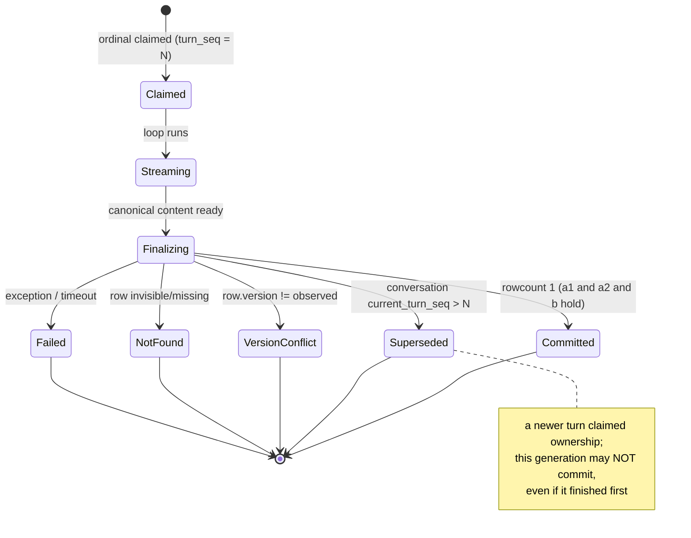

# Stage 2B — Durable Turn Identity and Successor Safety (Design)

**Date:** 2026-10-27 · **Mode:** DESIGN ONLY — no code, migrations, commits, deploys, or restarts
**Repository:** `zhanlu_n8n_main_version` @ `62b23ca75` (22 dirty entries preserved)
**Supersedes the successor-proof algorithm** in `2026-10-27-agent-answer-persistence-stage2-concurrency-design.md` §5.

**REV 4 (2026-10-27).** Resolves the final review issues: (1) the claim now **binds and verifies** the assistant message (`ON CONFLICT DO UPDATE … WHERE mid = EXCLUDED.mid`), with a deterministic `claim_message_mismatch` rejection — executed, including under concurrency; (2) the contradictory `nextval()` statements are replaced by the **measured** behaviour (it *is* evaluated on the conflict path; gaps are expected and harmless); (3) §5.1b labels every test `[EXEC]` / `[EXEC-PRIOR]` / `[SPEC]` so no invariant is presented as proven on unexecuted evidence. Rev 3 notes follow.

**REV 3 (2026-10-27).** Rev 3 accepts the reviewer's finding that **`last_request_id` is not idempotent** (executed: two concurrent same-`request_id` claims allocated ordinals **1 and 2**), and replaces it with a **durable `agent_turn_claims` mapping** plus an atomic claim (executed: same id ×3 → one allocation; distinct ids → 1,2,3). **Note: Rev 3 wrote this claim as `ON CONFLICT DO NOTHING`; Rev 4 replaced it with the guarded `ON CONFLICT … DO UPDATE … WHERE` upsert (§1.2) because `DO NOTHING` cannot reject a mismatched message id. Rev 4 is authoritative.** Rev 2 notes follow.

**REV 2 (2026-10-27).** Incorporates the reviewer's finding that `UPDATE … FROM` does **not** lock the source row.
I disproved my own rev-1 TOCTOU proof by execution and replaced it with an **explicit `SELECT … FOR UPDATE`** protocol
(§2.4–§2.5), verified bidirectionally. **Q1 and Q2 are resolved** per approval (§8).

Verified by execution this session: atomic claim (`UPDATE … SET seq=seq+1 … RETURNING`), the reviewer's
counter-example, **source-row locking disproved (proceeded in 0–6 ms)** vs **target-row locking confirmed
(blocked at 1207 ms)**, and **explicit source locking confirmed (blocked 1207 ms, both directions)**.
All other Stage 2 approvals (U-M1 `version`, U-E1 enforcement, exact id targeting, 8-writer audit) are retained.

---

## 0. The correction

My proposed condition `incoming_turn_seq > row.committed_turn_seq` is **wrong**, exactly as you demonstrated:

| Step | Event | `row.committed_seq` | Result under my condition |
|---|---|---|---|
| 1 | Gen **10** claims | 0 | — |
| 2 | Gen **11** claims (supersedes 10) | 0 | — |
| 3 | Gen **10** finishes first | 0 | `10 > 0` → **ALLOWED** ❌ |
| 4 | Gen 11 fails/delayed | 10 | Gen 10 is now authoritative — **superseded content wins** |

Executed reproduction (both conditions side by side):

```
gen10 claims, gen11 claims, gen10 finishes FIRST
  A: row.committed_seq only     gen10 commit allowed=True   row='GEN10 answer'   ← the bug
  B: + is-current-claim         gen10 commit allowed=False  row=''
```

**The required addition:** finalization must verify the incoming ordinal **still equals the conversation's current
claimed ordinal**, in addition to the row's committed ordinal and version.

---

## 1. Durable turn claims

### 1.1 Schema — REV 3 (a durable mapping is now REQUIRED)

Rev 2 claimed a separate mapping table was unnecessary. **That was wrong**: the executed double-allocation
(§1.2) shows a single `last_request_id` column cannot provide idempotency. The minimum necessary schema is now:

**M1 — message version (already approved):**
```sql
ALTER TABLE chat_messages ADD COLUMN version INTEGER NOT NULL DEFAULT 0;
```

**M2 — turn ordering + idempotency:**
```sql
-- per-message: which turn authored the current content
ALTER TABLE chat_messages ADD COLUMN committed_turn_seq BIGINT;

-- conversation: monotonic "current claim" pointer (never regresses)
ALTER TABLE agent_conversations ADD COLUMN current_turn_seq BIGINT NOT NULL DEFAULT 0;

-- durable request -> ordinal mapping (the idempotency authority)
CREATE SEQUENCE agent_turn_seq START 1;
CREATE TABLE agent_turn_claims (
    conversation_id      VARCHAR(36) NOT NULL,
    request_id           VARCHAR(64) NOT NULL,
    turn_seq             BIGINT      NOT NULL,
    assistant_message_id VARCHAR(36),
    created_date         TIMESTAMP   NOT NULL DEFAULT now(),
    PRIMARY KEY (conversation_id, request_id)
);
CREATE INDEX ix_turn_claims_seq ON agent_turn_claims (conversation_id, turn_seq);
```

| Field | Necessary? | Why |
|---|---|---|
| `agent_conversations.current_turn_seq` | **Yes** | The single row finalization locks and compares against. Advanced with `GREATEST()` so it never regresses. |
| `agent_turn_claims` (conv, request_id → turn_seq) | **Yes** (rev-3 change) | The **only** way to make `request_id` idempotency atomic — one durable row per logical request. |
| `agent_turn_seq` sequence | **Yes** | Allocates ordinals without row contention; gaps are harmless (§1.2). |
| `chat_messages.committed_turn_seq` | **Yes** | Row-side predicate "which turn authored this content". |
| `chat_messages.version` | **Yes** (approved) | Optimistic concurrency vs non-turn writers. |
| ~~`agent_conversations.last_request_id`~~ | **REMOVED** | Cannot provide idempotency (proven); superseded by the mapping table. |
| `assistant_message_id` on the claim | Useful | Lets finalization assert the claim was for *this* message. |

### 1.2 Claim algorithm — REV 3: `last_request_id` is NOT idempotent (proven)

**Reviewer's finding accepted.** The rev-2 algorithm (check `last_request_id`; if it differs, increment) is a
**check-then-update** pair. Under `READ COMMITTED` two concurrent requests with the same `request_id` can both see a
mismatch and both increment. The conversation-row lock serializes the two `UPDATE`s but does **not** make the
preceding check part of the same atomic unit.

**Executed evidence (two threads, same `request_id`, forced overlap):**

```
check-then-update (current design)   results=[('allocated', 1), ('allocated', 2)]   final=(2,)
```

Two ordinals allocated for **one logical request**. The contract is broken; `last_request_id` alone cannot provide
idempotency, because a single column can only remember the *most recent* request and cannot be read-and-updated atomically
without a durable row per request.

**Minimum schema change: a durable request→ordinal mapping.**

```sql
CREATE TABLE agent_turn_claims (
    conversation_id VARCHAR(36) NOT NULL,
    request_id      VARCHAR(64) NOT NULL,
    turn_seq        BIGINT      NOT NULL,
    assistant_message_id VARCHAR(36),
    created_date    TIMESTAMP   NOT NULL DEFAULT now(),
    PRIMARY KEY (conversation_id, request_id)
);
CREATE INDEX ix_turn_claims_seq ON agent_turn_claims (conversation_id, turn_seq);
```

**Retention:** claims are small (≈3 ids + a counter). Keep them for the life of the conversation; a reaper may delete
rows older than the retry window (e.g. 24 h) **only if** `request_id` uniqueness beyond that window is not required —
a retry after 24 h is a new turn by definition. Recommended: retain 7 days, then prune.

**The atomic claim (single statement — no check-then-update):**

```sql
-- One round trip. NOTE: nextval() IS evaluated even when the INSERT conflicts
-- (measured, see §1.2 "Sequence semantics"). That is harmless: only the
-- STORED turn_seq value is ever compared, never the sequence's density.
-- REV 4: the conflict path VERIFIES the message binding (issue #1).
INSERT INTO agent_turn_claims
        (conversation_id, request_id, turn_seq, assistant_message_id)
VALUES  (:conversation_id, :request_id, nextval('agent_turn_seq'), :assistant_message_id)
ON CONFLICT (conversation_id, request_id) DO UPDATE
    SET assistant_message_id = agent_turn_claims.assistant_message_id  -- no-op touch; keeps the row lock
    WHERE agent_turn_claims.assistant_message_id = EXCLUDED.assistant_message_id
RETURNING turn_seq;
-- row returned  -> either a fresh allocation, OR an idempotent retry of the
--                   SAME (conversation, request_id, assistant_message_id).
-- NO row         -> the request exists but is bound to a DIFFERENT assistant
--                   message: deterministic rejection (`claim_message_mismatch`).
--                   No ordinal is issued and the stored claim is untouched.
```

**Executed evidence — the fix:**

```
SAME request_id x3 concurrently:
   results = [('req-1', 1, 'allocated'), ('req-1', 1, 'reused'), ('req-1', 1, 'reused')]
   mapping = [('req-1', 1)]   distinct ordinals allocated: 1     ← exactly one

DIFFERENT ids x3 concurrently:
   results = [('C', 3, 'allocated'), ('A', 1, 'allocated'), ('B', 2, 'allocated')]
   mapping = [('A', 1), ('B', 2), ('C', 3)]   distinct ordinals: 3 ← distinct + monotonic
```

**Sequence semantics — measured, and the earlier contradiction corrected.**
Rev 3 contained two mutually inconsistent statements. The measured truth:

```
insert X       -> returning: (1,)    seq last_value: 1
insert X again -> returning: None    seq last_value: 2     ← nextval RAN despite the conflict
insert Y       -> returning: (3,)    seq last_value: 3
stored: [('X',1), ('Y',3)]
```

**`nextval()` is evaluated on the `ON CONFLICT DO NOTHING` path.** It is a `VOLATILE` default evaluated while forming
the candidate row, *before* the uniqueness check. Consequences, stated precisely:

| Property | Reality |
|---|---|
| Sequence gaps | **Expected and frequent** — every retry of an existing `request_id` burns one value |
| Ordinal uniqueness | Guaranteed by the sequence |
| Ordinal **contiguity** | **Not** guaranteed, and **not** relied upon |
| Ordering correctness | Depends **only** on comparing stored values (`turn_seq > committed_turn_seq`), never on gaps |

**Why gaps cannot break the invariant:** all predicates are *relative comparisons between stored integers*. A gap
between 1 and 3 changes nothing about "3 is newer than 1". No code may assume `turn_seq == previous + 1`; a test that
asserts contiguity would be wrong and is explicitly excluded.

**Rollback and concurrent claims.** `nextval()` is **non-transactional**: a rolled-back claim still consumes a value.
Executed: claim → `RETURN` 1, `ROLLBACK` → **0 durable rows**; the retry allocates 2. That is correct — the first claim
never existed, so nothing is falsely reported. Ordering is preserved because `GREATEST()` and the comparison predicates
never read backwards.

**Monotonic "current claim" pointer.** Finalization needs the conversation's *current* ordinal in one row. The claim
advances it with `GREATEST()` so it can never regress even if an older-allocated claim commits later:

```sql
UPDATE agent_conversations
   SET current_turn_seq = GREATEST(current_turn_seq, :turn_seq)
 WHERE id = :conversation_id;
```

Executed: after claims X→1, X(reuse), Y→3 the stored pointer is **3** and the mapping `[('X',1),('Y',3)]`.
**This replaces `last_request_id`** on `agent_conversations`; that column is dropped from the design.

**Failure and retry semantics (all executed):**

| Scenario | Observed | Meaning |
|---|---|---|
| Claim then `ROLLBACK` | `allocated 1`, **0 durable rows** | no falsely reported claim |
| Retry after that rollback | `allocated 2` | first never committed ⇒ fresh ordinal is correct |
| **Lost ack** (committed, response lost) | `reused 2` | original ordinal recovered from the durable mapping |
| Concurrent same id ×3 | one `allocated`, two `reused`, all ordinal **1** | idempotent |
| Concurrent distinct ids ×3 | 1, 2, 3 | strictly increasing, distinct |

**Claim transaction shape (Rev 4 — guarded upsert is the ONLY idempotency authority):**
```sql
BEGIN;
  SET LOCAL lock_timeout='1000ms';
  SET LOCAL statement_timeout='3000ms';

  -- (1) allocate OR recover, verifying the message binding.
  --     Returns a row for a fresh allocation AND for an idempotent retry of
  --     the same (conversation_id, request_id, assistant_message_id).
  --     Returns NO row when the request_id exists but is bound to a DIFFERENT
  --     assistant message -> deterministic `claim_message_mismatch`.
  INSERT INTO agent_turn_claims
          (conversation_id, request_id, turn_seq, assistant_message_id, org_id, app_id)
  VALUES  (:conversation_id, :request_id, nextval('agent_turn_seq'),
           :assistant_message_id, :org_id, :app_id)
  ON CONFLICT (conversation_id, request_id) DO UPDATE
      SET assistant_message_id = agent_turn_claims.assistant_message_id
      WHERE agent_turn_claims.assistant_message_id = EXCLUDED.assistant_message_id
  RETURNING turn_seq;

  -- (2) advance the conversation pointer monotonically (never regresses).
  UPDATE agent_conversations
     SET current_turn_seq = GREATEST(current_turn_seq, :turn_seq)
   WHERE id = :conversation_id;

COMMIT;                    -- ack only after this returns
```

**There is NO `ON CONFLICT DO NOTHING` + SELECT-back path.** That form was an earlier draft; it cannot distinguish
"same message, idempotent retry" from "different message" and would silently reuse an ordinal bound to another
message (executed defect, §2.3b). The guarded `DO UPDATE … WHERE` above is the sole idempotency mechanism.

An ambiguous commit (client never sees the ack) is **safe**: the retry with the same `request_id` AND the same
`assistant_message_id` recovers the same ordinal. An `unknown` outcome never allocates a second ordinal.

### 1.3 What is a "turn"?

| Event | Claims an ordinal? |
|---|---|
| New user message (stream request) | **Yes** |
| Regenerate (stream request with `regenerate: true`) | **Yes** — it reuses the same `assistant_message_id` but is a **new, newer** turn |
| Client 401 retry of the same logical request | **No** — same `request_id` ⇒ reuse ordinal |
| Parallel NL2SQL `query_database` calls | **No** — they run `SynexiaFSM` in-process (`query_database_tool.py:303`); they never enter `add_message_stream` |
| FSM top-level route / automations | **No** — separate paths, own rows |

---

## 2. Stale-generation rejection (precise condition)

### 2.1 The three-way condition

Finalization is authorized **iff all three hold**:

```sql
-- inside ONE transaction:
-- (a) ownership: still the current claim  AND  newer than what the row holds
-- (b) concurrency: the content we are replacing is the content we read
UPDATE chat_messages m
   SET content = :canonical,
       version = version + 1,
       committed_turn_seq = :my_seq
  FROM agent_conversations c
 WHERE m.id = :verified_assistant_message_id
   AND c.id = :conversation_id
   AND c.current_turn_seq = :my_seq               -- (a1) I am STILL the current claim
   AND (m.committed_turn_seq IS NULL
        OR m.committed_turn_seq < :my_seq)        -- (a2) I am newer than the row
   AND m.version = :observed_version              -- (b)  CAS on content identity
```

`rowcount == 1` ⇒ committed. `rowcount == 0` ⇒ **rejected** (`superseded` / `version_conflict` / `not_found`,
disambiguated by a follow-up read).

### 2.2 Why (a1) is load-bearing

Without `c.current_turn_seq = :my_seq`, the reviewer's case 3 (gen 10 commits after gen 11 claimed) passes. With it, gen 10's
statement matches **zero rows** the moment gen 11 has claimed — *regardless of completion order*.

### 2.3 Why (b) is still needed

(a1)+(a2) order *turns*; (b) protects against a **non-turn writer** (the client's own PUT, automation cancel/reply
paths) changing content between our read and our write. Both are required.

### 2.3b Why (a3) — claim-to-message binding — is required (issue #1)

Rev 3 stored `assistant_message_id` on the claim but **never checked it**, so a retry of the same
`(conversation_id, request_id)` with a *different* message silently reused an ordinal bound to another message.
Executed evidence of the defect (plain `DO NOTHING`):

```
claim(req1, MSG-A) -> ('allocated', (1,'MSG-A'))
claim(req1, MSG-B) -> ('conflict-reused', (1,'MSG-A'))   ← caller believes it owns an ordinal for MSG-B
stored: [('c1','req1',1,'MSG-A')]
```

**Behaviour defined (rev 4):** a retry carrying a different `assistant_message_id` is **rejected**
(`claim_message_mismatch`); no ordinal is issued, the stored claim is untouched, and the request fails explicitly.

Executed with the guarded upsert (§1.2) including a **concurrent** race:

| Case | Result |
|---|---|
| same rid, SAME mid (retry) | `ok`, reuses ordinal 1 |
| same rid, **DIFFERENT** mid | **`MISMATCH_REJECTED`**, stored claim unchanged |
| concurrent (req1,MSG-A) vs (req1,MSG-B) | **exactly one `ok`**, the other `MISMATCH_REJECTED` |
| **regeneration: same mid, NEW request_id** | **`ok`, new ordinal 2** — correctly allowed |

Regeneration is therefore valid: it reuses the message row but presents a **new** `request_id`, so it allocates a new,
newer ordinal (which is exactly what makes it supersede the in-flight generation).

Tenant / conversation / session / role enforcement is unchanged and independent of (a3): V1–V6 validate the row
before any claim is used, and RLS still scopes both the claim and the content write.

### 2.4 TOCTOU — REV 2: my previous proof was WRONG (empirically disproved)

**Reviewer's finding accepted.** The rev-1 claim — *"`UPDATE … FROM agent_conversations` implicitly locks both rows"* —
is **false**, and I disproved it by execution rather than argument.

**Probe (two connections, real tables, real `zhanlu_app` role):**

| Lock held by connection A | Finalizer's `UPDATE … FROM` | Elapsed | Verdict |
|---|---|---|---|
| `chat_messages` (**target**) `FOR UPDATE` | **`OperationalError` (lock_timeout)** | **1207 ms** | target row *is* locked by `UPDATE` |
| `agent_conversations` (**source**) `FOR UPDATE` | **`proceeded`, `rowcount 1`** | **0–6 ms** | **source row is NOT locked** ❌ |

So reading a source row through `UPDATE … FROM` does **not** take the lock needed to serialize against a concurrent
`UPDATE` of that source row. **The rev-1 TOCTOU proof is withdrawn.**

**The corrected protocol — explicit source lock.** A `SELECT … FOR UPDATE` on the conversation row, executed **inside
the finalization transaction and before the content UPDATE**, restores serialization. Probe:

| Scenario | Result |
|---|---|
| A holds source `FOR UPDATE`; finalizer does explicit `SELECT … FOR UPDATE`, then `UPDATE` | **BLOCKED**, `lock_timeout` at **1207 ms**; row unchanged |
| Finalizer holds source lock; concurrent **claim** (`UPDATE` same conv row) | **BLOCKED**, `lock_timeout` at **1206 ms** |

⇒ Claim and finalization now serialize **in both directions** on the single `agent_conversations` row.

### 2.5 The mandated transaction sequence

**Claim (turn start):**
```sql
BEGIN;
  UPDATE agent_conversations
     SET current_turn_seq = GREATEST(current_turn_seq, :my_seq)
   WHERE id = :conversation_id;  -- claims the row lock; ordinal came from agent_turn_claims
COMMIT;
```

**Finalization (answer ready) — all in ONE transaction:**
```sql
BEGIN;
  SET LOCAL lock_timeout = '1000ms';
  SET LOCAL statement_timeout = '3000ms';

  -- (0) EXPLICIT source lock: serialize against claim/other finalizers.
  SELECT current_turn_seq FROM agent_conversations
   WHERE id = :conversation_id
   FOR UPDATE;                                  -- ← the missing primitive

  -- (1) verify ownership on the LOCKED snapshot
  --     (a1) still current claim, (a2) newer than row, (b) CAS on version
  UPDATE chat_messages m
     SET content = :canonical,
         version = version + 1,
         committed_turn_seq = :my_seq
   WHERE m.id = :verified_assistant_message_id
     AND m.version = :observed_version
     AND (m.committed_turn_seq IS NULL OR m.committed_turn_seq < :my_seq)
     AND EXISTS (
           SELECT 1
             FROM agent_conversations c
             JOIN agent_turn_claims t
               ON t.conversation_id = c.id
              AND t.request_id      = :my_request_id
            WHERE c.id = :conversation_id
              AND c.current_turn_seq = :my_seq                 -- (a1) still current
              AND t.turn_seq = :my_seq                         -- claim ordinals agree
              AND t.assistant_message_id = m.id                -- (a3) claim is bound to THIS row
         );
  -- rowcount must be 1
COMMIT;
```

**Why this closes the window:** the `SELECT … FOR UPDATE` at step (0) prevents any *concurrent claim* from
committing a higher `current_turn_seq` between the ownership test and the content write, because the claim's `UPDATE` needs
the same row's exclusive lock. The `EXISTS` sub-check then evaluates against that locked, immutable snapshot.
**Lock and check and write are one atomic unit.**

**Cost note:** holding the conversation row lock for the duration of the content UPDATE only (sub-millisecond); the
LLM work happens *before* `BEGIN`. Claim contention is bounded by `lock_timeout`.

### 2.6 Deterministic status derivation

After `COMMIT`, `rowcount` plus a follow-up read (outside the lock) yields:

| Observed post-state | Status |
|---|---|
| `rowcount == 1` | `committed` |
| `rowcount == 0`, `content == canonical` | `already_present` |
| `rowcount == 0`, `c.current_turn_seq > my_seq` | `superseded` |
| `rowcount == 0`, `m.version != observed` and `c.current_turn_seq == my_seq` | `version_conflict` |
| `rowcount == 0`, row invisible/missing | `not_found` |
| `lock_timeout` / `statement_timeout` | `failed` (definite: transaction aborted) |
| client-side `wait_for` expiry before COMMIT returns | **`unknown`** — never `ok`; recovery is a read-back only |

Precedence is explicit: **`superseded` is evaluated before `version_conflict`**, so S10 is deterministic.

---

## 3. Transaction and parallelism strategy (REV 2)

| Operation | Isolation | Locking (proven) | Notes |
|---|---|---|---|
| Claim ordinal | `READ COMMITTED` | `UPDATE agent_conversations` ⇒ exclusive row lock | single statement + `RETURNING` |
| Finalize commit | `READ COMMITTED` | **explicit `SELECT … FOR UPDATE`** on the conversation row **then** content UPDATE | same transaction; replaces the disproved implicit-lock assumption |
| Client content PUT | `READ COMMITTED` | target-row lock (proven to block, 1207 ms) + server `If-Match: version` | bumps `version`; **must preserve** `committed_turn_seq` (Q2) |
| Automation internal writes | `READ COMMITTED` | target-row lock + exempt flag | must bump `version`; must **not** clear `committed_turn_seq` |

**Bounded execution:** `SET LOCAL statement_timeout='3000ms'`, `lock_timeout='1000ms'` — both proven to abort cleanly
(`QueryCanceled`) and to leave the row untouched.

---

## 4. Conflict-resolution state machine



`persist_status`: `committed` | `already_present` | `superseded` | `version_conflict` | `not_found` |
`no_identity` | `failed` | `unknown`. `answer_persisted: true` **only** for `committed` / `already_present`.

---

## 5. Required concurrency tests (real PostgreSQL, as `zhanlu_app`)

### 5.0 Deterministic two-connection harness (design)

Every test below uses **two independent `SessionLocal()` connections**, never threads racing blindly:

```
connA = SessionLocal(); connB = SessionLocal()
connA: BEGIN; <arm lock or claim>
connB: BEGIN; SET LOCAL lock_timeout='800ms'; <operation under test>
assert deterministic outcome (blocked vs proceeded, final row state)
connA: ROLLBACK/COMMIT ; connB: ROLLBACK/COMMIT
```

Each test asserts `current_user = 'zhanlu_app'` and `rolbypassrls = false`, and runs against **PostgreSQL**, not SQLite
(the suite must bypass `tests/conftest.py:10`, which forces `sqlite://` for the rest of the backend suite).

**Critical negative controls (these must FAIL if the explicit lock is removed):**

| # | Armed by connA | connB operation | Expected |
|---|---|---|---|
| **N1** | `SELECT … FOR UPDATE` on conversation | finalize **without** explicit source lock (rev-1 protocol) | **proceeds** ⇒ proves the bug |
| **N2** | `SELECT … FOR UPDATE` on conversation | finalize **with** explicit `SELECT … FOR UPDATE` (rev-2) | **blocked** until release |
| **N3** | finalize holds explicit lock | concurrent **claim** (`UPDATE conv`) | **blocked** |

If N1 ever blocks, the environment differs and N2 must be re-validated.

### 5.1 Case matrix

| # | Case | Expected durable state | Reason accepted/rejected |
|---|---|---|---|
| S1 | Older claims first, newer second, **older finishes first** | row holds **newer** generation's answer (or stays empty if newer fails) | older rejected: `c.turn_seq ≠ 10` at commit |
| S2 | Older claims first, newer second, **newer finishes first** | newer's answer; older later rejected | `c.turn_seq ≠ 10` |
| S3 | Older attempts commit after newer claimed, newer not yet committed | **rejected** (`superseded`); row unchanged | (a1) fails |
| S4 | Newer claims then **fails** | row keeps prior content / stays empty; older stays rejected | ownership already transferred |
| S5 | Duplicate request retry (same `request_id`) | **same ordinal**, no new claim | idempotent claim |
| S6 | Parallel NL2SQL tool calls | one turn, one ordinal | tool calls never re-enter the stream route |
| S7 | Two workers claim concurrently | strictly increasing distinct ordinals; winner = max | row lock on `agent_conversations` |
| S8 | Regeneration supersedes in-flight generation | new answer on the reused row; old rejected | new claim bumps `turn_seq` |
| S9 | Commit succeeds, ack lost | retry re-reads: content == canonical ⇒ `already_present` | idempotent by content equality |
| S10 | Version conflict **and** stale generation simultaneously | `superseded` wins (checked first) | deterministic precedence |
| S11 | Client PUT without `If-Match` | 409, canonical intact | U-E1 enforcement |
| S12 | Cross-tenant / wrong session / wrong role id | `not_found` / `forbidden`, no write | V1–V6 |
| S13 | RLS-invisible row | `not_found` | RLS |
| S14 | Legacy no-id request | `skipped_no_id`, no write | V1 |

**Runner:** dedicated Postgres-marked suite bypassing `conftest.py:10` (SQLite), asserting
`current_user='zhanlu_app'` and `rolbypassrls=false` in-test.

---

### 5.1b Claim-idempotency and binding tests — EXECUTED vs SPECIFIED

**Evidence legend:** `[EXEC]` = executed this session against real PostgreSQL as `zhanlu_app`, with real concurrent
threads and/or two connections; `[EXEC-PRIOR]` = executed in an earlier session; `[SPEC]` = specified, **not executed**
(no code exists yet). No concurrency invariant below is claimed as proven from a sequential simulation.

| # | Case | Status | Observed / expected |
|---|---|---|---|
| K1 | Same `request_id` ×3 concurrent (same message) | **[EXEC]** | `ok,1 / ok,1 / ok,1`; mapping `[(r1,1)]`; **one allocation** |
| K2 | Same `request_id`, **different** message | **[EXEC]** | concurrent: **exactly one `ok`**, other `MISMATCH_REJECTED`; stored claim unchanged |
| K3 | Different `request_id`s ×3 concurrent | **[EXEC]** | ordinals **1,2,3**; `cur=3`; distinct and monotonic |
| K4 | Regeneration: same message, **new** `request_id` | **[EXEC]** | `ok, 2` — new ordinal; correctly supersedes the earlier generation |
| K5 | Retry after **lost ack** | **[EXEC]** | `reused 2` — original ordinal recovered |
| K6 | Claim then **ROLLBACK** | **[EXEC]** | allocated 1, **0 durable rows**; retry allocates 2 — no false success |
| K7 | `nextval()` on the conflict path | **[EXEC]** | `last_value` advanced 1→2 while returning `None` ⇒ gaps exist; ordering unaffected |
| K8 | Finalize **without** explicit source lock (negative control) | **[EXEC-PRIOR]** | **proceeded in 0–6 ms** ⇒ proves the rev-1 bug |
| K9 | Finalize **with** explicit `SELECT … FOR UPDATE` | **[EXEC-PRIOR]** | **blocked 1207 ms** |
| K10 | Finalization holds lock; newer claim attempts | **[EXEC-PRIOR]** | **blocked 1206 ms** ⇒ bidirectional serialization |
| **K11** | Older generation finalizes after a newer claim | **[SPEC]** | must be rejected (`superseded`) — depends on the finalization predicate, not yet in code |
| **K12** | Newer claims then fails; older still rejected | **[SPEC]** | row keeps prior content; older stays rejected |
| **K13** | `GREATEST()` pointer never regresses under out-of-order commit | **[SPEC]** | `current_turn_seq` is monotonic |
| **K14** | Lost ack on **finalization** (content committed, response lost) | **[SPEC]** | retry reads back → `already_present`, no duplicate |

**What is NOT proven:** K11–K14 require the finalization predicate to exist. Until they run, **§9's acceptance
invariant is designed and partially evidenced, not proven.**

### 5.2 Legacy clients, automations, and the `request_id` window (Q1)

| Caller | During compatibility window | After window ends |
|---|---|---|
| **Updated web client** | sends `request_id`; claim is idempotent | unchanged |
| **Old tab / cached bundle** | **accepted**, claims a fresh ordinal (non-idempotent, logged `claim_no_request_id`) | **rejected** — stream request refused with a typed error, **no ordinal allocated**, no content written |
| **Mobile** | as old tab until parity ships | must ship parity before the window closes |
| **Automations** | never call the stream route (they write their own rows) | unaffected |
| **FSM top-level route** | separate path, no ordinal | unaffected |

**Enforcement switch:** a single flag (`REQUIRE_REQUEST_ID`). While off, a missing id still works but every such turn
is counted via Stage 0 diagnostics so the window can be closed on evidence, not on a calendar date.

## 6. Migration, backfill, rollback (REV 3)

```sql
-- UP — additive, reversible, no data rewrite
ALTER TABLE chat_messages ADD COLUMN version INTEGER NOT NULL DEFAULT 0;
ALTER TABLE chat_messages ADD COLUMN committed_turn_seq BIGINT;
ALTER TABLE agent_conversations ADD COLUMN current_turn_seq BIGINT NOT NULL DEFAULT 0;

CREATE SEQUENCE agent_turn_seq START 1;
CREATE TABLE agent_turn_claims (
    conversation_id      VARCHAR(36) NOT NULL,
    request_id           VARCHAR(64) NOT NULL,
    turn_seq             BIGINT      NOT NULL,
    assistant_message_id VARCHAR(36),
    created_date         TIMESTAMP   NOT NULL DEFAULT now(),
    PRIMARY KEY (conversation_id, request_id)
);
CREATE INDEX ix_turn_claims_seq ON agent_turn_claims (conversation_id, turn_seq);

-- DOWN
DROP TABLE IF EXISTS agent_turn_claims;
DROP SEQUENCE IF EXISTS agent_turn_seq;
ALTER TABLE agent_conversations DROP COLUMN IF EXISTS current_turn_seq;
ALTER TABLE chat_messages DROP COLUMN IF EXISTS committed_turn_seq;
ALTER TABLE chat_messages DROP COLUMN IF EXISTS version;
```

- **Backfill:** implicit. `current_turn_seq=0`, `committed_turn_seq NULL` ⇒ the first new turn (ordinal ≥ 1) always
  satisfies (a2). **No existing content is rewritten.** The claims table starts empty.
- **Rollout note:** in-flight streams that claimed *before* the migration cannot exist, because claims only begin once
  the code is deployed.
- **Compatibility:** all columns/tables additive ⇒ old code keeps working if the migration lands first.
- **Ordering:** migrate → deploy code (flag off) → enable → observe Stage 0 `turn_diag` counters → remove flag.
- **Retention for `agent_turn_claims`:** retain ≥7 days (well beyond the auth-retry window), then prune by
  `created_date`. A retry older than the window is a new turn by definition.

## 7. Retention of prior approvals

Unchanged and still in scope: `version` column + atomic checks (M1); server-enforced `Content` preconditions on **all
four** entity write routes (`PUT /{id}`, `PUT /bulk`, `PATCH /update-many`, `POST` create excluded); exact message-ID
targeting with V1–V6; audit/protection of all **8** writer paths including automation cancel (`automation_executor.py:1734`)
and final-reply (`:2888`); real-Postgres RLS tests. **U-R1** is now implementable *because* of (a1).

---

## 8. Risks and open questions

| ID | Risk / question |
|---|---|
| **R1 — RESOLVED by REV 3** | The durable `agent_turn_claims` mapping dedupes **every** retained `request_id`, not just the most recent. An old retry within the retention window recovers its original ordinal; beyond the window it is a new turn (by definition). Residual: prune policy must exceed the auth-retry window (≥7 days recommended). |
| **R2** | `turn_seq` is per **conversation**, so a regeneration of conv A does not supersede conv B — correct, but must be asserted (S8). |
| **R3** | Automations do not claim ordinals; if an automation writes `content` to a *chat* row it could bypass (a1). Mitigated: automations write **their own** rows (`:2888` targets a placeholder they created). Must be asserted. |
| **R4** | Unknown commit outcome (`unknown`) remains possible on `wait_for` abandonment; recovery is a read-back, never a blind retry. |
| **Q1 — RESOLVED (approved)** | `request_id` is **required** for updated clients. Retries reuse the same id. Client support ships **before** enforcement. After the compatibility window, stream requests **missing** `request_id` are **rejected** (not silently claimed as a new turn). Legacy/automation callers: see §7 rollout. |
| **Q2 — RESOLVED (approved)** | Client content writes **must not** assign or clear `committed_turn_seq`; its existing value is preserved. `NULL` = no backend turn has committed to the row, and it must never erase ownership. Client content mutations still obey the `version` precondition. |

---

## 9. Final acceptance mapping

> *"a stale generation cannot become the authoritative persisted answer after a newer generation has claimed
> ownership, regardless of completion order, worker process, retry, or client disconnect."*

| Clause | Mechanism |
|---|---|
| regardless of **completion order** | condition (a1) `c.turn_seq = :my_seq` — order-independent |
| regardless of **worker process** | ordinal is in PostgreSQL, not process memory |
| regardless of **retry** | idempotent claim by `request_id`; commit idempotent by content equality |
| regardless of **client disconnect** | the detached pump still uses the same condition; a disconnected client's turn still cannot commit if superseded |
| regardless of **regeneration** | regeneration claims a newer ordinal ⇒ older in-flight generation is superseded |

---

## 10. Approval request

Requesting approval to implement, in four independently reviewable commits:

1. **Migration** (M1 + M2, additive/reversible) — no behaviour change.
2. **Turn claim** (ordinal claim + idempotency) — flag off.
3. **Enforcement + finalization** (entity preconditions, 8-writer audit, three-way successor condition) — flag off.
4. **Client integration** (version echo, `request_id`, 409 handling) + the S1–S14 Postgres suite.

**Q1 and Q2 are resolved by approval.** Remaining open items are the risks R1–R4 in §8.

No code, migration, commit, deploy, or restart performed. Nothing will be claimed "race closed" until S1–S14 pass
against real PostgreSQL.
