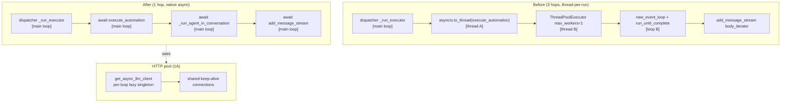

# Sub-project 1: Shared HTTP Pool + Native Async Executor

**Date:** 2026-07-29
**Status:** Design (awaiting plan)
**Scope:** Execution speed & resource management — the foundational sub-project that SP2 (reliability polish) and SP3 (decision-making) build on.

---

## 1. Problem & motivation

The automation agent's hot path has two compounding inefficiencies:

1. **No HTTP connection pooling.** Every LLM call creates a *fresh* `httpx.AsyncClient` (or sync `httpx.Client`), performs a full TCP + TLS handshake, then discards the client. A 5-iteration tool loop = 5 handshakes (~100–300 ms each on Aliyun RDS / DeepSeek). Confirmed at `llm_service.py:200` (`call_llm`), `:420` (`stream_chat_completion`), `sub_agent_reliability.py:96`, plus sync clients at `llm_service.py:324` (`get_embedding`), `:364` (`chat_completion_json_sync`), `automation_executor.py:315` (`_probe_api_source`).

2. **Thread-per-run + new-event-loop-per-run execution model.** Each run traverses three hops:
   ```
   dispatcher _run_executor [main loop]
     → asyncio.to_thread(execute_automation)              [thread A — default pool]
       → ThreadPoolExecutor(max_workers=1).submit(...)    [thread B — fresh pool]
         → asyncio.new_event_loop() + run_until_complete   [loop B — fresh loop]
           → add_message_stream body_iterator
   ```
   Thread + loop creation per run adds latency and limits scalability (GIL contention, thread-pool exhaustion under burst). The inner `ThreadPoolExecutor` exists solely to enforce a hard timeout (`fut.result(timeout=...)`) — a need better served by `asyncio.wait_for`.

**Why now:** the reliability stack (transient retry, streaming parity, provider failover, bounded concurrency) was completed 2026-07-29. The execution model is now the dominant remaining bottleneck for per-run latency and concurrency ceiling.

---

## 2. Goals & non-goals

### Goals
- **G1:** Eliminate per-call TCP+TLS handshake for all LLM HTTP calls via a shared, keep-alive connection pool.
- **G2:** Collapse the 3-hop thread/loop execution model to a single native-async path on the main event loop.
- **G3:** Preserve every existing guarantee: hard timeout, partial-output persistence on timeout, CAS transitions, zombie reaping, bounded concurrency, retry scheduling, auto-approve loop, truthfulness gate.
- **G4:** No behavior change observable to the frontend or API callers.

### Non-goals
- Migrating to async SQLAlchemy (`AsyncSession`). Sync `SessionLocal` stays — consistent with how `add_message_stream` (an async FastAPI route) already does sync DB I/O. Noted as a future option.
- Migrating the chat (interactive) path's execution model — only the automation executor path is refactored. (The chat path is already native-async; it's the executor that wraps it in threads.)
- Changing the dispatcher's tick / claiming / reaping logic — only `_run_executor`'s dispatch mechanism changes.

---

## 3. Design 1A — Shared HTTP connection pool

### 3.1 The loop-binding constraint (critical)

`httpx.AsyncClient` is **bound to the event loop it was created on**. Using it from a different loop raises or silently breaks. Today, the executor creates a *new* event loop per run (`_run_agent_in_conversation:1466`), so a naive module-level singleton created on the main loop would fail inside every executor run.

**Resolution:** a **per-loop lazy singleton** — one cached `httpx.AsyncClient` per event loop, keyed by loop identity. This is safe at every stage:

| Stage | Behavior |
|-------|----------|
| Before 1B (thread-per-loop) | Each run's new loop gets its own client → reuses connections *within* a run (5 LLM calls → 1 handshake, reused 5×). Already a win. |
| After 1B (main loop) | All runs share the main loop → one client → true cross-run connection reuse. |

The per-loop cache uses `weakref.WeakKeyDictionary` keyed by the loop object, so clients are GC'd when their loop closes (the executor currently closes its per-run loop in a `finally`). No manual per-loop teardown needed.

### 3.2 Pool API (`llm_service.py`)

```python
import weakref, httpx

_async_clients: "weakref.WeakKeyDictionary[asyncio.AbstractEventLoop, httpx.AsyncClient]" = weakref.WeakKeyDictionary()
_sync_client: httpx.Client | None = None  # module-level singleton (sync requests are loop-agnostic)

def _pool_limits() -> httpx.Limits:
    return httpx.Limits(
        max_connections=settings.LLM_HTTP_MAX_CONNECTIONS,       # default 20
        max_keepalive_connections=settings.LLM_HTTP_MAX_KEEPALIVE,  # default 10
        keepalive_expiry=settings.LLM_HTTP_KEEPALIVE_EXPIRY,     # default 30.0
    )

def _pool_timeout() -> httpx.Timeout:
    return httpx.Timeout(settings.LLM_HTTP_TIMEOUT)  # default 120.0

def get_async_llm_client() -> httpx.AsyncClient:
    """Lazy per-loop shared async client. Safe from any running loop."""
    loop = asyncio.get_running_loop()
    client = _async_clients.get(loop)
    if client is None or client.is_closed:
        client = httpx.AsyncClient(timeout=_pool_timeout(), limits=_pool_limits())
        _async_clients[loop] = client
    return client

def get_sync_llm_client() -> httpx.Client:
    """Lazy shared sync client (embedding / classifier). Loop-agnostic."""
    global _sync_client
    if _sync_client is None or _sync_client.is_closed:
        _sync_client = httpx.Client(timeout=30.0, limits=_pool_limits())
    return _sync_client

async def close_llm_http_pool() -> None:
    """Shutdown: close all async clients + the sync client. Called from lifespan."""
    global _sync_client
    for client in list(_async_clients.values()):
        try: await client.aclose()
        except Exception: pass
    _async_clients.clear()
    if _sync_client is not None:
        try: _sync_client.close()
        except Exception: pass
        _sync_client = None
```

### 3.3 Call-site changes

| File:line | Current | After |
|-----------|---------|-------|
| `llm_service.py:200` (`call_llm`) | `async with httpx.AsyncClient(timeout=120.0) as client:` | `client = get_async_llm_client()` then `resp = await client.post(...)` (no `async with`) |
| `llm_service.py:420` (`stream_chat_completion`) | `async with httpx.AsyncClient(timeout=120.0) as client:` | `client = get_async_llm_client()` then `async with client.stream(...)` (no outer `async with`) |
| `sub_agent_reliability.py:96` | `async with httpx.AsyncClient(timeout=120.0) as client:` | `client = get_async_llm_client()` |
| `llm_service.py:324` (`get_embedding`) | `with httpx.Client(timeout=30.0) as client:` | `client = get_sync_llm_client()` (no `with`) |
| `llm_service.py:364` (`chat_completion_json_sync`) | `with httpx.Client(timeout=30.0) as client:` | `client = get_sync_llm_client()` |

**`_probe_api_source` (`automation_executor.py:315`)** — low frequency (once per bound source, preflight only). Defer to keep the diff focused; it already uses a short-lived `httpx.Client`. Flag as a minor follow-up.

### 3.4 Lifecycle wiring (`backend/main.py` lifespan)

In the `lifespan` context manager (`main.py:402`):
- **Startup** (before `yield`, after DB init): no explicit init needed — clients are lazy. Optionally pre-warm the main-loop async client: `get_async_llm_client()`.
- **Shutdown** (after `yield`, before/after `stop_dispatcher`): `await close_llm_http_pool()`.

### 3.5 Config additions (`app/config.py`)

```python
LLM_HTTP_MAX_CONNECTIONS: int = 20
LLM_HTTP_MAX_KEEPALIVE: int = 10
LLM_HTTP_KEEPALIVE_EXPIRY: float = 30.0
LLM_HTTP_TIMEOUT: float = 120.0
```
All env-overridable via standard pydantic-settings. Defaults tuned for concurrency cap of 3 × 2–3 providers = ≤9 concurrent connections; 20 max is headroom.

---

## 4. Design 1B — Native async executor refactor

### 4.1 Target flow (1 hop)

```
dispatcher _run_executor [main loop]
  → await execute_automation(execution_id)        [main loop — coroutine]
    → await _run_agent_in_conversation(...)        [main loop]
      → await add_message_stream(...)              [main loop — same loop as chat path]
        → iterates body_iterator
```

Multiple runs interleave at `await` points (LLM streaming, tool I/O) — true async concurrency instead of OS threads.

### 4.2 `execute_automation` → `async def`

```python
async def execute_automation(execution_id: str) -> None:
    ...
    # Replace ThreadPoolExecutor + fut.result(timeout=...):
    try:
        assistant_text, conv_id, fsm_meta, tool_outcome = await asyncio.wait_for(
            _run_agent_in_conversation(task, agent, agent_prompt, execution.id, None, project_id),
            timeout=settings.AUTOMATION_RUN_TIMEOUT_SECONDS,
        )
    except asyncio.TimeoutError:
        db.refresh(execution)  # pick up partial output persisted during streaming
        _mark_failed(db, execution, f"Run timed out after {settings.AUTOMATION_RUN_TIMEOUT_SECONDS}s")
        return
    except _AutomationPaused as e:
        _mark_failed_no_retry(db, execution, str(e))
        return
    except _TaskCreatorMissingError as e:
        _mark_failed_no_retry(db, execution, "Task creator account no longer exists …")
        return
    except Exception as e:
        err_msg = f"Agent run failed: {e}"
        if _is_transient_error(e):
            _mark_failed(db, execution, err_msg)
        else:
            _mark_failed_no_retry(db, execution, err_msg)
        return
    # ... rest unchanged (truthfulness gate, file gen, CAS completed) ...
```

**Sync DB calls inside the async function** (e.g. `_resolve_agent`, `_mark_failed`, `_render_and_save_files`) run on the main loop and briefly block. This is **consistent with existing behavior**: `add_message_stream` is an async FastAPI route that already does sync SQLAlchemy I/O on the main loop. At concurrency=3 the blocking is bounded (ms-level queries). The LLM streaming — the long part — yields properly. Noted as an accepted tradeoff; async SQLAlchemy is a future option (non-goal here).

**Preflight probes** (`_check_bound_source_connectivity` → `_probe_db_source` uses `ThreadPoolExecutor`) must not block the main loop. Wrap the preflight call:
```python
_ds_failures = await asyncio.to_thread(_check_bound_source_connectivity, db, _bound_ids)
```
(Uses the same `db` session — safe because `to_thread` runs it in isolation and the main coroutine is suspended at the `await`.)

### 4.3 `_run_agent_in_conversation` → `async def`

Remove the entire event-loop machinery:
- ❌ `loop = asyncio.new_event_loop()`
- ❌ `asyncio.set_event_loop(loop)`
- ❌ `loop.run_until_complete(_consume())`
- ❌ `loop.close()`

The inner `_consume()` is already `async def` — just `await _consume()`. The auto-approve loop's `_approve_and_resume` call becomes `await _approve_and_resume(...)`.

### 4.4 `_approve_and_resume` → `async def`

```python
async def _approve_and_resume(db, conv, task) -> dict:
    ...
    async def _do_resume():
        return await _resume(app_id=..., conversation_id=conv.id, db=db, user=user)
    return await _do_resume()
```
Removes the `loop` parameter and `loop.run_until_complete`.

### 4.5 Partial-output persistence on cancellation

With `asyncio.wait_for`, a timeout cancels the inner task → `CancelledError` is injected at the next `await` in `_consume()`. The `finally` block in `_consume()` (or `_run_agent_in_conversation`) still runs and calls `_persist_run_progress(...)` — which is **synchronous** (own short-lived session, no `await`), so it completes before cancellation propagates. `execute_automation` catches `TimeoutError`, does `db.refresh(execution)` to pick up the persisted partial output, then `_mark_failed`.

This preserves the current timeout-recovery behavior exactly. Add an explicit `try/except asyncio.CancelledError` in `_consume`'s `finally` to be defensive:

```python
async def _consume():
    try:
        ...  # existing stream iteration
    except asyncio.CancelledError:
        # Timeout path: persist partial output before cancellation propagates.
        _persist_run_progress(execution_id, activity_steps, current_phase, partial_text)
        raise
    finally:
        # Always persist the latest state.
        _persist_run_progress(execution_id, activity_steps, current_phase, final_text or partial_text)
```

### 4.6 Dispatcher `_run_executor` change

```python
async def _run_executor(execution_id: str) -> None:
    from app.services.automation_executor import execute_automation
    sem = _concurrency_sem
    try:
        if sem is not None:
            async with sem:
                await execute_automation(execution_id)  # was: asyncio.to_thread(execute_automation, ...)
        else:
            await execute_automation(execution_id)
    except Exception as e:
        logger.exception("_run_executor: %s failed: %s", execution_id, e)
```

### 4.7 `schedule_retry` — loop-aware dispatch

`schedule_retry` is called from `_mark_failed` (now on the main loop) and the janitor (main loop). Replace `run_coroutine_threadsafe` with loop-aware scheduling:

```python
def schedule_retry(task_id, prev_execution_id, prev_attempt, error) -> Optional[str]:
    ...
    try:
        loop = asyncio.get_running_loop()
        loop.create_task(_delayed_run(exec_id, backoff))  # on-loop path (post-1B)
    except RuntimeError:
        # Fallback: called from a thread (pre-1B or test context).
        main = _main_loop
        if main and main.is_running():
            asyncio.run_coroutine_threadsafe(_delayed_run(exec_id, backoff), main)
        else:
            logger.warning("schedule_retry: no running loop — retry not created")
            # cleanup the row we just created (don't strand an un-runnable retry)
            ...
    ...
```

This is backward-compatible: works during transition and after.

### 4.8 Graceful shutdown

`stop_dispatcher` currently can't cancel thread-based runs (they run to completion or time out). In the async model, in-flight `execute_automation` tasks *could* be tracked and awaited. **Decision: preserve current behavior** — don't cancel in-flight runs on shutdown; let them finish or time out. The zombie reaper handles any stuck runs on the next startup. This avoids losing work mid-run and matches the existing contract. A future enhancement could `gather` in-flight tasks with a grace period.

To enable future graceful shutdown, track in-flight tasks:
```python
_in_flight: set[asyncio.Task] = set()
# in _run_executor:
task = asyncio.current_task()
_in_flight.add(task)
try: ...
finally: _in_flight.discard(task)
```

---

## 5. Before / after



---

## 6. Risks & mitigations

| Risk | Severity | Mitigation |
|------|----------|------------|
| Shared async client used from wrong loop | **High** | Per-loop `WeakKeyDictionary` cache (§3.1) — safe at every stage. |
| `CancelledError` loses partial output on timeout | Medium | Sync `_persist_run_progress` in `finally` + explicit `CancelledError` handler (§4.5). |
| Sync DB calls block the main loop under concurrency | Medium | Accepted (consistent with chat path); bounded by semaphore=3 + ms-level queries. Future: async SQLAlchemy. |
| `schedule_retry` called from wrong context | Medium | Loop-aware dispatch with thread fallback (§4.7). |
| Provider failover + shared client interaction | Low | Failover iterates providers on the *same* client (different URL) — connection pool is per-host, so no interference. |
| Shutdown kills in-flight runs | Low | Preserve current behavior — no cancellation, reaper handles stragglers (§4.8). |
| Test breakage (tests call `execute_automation` sync) | Medium | Provide a thin sync wrapper `execute_automation_sync` for tests, or update tests to `await`. Audit test files first. |

---

## 7. Testing plan

> **RAM constraint:** run explicit test file paths only, no `-n` workers, no broad collection.

1. **Unit — pool lifecycle:** `tests/test_llm_http_pool.py`
   - `get_async_llm_client()` returns same instance per loop, different across loops.
   - `get_sync_llm_client()` returns singleton.
   - `close_llm_http_pool()` closes all clients; subsequent `get_*` re-creates.
   - Mock the LLM endpoint; verify connection reuse (spy on `httpx` transport — connection count < call count).

2. **Unit — executor async:** `tests/test_automation_executor_async.py`
   - `execute_automation` is a coroutine (`asyncio.iscoroutinefunction`).
   - Timeout path: mock `_run_agent_in_conversation` to sleep > timeout → assert `_mark_failed` called with timeout message, partial output persisted.
   - Transient error → retry scheduled; permanent error → no-retry.
   - Auto-approve loop: mock `add_message_stream` to emit `paused` then `done` → assert resume called, final text captured.

3. **Integration — dispatcher dispatch:** `tests/test_automation_dispatcher_dispatch.py`
   - `_run_executor` awaits `execute_automation` (no thread spawn).
   - Concurrency semaphore gates execution (3 concurrent, 4th waits).
   - `schedule_retry` schedules on the running loop.

4. **Regression — existing executor tests:** re-run `tests/test_automation_*` (explicit paths) to confirm no behavior change in: CAS transitions, zombie reaping, truthfulness gate, file generation, chat notification, cross-run context.

5. **Manual smoke:** `docker restart zhanlu-backend`, trigger a `data_sync` task via Run Now, confirm: run completes, deliverable generated, activity steps stream, no errors in logs, latency improvement (compare run duration before/after).

---

## 8. Rollout sequencing

**Within SP1, implement in this order** (each step is independently testable):

1. **1A sync pool** — `get_sync_llm_client` + wire `get_embedding` / `chat_completion_json_sync`. Zero risk to async paths. Verify embedding still works.
2. **1A async pool** — `get_async_llm_client` (per-loop) + wire `call_llm` / `stream_chat_completion` / `sub_agent_reliability`. Safe with current thread-per-loop model (each loop gets its own client). Verify a live run works — latency should already drop (intra-run reuse).
3. **1B executor refactor** — `execute_automation` + `_run_agent_in_conversation` → async; dispatcher `_run_executor` → `await`; `schedule_retry` → loop-aware. After this, the per-loop async cache collapses to one client on the main loop → cross-run reuse.
4. **1B cleanup** — remove `_probe_db_source` blocking via `to_thread`; add in-flight task tracking; update tests.

Steps 1–2 can ship independently (low risk, immediate latency win). Step 3 is the higher-risk change and should get its own review cycle.

---

## 9. Open questions (resolve during planning)

1. **Test callers of `execute_automation`:** how many tests call it synchronously? Need an audit (`grep execute_automation tests/`) to size the test-update effort. A temporary `execute_automation_sync = lambda eid: asyncio.run(execute_automation(eid))` shim could ease migration.
2. **`_probe_db_source` `ThreadPoolExecutor`:** it creates a pool per probe call. After 1B, wrap the entire preflight in `asyncio.to_thread` (§4.2) — but the inner `ThreadPoolExecutor` becomes redundant. Collapse it to a direct call inside the `to_thread`.
3. **Connection pool sizing under provider failover:** if 3 fallback providers are configured, worst case is 3 × 3 concurrent = 9 simultaneous connections to different hosts. `max_connections=20` is per-pool (not per-host) in httpx — verify this is sufficient or switch to per-host limits.
