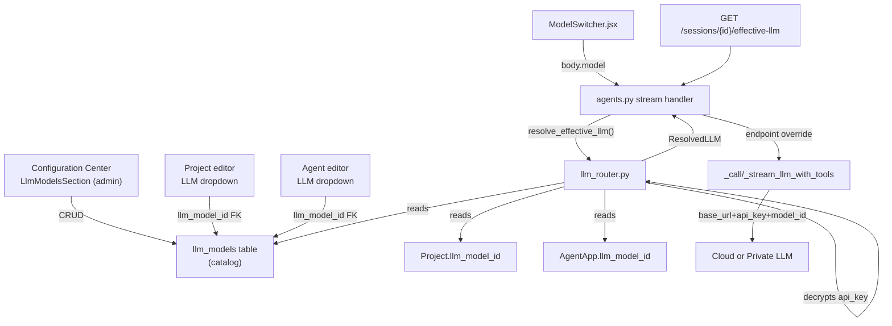

# Hierarchical LLM Configuration — Design Spec

**Date:** 2026-08-08
**Status:** Approved
**Author:** Brainstormed with user (precedence, catalog, lock-UX questions all resolved)

## Problem

Today LLM model selection is a **per-user preference only**:

- `ModelSwitcher.jsx` stores the chosen model in `localStorage` and sends it as `body.model` on every message.
- `backend/app/routers/agents.py:5001` reads it as `user_model = body.get("model")` and passes it down as `model_override: str` to `_call_llm_with_tools` / `_stream_llm_with_tools`.
- The override is **just a model name string** — the actual endpoint (`llm_url()` / `llm_headers()` in `backend/app/services/llm_service.py`) is always built from the single global `OPENAI_BASE_URL` / `OPENAI_API_KEY` / `LLM_MODEL`. So a self-hosted "private LLM" can never actually be reached.
- `AgentApp.model` exists as a column but is **unused** in the chat path. `Project` has **no** LLM config at all.
- `Settings.jsx` (Configuration Center) has a `model` section with `fallback_model` / `max_tokens` / `temperature` fields backed by the hardcoded `MODELS = ['automatic', 'gpt_5_mini', ...]` list — but no registry of actual LLM endpoints, and no admin-managed catalog.

**User requirements (from brainstorm):**

1. **Hierarchical**: Configuration Center sets the global default; each *project* can pin its own model; each *agent* can pin its own model. When chatting inside a project + agent, the effective model is resolved from this hierarchy.
2. **Privacy motivation**: if a project's/agent's data is private (e.g. Acme BI industrial data), bind that project/agent to a **private/self-hosted LLM** instead of a cloud model.
3. **Admin lock**: `Project` and `AgentApp` already have `resource_type` = `company` (admin-created) vs `personal`. For `company` resources, normal users **cannot** change the model — only admins can. Server-side enforcement, not just UI hiding.
4. **Chat header UX**: for a normal user in a company-locked chat, the `ModelSwitcher` renders a **read-only locked badge** instead of the dropdown, and the server rejects any `body.model` the client sends.

## Decisions (from brainstorm Q&A)

| Question | Decision |
|---|---|
| Precedence when both project & agent define a model | **Project wins** > Agent > user header pick > Configuration Center default |
| Model catalog management | **Admin-managed catalog** in Configuration Center (name, model id, base_url, API key, cloud/private tag) |
| Lock UX for non-admin in company chat | **Disabled + locked badge** (server also rejects client-sent model) |

## Solution

### 1. Data model — new `llm_models` registry table

Admin-managed catalog of LLM endpoints. One row per callable model. Columns:

| Column | Type | Notes |
|---|---|---|
| `id` | String(32) | PK (matches `prompt_ab_test.py` / `agent_run_step.py` convention) |
| `name` | String(100) | Display label shown in dropdowns, e.g. "DeepSeek Chat (cloud)" |
| `model_id` | String(120) | The `model` field sent in the OpenAI-compatible payload, e.g. `deepseek-chat` |
| `provider` | String(60) | Human-readable provider tag: `deepseek` / `openai` / `ollama` / `vllm` / `custom` |
| `base_url` | String(255) | OpenAI-compatible base URL, e.g. `https://api.deepseek.com/v1` or `http://10.10.10.51:11434/v1` |
| `api_key` | Text | Encrypted at rest (Fernet, key from `LLM_MODEL_ENCRYPTION_KEY` env). Cloud models use the cloud key; private/self-hosted may use a dummy or internal token. |
| `is_private` | Boolean | `True` = self-hosted / on-prem endpoint (privacy boundary). `False` = cloud. Drives the badge label. |
| `is_default` | Boolean | Exactly one row should be `True` — the global fallback. The Configuration Center default. |
| `enabled` | Boolean | Admin can disable a model without deleting it; resolution skips disabled rows. |
| `description` | Text (nullable) | Optional notes for admins. |

**Existing columns to reuse/migrate:**

- `AgentApp.model` (currently `String`, unused) → add `llm_model_id` FK (nullable) to `llm_models.id`. Keep `model` for backward-compat / legacy, but the chat path reads `llm_model_id`.
- `Project` → add `llm_model_id` FK (nullable) to `llm_models.id`.

**Seeds:** the current 5 hardcoded models (`automatic`, `gpt_5_mini`, `gemini_3_flash`, `claude_sonnet_4_6`, `claude_opus_4_8`) become initial catalog rows, first usable one flagged `is_default=True`. "automatic" maps to the global default (no per-row pin).

**Migration:** `045_llm_models_registry.py` (next after `044_agent_run_steps_and_reasoning.py`).

### 2. Runtime resolution — `backend/app/services/llm_router.py`

New service. Single entry point:

```python
@dataclass
class ResolvedLLM:
    model_id: str          # payload "model" field
    base_url: str          # endpoint
    api_key: str           # bearer token (decrypted)
    source: str            # "project" | "agent" | "user" | "default"
    locked: bool           # True when a company resource forced this model
    catalog_entry_id: str  # for logging / display
    is_private: bool       # for badge

def resolve_effective_llm(
    db: Session,
    *,
    project_id: str | None,
    agent_id: str | None,
    requested_model: str | None,   # from body.model (user header pick)
    user,                          # current user (for admin check)
) -> ResolvedLLM: ...
```

**Precedence algorithm:**

1. If `project_id` set and `Project.llm_model_id` references an enabled catalog row → use it. Set `locked = (project.resource_type == 'company' and not is_admin(user))`.
2. Else if `agent_id` set and `AgentApp.llm_model_id` references an enabled catalog row → use it. Set `locked = (agent.resource_type == 'company' and not is_admin(user))`.
3. Else if `requested_model` (header pick) matches an enabled catalog row by `model_id` or `name` AND not locked → use it. (When `locked`, the client pick is **ignored** — logged at INFO.)
4. Else → the catalog row with `is_default=True` (if enabled), else `settings.LLM_MODEL` + `OPENAI_BASE_URL` + `OPENAI_API_KEY` (legacy global config) as a final fallback so nothing ever breaks.

**Admin check:** reuse the existing `user.role == 'admin'` check already used throughout `Settings.jsx` / `agents.py`.

**Fallback safety:** if the resolved catalog row is disabled or missing, step down to the next tier and log a WARNING. The function never raises — it always returns a usable `ResolvedLLM`.

### 3. Endpoint injection into the chat path

`_call_llm_with_tools` and `_stream_llm_with_tools` currently call `llm_url()` and `llm_headers()` (always global). Extend their signatures to accept an optional `endpoint` override:

```python
async def _call_llm_with_tools(
    messages, tools, tool_choice=None, *,
    model_override: str | None = None,
    endpoint: "LLMEndpoint | None" = None,   # NEW
) -> dict: ...
```

Where `LLMEndpoint` is a lightweight dataclass (`base_url`, `api_key`, `model_id`) — essentially the `ResolvedLLM` minus metadata. When `endpoint` is provided, the call uses `endpoint.base_url` / `endpoint.api_key` / `endpoint.model_id` instead of the global `llm_url()` / `llm_headers()` / `get_model()`. When `None`, behavior is **identical to today** (zero blast radius for flag-off).

The streaming handler at `agents.py:5001` becomes:

```python
user_model = body.get("model")
_resolved = resolve_effective_llm(db, project_id=..., agent_id=..., requested_model=user_model, user=current_user)
# pass _resolved as endpoint= to _stream_llm_with_tools / _call_llm_with_tools
```

This naturally extends today's `model_override` param into a full endpoint override, so a private self-hosted LLM is actually reachable.

### 4. Configuration Center UI — admin LLM catalog

`Settings.jsx` currently uses `SECTIONS_CONFIG` with field arrays. Add a new section:

```js
{ id: 'llm_models', icon: Cpu, component: 'llm_models' },  // admin-only
```

Rendered by a new `LlmModelsSection` component (like `WorkspaceDataSection`):

- Table of catalog entries: name, model_id, provider, base_url, privacy tag, default badge, enabled toggle, edit/delete actions.
- Add/Edit dialog: name, model id, provider, base URL, API key (masked), `is_private` toggle, `is_default` toggle, `enabled` toggle, "Test connection" button (sends a tiny `{"messages":[{"role":"user","content":"ping"}]}` to verify).
- Non-admin users see this section hidden or read-only (the nav button is gated on `user.role === 'admin'`).

### 5. Project & Agent config UI — model binding

- **Edit project dialog**: new "LLM Model" dropdown fed from the catalog (enabled rows only). Shows a 🔒 indicator when `resource_type == 'company'` and the viewer isn't admin (field disabled). "Default (use Configuration Center)" option = `llm_model_id = null`.
- **Agent editor**: same dropdown under a "Model" section, same lock behavior.

### 6. Chat header UX — locked badge + effective-LLM endpoint

`Chat.jsx` fetches effective-model info for the active session via a new lightweight endpoint:

```
GET /apps/{app_id}/api/agents/sessions/{session_id}/effective-llm
→ { model_name, source, locked, is_private }
```

When `locked` is `True`, `ModelSwitcher.jsx` renders a read-only badge (e.g. "🔒 Private LLM — set by admin") instead of the dropdown. When `False`, the dropdown shows the catalog (enabled rows) and persists the pick as before — but the pick is now validated server-side against the catalog.

### 7. Encryption at rest

`api_key` in `llm_models` is encrypted with Fernet (`cryptography.fernet`). Key from `LLM_MODEL_ENCRYPTION_KEY` env var. If unset, the service falls back to plaintext with a WARNING log (dev convenience; prod should always set the key). Decryption happens only inside `resolve_effective_llm` — the plaintext key never leaves the backend, never appears in API responses (the catalog list endpoint masks it as `••••••`).

## Architecture



## What stays unchanged

- **Flag-off path**: when no catalog entries exist / feature not used, `resolve_effective_llm` falls through to the global `settings.LLM_MODEL` / `OPENAI_BASE_URL` / `OPENAI_API_KEY` and returns `endpoint=None`-equivalent. `_call_llm_with_tools` with `endpoint=None` behaves exactly as today.
- **Existing 5-model `ModelSwitcher`**: still works for users with no project/agent binding — the dropdown now reads from the catalog instead of the hardcoded `MODELS` array, but the UX is identical.
- **`LLMProvider` failover** in `llm_service.py`: unchanged. The resolved catalog entry becomes the *primary* provider; the existing `LLM_FALLBACK_PROVIDERS` still work as secondary.
- **Provider health routing** (`LLM_HEALTH_ROUTING_ENABLED`): unchanged — the resolved endpoint participates in health tracking under its `name`.

## Edge cases & testing

- **Catalog entry disabled/deleted while referenced** by a project/agent → resolution falls through to the next tier, logs WARNING. Never 500s.
- **Existing chats with no project/agent** → unchanged behavior (header pick → default).
- **Admin in a company chat** → `locked=False`, admin can still override via the header (they're admin).
- **API key decryption failure** → treat row as disabled, fall through, log ERROR.
- **"Test connection" in catalog editor** → 5s timeout, returns success/failure, never crashes the dialog.
- **Two catalog rows flagged `is_default`** → resolution picks the first enabled one deterministically (by `created_date`); a DB constraint or app-level guard should prevent duplicates on write.

**Tests:**
- `tests/test_llm_router.py`: resolution precedence matrix (project > agent > user > default), admin-lock rejection (company project + non-admin → user pick ignored + `locked=True`), admin override allowed, fallback on disabled model, fallback on missing default, decryption-failure graceful degradation.
- `tests/test_llm_endpoint_injection.py`: `_call_llm_with_tools` with `endpoint=` uses the override URL/key/model; without it, uses global (regression).
- Frontend: `ModelSwitcher` locked-badge render test; `LlmModelsSection` CRUD test.

## Security considerations

- **API keys never reach the browser**: the catalog list endpoint returns `api_key: null` (or masked). Only admins can create/edit entries. Decryption is server-only.
- **Admin lock is unbypassable**: even if a non-admin crafts a `body.model` via API, `resolve_effective_llm` ignores it when `locked`. The resolved model is what gets called.
- **Private model traffic stays internal**: when `is_private=True` and `base_url` is an internal IP, the request never egresses to the cloud.
