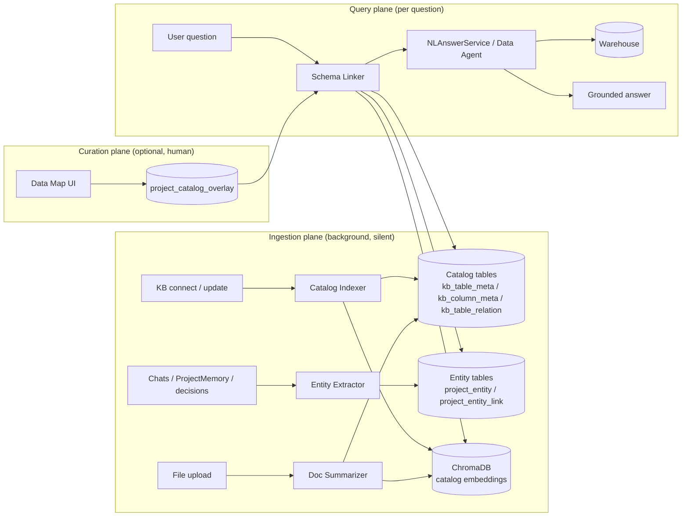
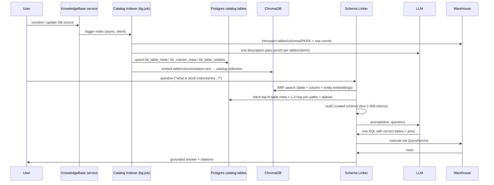

# Project Knowledge Graph & Semantic Catalog — Design Spec

**Date:** 2026-08-10
**Status:** Draft (pending user review)
**Author:** Brainstormed with user (scope, data model, phases, flags all resolved)

## Problem

Two diagnosed pains in today's data-answer path, both in the database KB flow:

**1. Slow responses — live introspection on every query.**
`backend/app/services/db/nl_answer_service.py:59-68` — every `ask_data_agent` / `answer_from_database` call runs `schema_svc.describe_all(kb_id, max_tables=30)` **live against the remote DB** on each question. There is no caching layer: same question asked twice re-introspects 30 tables twice. Against a 139-table warehouse this is seconds of network + DDL parsing before the LLM even sees a schema.

**2. Missed tables + guessed joins — raw DDL dumps with no semantics.**
`backend/app/services/db/schema_service.py:73-96` — `describe_all` returns raw column DDL capped at `max_tables` (default 50, called with 30). Concretely, against the EDIA warehouse `aipdp_data_warehouse_prod` (139 tables), ~109 tables are **invisible to the model by construction**. Cryptic names like `erp_t_stk_instockentry` carry no business meaning. No foreign-key relationships are extracted, so joins are guesswork. The result: the Data Agent misses tables it should use and answers slowly.

**Root cause:** schema understanding is reconstructed from scratch per query instead of being **built once, silently, in the background** and reused.

**User requirements (from brainstorm, verbatim intent):**

1. Each project needs an ontology / knowledge graph built from its resources: databases, files, chat, user conversations, memory, past conversation history, past decisions.
2. When a user adds a resource, the agent should **silently construct** the ontology/graph from the user's data — discover all tables, all information, and data descriptions.
3. When a user asks any question within that project, the agent should easily know **which table holds which data** and **which files contain relevant logic** — delivering more accurate and complete answers.
4. Fix the specific symptoms: missing data tables and long response times.

## Goals / Non-goals

**Goals:**

- Silent background indexing: KB connect/update and file uploads build the catalog with zero user effort.
- Faster data answers: schema linking replaces per-query live introspection with retrieval over a pre-built catalog (no more 30-table DDL dumps).
- More accurate data answers: tables discovered even when the question's vocabulary doesn't match table names; join paths derived from real FK relationships + inferred edges.
- Per-project semantic layer: entities (products, customers, metrics, concepts) extracted from memory/chats/decisions and linked to catalog tables/columns/files, plus human-curated aliases/descriptions.
- Each phase independently useful and flag-gated (safe rollout, matching the `ECISCO_BI_*` / `FORECAST_*` pattern).

**Non-goals (explicitly out of scope):**

- Dedicated graph database (Neo4j / JanusGraph). Postgres + ChromaDB is sufficient; no new infra.
- Real-time schema sync (change-data-capture). Catalog is refreshed by a refresh policy (on-connect, on-upload, manual re-index, periodic sweep) — eventual consistency is fine.
- Auto-changing how SQL is executed. The linker only changes what schema context the LLM sees; `QueryService` execution stays untouched.
- Entity extraction from raw file contents. Documents get summary-level catalog entries (Phase 2); entity extraction reads ProjectMemory and conversation summaries (Phase 3), not arbitrary files.
- General-purpose ontology modeling (SKOS/OWL inference). We store lightweight typed entities + links with confidence scores.

## Architecture

Three planes, one new module `backend/app/services/knowledge_graph/`:





**Key design principles:**

- **Catalog is keyed by KnowledgeBase** (shared across projects/agents that bind the same DB). Entities and overlays are keyed by project.
- **Postgres is the system of record** for structured metadata; **ChromaDB holds embeddings** for retrieval, following the existing per-org hybrid-RAG pattern (`domain_{org_id}_{name}` collections, RRF k=60).
- **Fallback preserved**: if a KB has no catalog yet, the current live-introspection path runs unchanged, and a background job is kicked off to build the catalog.

## Data Model

New tables follow the existing metadata/`create_all` convention (like migrations 036/038): plain SQLAlchemy models registered in `Base.metadata`, created by `Base.metadata.create_all()`. (Alembic head is `040_report_session_project_agent`; migration 026 crashes, so no new alembic migration is required — schema is managed by metadata.)

### Layer 1 — catalog tables (KB-keyed, shared across projects)

**`kb_table_meta`** — one row per (KB, table).

| Column | Type | Notes |
|---|---|---|
| `id` | String(32) | PK |
| `kb_id` | String(36) FK `knowledge_bases.id` | catalog owner |
| `table_name` | String(190) | physical table name |
| `description_en` | Text | LLM business description (English) |
| `description_zh` | Text | LLM business description (中文) |
| `row_count` | BigInteger | latest known cardinality |
| `entity_guess` | String(100) | e.g. `product`, `inventory`, `order`, `contract` |
| `last_introspected_at` | DateTime | freshness |
| `last_described_at` | DateTime | when LLM description was generated |
| `created_at` / `updated_at` | DateTime | timestamps (TimestampedBase) |

**`kb_column_meta`** — one row per (KB, table, column).

| Column | Type | Notes |
|---|---|---|
| `id` | String(32) | PK |
| `kb_id` | String(36) FK | catalog owner |
| `table_name` | String(190) | |
| `column_name` | String(190) | |
| `data_type` | String(100) | raw DDL type |
| `description` | Text | LLM business description |
| `sample_values` | JSON | 3-5 sample values from introspection |
| `is_primary_key` | Boolean | |
| `is_foreign_key` | Boolean | |
| `semantic_type` | String(50) | `date` / `money` / `id` / `enum` / `text` / `number` / `other` |

**`kb_table_relation`** — FK edges from introspection + LLM-inferred edges.

| Column | Type | Notes |
|---|---|---|
| `id` | String(32) | PK |
| `kb_id` | String(36) FK | catalog owner |
| `from_table` | String(190) | |
| `from_column` | String(190) | nullable (table-level edge) |
| `to_table` | String(190) | |
| `to_column` | String(190) | nullable |
| `kind` | String(20) | `fk` (from introspection) / `inferred` (LLM) |
| `confidence` | Float | 0.0-1.0; `fk` edges = 1.0 |
| `origin` | String(50) | `introspection` / `llm` / `overlay` |

### Layer 2/3 — project tables (project-keyed)

**`project_entity`** — per project.

| Column | Type | Notes |
|---|---|---|
| `id` | String(32) | PK |
| `project_id` | String(36) FK `projects.id` | project owner |
| `name` | String(190) | canonical name |
| `aliases` | JSON | list of strings |
| `entity_type` | String(50) | `product` / `customer` / `metric` / `concept` |
| `description` | Text | |
| `source` | String(50) | `memory` / `chat` / `file` / `schema` |

**`project_entity_link`** — entity → {table, column, file, memory, conversation}.

| Column | Type | Notes |
|---|---|---|
| `id` | String(32) | PK |
| `entity_id` | String(32) FK `project_entity.id` | |
| `target_type` | String(30) | `table` / `column` / `file` / `memory` / `conversation` |
| `target_id` | String(190) | table name / column name / document id / memory id / conversation id |
| `confidence` | Float | only links ≥ threshold used at query time |
| `source` | String(50) | `llm` / `embedding` / `overlay` |

**`project_catalog_overlay`** — per (project, table): user-written overrides.

> A possible 7th table `kb_doc_meta` (per-file catalog entries) is anticipated in Phase 2; exact shape (dedicated table vs. a `kind` discriminator on `kb_table_meta`) is deferred to the Phase 2 implementation plan.

| Column | Type | Notes |
|---|---|---|
| `id` | String(32) | PK |
| `project_id` | String(36) FK | |
| `kb_id` | String(36) FK | nullable |
| `table_name` | String(190) | nullable |
| `alias` | String(190) | user-provided alias |
| `description` | Text | overrides auto description |
| `metric_definition` | Text | e.g. "GMV means net of refunds here" |
| `scope` | String(20) | `table` / `kb` |

### KnowledgeBase lifecycle field

Add `catalog_status` to `KnowledgeBase`, mirroring the existing `indexing_status` lifecycle (`None -> "pending" -> "indexing" -> "ready" | "failed"`):

| Field | Type | Notes |
|---|---|---|
| `catalog_status` | String(50), nullable, default None | catalog lifecycle |
| `catalog_error` | Text, nullable | last index error |
| `catalog_last_indexed_at` | DateTime, nullable | freshness |

## Phase 1 — Schema Catalog + Schema Linking (DBs only)

Fix the stated pain first. This phase alone delivers: no per-query live introspection, all 139 tables discoverable, join paths from real FKs.

### 1.1 Catalog Indexer — `backend/app/services/knowledge_graph/catalog_indexer.py`

Background job, silent, triggered by KB connect/update (mirrors the document ingestion trigger). Steps:

1. **Introspect** via existing `get_connector(kb)` context manager: all table names, per-table columns + PK/FK flags, FK edges, row counts, 3-5 sample values per column.
2. **LLM description pass** — one pass per KB, cheap model (reuse `llm_headers` / `llm_url` / `get_model`; a `SEMANTIC_CATALOG_MODEL` override optional). For each table + its columns, generate `description_en`, `description_zh`, `entity_guess`; infer table-level relations the FK scan misses (confidence < 1.0). **Cost guardrail:** descriptions are generated once, stored, and only regenerated on manual re-index or schema-diff detection — never per query.
3. **Persist** to `kb_table_meta` / `kb_column_meta` / `kb_table_relation` (upsert, keyed by kb + table + column).
4. **Embed** table text (name + description_en/zh + entity_guess) and column text (name + data_type + description + sample values) into a per-KB Chroma collection.
5. Set `catalog_status = "ready"` (+ `catalog_last_indexed_at`); on failure `"failed"` + `catalog_error`.

**Chroma collection naming:** `catalog_{kb_id}` per KB (mirrors the per-org `domain_{org_id}_{name}` hybrid-RAG pattern).

### 1.2 Schema Linker — `backend/app/services/knowledge_graph/schema_linker.py`

Query-time retrieval. Algorithm:

1. Embed the user question (reuse the existing embedding path used by Hybrid RAG).
2. **RRF search** over the KB's catalog collection — three sub-queries: table-embedding similarity, column-embedding similarity, entity-embedding similarity (entity pool available from Phase 3; in Phase 1 just table+column). RRF k=60 to match existing RAG.
3. Take **top 5-10 tables**; expand each by **1-2 hop join paths** over `kb_table_relation` edges (FK edges first, then inferred edges above confidence threshold).
4. Fetch full meta rows for selected tables + columns; apply any `project_catalog_overlay` overrides (aliases/descriptions/metric definitions win over auto text).
5. **Build a curated schema slice (~800 tokens)** — table name + business description + key columns with semantic types + join path hints — replacing the raw 30-table DDL dump.
6. Return the slice to the caller.

**Fallback:** if `catalog_status` is not `ready` for the KB, return a "no catalog" marker so the caller falls back to the current `describe_all` path, and kick off the indexer job.

### 1.3 Integration points

- `NLAnswerService.answer()` (`nl_answer_service.py:59-68`): replace step 1's `describe_all(max_tables=30)` with `SchemaLinker.retrieve(kb_id, question)` when `SCHEMA_LINKING_ENABLED` and catalog is ready; keep the current path as fallback.
- Data Agent tool handlers in `backend/app/services/tool_handlers/db_tools.py`: the `describe_schema` / `answer_from_database` handlers route through the same linker when enabled.
- LLM call sites continue to use `llm_url()` / `llm_headers()` / `get_model()` unchanged.

### 1.4 Guardrails

- Description generation: one LLM pass per KB; token-bounded (chunked by table groups); cheap model; `catalog_status` shows progress/failure.
- Linking: top-N capped (5-10), slice capped (~800 tokens) so prompt cost stays flat regardless of warehouse size.
- No catalog → exact current behavior (zero blast radius when flags off).

## Phase 2 — Documents + Project Overlay

### 2.1 Doc Summarizer — `backend/app/services/knowledge_graph/doc_summarizer.py`

Hooks the existing `document_ingestion` lifecycle (`service.py`): after a file's vector chunks are built, run a background summarizer that:

1. Produces a **per-file summary** (what's in this file, key entities, ~1 paragraph) via one LLM call.
2. Stores a catalog entry: a summary row in a new `kb_doc_meta` table (or reused `kb_table_meta`-style shape with `doc` variant) + optional extracted key entities into `project_entity` (source = `file`).
3. Embeds the summary text into the catalog Chroma collection so file summaries surface in schema-linking retrieval (complementing vector-chunk RAG).

### 2.2 Overlay API — project curation

New REST endpoints under the project resources API (pattern follows existing project-scoped routes):

```
GET    /projects/{project_id}/catalog/tables          # catalog view (tables + auto descriptions + overlay status)
PUT    /projects/{project_id}/catalog/overlay         # upsert project_catalog_overlay (alias / description / metric_definition)
GET    /projects/{project_id}/catalog/entities        # entity list (Phase 3 fills)
```

RBAC: catalog reads respect existing access control (KnowledgeBase is in `USER_SCOPED_ENTITIES`); overlay writes require `canEditProject` (admin implicit edit applies as today).

### 2.3 "Data Map" tab in project UI

New tab in the project page: lists catalog tables with business descriptions (auto + overlay-indicator), search box over table/column names + descriptions, inline edit for alias/description/metric definition (writes `project_catalog_overlay`). Read-only for viewers.

## Phase 3 — Entity Graph

### 3.1 Entity Extractor — `backend/app/services/knowledge_graph/entity_extractor.py`

Flag-gated (`ENTITY_GRAPH_ENABLED`) background job:

1. Reads new `ProjectMemory` entries and conversation summaries for the project.
2. Cheap-model extraction of named entities → `project_entity` (type: product/customer/metric/concept, aliases, description, source).
3. Links entities to catalog tables/columns by embedding similarity + LLM confirmation → `project_entity_link` with confidence; only links ≥ threshold (default 0.7) used at query time.
4. Idempotent: re-runs only process new/unseen memory entries.

### 3.2 Entity-aware retrieval

Schema Linker adds entity-embedding sub-query to the RRF mix (entity names + aliases + linked table names), so questions phrased in project vocabulary ("our stock levels for C5") surface the right tables even when table names are cryptic.

### 3.3 "Project Data Map" prompt section

`prepare_data_source_runtime()` (`data_source_runtime.py:396`) appends a compact "Project Data Map" block when a project is selected and the catalog is ready: available entity types, key tables + one-line business descriptions, notable aliases. Kept short (~300-400 tokens) so the main agent always knows what data exists in the project, on top of the per-question schema slice.

## Flags & Rollout

Three new flags in `backend/app/config.py` (Settings fields, following the `ECISCO_BI_*` / `FORECAST_*` comment style at config.py:447-501):

| Flag | Default | Gates |
|---|---|---|
| `SEMANTIC_CATALOG_ENABLED` | `False` | Catalog indexer + doc summarizer + entity extractor background jobs |
| `SCHEMA_LINKING_ENABLED` | `False` | Schema Linker integration in `NLAnswerService` / Data Agent tools |
| `ENTITY_GRAPH_ENABLED` | `False` | Entity extraction + entity-aware retrieval + Data Map prompt section |

Rollout:

- `.env` flag changes require `docker compose up -d --force-recreate backend` (env_file is baked at container creation).
- Service code changes require `docker restart zhanlu-backend` (no `--reload`).
- Suggested enable order: Phase 1 (`SEMANTIC_CATALOG_ENABLED` + `SCHEMA_LINKING_ENABLED`) → measure eval recall/latency → Phase 2 (doc summaries + overlay UI) → Phase 3 (`ENTITY_GRAPH_ENABLED`).

## Testing & Eval

**Unit tests** (SQLite fixtures; run via `backend/venv/bin/python`, individually — SSH RAM is limited; avoid broken suites `tests/test_intelligence/` and `tests/test_document_ingestion`):

- Indexer: introspect fixtures → catalog tables populated correctly; upsert idempotency; FK edge extraction; LLM-description pass mocked.
- Linker: RRF over fixture embeddings returns expected top tables; join-path expansion (1-hop, 2-hop); overlay override wins; fallback marker when no catalog.
- Entity extractor: memory fixture → entities + links with confidence; threshold filtering.
- Overlay API: write/read/override semantics; RBAC gating.

**Integration test** (one, against the real warehouse):

- `aipdp_data_warehouse_prod` @ 10.10.10.49:3306 (`EDIA_MYSQL_URL`), 139 tables. Verify: indexer completes, all 139 tables present in `kb_table_meta`, FK edges found, catalog_status = ready, linker returns a slice for a sample question.

**Eval set** (the acceptance criterion for "fixes missed tables"):

- 10-15 real NL questions per project, chosen from actual chat history.
- Metric: **table recall before/after** — does the schema slice contain the table(s) the ground-truth SQL uses? Target: recall on the EDIA warehouse jumps from ~22% (30-of-139-tables cap) toward ≥90%.
- Also record per-query latency before (live 30-table introspection) vs after (RRF retrieval + slice).

## Risks & Open Questions

| Risk | Mitigation |
|---|---|
| LLM description quality varies | Overlay UI lets users correct; descriptions stored once and reused; cheap-model pass is a best-effort first version, regenerable |
| Catalog staleness after schema changes | Refresh on connect/update + manual re-index + periodic sweep; `catalog_last_indexed_at` shown in UI; fallback to live introspection if catalog is stale/absent |
| Multi-tenant / RBAC leaks | Catalog tables are internal to services, exposed only through overlay API gated by existing access checks (KnowledgeBase in `USER_SCOPED_ENTITIES`; admin implicit edit) |
| Entity extraction false positives | Confidence threshold (0.7) on links; only high-confidence links enter the query path; source tagging (`llm`/`embedding`) for auditability |
| Chroma collection growth | Per-KB collections, small payloads (descriptions, not chunk texts); cleanup on KB delete |
| Prompt budget | Slice capped ~800 tokens, Data Map ~300-400 tokens; flat cost regardless of warehouse size |
| Open: catalog refresh policy details | Decide in Phase 1 implementation plan: on-connect trigger + manual re-index button + optional nightly sweep |
| Open: `kb_doc_meta` exact shape | Decide in Phase 2 implementation plan (reuse `kb_table_meta` with a `kind` discriminator vs a dedicated table) |
| Open: which LLM model for descriptions/extraction | Reuse global config by default; `SEMANTIC_CATALOG_MODEL` env override for a cheaper model if desired |
