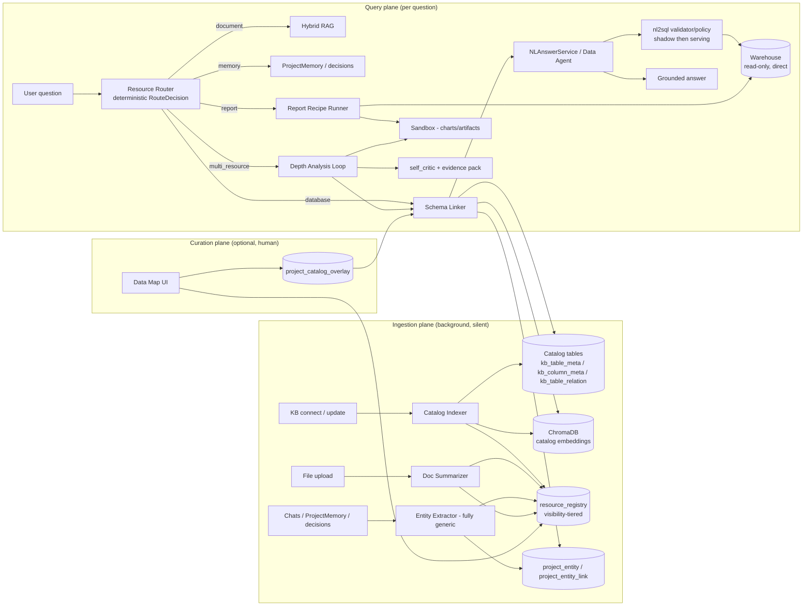

# Project Knowledge Graph & Semantic Catalog — Design Spec

**Date:** 2026-08-10
**Status:** Revised (comprehensive 5-phase version; supersedes the 3-phase draft)
**Author:** Brainstormed with user (scope, data model, phases, flags all resolved)

**Revision notes (2026-08-10, comprehensive plan):**
1. Phase structure expanded from 3 to 5 phases: Phase 3 entity graph is **folded into Phase 2** (Unified Resource Registry) as derived entity resources; new phases for Multi-Resource Router (3), Report Recipes (4), Depth Analysis Loop (5).
2. Phase 1 is **built, pending eval gate** (catalog indexer + schema linker + catalog tables shipped; 139 tables indexed).
3. Execution rule: **SQL runs through the direct read-only QueryService runner; Python/charts/artifacts run in the sandbox.** Never the reverse.
4. "User-facing agents are Harness Agents" remains an **interface/manifest principle only** — no agent-runtime migration in this program.
5. **Entity enrichment is fully generic**: extraction prompts, entity types, seed data, and tests must not contain domain-specific examples (no product names, no industry vocabulary). Entity types are universal categories; all vocabulary comes from the project's own data.
6. Every new behavior is flag-gated (default OFF): flags off = zero behavioral impact; coded fallbacks preserved.
7. Migration discipline (hard rule, the 047 lesson): **any new table AND any new column on an existing model ships with an alembic migration in the same task** — `create_all()` creates tables only, not columns.

## Problem

Two diagnosed pains in today's data-answer path, both in the database KB flow:

**1. Slow responses — live introspection on every query.**
`backend/app/services/db/nl_answer_service.py:59-68` — every `ask_data_agent` / `answer_from_database` call runs `schema_svc.describe_all(kb_id, max_tables=30)` **live against the remote DB** on each question. There is no caching layer: same question asked twice re-introspects 30 tables twice. Against a 139-table warehouse this is seconds of network + DDL parsing before the LLM even sees a schema.

**2. Missed tables + guessed joins — raw DDL dumps with no semantics.**
`backend/app/services/db/schema_service.py:73-96` — `describe_all` returns raw column DDL capped at `max_tables` (default 50, called with 30). Concretely, against the EDIA warehouse `aipdp_data_warehouse_prod` (139 tables), ~109 tables are **invisible to the model by construction**. Cryptic names like `erp_t_stk_instockentry` carry no business meaning. No foreign-key relationships are extracted, so joins are guesswork. The result: the Data Agent misses tables it should use and answers slowly.

**3. (Added in revision) No cross-resource awareness.**
The agent cannot tell whether a question should hit a database, an uploaded file, project memory, a past decision, or a report recipe — it guesses per-tool. And the validated `nl2sql` pipeline (`backend/app/services/nl2sql/`) is orphaned: consumed only by the standalone `POST /nl2sql/ask`, never by the agent path.

**Root cause:** schema understanding is reconstructed from scratch per query instead of being **built once, silently, in the background** and reused; and there is no deterministic routing layer over project resources.

**User requirements (from brainstorm, verbatim intent):**

1. Each project needs an ontology / knowledge graph built from its resources: databases, files, chat, user conversations, memory, past conversation history, past decisions.
2. When a user adds a resource, the agent should **silently construct** the ontology/graph from the user's data — discover all tables, all information, and data descriptions.
3. When a user asks any question within that project, the agent should easily know **which table holds which data** and **which files contain relevant logic** — delivering more accurate and complete answers.
4. Fix the specific symptoms: missing data tables and long response times.

## Goals / Non-goals

**Goals:**

- Silent background indexing: KB connect/update and file uploads build the catalog with zero user effort.
- Faster data answers: schema linking replaces per-query live introspection with retrieval over a pre-built catalog (no more 30-table DDL dumps).
- More accurate data answers: tables discovered even when the question's vocabulary doesn't match table names; join paths derived from real FK relationships + inferred edges.
- A Unified Resource Registry over all project resources (databases, files, reports, memories, decisions, derived entities) with visibility tiers.
- Deterministic routing of each question to the right resource(s), with conservative fallback to current behavior.
- Wire the orphaned `nl2sql` validation pipeline into the agent data path (shadow mode first, serving switch on evidence).
- Report recipes as first-class reusable objects; depth analysis loop for multi-step "why" questions grounded in evidence packs.
- Each phase independently useful and flag-gated (safe rollout, matching the `ECISCO_BI_*` / `FORECAST_*` pattern).

**Non-goals (explicitly out of scope):**

- Dedicated graph database (Neo4j / JanusGraph). Postgres + ChromaDB is sufficient; no new infra.
- Real-time schema sync (change-data-capture). Catalog is refreshed by a refresh policy (on-connect, on-upload, manual re-index, periodic sweep) — eventual consistency is fine.
- Auto-changing how SQL is executed. The linker only changes what schema context the LLM sees; `QueryService` execution stays untouched.
- Entity extraction from raw file contents. Documents get summary-level registry entries; entity extraction reads ProjectMemory and conversation summaries, not arbitrary files.
- General-purpose ontology modeling (SKOS/OWL inference). We store lightweight typed entities + links with confidence scores.
- Agent-runtime migration to the Agent Harness (AgentRunOrchestrator). Harness-agent metadata remains manifest/config only.

## Architecture

Three planes, one new module `backend/app/services/knowledge_graph/`:



**Key design principles:**

- **Catalog is keyed by KnowledgeBase** (shared across projects/agents that bind the same DB). Registry entries, entities, and overlays are keyed by project with visibility tiers (`project` / `user_private` / `org`).
- **Postgres is the system of record** for structured metadata; **ChromaDB holds embeddings** for retrieval, following the existing per-org hybrid-RAG pattern (`domain_{org_id}_{name}` collections, RRF k=60).
- **SQL → direct read-only runner; Python/charts/artifacts → sandbox.** Report recipes and the depth loop execute SQL bundles via `QueryService` directly (never through the sandbox); chart/statistics code runs in the existing sandbox tool (never as raw SQL).
- **Harness agents = interface principle only.** No runtime migration; the main chat FSM in `agents.py` is untouched by this program.
- **Entity enrichment is fully generic.** The extractor knows only universal entity categories (`product` / `customer` / `metric` / `concept` / `organization` / `location`); all names, aliases, and descriptions come from the project's own memory/conversations. Prompts, seeds, and tests contain no industry-specific examples.
- **Fallback preserved everywhere**: no catalog → live `describe_all`; shadow disagreement → serve current result; router uncertain → current routing; recipe missing → generic report path; depth loop failure → normal answer.
- **Raw conversations are never dumped into prompts** — only permission-filtered summaries/entities.

## Data Model

New tables are plain SQLAlchemy models **plus an alembic migration in the same task** (hard rule; `create_all()` does not add columns to existing tables). Next migration numbers: 048 `resource_registry`, 049 `project_entity`/`project_entity_link`/`project_catalog_overlay`, 050 `report_recipes`.

### Layer 1 — catalog tables (KB-keyed, shared across projects) — BUILT

`kb_table_meta`, `kb_column_meta`, `kb_table_relation` exist in `backend/app/models/knowledge_catalog.py` (note: `kb_column_meta` links via `table_meta_id`; the `kb_table_relation` UniqueConstraint must not include JSON columns — no default btree opclass for JSON in Postgres).

### Layer 2 — Unified Resource Registry (project-keyed, visibility-tiered) — Phase 2

**`resource_registry`** — one row per indexed resource.

| Column | Type | Notes |
|---|---|---|
| `id` | String(36) | PK |
| `project_id` | String(36) FK `projects.id` | project owner |
| `resource_type` | String(30) | `database` / `file` / `report` / `memory` / `decision` / `entity` |
| `resource_id` | String(191) | source id (kb id, document id, memory id, ...) nullable for derived |
| `name` | String(256) | display name |
| `summary` | Text | one-paragraph "what's in this resource" (indexer-generated) |
| `entities` | JSON | list of entity names mentioned (derived) |
| `owner_user_id` | String(36) | nullable; set for `user_private` |
| `visibility` | String(20) | `project` / `user_private` / `org` |
| `status` | String(20) | `pending` / `indexing` / `ready` / `error` |
| `last_indexed_at` | DateTime | freshness |

Unique on (`project_id`, `resource_type`, `resource_id`). Visibility enforced at query time via existing RBAC (`resource_shares`, `USER_SCOPED_ENTITIES`, `canEditProject`, admin implicit edit).

### Layer 3 — Entity tables + overlay (project-keyed) — Phase 2 (folded in)

**`project_entity`** — per project, fully generic.

| Column | Type | Notes |
|---|---|---|
| `id` | String(36) | PK |
| `project_id` | String(36) FK `projects.id` | project owner |
| `name` | String(191) | canonical name as it appears in project data |
| `aliases` | JSON | list of strings |
| `entity_type` | String(50) | universal category: `product` / `customer` / `metric` / `concept` / `organization` / `location` |
| `description` | Text | from project context only |
| `source` | String(50) | `memory` / `chat` / `file` / `schema` |

**`project_entity_link`** — entity → {table, column, file, memory, conversation}.

| Column | Type | Notes |
|---|---|---|
| `id` | String(36) | PK |
| `entity_id` | String(36) FK `project_entity.id` | |
| `target_type` | String(30) | `table` / `column` / `file` / `memory` / `conversation` |
| `target_id` | String(191) | table name / column name / document id / memory id / conversation id |
| `confidence` | Float | only links ≥ 0.7 used at query time |
| `source` | String(50) | `llm` / `embedding` / `overlay` |

**`project_catalog_overlay`** — per (project, table): user-written overrides.

| Column | Type | Notes |
|---|---|---|
| `id` | String(36) | PK |
| `project_id` | String(36) FK | |
| `kb_id` | String(36) FK | nullable |
| `table_name` | String(191) | nullable |
| `alias` | String(191) | user-provided alias |
| `description` | Text | overrides auto description |
| `metric_definition` | Text | e.g. "GMV means net of refunds here" |
| `scope` | String(20) | `table` / `kb` |

### Layer 4 — Report Recipes — Phase 4

**`report_recipes`** — data-defined reports; the runner executes, never the LLM.

| Column | Type | Notes |
|---|---|---|
| `id` | String(36) | PK |
| `name` | String(100) | unique per scope |
| `project_id` | String(36) | nullable (null = global recipe) |
| `required_metrics` | JSON[list[str]] | metric names resolvable via `metric_definition` |
| `optional_dimensions` | JSON[list[str]] | |
| `sql_bundle` | JSON[list] | `[{key, sql, params}]` — executed read-only via QueryService (direct) |
| `charts` | JSON[list] | `[{type, source_key, x, y}]` — rendered via sandbox |
| `sections` | JSON[list] | `[{title, source_key|template}]` |
| `validation_rules` | JSON[list] | `[{rule, params}]` — enforced post-execution |
| `output_format` | String(20) | `markdown` / `pptx` / `xlsx` |
| `is_enabled` | Boolean | |

### KnowledgeBase lifecycle field — BUILT

`catalog_status` on `KnowledgeBase` (migration 047) mirrors the `indexing_status` lifecycle (`pending -> indexing -> ready | failed`), with `catalog_error` / `catalog_last_indexed_at` on the model.

## Phase 1 — Schema Catalog + Schema Linking (DBs only) — BUILT, pending eval gate

Shipped: `catalog_indexer.py`, `schema_linker.py`, `resolver.py`, `graph.py`, `tool.py` under `backend/app/services/knowledge_graph/`; 139 tables / 2551 columns indexed from `aipdp_data_warehouse_prod`; Chroma `catalog_{kb_id}` with RRF; `describe_all` fallback preserved; `_safe_list_tables` re-raises connection-level failures (status truthfully `error`).

**Acceptance gate (must pass before declaring Phase 1 done):**

- Expand `backend/tests/test_knowledge_graph/eval_questions.py` from 8 to **15 questions** with ground-truth tables (from the warehouse discovery report).
- **Table recall ≥ 90%** (from the ~22% implied by the 30-of-139 cap).
- Record **per-query latency** vs the live `describe_all(30)` path (expect: seconds → sub-second).
- Eval is a manual-run report (`test_eval_table_recall.py`), not CI.

Linker/indexer gaps found by the eval are fixed until the gate passes (e.g. description coverage, embedding quality, join-path expansion).

## Phase 2 — Unified Resource Registry (+ Documents, Overlay, Entity Graph)

One registry over all project resources. The entity graph (spec'd as Phase 3 in the original draft) is folded in here as **derived entity resources**.

### 2.1 Registry indexers — `backend/app/services/knowledge_graph/registry_indexer.py`

Lightweight upsert indexers (no new ingestion system):

- **Databases**: hook catalog indexer completion → `database` rows (summary = table count + top descriptions).
- **Documents**: hook `document_ingestion` lifecycle → per-file summary (one LLM call, ~1 paragraph) → `file` rows + embed summary into the catalog Chroma collection.
- **Reports / memories / decisions**: upsert on creation events → `report` / `memory` / `decision` rows.
- **Entities** (from 2.3): upsert `entity` rows pointing at `project_entity`.

Idempotent upserts keyed by (`project_id`, `resource_type`, `resource_id`); status transitions `pending → indexing → ready | error`; visibility set at write time and enforced at read time.

### 2.2 Overlay + registry API — `backend/app/routers/project_catalog.py`

```
GET    /projects/{project_id}/catalog/tables      # catalog view (auto descriptions + overlay status)
PUT    /projects/{project_id}/catalog/overlay     # upsert overlay (alias / description / metric_definition)
GET    /projects/{project_id}/catalog/entities    # entity list
GET    /projects/{project_id}/registry/resources  # registry list (type/visibility filters)
```

RBAC: reads respect existing access control (KnowledgeBase in `USER_SCOPED_ENTITIES`); overlay writes require `canEditProject` (admin implicit edit applies).

### 2.3 Entity Extractor — `backend/app/services/knowledge_graph/entity_extractor.py` (FULLY GENERIC)

Flag-gated (`ENTITY_GRAPH_ENABLED`) background job:

1. Reads new `ProjectMemory` entries and conversation summaries for the project.
2. Cheap-model extraction of named entities → `project_entity`. **The prompt is domain-agnostic**: it instructs extraction of "named entities that appear in this text (products, customers, metrics, concepts, organizations, locations)" with **no example values**. Entity names come only from the text itself.
3. Links entities to catalog tables/columns by embedding similarity + LLM confirmation → `project_entity_link` with confidence; only links ≥ 0.7 used at query time.
4. Idempotent: re-runs only process new/unseen memory entries (track processed ids).
5. Upserts `entity` rows into `resource_registry`.

### 2.4 Entity-aware retrieval

Schema Linker adds entity-embedding sub-query to the RRF mix (entity names + aliases + linked table names), so questions phrased in project vocabulary surface the right tables even when table names are cryptic.

### 2.5 "Project Data Map" prompt section

`prepare_data_source_runtime()` (`data_source_runtime.py`) appends a compact "Project Data Map" block when a project is selected and the catalog is ready: available entity types, key tables + one-line business descriptions, notable aliases. Kept short (~300-400 tokens) so the main agent always knows what data exists in the project.

### 2.6 "Data Map" tab in project UI

New tab in the project page: catalog table browser (auto + overlay-indicator descriptions, search, inline edit for editors), registry resource list (type/visibility badges), entity chips. Read-only for viewers. Entity block hidden when `ENTITY_GRAPH_ENABLED` is off.

**Acceptance metrics:**

- Registry covers 100% of connected KBs + uploaded files within one indexer pass (status `ready` or truthful `error`).
- Visibility filter: `user_private` entries invisible to other project members (API test).
- Entity extractor: precision on a labeled fixture ≥ 0.8 with the generic prompt; zero domain vocabulary in prompt/tests (lint-checked fixture review).
- Data Map prompt block ≤ 400 tokens.

## Phase 3 — Multi-Resource Router

### 3.1 Contract — `backend/app/services/knowledge_graph/resource_router.py`

Deterministic rule engine producing a typed decision; never raises; rules over question text + `bound_kb_ids` + registry resource types; optional LLM assist via `intent_classifier` extension. Zero LLM cost on rule hit.

```python
class ResourceRoute(str, Enum):
    DATABASE = "database"
    DOCUMENT = "document"
    MEMORY = "memory"
    REPORT = "report"
    MULTI_RESOURCE = "multi_resource"

@dataclass
class RouteDecision:
    route: ResourceRoute
    resource_ids: list[str]
    confidence: float       # rules emit 1.0 or 0.0; LLM assist in between
    used_fallback: bool     # True = conservative default, behave exactly as today
```

### 3.2 Integration

- `intent_classifier.py` gains the resource-route taxonomy (preserving never-raise + per-session cache contract).
- `tool_handlers/delegation_tools.py` consumes `RouteDecision` when `KG_RESOURCE_ROUTER_ENABLED`; ambiguous → `used_fallback=True` → current behavior.
- `tool_handlers/db_tools.py` route-aware tool gating behind the flag (database route gets DB tools; others excluded). **No change when flag off. Router must not touch `agents.py` chat FSM.**

**Acceptance metrics:**

- Route accuracy ≥ 90% on a 20-question fixture set covering all 5 routes.
- `classify` never raises (fuzz test); fallback path byte-identical behavior with flag off.

## Phase 4 — Report Recipes

### 4.1 Runner — `backend/app/services/report_recipes/runner.py`

Execution order (deterministic):

1. Resolve `required_metrics` via `metric_definition` (exists: base_sql, synonyms, aggregations).
2. Execute `sql_bundle` via QueryService — **direct, read-only, never through sandbox**.
3. Render `charts`/artifacts via the existing sandbox tool.
4. Enforce `validation_rules` (incl. nl2sql validator on generated SQL) post-execution.
5. Assemble `sections` into `output_format`.

### 4.2 Seeds — `backend/app/services/report_recipes/seed_recipes.py`

Five generic recipe templates (sales / weekly / monthly / inventory / customer) defined as data (JSON), with metric placeholders resolved per project — **no hardcoded schema or product names**. The EDIA weekly-report module later plugs into this foundation.

### 4.3 Learning hooks

Connect to the experience layer: recipe selection/success feeds `.recipes.json` (`ECISCO_BI_RECIPE_LEARNING_ENABLED`), and `/feedback` adjusts recipe rankings (`adjust_recipe_feedback`).

**Acceptance metrics:**

- Each seed recipe executes end-to-end against a fixture datasource with validation passing.
- Sandbox failure degrades to markdown-without-charts (soft-fail test).
- Validation-rule violation blocks output with a clear error.

## Phase 5 — Depth Analysis Loop

### 5.1 Loop — `backend/app/services/depth_analysis/loop.py`

For multi-step "why" questions. Modeled on the proven forecast analyst pattern (`forecasting/analyst/`: evidence_pack → brief_writer; **LLM explains, NEVER decides**) plus `self_critic.py` for validation.

```python
async def run_depth_loop(
    question: str, project_id: str, db: Session, *,
    max_iterations: int = 3,
) -> DepthAnalysisResult  # {answer, evidence_pack, iterations, confidence, degraded}
```

Per iteration: hypothesis → catalog/nl2sql query (direct SQL) → validate (self_critic) → refine; optional sandbox statistics; final answer carries an **evidence pack** (queries run, rows examined, charts, confidence, citations). Soft-fail: any loop failure degrades to the normal single-pass answer (`degraded=True`).

**Acceptance metrics:**

- Iteration cap enforced (test: never exceeds `max_iterations`).
- Evidence pack present and well-formed on success; `degraded=True` with normal answer on induced failure.
- Termination + correctness on fixture questions; the LLM never emits a decision without a supporting query in the evidence pack.

## nl2sql Shadow-Mode Wiring (cross-cutting, lands with Phase 1 gate)

The validated `nl2sql` pipeline (`semantic_resolver`, `context_builder`, `validator`, `policy`, `row_filter`, `dialect_rules`) is consumed ONLY by `POST /nl2sql/ask` today. Wire it into the agent path behind `NL2SQL_SHADOW_MODE_ENABLED`:

- `nl_answer_service.py` + `delegation_tools.py` `ask_data_agent` paths: after text-to-SQL, shadow-run the nl2sql validator/policy on the generated SQL; log divergences to `nl2sql_query_logs`; **still serve the current result**.
- Facade: single `validate_sql(sql, dialect, datasource_id)` entry in `nl2sql/__init__.py`; existing pipeline untouched.
- Serving switch only after divergence eval passes (evidence-based, recorded numbers).

## Flags & Rollout

New flags in `backend/app/config.py` (Settings fields, `ECISCO_BI_*` / `FORECAST_*` comment style), all default `False`:

| Flag | Gates |
|---|---|
| `SEMANTIC_CATALOG_ENABLED` | Catalog indexer + doc summarizer background jobs (exists) |
| `SCHEMA_LINKING_ENABLED` | Schema Linker integration in NLAnswerService / Data Agent tools (exists) |
| `NL2SQL_SHADOW_MODE_ENABLED` | Shadow validation + divergence logging in agent data path |
| `KG_RESOURCE_REGISTRY_ENABLED` | Registry indexers + registry read API |
| `ENTITY_GRAPH_ENABLED` | Entity extraction + entity-aware retrieval + Data Map prompt section |
| `KG_RESOURCE_ROUTER_ENABLED` | RouteDecision consumption in delegation/db tools |
| `REPORT_RECIPES_ENABLED` | Recipe runner + seed loading |
| `DEPTH_ANALYSIS_LOOP_ENABLED` | Depth loop route + execution |

Rollout:

- `.env` flag changes require `docker compose up -d --force-recreate backend`; service code changes require `docker restart zhanlu-backend`.
- Enable order: Phase 1 gate → `NL2SQL_SHADOW_MODE_ENABLED` (observe divergence) → `KG_RESOURCE_REGISTRY_ENABLED` → `ENTITY_GRAPH_ENABLED` → `KG_RESOURCE_ROUTER_ENABLED` → `REPORT_RECIPES_ENABLED` → `DEPTH_ANALYSIS_LOOP_ENABLED` → shadow serving switch (evidence-based).

## Testing & Eval

**Unit tests** (SQLite fixtures; `backend/venv/bin/python`, individually — SSH RAM limited; avoid broken suites `tests/test_intelligence/` and `tests/test_document_ingestion`). TDD: failing test first for router decisions, shadow logging, registry visibility filtering, entity extraction, recipe validation, depth-loop termination.

- Indexer/linker: existing `tests/test_knowledge_graph/` suites stay green.
- Shadow mode: divergence records written; served result invariant.
- Router: route decisions per fixture; fallback contract; never-raise fuzz.
- Registry: upsert idempotency, visibility tiers, status transitions.
- Entity extractor: generic-prompt extraction, threshold filtering, idempotency; **test fixtures use invented neutral names only** (e.g. "Item Alpha", "Acme Corp") — no industry vocabulary.
- Recipes: bundle execution order, validation-rule enforcement, sandbox failure fallback.
- Depth loop: iteration cap, critic gate, evidence pack shape, soft-fail.
- Overlay/registry API: write/read semantics, RBAC gating.

**Integration test** (one, against the real warehouse `aipdp_data_warehouse_prod` @ 10.10.10.49:3306): indexer completes, 139 tables present, catalog_status ready, linker returns a slice.

**Eval set** (the Phase 1 acceptance criterion): 15 real NL questions with ground-truth tables; **table recall ≥ 90%**; per-query latency recorded before/after.

## Risks & Open Questions

| Risk | Mitigation |
|---|---|
| LLM description quality varies | Overlay UI lets users correct; descriptions stored once and reused; regenerable |
| Catalog staleness after schema changes | Refresh on connect/update + manual re-index + periodic sweep; `catalog_last_indexed_at` shown in UI; fallback to live introspection |
| Multi-tenant / RBAC leaks | Registry visibility tiers enforced at query time; catalog exposed only through RBAC-gated API; raw conversations never enter prompts (permission-filtered summaries only) |
| Entity extraction false positives | Confidence threshold (0.7); source tagging for auditability; generic prompt reduces domain bias |
| Entity extractor drifts domain-specific | Hard constraint: prompt/fixtures contain no example values; fixture review in PR checklist |
| nl2sql validator rejects SQL that works today | Shadow mode first: run both, log divergence, serve current result; serving switch only on eval evidence |
| Router misclassification | Conservative defaults; `used_fallback=True` = byte-identical current behavior; never-raise contract |
| Shadow mode doubles validation compute | Log-only, cheap relative to LLM calls; temporary until serving switch |
| Chroma collection growth | Per-KB collections, small payloads; cleanup on KB delete |
| Prompt budget | Slice ~800 tokens, Data Map ~300-400 tokens; flat cost regardless of warehouse size |
| Open: catalog refresh policy details | On-connect trigger + manual re-index + optional nightly sweep (decide at rollout) |
| Open: which LLM model for descriptions/extraction | Reuse global config by default; `SEMANTIC_CATALOG_MODEL` env override for a cheaper model |
