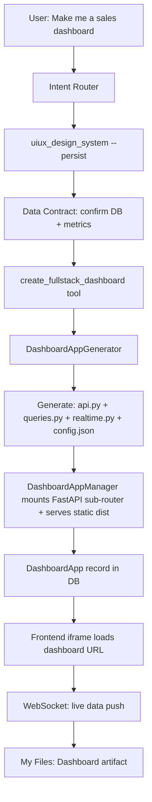

# Full-Stack Dashboard Pipeline Redesign — Design

> **Status:** Approved (full cutover). Ready for implementation.
> **Date:** 2026-08-18
> **Scope:** Replace the legacy SQL-widget `create_dashboard` pipeline with a design-first, full-stack application pipeline (FastAPI + React + Tailwind + WebSocket live data).

---

## 1. Goal

When a user asks for a dashboard, the agent must deliver a **deployable full-stack application** backed by **real database data with live updates** — never a static UI and never fabricated data. The pipeline is:

1. User requests a dashboard → intent routed to the new pipeline.
2. Agent calls `uiux_design_system --persist` (ui-ux-pro-max skill at `backend/skills/ui-ux-pro-max/`, backup copy at `backend/old_skills/ui-ux-pro-max/`) to generate and persist a design system to `design-system/MASTER.md`.
3. Agent introspects the data source (`describe_schema`), proposes a metric mapping, and **confirms the data contract with the user** before writing any code.
4. Agent calls `create_fullstack_dashboard(spec=DashboardSpec(...))` — a Jinja2 template generator produces a FastAPI router + queries + WebSocket realtime layer + a pre-built React frontend configured via `config.json`.
5. The app is mounted as a FastAPI sub-router, a `DashboardApp` DB record is created, and the frontend opens it (iframe) with WebSocket live-data push.
6. The user can keep chatting to iterate on design/data/layout (`update_fullstack_dashboard`); each change regenerates and hot-reloads.

## 2. Current State (baseline) and Gaps

| Layer | Today (legacy) | Gap |
|---|---|---|
| Build path | `create_dashboard` SQL-widget tool writes `Dashboard.definition.widgets[].sql` | Static widgets, no app structure, no live push |
| Design | `uiux_design_system` generates tokens but does not persist/apply them | No `--persist`, no `--output-dir`, no MASTER.md reference |
| Data | Widget SQL executed ad hoc via `/dashboards/{id}/execute` | No per-dashboard query layer, no real-time change detection |
| Real-time | None | No WebSocket/SSE channel |
| Iteration | `_update_dashboard` patches widget JSON | No app regeneration / hot-reload |
| Storage | `Dashboard` + `DashboardVersion` models | New `DashboardApp` model needed (slug, spec JSONB, status, app_url, design_system_ref) |

Files involved today:
- `backend/app/services/tool_handlers/dashboard_tools.py` — `_create_dashboard`, `_update_dashboard`, `_undo_dashboard_edit`
- `backend/app/services/tool_handlers/ui_ux_pro_max_tool.py` — `_uiux_design_system`
- `backend/app/services/dashboard_turn_guard.py` — `should_force_create_dashboard`
- `backend/app/services/agent_prompts.py:93-106` — dashboard HARD RULE block
- `backend/app/services/skill_routing/resolver.py:37` — `"dashboard": "dashboard-generation"` mapping
- `backend/app/services/skill_routing/post_router_hook.py` — `_DASHBOARD_INTENT_RE` forced routing
- `backend/app/routers/dashboards.py` — CRUD + SQL execution
- `backend/skills/dashboard-generation/SKILL.md` — legacy skill
- `backend/app/models/dashboard.py`, `dashboard_version.py` — legacy models
- `frontend/src/components/dashboard/DashboardViewer.jsx`, `ArtifactPreviewPane.jsx`, `pages/DashboardView.jsx`, `lib/dashboardStreamWatcher.js`, `api/dashboards.js`

## 3. Architecture



### Module division

- **`services/dashboard_app/generator.py`** — `DashboardAppGenerator`: fills Jinja2 templates (`backend/app/dashboards/_template/`) with a `DashboardSpec`, produces `api.py`, `queries.py`, `realtime.py`, `config.json`; copies the pre-built React `dist/`.
- **`services/dashboard_app/manager.py`** — `DashboardAppManager`: mounts/unmounts generated FastAPI sub-routers, lifecycle (building → running → stopped/error), serves static dist.
- **`services/dashboard_app/realtime.py`** — WebSocket connection manager + hash-based change detection (interval polling 1–5 s baseline; upgradeable to Postgres LISTEN/NOTIFY later).
- **`tool_handlers/dashboard_tools.py`** — add `create_fullstack_dashboard` + `update_fullstack_dashboard`; keep legacy handlers behind `LEGACY_DASHBOARD_ENABLED`.
- **`tool_handlers/ui_ux_pro_max_tool.py`** — add `persist: bool = False` + `output_dir: str = "design-system"` params; persist writes `design-system/MASTER.md`.
- **`models/dashboard_app.py`** — `DashboardApp` SQLAlchemy model + alembic migration `066_dashboard_apps.py` (raw SQL `CREATE TABLE IF NOT EXISTS`).
- **Frontend** — `FullStackDashboardViewer.jsx` (iframe), updates to `DashboardViewer.jsx` / `ArtifactPreviewPane.jsx` / `DashboardView.jsx` / `dashboardStreamWatcher.js` / `dashboards.js`.

### Data flow

1. `uiux_design_system(query=..., persist=True, output_dir="design-system")` → `design-system/MASTER.md` (per-org).
2. `describe_schema` → agent proposes metric mapping → **user confirms** (anti-fake-data guarantee; if DB unreachable, ask for connection details, never fabricate).
3. `create_fullstack_dashboard(spec=DashboardSpec(...))` → generator fills templates → manager mounts router → `DashboardApp` row (`status=running`, `app_url=/api/dashboards/apps/{slug}`).
4. Frontend opens `/dashboards/{slug}/` → iframe → React app reads `config.json` → WebSocket `ws://…/api/dashboards/apps/{slug}/ws` pushes live metric updates (~2 s of DB change).
5. User chats "add refunds chart" → agent calls `update_fullstack_dashboard` → regenerate → hot-reload.

## 4. Data Contract (anti-fake-data guarantee)

The agent MUST NOT fabricate data. Required before `create_fullstack_dashboard`:

- A confirmed `datasource_kb_id` reachable from the backend.
- For each metric: the exact read-only `SELECT`/`WITH` SQL (validated against schema via `describe_schema`).
- User confirmation of metric semantics (what each KPI means, expected ranges).

If the DB is unreachable: the agent returns an explicit error explaining the missing connection and asks for the connection details — no placeholder values.

## 5. Key Data Structures

```python
class MetricSpec(BaseModel):
    id: str
    type: str  # kpi | line | bar | pie | table | area | gauge | radar
    title: str
    sql: str  # read-only SELECT/WITH
    options: dict = {}

class DashboardSpec(BaseModel):
    name: str
    slug: str
    description: str | None = None
    datasource_id: str
    design_system_ref: str  # path to design-system/MASTER.md
    metrics: list[MetricSpec] = Field(min_length=1)
    refresh_interval_seconds: int = 30
    theme: str = "light"  # light | dark
```

```python
class DashboardApp(TimestampedBase):
    __tablename__ = "dashboard_apps"
    name: Mapped[str]
    slug: Mapped[str]            # unique, URL-safe
    description: Mapped[str | None]
    datasource_kb_id: Mapped[str]
    design_system_ref: Mapped[str | None]
    spec: Mapped[dict]           # JSONB: full DashboardSpec
    status: Mapped[str]          # building | running | stopped | error
    app_url: Mapped[str | None]
    refresh_interval_seconds: Mapped[int]
    org_id: Mapped[str]
    project_id: Mapped[str | None]
    created_by_id: Mapped[str]
```

## 6. Flags

- `FULLSTACK_DASHBOARD_ENABLED: bool = False` — master gate for the new pipeline (routing, prompt block, tools).
- `LEGACY_DASHBOARD_ENABLED: bool = False` — keeps legacy `create_dashboard` + Dashboard model/router available for rollback. When False, legacy tool is hidden from the agent and legacy routes return 404/disabled.

Both default `False` per project convention. Full cutover sets `FULLSTACK_DASHBOARD_ENABLED=True`.

## 7. Template Pre-Build Strategy

The dashboard viewer React app (`backend/app/dashboards/_template/frontend/`) is built once (`npm run build`) during setup → `dist/`. Each dashboard instance copies `dist/` into its own app directory and a generated `config.json` (metrics, design tokens, theme, refresh interval) is injected at serve time. No Node.js needed at runtime.

Widgets: KPI, LineChart, BarChart, PieChart, Table, Gauge, Area, Radar (Recharts). `useDashboardStream` hook opens the WebSocket and re-renders on change frames.

## 8. Real-Time Layer

- `realtime.py` — `ConnectionManager` (dict of `{slug: set[WebSocket]}`), `broadcast(slug, payload)`.
- Change detection: background task per running app polls its queries at `refresh_interval_seconds`, computes a hash of result rows, and broadcasts only when the hash changes → clients update within ~2 s of DB change.
- Phase 2 upgrade path: Postgres `LISTEN/NOTIFY` or a single shared poller with per-query hashing. Not in this scope.

## 9. Iteration Loop (conversational)

- `update_fullstack_dashboard(spec_patch, slug)` regenerates templates, re-mounts the router, bumps the `DashboardApp` record, and emits a `dashboard:updated` frontend event (watched by `dashboardStreamWatcher.js`).
- Every material change is a DB-persisted state transition; the frontend `FullStackDashboardViewer` listens for the event and reconnects the WebSocket.

## 10. Tests

- `backend/tests/services/dashboard_app/test_generator.py` — template fill produces valid `api.py`/`queries.py`/`config.json` for a sample spec.
- `backend/tests/services/dashboard_app/test_manager.py` — mount/unmount lifecycle, status transitions, duplicate slug handling.
- `backend/tests/services/dashboard_app/test_realtime.py` — `ConnectionManager.broadcast`, hash-change detection (same rows → no broadcast; changed rows → broadcast).
- Frontend: `FullStackDashboardViewer` renders iframe URL from artifact; `dashboardStreamWatcher` reacts to `create_fullstack_dashboard` tool calls.

## 11. Rollback

- Set `FULLSTACK_DASHBOARD_ENABLED=False` and `LEGACY_DASHBOARD_ENABLED=True` → old SQL-widget pipeline fully restored (code kept, only gated).
- `dashboard_apps` rows are safe to keep; unmount via manager.

---

## Implementation order

1. **design-spec-and-flags** — this spec + `LEGACY_DASHBOARD_ENABLED`/`FULLSTACK_DASHBOARD_ENABLED` in `config.py`.
2. **dashboard-app-model** — `DashboardApp` model + migration `066` + `_template/` Jinja2 templates (api.py, queries.py, realtime.py, config.json) + pre-built frontend dist.
3. **dashboard-app-generator** — `DashboardAppGenerator`, `DashboardAppManager`, realtime layer.
4. **fullstack-dashboard-tool** — `create_fullstack_dashboard`/`update_fullstack_dashboard` tools + `uiux_design_system` persist/output_dir params.
5. **agent-prompt-and-routing** — rewrite agent prompt HARD RULE block, `dashboard-generation` SKILL.md, resolver/post_router_hook/turn_guard.
6. **frontend-viewer** — `FullStackDashboardViewer.jsx` + viewer/pane/page/stream-watcher/API updates.
7. **flag-gate-and-verify** — legacy gate, tests, end-to-end verification against real DB.
